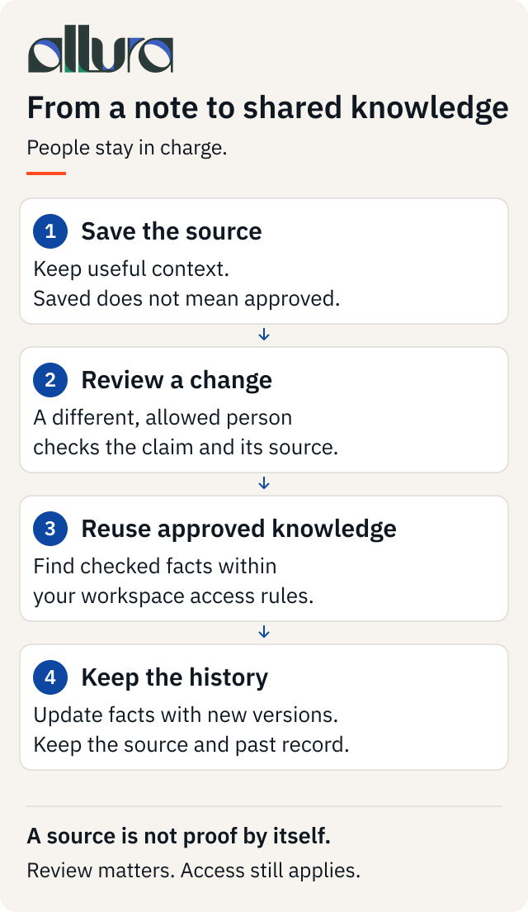

<p align="center">
  
</p>

# Allura Memory

**Shared memory for people and AI, with sources, review, and clear access rules.**

Allura helps you keep useful knowledge across projects and AI chats. Save the source, have a person review a proposed fact, and let the right people and AI tools find it later. When something changes, Allura keeps the history.

You host Allura on systems you control. It is a memory service with a web dashboard—not a chatbot or a replacement for your AI tools.

[How it works](#how-it-works) · [What you can do](#what-you-can-do) · [For developers](#for-developers) · [Project status](#project-status)

> **Beta 2: ready to begin bounded story development, not a finished product or production release.** Use **`beta-v2`**. The pinned developer toolchain, locked packages and selected upstream source checkouts are prepared. The inherited full database lane is incomplete; hosted CI and real-user acceptance are not claimed green. `main`, `beta` and the older hosted service are separate targets.

## Beta 2 scope

- **Local first:** the product must work without Cloudflare. Cloud deployment is an option, not a requirement for home use.
- **Two current human users:** personal/home and business workspaces, explicit sharing, and no silent merging of spaces. Qualification for at least 150 users remains a future requirement, not a proven capacity or concurrency claim.
- **Preserve the existing UX:** retain Allura's dashboard, navigation, history and brand while fixing the failed paths. Ordinary users should not need CLI commands, JSON or internal IDs for normal dashboard tasks.
- **RuVector-first reuse:** qualify existing storage, retrieval and UI components rather than regenerate everything. PostgreSQL remains the authority for records, permissions, review and history.
- **Keep human review:** selecting a source does not grant authority to act on it. If no eligible independent human reviewer is available, a proposal remains pending.
- **Notion is a plan backup only:** it is not an application dependency, runtime connector or permission authority.

## Why use it?

AI chats can lose context. Team notes can get out of date. A saved answer may not be a checked fact.

Allura gives that knowledge a home where you can ask:

- **Where did this come from?** See the linked source.
- **Who checked it?** See the review decision.
- **Who can use it?** Access is checked for each workspace and action.
- **What changed?** Follow the earlier versions.

It is built for both personal work and teams. A workspace keeps its own knowledge and access rules.

## How it works

<p align="center">
  
</p>

1. **Save the source.** An AI tool records useful context as evidence. Saving it does not make it an approved fact.
2. **Review a change.** A proposal links a claim to its evidence. A different, authorized person can approve it, reject it, or ask for more evidence.
3. **Reuse approved knowledge.** People and AI tools search the records they are allowed to read. Raw evidence remains separate from approved knowledge.
4. **Keep the history.** Corrections create new versions rather than silently replacing the old record.

### A simple example

Your team changes its return policy. An AI helper saves the source note. A reviewer checks the proposed policy against that source and approves it. Other allowed helpers can then find the approved policy. If the policy changes again, its history shows what changed and why.

Allura tracks sources and decisions. It does **not** promise that every source, review, or AI answer is correct.

## What you can do

The inherited source contains the areas below. Beta 2 must qualify them against its own stories and real-user acceptance; their presence is not proof that the new beta is complete or usable end to end.

| Feature | What it helps you do |
| --- | --- |
| Shared memory | Save evidence and find approved knowledge without mixing the two. |
| Human review | Check sources before a proposed change becomes approved knowledge. |
| Web dashboard | Search, inspect records, review changes, and manage allowed settings. |
| Interactive Memory Map | Explore saved links between versions and sources, with a list view on phones. |
| AI connections | Use a TypeScript SDK, command-line tool, or MCP connection. MCP is a shared way for AI tools to use services. |
| Device access | Enroll and revoke scoped devices; the persistent client uses a Linux secure store. |
| Optional Bumblebee integration | Inspect an approved software source and review inventory evidence. It does not run fixes or enforce policy. |
| Memory experiments | Try changes in a temporary working copy. Selected changes still need the normal human review. |

## For developers

The inherited implementation lives in [`foundation/`](foundation/). It uses TypeScript, Bun, PostgreSQL, and RuVector. Packages are private development builds, not published npm releases. Start with the current section of [DEVELOPMENT.md](DEVELOPMENT.md); its older local-development section is historical, not a direction to switch checkouts.

### Start with a source checkout

Use the rebuilt source that includes `foundation/core-package/` and `foundation/consumer-package/`. An older published snapshot may not have these directories. Do not mix the rebuilt clients with the older hosted service.

**Toolchain:** Git, **Bun 1.3.14**, and **Node.js 24.19.0**. The project checks these exact runtime versions. Linux is the tested platform for the packaged runtime and secure-store client. Some unit tests require Linux Secret Service, `secret-tool`, GNOME Keyring, D-Bus, `flock`, and `/usr/bin/gdbus`. On Ubuntu, `gdbus` is supplied by `libglib2.0-bin`; package names differ across distributions. The tests create their own private D-Bus session, keyring, runtime directory and environment, so they need these installed executables—not a logged-in desktop session or access to your existing keyring. The [persistent-client prerequisites](foundation/consumer-package/README.md#persistent-linux-device-sdk) describe the separate session setup for real client use.

Provision the exact tools first. The process-local launcher expects the directory layout documented in [DEVELOPMENT.md](DEVELOPMENT.md), or an existing `ALLURA_TOOLCHAIN_ROOT` with that layout. It validates the tools; it does **not** download them or replace your global Node installation.

Clone Beta 2, then run these commands from the repository root:

```bash
git clone --branch beta-v2 https://github.com/Allura-Ecosystem/Allura_Memory.git
cd Allura_Memory
sh foundation/scripts/with-toolchain.sh
sh foundation/scripts/with-toolchain.sh bun run install:frozen
```

Already have the repository? Use a clean `beta-v2` checkout and run the last two commands from its root. Do not discard private plans or unfinished work to make an existing checkout clean. The launcher changes to `foundation/` itself.

Prepare the public local model only if the pinned files are missing from this checkout:

```sh
env -u HF_TOKEN -u HF_ACCESS_TOKEN sh foundation/scripts/with-toolchain.sh bun scripts/prepare-model.ts
```

The pinned model identity is defined in [`foundation/src/embedding.ts`](foundation/src/embedding.ts). A cache belonging to another tool or checkout does not automatically satisfy this requirement; prepare it again if rebuilding `node_modules` removes this checkout's cache.

`install:frozen` installs the locked dependencies without package lifecycle scripts. The separate `prepare-model.ts` step downloads the pinned public MiniLM model, exercises CPU inference, and refuses nonempty `HF_TOKEN` and `HF_ACCESS_TOKEN` environment variables. Unit tests require that prepared native model and the Linux keyring prerequisites above; inference during checks is offline and does not download missing model files. None of these setup commands starts or deploys the app.

### Reusable upstream source

The preparation workspace has separate, pinned **sparse Git checkouts** of the following repositories. These are selected source inputs, not forks, bundled source, or six newly installed application platforms. Cloning Allura does not fetch them automatically.

| Repository | Pinned source commit | Intended use |
| --- | --- | --- |
| [RuVector](https://github.com/ruvnet/RuVector) | `f39d6b001cd341f85e1cbcbdda32c020be013cc0` | Storage/retrieval and selected graph, filter and metrics UI source |
| [AgentDB](https://github.com/ruvnet/agentdb) | `cd98bdbc4e0b2f0855a3994afb26eee93dd938b4` | Narrow retrieval/ranking/evaluation reuse |
| [agenticow](https://github.com/ruvnet/agenticow) | `0830fbbedbe5449f3ca0766d43fd48f3dc77be61` | Later isolated experiment mechanics |
| [Ruflo](https://github.com/ruvnet/ruflo) | `09bd1bf304cf1906729f8cca66460549d78b1f89` | Selected capability/host boundary patterns, not a replacement host |
| [MetaHarness](https://github.com/ruvnet/metaharness) | `574ce3b881e902d23472a541f9f9e2fdccfa63db` | Adapter, default-deny and release/witness patterns |
| [agentic-flow](https://github.com/ruvnet/agentic-flow) | `fed69f498c0f350f26e37b3e33ab57b1e327a26f` | Optional later pattern comparison; license disposition required before copying |

The owning story must qualify the exact API, package/native compatibility, license and permission boundary before adoption. A fetched repository is not an accepted runtime dependency. Do not install entire upstream agent platforms, execute their setup hooks, replace the existing agent host, or add LangChain merely because examples use them. Fork only when maintaining upstream changes requires it.

### Checks for the change you are making

Do not rerun unchanged broad suites simply to begin a story. Run the checks relevant to the changed behavior, then the required integration/release gates at their proper stage. Keep known baseline failures visible; do not skip required cases or change deadlines to manufacture a pass.

From the repository root:

```sh
sh foundation/scripts/with-toolchain.sh bun run typecheck
sh foundation/scripts/with-toolchain.sh bun run lint
sh foundation/scripts/with-toolchain.sh bun run test
```

`test` is the canonical unit lane, not a single-story test. Choose focused controls where the story supports them. `check` combines the unit lane, TypeScript checks and linting.

### Run the full local checks

```sh
sh foundation/scripts/with-toolchain.sh bun run check:all
```

This adds database and browser integration tests. It needs Docker and the native model, browser, scanner, and Linux keyring test dependencies. Read the [database test harness](foundation/scripts/test-db.ts) before running it. Use an isolated development environment, not a live database. A passing run is not production approval.

### Run the service or connect an AI tool

- **Host an isolated instance:** follow the [core setup guide](foundation/core-package/README.md). It covers packaging prerequisites, a new empty database, model files, identity setup, and startup. There is no one-command production install.
- **Connect a client:** use the [SDK, CLI, and MCP guide](foundation/consumer-package/README.md). Supply your own approved endpoint and credentials. Installing a package does not grant access.
- **Open the dashboard:** use `/dashboard` on your configured instance after identity and workspace access are set up. Opening the page alone does not grant memory access.

Keep secrets out of source files, command arguments, and logs. Do not use sample test identities or test keys in a live system.

### How the parts fit

```text
People → Web dashboard       AI tools → SDK / CLI / MCP
             │                            │
             └──────── Allura services ────┘
                    Identity + access checks
                    Capture · Review · Search
                              │
                  PostgreSQL: records + history
                  RuVector: derived search index
```

PostgreSQL holds the lasting records, review state, and version history. RuVector helps with retrieval; its index cannot approve a fact or grant access. Neo4j is not part of the rebuild.

## Project status

**Developer preparation completed:** the `beta-v2` setup commit was pushed with upstream tracking verified. A separate clean coding checkout has all 19 direct package pins installed with the lockfile unchanged, plus verified public model/scanner caches. Six pinned upstream source checkouts are prepared separately. The first bounded story is **V2-E01-S01**; preparation does not mark that story complete.

**Existing evidence, not a new full acceptance run:** the canonical unit lane passed 221 cases across 33 suites. Toolchain, typecheck, lint, native RuVector, offline model and headless-browser prerequisite checks passed. The full database lane exited unsuccessfully: its first two completed reports contain 322 passing cases, but the required third-batch completion report is missing. This inherited failure remains open; partial results are not a green baseline.

**Hosted CI:** the setup-only preparation commit intentionally skipped a repeated automatic full run. Hosted CI is not claimed green; normal future story CI gates remain configured. A source push does not deploy the application.

**Still open before release:** Beta 2 story implementation and acceptance, the incomplete database lane, exact-revision integrated/hosted CI, genuine local human sessions and nontechnical dashboard journeys, accessibility, recovery/update checks, and any chosen cloud deployment qualification. Earlier unexplained backup/restore failures remain historical evidence, not erased by later passing runs. No 150-user capacity, Vercel deployment, production-readiness or compliance acceptance is asserted.

Local completion is not the same as a published release. There is no production-readiness or compliance claim. The roadmap also includes deferred work that is not shipped.

## Find your way around

| Path | What is there |
| --- | --- |
| [`foundation/src/`](foundation/src/) | Memory services, access rules, and runtime code |
| [`foundation/ui/`](foundation/ui/) | The current web dashboard |
| [`foundation/tests/`](foundation/tests/) | Unit, database, client, and browser tests |
| [`foundation/core-package/`](foundation/core-package/) | Packaged runtime guide and metadata |
| [`foundation/consumer-package/`](foundation/consumer-package/) | SDK, CLI, and MCP package guide |
| [`DEVELOPMENT.md`](DEVELOPMENT.md) | Current Beta 2 tooling and isolated-check instructions; older target clearly separated |
| [`_bmad-output/planning-artifacts/architecture.md`](_bmad-output/planning-artifacts/architecture.md) | Inherited architecture reference, not automatic Beta 2 acceptance |
| [`_bmad-output/planning-artifacts/epics.md`](_bmad-output/planning-artifacts/epics.md) | Historical scope reference, not the active Beta 2 story queue |

The active Beta 2 brief, PRD and story set are maintained in the separate planning workspace, with Notion as a backup. They are not bundled into this public setup commit. Do not resume the historical story queue merely because its files are present. Older designs and previews remain references, not proof that a feature is available in the current runtime.

## Contributing

Start with a small, scoped change. Add tests for changed behavior, run the relevant checks, and explain any setup needs. Keep access rules and review steps intact. Do not include private data or credentials in issues or pull requests.

## License

This source tree does not include a root license file. Public visibility does not grant permission to reuse or distribute it. Obtain the project owner's terms before doing so; dependencies and brand assets have their own terms.
