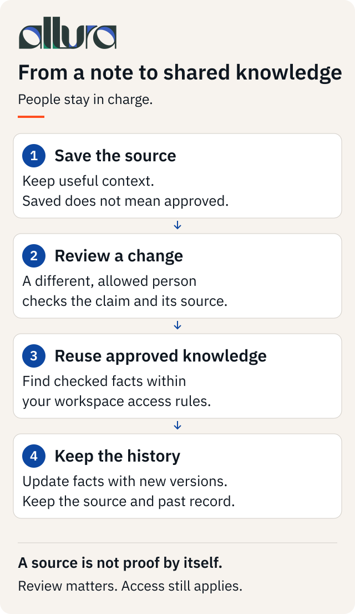

<p align="center">
  
</p>

# Allura Memory

**Shared memory for people and AI, with sources, review, and clear access rules.**

Allura helps you keep useful knowledge across projects and AI chats. Save the source, have a person review a proposed fact, and let the right people and AI tools find it later. When something changes, Allura keeps the history.

You host Allura on systems you control. It is a memory service with a web dashboard—not a chatbot or a replacement for your AI tools.

[How it works](#how-it-works) · [What you can do](#what-you-can-do) · [For developers](#for-developers) · [Project status](#project-status)

> **Development preview—not a production release.** This guide describes the rebuilt source. Local tests pass, and hosted setup, real-user checks, and operational release checks are still open. Use `beta` for this rebuild; `main` and the older hosted service may differ.

## Why use it?

AI chats can lose context. Team notes can get out of date. A saved answer may not be a checked fact.

Allura gives that knowledge a home where you can ask:

- **Where did this come from?** See the linked source.
- **Who checked it?** See the review decision.
- **Who can use it?** Access is checked for each workspace and action.
- **What changed?** Follow the earlier versions.

It is built for both personal work and teams. A workspace keeps its own knowledge and access rules.

## How it works

<p align="center">
  
</p>

1. **Save the source.** An AI tool records useful context as evidence. Saving it does not make it an approved fact.
2. **Review a change.** A proposal links a claim to its evidence. A different, authorized person can approve it, reject it, or ask for more evidence.
3. **Reuse approved knowledge.** People and AI tools search the records they are allowed to read. Raw evidence remains separate from approved knowledge.
4. **Keep the history.** Corrections create new versions rather than silently replacing the old record.

### A simple example

Your team changes its return policy. An AI helper saves the source note. A reviewer checks the proposed policy against that source and approves it. Other allowed helpers can then find the approved policy. If the policy changes again, its history shows what changed and why.

Allura tracks sources and decisions. It does **not** promise that every source, review, or AI answer is correct.

## What you can do

These features exist in the local rebuild. They are not a claim of a finished hosted release.

| Feature | What it helps you do |
| --- | --- |
| Shared memory | Save evidence and find approved knowledge without mixing the two. |
| Human review | Check sources before a proposed change becomes approved knowledge. |
| Web dashboard | Search, inspect records, review changes, and manage allowed settings. |
| Interactive Memory Map | Explore saved links between versions and sources, with a list view on phones. |
| AI connections | Use a TypeScript SDK, command-line tool, or MCP connection. MCP is a shared way for AI tools to use services. |
| Device access | Enroll and revoke scoped devices; the persistent client uses a Linux secure store. |
| Optional Bumblebee integration | Inspect an approved software source and review inventory evidence. It does not run fixes or enforce policy. |
| Memory experiments | Try changes in a temporary working copy. Selected changes still need the normal human review. |

## For developers

The current implementation lives in [`foundation/`](foundation/). It uses TypeScript, Bun, PostgreSQL, and RuVector. Packages are private development builds, not published npm releases.

### Start with a source checkout

Use the rebuilt source that includes `foundation/core-package/` and `foundation/consumer-package/`. An older published snapshot may not have these directories. Do not mix the rebuilt clients with the older hosted service.

**Toolchain:** Git, **Bun 1.3.14**, and **Node.js 24.19.0**. The project checks these exact runtime versions. Linux is the tested platform for the packaged runtime and secure-store client. Some unit tests use Linux Secret Service, `secret-tool`, GNOME Keyring, D-Bus, and `flock`; see the [client prerequisites](foundation/consumer-package/README.md#persistent-linux-device-sdk).

Clone the rebuild branch, then enter its source directory:

```bash
git clone --branch beta https://github.com/Allura-Ecosystem/Allura_Memory.git
cd Allura_Memory/foundation
bun run install:frozen
bun run check
```

Already have the repository? Run the last two commands from its `foundation/` directory.

`install:frozen` installs the locked dependencies without package lifecycle scripts. `check` runs unit tests, TypeScript checks, and linting. These commands validate code; they do not start the app.

### Run the full local checks

```bash
bun run check:all
```

This adds database and browser integration tests. It needs Docker and the native model, browser, scanner, and Linux keyring test dependencies. Read the [database test harness](foundation/scripts/test-db.ts) before running it. Use an isolated development environment, not a live database. A passing run is not production approval.

### Run the service or connect an AI tool

- **Host an isolated instance:** follow the [core setup guide](foundation/core-package/README.md). It covers packaging prerequisites, a new empty database, model files, identity setup, and startup. There is no one-command production install.
- **Connect a client:** use the [SDK, CLI, and MCP guide](foundation/consumer-package/README.md). Supply your own approved endpoint and credentials. Installing a package does not grant access.
- **Open the dashboard:** use `/dashboard` on your configured instance after identity and workspace access are set up. Opening the page alone does not grant memory access.

Keep secrets out of source files, command arguments, and logs. Do not use sample test identities or test keys in a live system.

### How the parts fit

```text
People → Web dashboard       AI tools → SDK / CLI / MCP
             │                            │
             └──────── Allura services ────┘
                    Identity + access checks
                    Capture · Review · Search
                              │
                  PostgreSQL: records + history
                  RuVector: derived search index
```

PostgreSQL holds the lasting records, review state, and version history. RuVector helps with retrieval; its index cannot approve a fact or grant access. Neo4j is not part of the rebuild.

## Project status

The local rebuild includes the core service, clients, dashboard, optional modules, and memory experiments. Automated tests have exercised these features with isolated data and test identities.

**Still open before release:** hosted setup, real-user and accessibility checks, operational recovery checks, and separately approved transfers to outside systems. An earlier backup-restore test failure has not been explained, even though later runs passed. Better error reporting is now in place.

Local completion is not the same as a published release. There is no production-readiness or compliance claim. The roadmap also includes deferred work that is not shipped.

## Find your way around

| Path | What is there |
| --- | --- |
| [`foundation/src/`](foundation/src/) | Memory services, access rules, and runtime code |
| [`foundation/ui/`](foundation/ui/) | The current web dashboard |
| [`foundation/tests/`](foundation/tests/) | Unit, database, client, and browser tests |
| [`foundation/core-package/`](foundation/core-package/) | Packaged runtime guide and metadata |
| [`foundation/consumer-package/`](foundation/consumer-package/) | SDK, CLI, and MCP package guide |
| [`_bmad-output/planning-artifacts/architecture.md`](_bmad-output/planning-artifacts/architecture.md) | Rebuild architecture and technical rules |
| [`_bmad-output/planning-artifacts/epics.md`](_bmad-output/planning-artifacts/epics.md) | Planned scope and acceptance criteria |

Older designs and previews remain in the repository. They are references, not proof that a feature is available in the current runtime.

## Contributing

Start with a small, scoped change. Add tests for changed behavior, run the relevant checks, and explain any setup needs. Keep access rules and review steps intact. Do not include private data or credentials in issues or pull requests.

## License

This source tree does not include a root license file. Public visibility does not grant permission to reuse or distribute it. Obtain the project owner's terms before doing so; dependencies and brand assets have their own terms.
