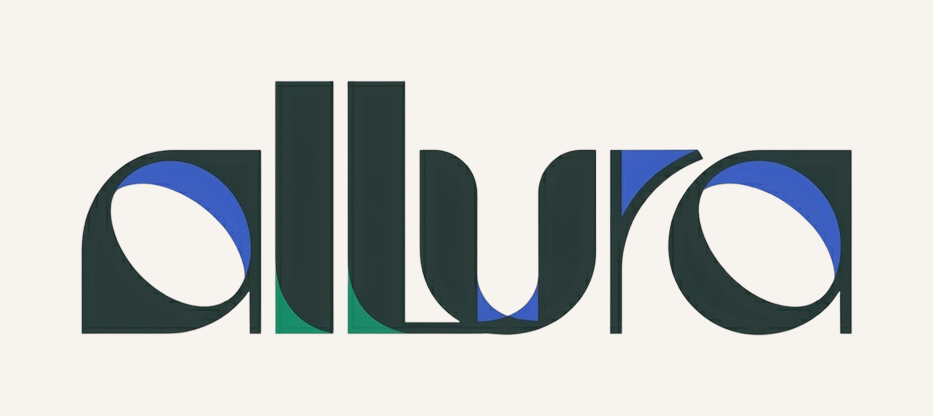

  

# Project memory your AI agents can return to

Allura Memory stores project decisions and work history so connected agents can retrieve them in later sessions. Your team controls which saved information becomes approved shared knowledge.

It is a self-hosted memory service for teams building with AI agents. Agents must be connected and instructed to save and retrieve context; installing Allura does not automatically capture every conversation or make an agent follow a decision.

**[Start with one saved decision](docs/user-guide/getting-started.md)**

If your agent already has Allura connected, start there. The guide uses the existing authorized connection; a fresh self-hosted installation and a verified later-session search remain open acceptance work.

## A concrete example

Your team decides to keep a particular database. A week later, a new agent starts work on the same project.

With an Allura integration, the first agent can save the decision and its reason. The next agent can search for that context before proposing a change. The team can distinguish the saved record from knowledge a person has reviewed and approved.

That is the intended benefit: less repeated explanation and a record you can inspect when context is disputed. The amount of rework saved still needs to be measured with real teams.

## What happens automatically—and what needs you

| Work | Responsibility |
|---|---|
| Decide what to save and when to search | Your connected agent or integration calls Allura. |
| Store submitted context and retrieve matching records | Allura handles persistence and search within the caller's authorized scope. |
| Decide what becomes approved shared knowledge | An authorized human reviews a proposal; a score alone is not approval. |
| Operate the service | Your team supplies hosting, configuration and maintenance. |

Saved work history and approved knowledge are different states. A successful save does not mean a person approved it, and a search result does not guarantee the agent's next answer is correct.

## Getting started

Follow the [shared first-use guide](docs/user-guide/getting-started.md): ask your connected agent to save a decision, then ask a fresh session to find it and show its source. The optional developer section provides an explicit two-session runner. The guide explains the known search gap, approval states and recovery before you repeat a save.

For the deployment boundary, inspect the [architecture reference](docs/allura/SOLUTION-ARCHITECTURE.md). The repository's primary Compose deployment depends on existing storage/networks; it is not yet a demonstrated clean-install path.

The [three visual explanations](docs/readme/first-use/README.md) cover the decision example, responsibilities, and saved-versus-approved knowledge. They are educational drafts with equivalent text and phone layouts.

The optional [review-workflow demo](https://allura-governed-demo.vercel.app) uses synthetic enterprise data. It is separate from this memory integration check.

## Current limits

Allura is under development. The [requirements matrix](docs/allura/REQUIREMENTS-MATRIX.md) records intended behavior and verification gaps; the [capability matrix](docs/portfolio/capability-matrix.md) links capabilities to their recorded evidence. Historical test results do not establish the state of every current revision.

- Human review is required for promotion to approved knowledge. Existing policy and implementation gaps remain tracked in the [risks and decisions](docs/allura/RISKS-AND-DECISIONS.md).
- Correction and version-history workflows have unresolved contracts; this README does not claim that every update path already preserves the required lineage.
- The portfolio demo and its screenshots are separate from the operational dashboard.
- Allura does not claim compliance certification, elimination of hallucinations, or measured productivity gains.

## Technical reference

Open the detail needed for your task:

| Task | Reference |
|---|---|
| Understand the memory service and its boundaries | [Architecture](docs/allura/SOLUTION-ARCHITECTURE.md) |
| Inspect the data model | [Data dictionary](docs/allura/DATA-DICTIONARY.md) |
| Review intended behavior and outstanding acceptance | [Requirements](docs/allura/REQUIREMENTS-MATRIX.md) |
| Inspect recorded test and release evidence | [Evidence index](docs/portfolio/evidence-index.md) |
| Evaluate the engineering portfolio | [Portfolio case study](docs/portfolio/allura-agentic-framework-harness/README.md) |
| Contribute | [Contributing guide](CONTRIBUTING.md) |

Architecture diagrams and portfolio infographics belong with those references, where their context and limitations can be read alongside them.

## License and attribution

[MIT](LICENSE). Allura uses and credits [RuVector](https://github.com/ruvnet/RuVector); see [third-party notices](THIRD_PARTY_NOTICES.md) for attribution and scope.

*AI-assisted editorial revision, 2026-10-20. Technical evidence, independent review and human-study status are tracked in the [execution checklist](docs/reference/reddit-remediation/execution-checklist.md).*
