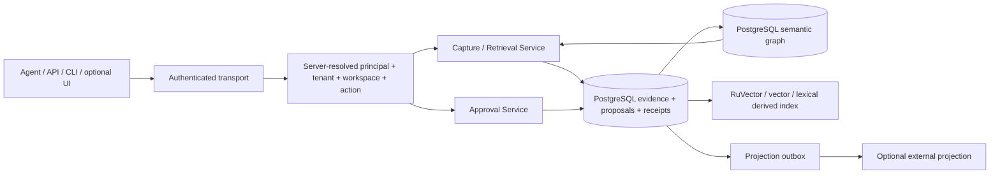

# Architecture Spine — Allura Memory

Direct-build update: committed baseline verified; locally accepted detailed contracts now live in `contracts/authority-v1.md` and `contracts/persistence-v1.md`, without restoring deleted specs. Epic 1 evidence/retrospective is in `../implementation-artifacts/epic-1-retro-2026-10-26.md`; next is 2.1. User delegated bounded local design and removed independent development review; direct self-checks/tests replace stale execution limits below. Product independent human promotion and production boundaries remain binding.

The [Epic 1–14 catalog](epics.md) replaces all legacy delivery numbering. Story 1.1's local `foundation/` package is verified; memory services, schema, auth, UI and release are not implemented by that scaffold. Epic 1 remains incomplete. Next is [1.2](stories/1.2-authority-and-service-contracts.md). Parent owns the pending clean baseline commit; no clean Git claim is made here. Legacy repair STOP stays intact; the user already approved scoped rebuild execution and sequencing.

Sources: [PRD](prds/prd-Allura_Memory-2026-10-25/prd.md), [Blueprint](../../docs/allura/BLUEPRINT.md), [Design](../../docs/allura/DESIGN-ALLURA.md), [Requirements Matrix](../../docs/allura/REQUIREMENTS-MATRIX.md), [Risks and Decisions](../../docs/allura/RISKS-AND-DECISIONS.md). Former detailed Solution Architecture/Data Dictionary were purged. Retained table/DTO names are context, not silently approved DDL. [Adapter mappings](../../guidelines/ALLURA-BMAD.md#missing-input-mapping) disclose missing inputs.

## Design paradigm

API-first governed memory data plane. Thin authenticated transports resolve principal/tenant/workspace/action authority and call bounded services. Services own PostgreSQL transactions for append-only evidence, proposal workflow, immutable semantic versions/lineage, receipts and outbox intent. Derived indexes/projections cannot authorize canonical state. UI and orchestration remain outside the engine boundary.

Target intent, not installed topology. PostgreSQL is durable authority; RuVector retrieval/graph direction retained; Neo4j retired. Presentation/transports depend on contracts/services; services depend on repository/adapter interfaces; adapters depend on stores/providers. Neither UI nor adapter owns authorization. No app framework or provider model is selected by this correction.

## Invariants

- AD-01/B3: raw evidence append-only; rollback never deletes accepted evidence.
- AD-04/B7/B25: independent authorized human promotion in every mode; score, persona, agent and workflow cannot approve.
- DOC-06: decision applies to exact reviewed proposal version; stale new decision writes nothing; valid scoped replay returns original immutable receipt.
- Immutable semantic versions and same-scope lineage; lifecycle flags are distinct from content. Restore/duplicate policy remains DOC-03/05.
- Every read/write/graph derivative carries server-derived current tenant/workspace/action authority. Caller fields, well-formed namespaces and edge admission grant nothing.
- DOC-07: remote delivery observation is separate from decision receipt; `synced` needs destination read-back.
- Intended / specified / implemented / verified / released are distinct. Source presence is provenance only.
- Allura owns operational work status, Notion planning, Brain governed continuity. Remote state unknown; no shadow tracker.

## Proposed decisions that block affected implementation

| Contract | Owning new story | Required disposition |
|---|---|---|
| Human/service/device authority; ENT-01 confidentiality/roles | 1.2 → 2.1/2.3 | Exact current binding/action contract and owner acceptance; AD-69 Cloudflare selection is settled, not permission to change live grants |
| Missing detailed schema, restricted role/RLS, transaction/fixture design | 1.3 → 2.2/2.3 | Knuth/Pike review and actual security/schema authority; historical field names cannot substitute |
| AD-65 capture key/digest/admission/retention/retry/compatibility | 3.1 → 3.2 | Product/API/data/worker decisions before replay implementation |
| AD-67 correction/base/current-head/concurrency | 4.3 | Product conflict behavior and data/public mapping approval |
| DOC-03 restore / DOC-05 duplicate policy | 4.4 | Separate affected decisions; not inferred from correction |
| AD-66 vector scope/model/dimension/index/worker details | 5.1 (storage scope starts 1.3/2) | Exact signatures, restricted-role evidence, model/index identity; no broad fallback |
| AD-68 observation/retention/destination/budgets | 6.1; measurement 5.4 | Stage-bound truthful outcomes; budgets grounded in baseline, not invented |
| AD-68 delivery mechanics and transfer authority | 7.1 | Read route/digest/retry/reconciliation plus exact authorized destination |
| DOC-02 / ENT UI identity/accessibility | 9.1/9.4; identities in 2/8 | Exact retained screen/revision/states and real multi-user/browser evidence |
| DOC-08 curator-first provenance | 3.3/9.1 | Locate valid evidence or obtain actual decision, not AD-57 substitution |
| Missing run provenance AC / concrete unmet use case | 12.1 | Defined before deferred runtime implementation |
| DOC-09 board/sync/conflicts | 13.1 | Product decision before native board/sync; operational routing alone is insufficient |

AD-68 exact local tooling is already selected/verified in 1.1. Broader decision remains proposed. AD-70 bounded retrieval behavior and AD-71 isolated first-use preparation retain their limits in 5.3/6.4. No approval is manufactured by assigning a story.

## State and mutation rules

1. Capture: service-owned scoped transaction; after AD-65, accepted event/receipt/replay/index intent atomic. Asynchronous indexing cannot rewrite capture truth.
2. Proposal: governed workflow state only; proposal existence never active knowledge.
3. Promotion: current proposal lock, independent actor and exact reviewed version; atomic semantic row/lineage/event/outbox/receipt/replay.
4. Retrieval: current/history filters and equivalent-scope degradation; denial never broadens fallback. Authorize graph nodes, endpoints, counts, labels, caches, cursors and citations before disclosure and re-check before return.
5. Projection: local outbox state separate from authorized destination observation; ambiguous results unknown.
6. Recovery: compatible forward changes/disable paths; preserve events, receipts, semantic versions, lineage and unknown remote operations. No destructive down migration by default.

## Consistency conventions

Opaque server-resolved principal + group_id + applicable workspace_id + action; stable scoped operation key and canonical digest only where accepted; denied/conflict/failed/partial/unknown remain distinct. PostgreSQL timestamps establish accepted durable records; client time is not decision authority. Logs are redacted, stage-bound, safe-correlation and bounded cardinality: no secrets, private content or foreign identifiers. Tests bind exact bytes, required discovery, actual compiler/lint, induced failures and independent review.

## Verified local stack versus unimplemented product stack

Story 1.1: single private ESM `foundation/`, Bun 1.3.14, Node 24.19.0, TypeScript 5.9.3, ESLint 9.39.1, typescript-eslint 8.46.2, @types/bun 1.3.14, @types/node 24.10.0. Real local checks cover one file/three behavior cases/19 assertions plus separate compiler/lint. This does not select Next/React, database package/version, embedding provider or public API schema. Vendor declaration checking is limited by disclosed skipLibCheck; maintained source/test/scripts/config remain checked.

PostgreSQL and RuVector are retained architecture direction, not installed-beta evidence. Cloudflare Access human identity is accepted under AD-69; machine/device routes remain separate. Production versions/topology/grants/providers are unverified.

## Architecture-to-sequence map

Approved2026-10-27 [Correct Course](sprint-change-proposal-2026-10-27.md): defer ONLY deployment-only6.5 acceptance without closing6.5/Epic6, and continue currently approved functional-dependency-ready local implementation. Next8.1 consumes locally verified2/6 contracts; unadopted optional7 is not a prerequisite. Other local/security gates and protected UX remain intact. Hosted/deployed/human/rollback release evidence remains required, with explicit staging authorization requested after local readiness.

1 contracts/tooling → 2 authority/persistence → 3 capture/proposals → 4 human review/immutable lifecycle → 5 retrieval/graph/evaluation → 6 core operations/consumers/self-hosted witness → 7 optional projection → 8 devices → 9 graph-capable operator surface → 10 bounded plugins → 11 governed memory experiments → 12 deferred run kernel → 13 deferred work plane → 14 deferred desktop. Functional prerequisites and numbered story acceptance are in the catalog. No later epic may retroactively supply an earlier prerequisite; smaller identity/decision contracts belong in Epics 1–2 before services.

## Operational envelope and deferred scope

This correction edits planning/adapters only and reruns the existing foundation, without application implementation. Parent alone stages/commits after both workers verify; the MCP repair worker exclusively owns tenant/project MCP/necessary private ignore changes. No shared bridge/global config, refs, worktrees or push here.

DB mutation/concurrency/RLS tests require approved disposable PostgreSQL, synthetic identities and restricted role. External projection requires destination and transfer authority. Release requires exact-SHA CI, explicit target authority and live acceptance; build success is insufficient. Legacy STOP remains active, not a blanket veto of scoped approved rebuild work.

Full run/work plane/desktop remain deferred; branch-learning remains experiment-first; provider/action/notification expansions remain proposals. Exact UI reference, schema/security contracts, numeric SLOs, commercial strategy and compliance assertions are not invented. Brain write hold retained; no remote status inferred.
