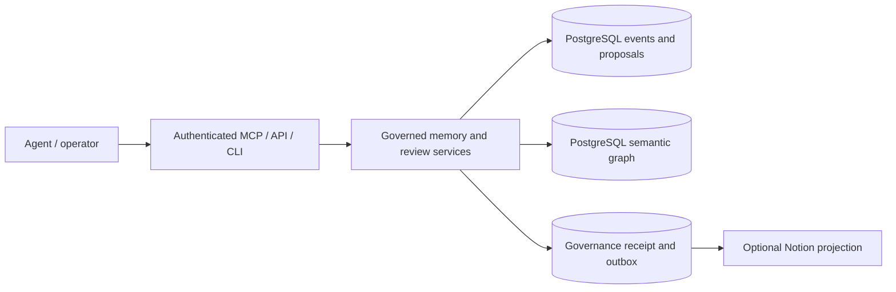
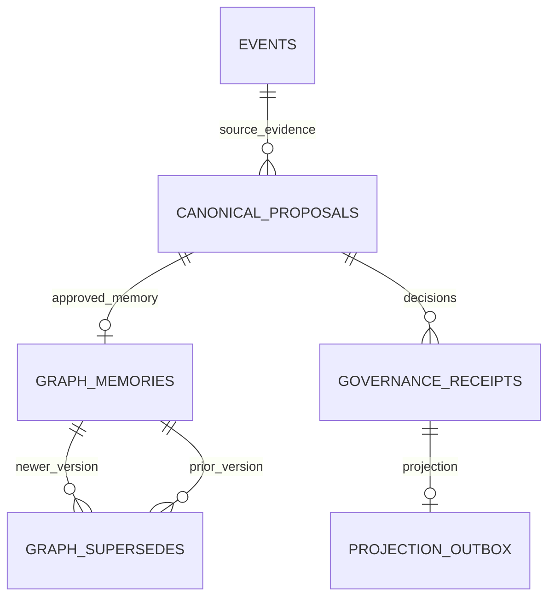

# Allura Blueprint

> [!NOTE]
> **AI-Assisted Documentation**
> Portions of this document were drafted with the assistance of an AI language model.
> Content has not yet been fully reviewed — this is a working design reference, not a final specification.
> Code and schemas evidence implementation; approved product decisions establish intent. Record disagreement for the owning decision rather than silently changing either.

Allura is a sovereign AI memory engine — a self-hosted, governed alternative to mem0.ai. It gives AI agents persistent, auditable, multi-tenant memory backed by a unified PostgreSQL architecture (append-only relational evidence, relational semantic graph tables, and pgvector retrieval — Neo4j sunset 2026-07, see AD-50). Tenant isolation, append-only history and versioned knowledge are invariants implemented across authenticated services, scoped transactions and schema constraints; their coverage requires verification.


## Documentation repair scope — 2026-10-18

This bounded reconciliation covers memory capture → human review/promotion → retrieval, current storage vocabulary and the validation findings. Sabir approved the repair plan and the publication, stale-review and confirmed-delivery specification decisions on 2026-10-18 in the current chat (DOC-01, DOC-06, DOC-07). This is not wholesale adoption of the proposed **Agreement Before Implementation** policy, implementation acceptance, or a product release. Unreviewed capability claims elsewhere require their own story evidence.

| Canonical document | Owns | Does not substitute for |
|---|---|---|
| Blueprint | Purpose, users, scope and product intent | Detailed persistence/API specification |
| Solution Architecture | Components, responsibilities and boundaries | Approval or deployed health |
| Data Dictionary | Identity, ownership, relationships, scope and physical fields | Behavior invented from field names |
| Design | State changes, failures, interactions and exact approved visual references | A generic brand instruction |
| Requirements Matrix | Testable demonstrations and evidence state | An unchecked list of features |
| Risks & Decisions | Owner decisions, alternatives and contradictions | Silent reconciliation of conflicting intent |

**Claim states:** intended → specified → implemented → verified → released. A source file establishes implementation evidence; verification requires a passing result for the reviewed revision; release requires deployment and acceptance evidence. These states are not interchangeable. The current journey matrix is in Requirements Matrix; the approved publication decision is DOC-01; visual-reference and restore questions remain DOC-02 and DOC-03 in Risks & Decisions.

**Audience and boundary:** agents capture/retrieve scoped evidence; independent human curators decide semantic promotion; operators inspect receipts and health. Agent orchestration, domain decisions, and optional external projections are outside the memory engine's responsibility. No unrelated dashboard redesign or schema change is part of this repair.
---

## Table of Contents

- [0) Brand Identity](#0-brand-identity)
- [1) Core Concepts](#1-core-concepts)
- [2) Requirements](#2-requirements)
- [3) Architecture](#3-architecture)
- [4) Diagrams](#4-diagrams)
- [5) Data Model](#5-data-model)
- [6) Execution Rules](#6-execution-rules)
- [7) Global Constraints](#7-global-constraints)
- [8) API Surface](#8-api-surface)
- [9) Logging & Audit](#9-logging--audit)
- [10) Admin Workflow](#10-admin-workflow)
- [11) References](#11-references)
- [12) Documentation Authority & Sync Contract](#12-documentation-authority--sync-contract)

---

## 0) Brand Identity

**Documentation audience decision, 2026-10-20:** Sabir accepted developers and teams using connected AI agents as primary readers, with operators and human reviewers supporting them and the enterprise dashboard optional. Keep the Allura name and visual identity. The older community positioning and organizer persona below are historical context, not the current public-documentation audience; [decision receipt](../reference/reddit-remediation/strategy-receipt.md#documentation-audience-decision--accepted-2026-10-20).

**Name:** allura (always lowercase in copy) / Allura Memory (legal / title context)  
**Tagline:** MEMORY THAT SHOWS ITS WORK  
**Positioning:** Warm + Connected — the AI memory layer for real life  
**Brand Promise:** We create spaces where connection thrives, community grows, and everyone belongs

### Core Values

| Value | Description |
|-------|-------------|
| MEMORY | Preserving what matters, faithfully |
| CONNECTION | Bridging people and their AI |
| CLARITY | Making memory visible, not hidden |
| TRUST | Governed, auditable, never opaque |
| EMPOWERMENT | Giving people agency over their own data |

### Target Persona

**Maya**, 31, Oakland — urban community organizer. Wants technology that feels warm, not soulless.  
Represents: urban millennials / Gen Z, ages 25–45.

### Brand Archetype

Caregiver 50% · Creator 30% · Explorer 20%

### Voice

| Dimension | Score |
|-----------|-------|
| Formality | 4/10 |
| Enthusiasm | 6/10 |
| Technicality | 3/10 |
| Humor | 4/10 |

**Use:** Community · Connection · Belonging · Together · Warmth · Inviting · Welcoming · Craft · Care · Celebrate · Amplify  
**Avoid:** "users" (→ "people") · frictionless · leverage · seamless · scalable

### Source of Truth

[`DESIGN-ALLURA.md`](./DESIGN-ALLURA.md) — brand canon and visual identity source, including Memory Command Center guidance
Full system: [`DESIGN-ALLURA.md`](./DESIGN-ALLURA.md)

---

## 1) Core Concepts

### Memory

A Memory is a unit of information an AI agent stores about a user, session, or context. Evidence and approved knowledge have distinct logical lifecycles within the default PostgreSQL architecture. Scoring may produce a proposal; only an authorized independent human decision promotes semantic knowledge.

**States:** `episodic | semantic | deleted`

**Key fields:**

- `content` — the raw text of the memory
- `user_id` — the owner (scoped within a `group_id`)
- `group_id` — tenant namespace, must match `^allura-`
- `score` — confidence/relevance (0–1), determines promotion eligibility

---

### Episodic Memory (PostgreSQL)

Every memory write lands here first. Append-only. Never mutated. Provides the raw event log and audit trail.

**States:** `recorded` (terminal — no transitions)

**Key fields:**

- `event_type` — e.g. `memory_add`, `memory_delete`
- `metadata` — JSONB payload (content, query, score, etc.)
- `created_at` — immutable write timestamp

---

### Semantic Memory (PostgreSQL / RuVector)

Promoted, curated knowledge. Content versions live in `graph_memories` and are linked by `graph_supersedes`. Content is never overwritten — a new row supersedes the prior one; lifecycle flags are separate from immutable content. (Neo4j was sunset 2026-07-17, Epic 23; see AD-49/AD-50.)

**States:** `active | deprecated`

**Key fields:**

- `id` — UUID
- `group_id` — tenant namespace
- `content` — memory content
- `score` — confidence score
- `deprecated` — true when a newer version exists

---

### Tenant (`group_id`)

The tenant scope boundary. Every read and write MUST use an authorized `group_id` and applicable workspace scope derived from authenticated authority. The PostgreSQL CHECK constraint (`group_id ~ '^allura-'`) validates namespace format only; it does not establish membership or prevent access to another valid tenant. Authentication, authorized scoped operations and applicable row-level security enforce access; their isolation requires separate tests.

---

## 2) Requirements

### Engine Boundary and RuVector/RuVix Posture

Allura is the governed memory engine: PostgreSQL append-only episodic traces, PostgreSQL/RuVector semantic knowledge, MCP/API access, curator approval, and RuVix policy receipts. Dashboard and operator surfaces visualize and request governed actions; they are not core engine components and must not own canonical engine state.

Historical runtime observation: **pgvector bridge**. TALON readiness evidence on 2026-06-02 observed PostgreSQL `vector` extension `0.8.2`, `ruvector_function_count=0`, and `allura_memories_count` around `3392`. Until the `ruvector` extension/functions and feedback/search health are proven by runtime checks, docs and UI must not claim full RuVector.

### Graph Adapter Posture (AD-29, AD-49, Story 19.3)

The RuVector Graph Cutover is **complete** (Story 19.3, 2026-07-12). Allura now uses **RuVector graph backend as default**. The Neo4j fallback was removed in Epic 23 (2026-07-17); PostgreSQL `graph_memories` is the default semantic store; the separate native addon remains opt-in.

**Source-inspected default and dated deployment observations:**

| Layer | Backend | Implementation | Status | Evidence |
|-------|---------|----------------|--------|----------|
| Vector search | pgvector (bridge) | `src/lib/ruvector/bridge.ts` | Active | `ruvector_function_count=0`, `vector=0.8.2` (TALON 2026-06-02) |
| Semantic/knowledge graph | IGraphAdapter (PG tables) | `src/lib/graph-adapter/` | **CUTOVER COMPLETE** | `GRAPH_BACKEND=ruvector` default; 14/14 parity checks green (Story 19.3); Neo4j removed Epic 23 |
| Native RuVector capabilities | Separate native addon / extension claims | `ruvector-crate` opt-in exists in source | Deployment readiness unverified here | Factory selection is not native PostgreSQL extension evidence |

**Runtime flag:**
- `GRAPH_BACKEND=ruvector` — default PostgreSQL graph table adapter.
- `GRAPH_BACKEND=ruvector-crate` — opt-in native addon requiring explicit module/storage/embedder configuration; no release claim.
- Historical dual-read migration configuration is not an active fallback contract. The current factory rejects the retired selector.

Historical cutover rationale: retire the separate Neo4j service and its cross-store consistency burden. Story 19.3 executed the flip to ruvector as default; Epic 23 (2026-07-17) removed the Neo4j fallback entirely.

### Agent Factory Delivery Boundary

The Allura Agent Factory follows `guidelines/AI-GUIDELINES.md` as its authoring and packaging authority while Allura remains the governance and memory authority. Factory modules, validators, and CI workflows live in this canonical repository so GitHub can execute the gates that protect them. A module is shippable only after structural validation, roster and tenant consistency checks, live tenant-isolation smoke evidence, and explicit packaging of a named team.

Factory CI does not imply native RuVector or an upstream governance package exists. Those claims remain blocked until native extension, smoke-test, and package source artifacts are present and independently verified.

RuVix governs action disposition with `Permit`, `Defer`, and `Deny` decisions. Any runtime/database, MCP configuration, cron, live RAM/Durham hook, RuVix enforcement, semantic promotion, Notion sync, or Done/Approved status change requires explicit approval and a receipt carrying `approval_required` when gated.

### API-First Scope and Optional Memory Command Center

Allura is an MCP/API-first memory engine with an optional RuVix-governed Memory Command Center for human operators. The engine remains usable through protocol and service interfaces without a browser, while the dashboard is the branded control plane for memory inspection, governance, curator decisions, audit evidence, graph exploration, and settings.

### Evidence-Gated Orchestration Positioning

Allura may expose governed orchestration records for teams, but this does not change the engine boundary. The memory engine stores run receipts, evidence, decisions, and reusable knowledge; it does not become an autonomous project manager. Corporate-facing language should say **evidence-gated, auditable, resumable runs** — never “hallucination-free.”

AD-35 now has an implemented process-engine foundation under
`src/lib/process-engine/` plus a headless runner in `scripts/process-run.ts`.
The canonical product contract remains a neutral `RunRecord` with separated
policy and runtime state. The current implementation is partial: event
persistence, gates, checkpoints, replay, DAG validation, and SDK primitives
exist, but process definitions are not durably versioned, checkpoint approval
does not yet continue remaining execution, doctor checks are absent, and no
first-class run API/product surface exists.

### Historical E2E Readiness Status (2026-06-14, later cutover notes retained)

These dated entries are not current verification or release receipts; use DOC-J01–08 for the bounded repair journey.

| Gate | Status | Notes |
|------|--------|-------|
| Live-DB 10-point engine acceptance gate | **PASSED** | All 10 engine unit/integration tests pass against real PostgreSQL (commit `f518b1eb`). Evidence in `bun run test:e2e` output. |
| Docker fresh-deploy (stranger-on-new-machine) | **UNVERIFIED** | `docker compose up` on a fresh machine has not been end-to-end smoke-tested. External volumes and network marked `external: true` will fail first `up` without prior manual setup. See AD-41 for the approved delivery sequence and INSTALL-DEPLOY-REVIEW.md in `docs/archive/allura/` for the outstanding checklist. |
| RuVector / full native extension | **NOT READY** | `ruvector_function_count=0` on 2026-06-02 (TALON). Label remains `pgvector bridge` until extension functions and feedback/search health checks pass (RK-21). |
| Graph adapter (IGraphAdapter, PG tables) | **READY** / **CUTOVER COMPLETE** | `GRAPH_BACKEND=ruvector` default, retired legacy fallback; 14/14 parity checks green (AD-29, AD-49, RK-32, Story 19.3). |

No doc or UI surface may claim "production-ready" or "fresh-deploy verified" until the Docker fresh-deploy gate is independently executed and recorded in INSTALL-DEPLOY-REVIEW.md.

- **MCP tools** — `memory_add`, `memory_search`, `memory_get`, `memory_list`, `memory_delete`
- **API routes** — `/api/health/*`, `/api/memory/*`, `/api/curator/*`
- **CLI scripts** — `bun run curator:run`, `bun run curator:approve`, `bun run mcp:http`
- **Memory Command Center** — `/dashboard`, `/dashboard/memories`, `/dashboard/curator`, `/dashboard/governance`, `/dashboard/graph`, `/dashboard/audit`, `/dashboard/settings`

**Core goals:**
- Provide real-time system status and health via API endpoints
- Show memory search, insights, and audit trails through MCP tools and the optional Memory Command Center
- Preserve tenant isolation and governed approval flows
- Expose active `group_id` scope in all responses and dashboard pages
- Avoid fabricated data; degraded states must be explicit
- Require governance receipts for every dashboard mutation

**Non-goals:** ungated direct database editing, fabricated live metrics, decorative dashboard charts without source evidence, bulk approval without rationale, generated logo marks, or any dashboard action that bypasses MCP/API governance.

### RuVix-Governed Memory Command Center

The approved dashboard direction is a Memory Command Center, not a decorative product dashboard. It manages what the system remembers, why it remembers it, who approved it, what it can affect, and whether governance is holding.

| Area | Purpose | First-release requirements |
|------|---------|----------------------------|
| Overview | System health, queue status, freshness, degraded state | PostgreSQL, MCP gateway, curator, embeddings, active `group_id` |
| Memories | Search, inspect, filter, and understand memory records | State, source, confidence, actor, evidence ID, graph relationship, provenance drawer |
| Curator | Human decision surface for proposals | Approve, reject, request evidence, request changes, required rationale |
| Governance | RuVix policy control and status | Promotion mode, thresholds, role separation, tenant isolation, locks, drift warnings |
| Graph | Semantic relationship exploration | Real PostgreSQL graph data only, source receipts, fallback list when degraded |
| Audit | Compliance and evidence surface | Full event log, filters, CSV/export packet, receipt details |
| Settings | Read-mostly tenant and policy visibility | Tenant config, promotion mode, role matrix, endpoint health |

Every page must show active `group_id`, source of truth, freshness, degraded state, and a path to evidence. Every mutation must produce a governance receipt with intent, actor, source, policy, validation, and audit trail.

**Memory/provenance/export requirements:** export/copy surfaces are read-only; preserve source, actor/creator/approver, timestamp, status, confidence, `group_id`, evidence IDs, hash/previous-hash fields when present; degraded export failures must be explicit.

### Business Requirements

| #   | Requirement                                                                                  |
| --- | -------------------------------------------------------------------------------------------- |
| B1  | Developers integrate Allura with a 5-tool API matching mem0's UX                             |
| B2  | All memory access must enforce authenticated tenant (`group_id`) and applicable workspace scope                            |
| B3  | Every write produces an immutable audit record in PostgreSQL                                 |
| B4  | Promoted knowledge is versioned and never mutated in the semantic store (PostgreSQL `graph_memories`) |
| B5  | The system is deployable via a single `docker compose up` command for core infra and app services |
| B6  | Agents connect via MCP (Model Context Protocol) through Team RAM-selected packaged MCP servers |
| B7 | Human approval governs semantic promotion; legacy mode configuration does not grant approval |
| B8  | Consumer memory viewer: no sidebar, search dominant, swipe to forget                         |
| B9  | Every memory shows provenance: "from conversation" or "added manually"                       |
| B10 | Memory usage indicator: "used N times this week" on expand                                   |
| B11 | Undo: recently forgotten memories recoverable within 30 days                                 |
| B12 | Enterprise admin view: tenant overview, SOC2 pending queue, audit log via API |
| B13 | Audit log exportable as CSV for compliance |
| B14 | TypeScript SDK (`@allura/sdk`) |
| B15 | BYOK encryption |
| B16 | Curator CLI: three-state approval workflow (Traces, Approved, Pending) |
| B17 | Curator sees confidence scores (60-100%) with one-sentence reasoning for uncertain proposals |
| B18 | Approve/reject decisions logged to audit trail with curator ID and timestamp |
| B19 | Historical auto-approval requirement is superseded by mandatory HITL; a score threshold does not authorize promotion |
| B20 | MCP HTTP gateway deployable via Docker; backend engine in user's VPC/cloud |
| B21 | Authentication via API keys and RBAC (curator, admin, viewer roles) |
| B22 | Error tracking via Sentry; alerts on engine failures |
| B23 | Agents must persist all task activity as append-only raw traces for auditability |
| B24 | A curator process must turn raw traces into proposed insights without promoting them directly |
| B25 | No insight may become active knowledge until approved by an independent authorized human through the governed approval flow |
| B26 | Approved insights must be stored in PostgreSQL `graph_memories` as immutable, versioned knowledge records |
| B27 | Agents must retrieve approved knowledge through a controlled retrieval layer |
| B28 | All reads/writes must pass through controlled APIs with project-level access and audit |
| B29 | The full loop from agent execution to knowledge reuse must be demonstrably end-to-end |
| B30 | Team RAM agents must follow `guidelines/AI-GUIDELINES.md` and Allura Brain memory through a documented workflow, preserving `.opencode/agent/` as the live agent source of truth |
| B31 | Teams must be able to define evidence-gated orchestration runs that map familiar work ceremonies to governed Allura receipts without exposing internal agent-routing details |
| B32 | Supply-chain threat intelligence must preserve source provenance, tenant/workspace scope, evidence freshness, and human authority while remaining read-only toward inventoried endpoints and external enforcement systems |

---

### Functional Requirements

Identifiers in this document use **BP-Fn** (Blueprint namespace, mapping revision 2026-10-18). They are distinct from Matrix **GM-Fn** and Design **DS-Fn** identifiers. The [crosswalk](./REQUIREMENTS-MATRIX.md#requirement-identifier-crosswalk) owns cross-document mapping; a matching number alone does not mean the same requirement.

#### Memory Operations

| #   | Requirement                                                                                                |
| --- | ---------------------------------------------------------------------------------------------------------- |
| <a id="bp-f1"></a>BP-F1 | `memory_add` appends authorized evidence and may queue an eligible proposal; semantic promotion requires a separate human decision |
| <a id="bp-f2"></a>BP-F2 | `memory_search(query, userId, limit?)` — federated search across Postgres episodic + `graph_memories` semantic, merged by relevance |
| <a id="bp-f3"></a>BP-F3 | `memory_get(memoryId)` — returns a single memory record by ID                                              |
| <a id="bp-f4"></a>BP-F4 | `memory_list(userId)` — returns all memories for a user within the tenant                                  |
| <a id="bp-f5"></a>BP-F5 | `memory_delete(memoryId)` — soft-delete: appends a deletion event to Postgres, marks `graph_memories` row deprecated |

#### Governance

| #   | Requirement                                                                                    |
| --- | ---------------------------------------------------------------------------------------------- |
| <a id="bp-f6"></a>BP-F6 | `PROMOTION_MODE=soc2` — score ≥ threshold queues for human approval; no autonomous semantic write |
| <a id="bp-f7"></a>BP-F7 | Legacy `PROMOTION_MODE=auto` remains human-gated; thresholds only assist proposal selection |
| <a id="bp-f8"></a>BP-F8 | `group_id` CHECK constraint blocks writes with invalid tenant namespaces                       |
| <a id="bp-f9"></a>BP-F9 | Changed semantic content creates a new version and lineage; lifecycle flags are separate, with restore unresolved under DOC-03 |

#### Curator Dashboard

| #   | Requirement                                                                                         |
| --- | --------------------------------------------------------------------------------------------------- |
| <a id="bp-f10"></a>BP-F10 | `POST /api/curator/score` — scores proposal, returns {confidence, reasoning, tier}                  |
| <a id="bp-f11"></a>BP-F11 | Human approval through `POST /api/curator/approve` requires authenticated authority, evidence and the reviewed proposal version; `tier` is categorical and no percentage comparison authorizes approval. Stale-version rejection is specified by DOC-06 but not implemented in the inspected service |
| <a id="bp-f12"></a>BP-F12 | `POST /api/curator/reject` is an implemented compatibility shim delegating rejection to the governed decision route (`src/app/api/curator/reject/route.ts`). Historical seven-day undo expectation is not implemented or accepted by this repair                   |
| <a id="bp-f13"></a>BP-F13 | `GET /api/curator/proposals` implements authenticated group/workspace scoping and status filtering (default `pending`; also `approved`, `rejected`, `all`), returning tier without filtering by it (`src/app/api/curator/proposals/route.ts`). Historical emerging/adoption-only expectation requires a separate specification decision before reintroduction           |
| <a id="bp-f14"></a>BP-F14 | Curator dashboard shows three tabs: Traces (raw), Approved (knowledge), Pending (decisions)         |
| <a id="bp-f15"></a>BP-F15 | Pending tab sorts by confidence (descending); shows confidence badge + reasoning + buttons          |
| <a id="bp-f16"></a>BP-F16 | Approved tab shows human-approved knowledge with provenance; sortable by date/confidence |
| <a id="bp-f17"></a>BP-F17 | Tab 1 restricted to authenticated users with `admin` role (engineers only)                          |
| <a id="bp-f18"></a>BP-F18 | Audit log endpoint: `GET /api/audit/events` — returns curator decisions with timestamps             |
| <a id="bp-f19"></a>BP-F19 | Dashboard integrates Clerk for authentication and RBAC (curator, admin, viewer roles)               |

#### Infrastructure

| #   | Requirement                                                                                 |
| --- | ------------------------------------------------------------------------------------------- |
| <a id="bp-f20"></a>BP-F20 | Agents access memory through authenticated Allura MCP/API contracts with tenant and workspace authority resolved by the server |
| <a id="bp-f21"></a>BP-F21 | `docker compose up` starts core infra and app services; packaged MCP servers are attached as focused external capabilities |
| <a id="bp-f22"></a>BP-F22 | Memory viewer UI at `/memory` lists, searches, and deletes memories                         |
| <a id="bp-f23"></a>BP-F23 | Curator dashboard deployed on Vercel; calls backend engine via `CURATOR_ENGINE_URL` env var |
| <a id="bp-f24"></a>BP-F24 | Vercel Functions (`/api/curator/*`) call Docker engine in VPC/cloud via HTTPS               |
| <a id="bp-f25"></a>BP-F25 | Error tracking: unhandled exceptions sent to Sentry; curator notified via email/Slack       |

#### Governed Memory Pipeline

| #   | Requirement                                                                                                          |
| --- | ------------------------------------------------------------------------------------------------------------------- |
| <a id="bp-f26"></a>BP-F26 | Agent task lifecycle events, tool calls, outputs, retries, and terminal status are persisted as append-only traces    |
| <a id="bp-f27"></a>BP-F27 | Raw trace storage is append-only; no UPDATE or DELETE on the `events` table                                        |
| <a id="bp-f28"></a>BP-F28 | Raw traces preserve provenance linking downstream insights back to source evidence                                   |
| <a id="bp-f29"></a>BP-F29 | Curator reads raw traces and generates proposed insights (not active insights)                                     |
| <a id="bp-f30"></a>BP-F30 | Each proposed insight includes summary, evidence links, confidence score, timestamp, and status                    |
| <a id="bp-f31"></a>BP-F31 | Proposed insights enter an approval flow before becoming active knowledge                                           |
| <a id="bp-f32"></a>BP-F32 | Every approval, rejection, or policy decision is recorded as an audit event with actor and timestamp                |
| <a id="bp-f33"></a>BP-F33 | Approved insights are written to PostgreSQL semantic tables as immutable nodes; no in-place updates                                     |
| <a id="bp-f34"></a>BP-F34 | Changed insights create new nodes linked with `SUPERSEDES`, `DEPRECATED`, or `REVERTED` relationships             |
| <a id="bp-f35"></a>BP-F35 | Agents retrieve knowledge through a controlled retrieval service, not by querying databases directly                 |
| <a id="bp-f36"></a>BP-F36 | Retrieval supports semantic and structured queries with project and global scope                                    |
| <a id="bp-f37"></a>BP-F37 | All knowledge-system reads/writes pass through controlled endpoints enforcing project-level access                  |
| <a id="bp-f38"></a>BP-F38 | Agent permissions enforced and all access to trace/knowledge resources is audited                                  |
| <a id="bp-f39"></a>BP-F39 | A second agent can retrieve approved knowledge and use it correctly in a later task                                |
| <a id="bp-f40"></a>BP-F40 | The full lifecycle from trace capture to knowledge reuse is traceable, auditable, and reversible                   |
| <a id="bp-f56"></a>BP-F56 | Bumblebee V1 may ingest allowlisted advisory evidence, correlate verified exposure, create deduplicated alerts, and prepare simulated mitigation proposals; it must not activate policy, block CI/packages, change schedules, or perform containment |

#### Declared Disposition — Requirements Without Current Story Coverage

As of 2026-08-29 (implementation readiness pass), these BLUEPRINT functional requirements have **no epic/story coverage**. This is a declared, honest disposition — not an oversight:

| FR | Requirement (short) | Disposition |
|----|---------------------|-------------|
| BP-F21 | `docker compose up` starts core infra + app services | Backlog (Story 24.7) — evidence gate remains unexecuted |
| BP-F22 | Memory viewer UI at `/memory` | Superseded by Memory Command Center (BP-F41/BP-F42) — legacy route, not planned |
| BP-F23 | Curator dashboard on Vercel + `CURATOR_ENGINE_URL` | Deployment detail, superseded by self-hosted control plane posture |
| BP-F24 | Vercel Functions call Docker engine via HTTPS | Same — superseded; dashboard is optional, not Vercel-mandated |
| BP-F25 | Sentry error tracking | Deferred operational requirement — no owner, no epic |
| <a id="bp-f43"></a>BP-F43 | `/work-board` Native Allura Kanban | Backlog: authoritative work board and sync direction unresolved (DOC-09); DOC-01 settles engineering-document publication only |
| <a id="bp-f44"></a>BP-F44 | `/resources` manifest | Deferred — resource manifest endpoint not yet scoped |
| <a id="bp-f45"></a>BP-F45 | `/agents` distinction taxonomy | Deferred — agent taxonomy in progress under governed AI office |
| <a id="bp-f46"></a>BP-F46 | `/telemetry` metrics | Deferred — no fabrication rule respected; honest empty state |
| BP-F49–BP-F52 | Governed run records/policy/journals/doctor | Partially implemented (AD-35 process-engine foundation); full run surface deferred |
| BP-F53–BP-F55 | Governed AI Office (projects, workspace, desktop shell) | Explicitly deferred — larger program, no epic assigned |

**Policy:** No FR is silently dropped. Each entry above declares its disposition. Any future epic must either address one of these FRs or update this table.

#### Memory Command Center

| #   | Requirement |
| --- | ----------- |
| <a id="bp-f41"></a>BP-F41 | Memory Command Center exposes `/dashboard` (new chat), `/dashboard/search` (memory search), `/dashboard/scheduled-tasks` (dreams), `/dashboard/governance` (policy gates), `/dashboard/kanban` (work board), `/dashboard/graph` (knowledge graph), `/dashboard/mission-control` (ops console), and `/dashboard/settings` as the governed operator surface |
| <a id="bp-f42"></a>BP-F42 | `/dashboard/memories` preserves useful reference memory capabilities: memory search/list, insights, trace logs, provenance, extracted facts, and approval queue |
| BP-F43 | Intended `/work-board` capability; Native Allura Kanban versus an external authoritative board and adapter sync direction remain unresolved under DOC-09. No default is approved by this repair |
| BP-F44 | `/resources` reads skills, agents, MCP servers, containers, cron jobs, and drift warnings from a declared Resource Manifest or generated manifest endpoint |
| BP-F45 | `/agents` distinguishes TALON/IRIS native subagents from Team RAM/Durham CLI harness agents and external runtime agents |
| BP-F46 | `/telemetry` surfaces model, prompt, tool, retry, rate-limit, failure, and degraded-state metrics without inventing missing measurements |
| <a id="bp-f47"></a>BP-F47 | Every Memory Command Center route displays its source-of-truth declaration and degraded-state behavior |
| <a id="bp-f48"></a>BP-F48 | Dashboard launch requires documented route parity, visual parity, source-of-truth parity, smoke tests, auth validation, and rollback plan |
| <a id="bp-f49"></a>BP-F49 | Governed runs capture a neutral tenant-scoped `RunRecord` and pin a process definition ID and immutable revision |
| <a id="bp-f50"></a>BP-F50 | Run policy declares allowed actions, approval breakpoints, measured quality gates, bounded attempts, and evidence required before Done |
| <a id="bp-f51"></a>BP-F51 | Run journals persist append-only execution evidence and continue from the first incomplete eligible step after approval without repeating completed side effects |
| <a id="bp-f52"></a>BP-F52 | Run doctor checks report stale, failed, incomplete, definition-drifted, unrecoverable, or approval-blocked runs before Done |
| <a id="bp-f53"></a>BP-F53 | Native projects and work items use PostgreSQL as operational state, link to runs, handoffs, evidence packets, and memory receipts, and move through audited transitions |
| <a id="bp-f54"></a>BP-F54 | The operator workspace provides mission-first navigation, Command Center behavior, a central work surface, and a right evidence/context inspector |
| <a id="bp-f55"></a>BP-F55 | Allura ships one governed desktop shell with secure connections, runtime supervision, updates, deep links, offline/read-only behavior, and reconnect recovery |

---

## 3) Architecture

### Components

| Component                | Responsibility                                 | Notes                                             |
| ------------------------ | ---------------------------------------------- | ------------------------------------------------- |
| Team RAM Orchestrator    | Selects skills, sequences retrieval, and synthesizes results | Brooks-led orchestration layer                    |
| Memory Skills            | Define behavior, guardrails, and escalation order | `.opencode/skills/allura-memory-skill/`, `.opencode/skills/memory-client/` |
| Allura MCP boundary | Authenticated memory capture, search and audit interfaces | `src/mcp/` |
| `database-server`        | Raw trace, audit, and SQL evidence access      | Packaged MCP server; evidence layer               |
| Next.js API              | REST endpoints for dashboard + curator APIs    | `src/app/api/memory/`, `src/app/api/curator/`     |
| Memory Engine            | Core read/write/score/route logic              | `src/lib/memory/`                                 |
| Curator Scorer           | Computes confidence (60-100%) + reasoning      | `src/lib/curator/score.ts` (rule-based or Claude) |
| Dedup Engine | Proposal similarity support; not a universal canonical-write guarantee | `src/lib/dedup/`; approval-specific replay is separate (DOC-05) |
| Budget + Circuit Breaker | Prevents runaway agent writes, enforces Kmax limits, auto-expires halted sessions | `src/lib/budget/`, `src/lib/circuit-breaker/` |
| Retrieval Gateway | Typed contract enforcement at the retrieval boundary — all agent reads pass through `SearchRequest`/`MemoryResult` typed contract | `src/lib/retrieval/contract.ts`, `src/lib/retrieval/policy.ts`, `src/lib/retrieval/startup-validator.ts` |
| Sync Contract Mappings | Resolves user_id→Agent and group_id→Project for relationship wiring on promoted memories | `src/lib/graph-adapter/sync-contract-mappings.ts` |
| Budget Admin API | `POST /api/admin/reset-budget` — reset halted sessions per group or globally | `src/mcp/canonical-http-gateway.ts` |
| Memory Command Center Shell | Approved governed dashboard for memories, curator work, RuVix governance, graph exploration, audit evidence, and settings | Launches only after source-of-truth, no-fabricated-data, auth, accessibility, route-smoke, and rollback gates pass |
| Allura Memory Reference Surface | Visual/product reference for the desired memory dashboard experience | `localhost:6420`; preserve capabilities in `/allura` |
| Native Allura Kanban | Proposed planning and execution board near the Memory Command Center | Backlog: authoritative board selection remains DOC-09 |
| Board Sync Adapters | Proposed Notion, Linear, and GitHub Projects integrations | Backlog: upstream ownership, conflict rules and sync direction require DOC-09 before implementation |
| Resource Manifest Adapter | Resource inventory adapter for skills, agents, MCP servers, containers, cron jobs, and drift warnings | `RESOURCE-MANIFEST.md` or generated manifest endpoint |
| PostgreSQL 16            | Episodic memory + audit trail + proposals      | Docker service                                    |
| PostgreSQL semantic graph | Promoted content, immutable lineage and structural context | `src/lib/graph-adapter/ruvector-adapter.ts` |
| Memory Viewer            | `/memory` page — list, search, delete          | `src/app/memory/page.tsx`                         |
| Curator Dashboard        | `/curator` page — three-tab HITL governance UI | `src/app/curator/page.tsx`                        |
| Clerk Auth               | Multi-tenant authentication + RBAC             | SaaS (vercel.com)                                 |
| Sentry Monitor           | Error tracking + alerts                        | SaaS (sentry.io)                                  |

---

## 4) Diagrams

### Component Overview



### Execution Flow — `memory_add`

Capture first appends scoped episodic evidence. Eligible content becomes a pending proposal. Score does not approve it. An independent authorized human reviews the proposal before the approval service commits semantic content, decision, audit, outbox and receipt atomically. See [Architecture](./SOLUTION-ARCHITECTURE.md#34-governed-memory-write-path) and [Design](./DESIGN-ALLURA.md#bounded-memory-journey) for failure and retry behavior.

### Data Model (ER Diagram)



Relationships are logical; keys, nullability, scope and actual constraints are owned by [Data Dictionary](./DATA-DICTIONARY.md#bounded-memory-journey-data-contract). Every governed join preserves tenant and workspace scope. This sketch is not a migration.

---

## 5) Data Model

This section summarizes logical concepts. Data Dictionary owns physical persistence fields, keys and mappings; logical labels below do not imply additional SQL columns or an executable seed contract.

### `events` — PostgreSQL (Episodic Memory)

The primary append-only log. Every memory operation produces a row here. No UPDATE or DELETE ever.

| Field         | Type         | Required | Description                                                     |
| ------------- | ------------ | -------- | --------------------------------------------------------------- |
| `id`          | bigserial    | Yes      | Auto-increment primary key                                      |
| `group_id`    | varchar(255) | Yes      | Tenant identifier. CHECK: `group_id ~ '^allura-'`               |
| `event_type`  | varchar(100) | Yes      | `memory_add` · `memory_search` · `memory_delete` · `memory_get` |
| `agent_id`    | varchar(255) | Yes      | Source agent or user identifier                                 |
| `workflow_id` | varchar(255) | No       | Optional workflow grouping                                      |
| `status`      | varchar(50)  | Yes      | Default: `completed`                                            |
| `metadata`    | jsonb        | No       | Content, query, score, result count, etc.                       |
| `created_at`  | timestamptz  | Yes      | Immutable. DEFAULT NOW()                                        |

**`event_type` values**

| Value           | Description                         |
| --------------- | ----------------------------------- |
| `memory_add`    | A memory was written                |
| `memory_search` | A search was performed              |
| `memory_get`    | A single memory was fetched         |
| `memory_list`   | All memories for a user were listed |
| `memory_delete` | A memory was soft-deleted           |

### Accepted Bumblebee plugin planning contract

Epic 26's remaining gate integrates the pinned upstream `perplexityai/bumblebee`
read-only endpoint scanner as an Allura plugin. Historical “Bumblebee Guard” and
“Bumblebee Threat Watch” labels describe local Allura adjuncts only; they are not the
upstream scanner and do not grant a distinct authority level.
The future contract treats advisory records, exposure findings, alerts, and simulated
mitigation proposals as scoped evidence objects; it does not create an enforcement
plane. Each object must retain its source identity, publication and fetch times,
verification/trust state, classification or redaction policy, evidence references,
and retention disposition. `group_id` and `workspace_id` are server-derived;
caller-supplied scope is never authoritative.

The plugin runner obtains a server-issued source/population lease and dedicated
ingestion-only credential before a scan. Accepted scanner snapshots join approved
internal events and allowlisted advisory polling as evidence lanes. A verified match
may create a deduplicated alert and a simulated proposal only. Any policy activation,
CI/package block, schedule change, credential revocation, workspace lock, or
containment action requires a separately approved workflow and governance receipt.

---

### `Memory` Node — PostgreSQL semantic tables (Semantic Memory)

Promoted, curated knowledge. Immutable after creation. Versioned via SUPERSEDES. See [DATA-DICTIONARY.md](./DATA-DICTIONARY.md#logical-graph-memory) for full property details.

| Property     | Type          | Required | Description                                    |
| ------------ | ------------- | -------- | ---------------------------------------------- |
| `id`         | string (UUID) | Yes      | Unique identifier                              |
| `name`       | string        | Yes      | Short descriptive title                        |
| `group_id`   | string        | Yes      | Tenant namespace. Must match `^allura-`        |
| `category`   | string        | Yes      | Memory classification                          |
| `type`       | string        | Yes      | Memory type (procedural, declarative, etc.)     |
| `content`    | string        | Yes      | The memory content                             |
| `source`     | string        | Yes      | Origin (notion, curator, manual, conversation) |
| `notion_id`  | string        | No       | Notion page ID for bidirectional traceability  |
| `score`      | float         | Yes      | Confidence score (0–1)                         |
| `deprecated` | boolean       | Yes      | True when a newer version supersedes this node |
| `created_at` | datetime      | Yes      | Creation timestamp                             |

### `Agent` Node — PostgreSQL semantic tables (Structural Context)

Represents an AI agent in the team. Persisted through the structural graph adapter; historical Cypher seed scripts are not current provisioning instructions. See [DATA-DICTIONARY.md](./DATA-DICTIONARY.md#logical-graph-agent) for full property details.

| Property     | Type          | Required | Description                                    |
| ------------ | ------------- | -------- | ---------------------------------------------- |
| `id`         | string        | Yes      | Unique agent identifier                        |
| `name`       | string        | Yes      | Human-readable agent name                      |
| `persona`    | string        | Yes      | Agent persona description                       |
| `team`       | string        | Yes      | Team name                                       |
| `category`   | string        | Yes      | Agent classification (ram, durham, governance, ship) |
| `type`       | string        | Yes      | Agent type (executor, reviewer, curator, orchestrator, specialist, creative) |
| `scope`      | string        | Yes      | Operational scope (project, team, global)      |
| `platform`   | string        | Yes      | Platform (openclaw, claude, cursor, opencode)   |
| `status`     | string        | Yes      | Lifecycle status (active, inactive, retired)   |
| `group_id`   | string        | Yes      | Tenant namespace                                |
| `description`| string        | No       | Extended description of the agent's role        |

### `Team` Node — PostgreSQL semantic tables (Structural Context)

Represents a team of agents. See [DATA-DICTIONARY.md](./DATA-DICTIONARY.md#logical-graph-team) for full property details.

| Property     | Type          | Required | Description                                    |
| ------------ | ------------- | -------- | ---------------------------------------------- |
| `id`         | string        | Yes      | Unique team identifier                         |
| `name`       | string        | Yes      | Human-readable team name                       |
| `group_id`   | string        | Yes      | Tenant namespace                                |
| `icon`       | string        | No       | Emoji or icon identifier                        |
| `description`| string        | No       | Team description and purpose                    |

### `Project` Node — PostgreSQL semantic tables (Structural Context)

Represents a project that agents contribute to and memories relate to. See [DATA-DICTIONARY.md](./DATA-DICTIONARY.md#logical-graph-project) for full property details.

| Property     | Type          | Required | Description                                    |
| ------------ | ------------- | -------- | ---------------------------------------------- |
| `id`         | string        | Yes      | Unique project identifier                       |
| `name`       | string        | Yes      | Human-readable project name                    |
| `group_id`   | string        | Yes      | Tenant namespace                                |
| `status`     | string        | Yes      | Project status (active, planned, complete, on-hold) |
| `description`| string        | No       | Project description and scope                   |

**Relationships**

| Relationship | Pattern                    | Description                                     |
| ------------ | -------------------------- | ----------------------------------------------- |
| `SUPERSEDES` | `(v2)-[:SUPERSEDES]->(v1)` | v1 is marked `deprecated: true`. Never edit v1. |
| `AUTHORED_BY` | `(m:Memory)-[:AUTHORED_BY]->(a:Agent)` | Memory was authored by Agent. |
| `RELATES_TO` | `(m:Memory)-[:RELATES_TO]->(p:Project)` | Memory relates to Project. |
| `MEMBER_OF` | `(a:Agent)-[:MEMBER_OF]->(t:Team)` | Agent is a member of Team. |
| `CONTRIBUTES_TO` | `(a:Agent)-[:CONTRIBUTES_TO]->(p:Project)` | Agent contributes to Project. |
| `DELEGATES_TO` | `(a:Agent)-[:DELEGATES_TO]->(b:Agent)` | Chain of command delegation. |
| `ESCALATES_TO` | `(a:Agent)-[:ESCALATES_TO]->(b:Agent)` | Escalation path. |
| `HANDS_OFF_TO` | `(a:Agent)-[:HANDS_OFF_TO]->(b:Agent)` | Creative flow handoff (Durham). |
| `PROPOSES_TO` | `(a:Agent)-[:PROPOSES_TO]->(b:Agent)` | Curator proposes to Auditor. |
| `APPROVES_PROMOTION` | `(a:Agent)-[:APPROVES_PROMOTION]->(b:Agent)` | Auditor approves promotion. |

---

## 6) Execution Rules

### Promotion Decision

**Approved specification, 2026-10-18 (Sabir, current chat):** an approval must bind the proposal version the human reviewed. A changed version requires rejection without a new approval and a refreshed review (DOC-06). This is an implementation gap in the inspected route/service. Score and tier assist review; tier is a category, not a percentage. The existing service has no score cutoff at approval, and this repair authorizes no new automatic or numeric approval gate.

Scoring may produce a pending proposal; it never grants approval. `src/lib/curator/auto-promote.ts` retains the legacy mode setting for compatibility but requires curator/HITL approval for both values. Approval is a scoped human decision executed through `approveProposal`, with actor separation, evidence checks, transactionality and idempotency. A `pending` response is not semantic promotion.

### Deduplication

Deduplication is operation-specific. Capture checks similar pending/approved proposals under the resolved tenant/workspace transaction (`src/mcp/canonical-tools.ts`); that similarity check is non-blocking if it fails. The watchdog excludes source events already referenced by same-scope proposals. Atomic approval instead locks one proposal and uses deterministic memory identity plus scoped idempotency; it does not perform a universal content/user similarity check before insertion.

Intended duplicate-knowledge protection across distinct approved proposals remains an open contract (DOC-05). Do not generalize proposal deduplication or approval replay protection into a guarantee covering every semantic write, and never compare or reuse identities across unauthorized workspaces.

### Failure Semantics

- **Capture:** the episodic event is persisted before optional retrieval projection, scoring and proposal creation. A retrieval-projection failure is logged and does not erase that event. A later scoring/proposal error can fail the request after evidence was stored; no semantic promotion occurred. Do not infer absence from failure or blindly retry with a new identity. Source: `src/mcp/canonical-tools.ts`.
- **Approval:** semantic content, proposal transition, audit, outbox, receipt and replay record share one transaction. Any failure before commit rolls back that approval transaction; it is not an episodic-only promotion success. The earlier capture event remains unchanged. Source: `src/lib/memory/approve-proposal.ts`.
- **Projection delivery:** a failed Notion outbox delivery is separate from a committed approval. Report its actual state without undoing or repeating the decision.
- **Ambiguous request completion:** a timeout alone proves neither commit nor rollback. Use the scoped operation's receipt/read-back and documented replay contract before claiming success or retrying.

### Soft Delete

`memory_delete` never removes rows. It appends an event of type `memory_delete` to Postgres and sets `deprecated: true` on the `graph_memories` row (if promoted). The original rows remain for audit purposes.

---

## 7) Global Constraints

- **`group_id` MUST match `^allura-`** — enforced by PostgreSQL CHECK constraint. Failure is a schema error, not an application error.
- **Postgres rows are append-only** — no UPDATE or DELETE on the `events` table under any circumstance.
- **Semantic content versions are immutable** — content changes create a new row and lineage edge; lifecycle flags are distinct, with restore behavior unresolved under DOC-03.
- **Circuit breaker trips at budget threshold** — agent runaway is cut off at the infrastructure layer, not application layer.

---

## 8) API Surface

### MCP Tools (Agent Interface)

| Tool            | Description                        |
| --------------- | ---------------------------------- |
| `memory_add`    | Add a memory for a user            |
| `memory_search` | Scoped retrieval across permitted evidence and semantic knowledge sources; source/status distinguishes unapproved evidence from approved knowledge |
| `memory_get`    | Fetch a single memory by ID        |
| `memory_list`   | List all memories for a user       |
| `memory_delete` | Soft-delete a memory               |

`memory_add` is write-only through an authenticated MCP transport or configured
stdio service boundary. The transport derives `group_id`, workspace, actor, and
session from verified server-side identity; a caller-supplied `user_id` is
injected when absent and rejected on mismatch. Raw canonical-tool calls and
serializable `scope` objects cannot authorize a write.

### REST API (Dashboard Interface)

| Method   | Path                            | Description          |
| -------- | ------------------------------- | -------------------- |
| `POST`   | `/api/memory`                   | Disabled for writes: returns `403`; use authenticated MCP/stdio `memory_add` |
| `GET`    | `/api/memory?userId=&groupId=`  | List memories        |
| `GET`    | `/api/memory/[id]`              | Get memory by ID     |
| `DELETE` | `/api/memory/[id]`              | Soft-delete a memory |
| `GET`    | `/api/memory/search?q=&userId=` | Search memories      |
| `GET`    | `/api/memory/graph?group_id=`   | Read-only tenant-scoped graph view for dashboard; returns real `graph_memories` rows/edges and total relationship count |
| `GET`    | `/api/health`                   | System health check  |
| `POST`   | `/api/admin/reset-budget`       | Reset halted budget sessions (auth required; body: `{group_id?}`) |
| `POST`   | `/api/memory/retrieval`         | Governed retrieval gateway — sole agent read path (AD-19) |

### Port Registry

Canonical service ports. **The 3000–3999 band is banned** (Next.js/React default — caused repeated collisions and orphaned containers). New services allocate by tier, incrementing +1 each: UI/frontends 4000+, APIs/backends 6000+, tools/workers/aux 7000+. Policy: [RISKS-AND-DECISIONS.md](./RISKS-AND-DECISIONS.md) AD-45. Claim a port via a PR that updates this table and `docker-compose.yml`.

| Service | Port | Tier |
| ------- | ---- | ---- |
| Allura Control Center UI (Next.js) | 4001 | UI (4000+) |
| Allura Control Center API (FastAPI) | 6001 | API (6000+) |
| MCP HTTP gateway | 5888 | infra (exempt) |
| PostgreSQL | 5432 | infra (exempt) — IGraphAdapter graph ops run here (AD-29, AD-49) |
| RuVector PG | 5433 | infra (exempt) — native extension port (not yet active; see AD-45, RK-21) |
| Neo4j bolt | 7687 | infra (exempt) — **retired** Epic 23 (2026-07-17) |
| Neo4j HTTP | 7474 | infra (exempt) — **retired** Epic 23 (2026-07-17) |
| legacy dashboard (sunset) | ~~3100~~ | retired with 3000-band ban |

---

## 9) Logging & Audit

| What                   | Where stored           | Notes                                               |
| ---------------------- | ---------------------- | --------------------------------------------------- |
| Every memory operation | `events` (Postgres)    | Append-only, permanent                              |
| Promotion decisions | Append-only events + durable governance receipts | Current approval evidence is the scoped decision receipt and associated proposal transition; historical promotion event names remain compatibility vocabulary |
| Search queries         | `events` (Postgres)    | Includes result count in metadata                   |
| `graph_memories` row versions | `graph_supersedes` chain | Full lineage preserved                              |

**Redacted fields:** passwords, API keys, raw credentials must never appear in `metadata` JSONB.

---

## 9.5) Event-Driven Architecture

Allura's internal coordination is event-driven: every significant state change emits an event to the PostgreSQL `events` table. Consumers subscribe by querying `event_type`; producers insert rows. This design enables loose coupling between subsystems (curator, Notion sync, audit export, dashboard) while preserving the append-only audit trail.

### Event Types

Historical producer/consumer mappings are retained below for compatibility. The source-inspected current journey is specified in Design: capture evidence, pending proposal, atomic decision receipt, then outbox delivery. Do not infer a current producer or transaction boundary from a legacy event name.

| Event Type | Producer | Consumer(s) | Description |
|------------|----------|-------------|-------------|
| `memory_add` | `memory_add` tool / REST API | Retrieval layer, curator, dashboard | A memory was written to PostgreSQL |
| `memory_search` | `memory_search` tool / REST API | Dashboard, audit export | A search query was executed |
| `memory_get` | `memory_get` tool | Dashboard | A single memory was fetched by ID |
| `memory_list` | `memory_list` tool | Dashboard | All memories for a user were listed |
| `memory_delete` | `memory_delete` tool / REST API | Dashboard, retrieval layer | A memory was soft-deleted |
| `memory_promoted` | Historical compatibility producer | Legacy consumers | Historical completed-promotion event vocabulary; not the current approval result contract |
| `promotion_failed` | Historical compatibility producer | Legacy consumers | Historical promotion-failure event vocabulary; current approval failure rolls back its transaction |
| `promotion_queued` | Historical compatibility producer | Legacy consumers | Historical queue event vocabulary; all current promotion requires human review |
| `memory_restore` | `memory_restore` tool | Dashboard, retrieval layer | A soft-deleted memory was restored |
| `memory_update` | `memory_update` tool | Dashboard, retrieval layer | Append-only versioned update (SUPERSEDES chain) |
| `proposal_created` | Curator engine (trigger) | Dashboard, Notion sync worker | A canonical proposal was created for HITL review |
| `proposal_approved` | Curator approve CLI / API | Dashboard, Notion sync worker (`notion-projection-sync`), audit export | A proposal was approved and promoted to PostgreSQL semantic tables |
| `proposal_rejected` | Curator reject CLI / API | Dashboard, Notion sync worker, audit export | A proposal was rejected |
| `knowledge_promotion` | Knowledge promotion path | Dashboard, audit export | Insight promoted via knowledge-promotion.ts |
| `notion_sync_pending` | Curator approve flow | Notion sync worker (`notion-sync-worker.ts`) | Proposal queued for Notion page creation |
| `tool_approved` | MCP catalog governance | Notion sync worker (`notion-projection-sync`) | MCP tool approved through catalog governance |
| `tool_denied` | MCP catalog governance | Notion sync worker (`notion-projection-sync`) | MCP tool denied through catalog governance |
| `sync_contract` | Curator approval | Notion sync worker, audit export | Sync contract mapping applied — user_id→Agent, group_id→Project relationships wired on promoted memory |
| `execution_succeeded` | Agent executor | Notion sync worker (`notion-projection-sync`) | Agent execution succeeded |
| `execution_failed` | Agent executor | Notion sync worker (`notion-projection-sync`), Sentry | Agent execution failed |
| `execution_blocked` | Agent executor | Notion sync worker (`notion-projection-sync`) | Agent execution blocked |
| `session_start` | Agent runtime | Dashboard, audit export | Agent session began |
| `session_end` | Agent runtime | Dashboard, audit export | Agent session ended |
| `graph_backend_unavailable` | Circuit breaker / health check | Dashboard, Sentry | Graph backend was unreachable — system degraded gracefully |
| `request_trace` | HTTP TraceMiddleware | Dashboard, audit export | HTTP request traced (Story 1.2) |
| `health_check` | Health endpoint | Dashboard, monitoring | System health check performed |

### Event Flow Diagram

```mermaid
graph LR
    subgraph Producers
        A[memory_add/search/get/list/delete]
        B[Curator Engine]
        C[Curator Approve/Reject CLI]
        D[Knowledge Promotion]
        E[MCP Catalog Governance]
        F[Agent Runtime]
        G[TraceMiddleware]
    end

    subgraph Bus[(PostgreSQL events table\nappend-only)]
    end

    subgraph Consumers
        H[Dashboard UI]
        I[Notion Sync Worker]
        J[Retrieval Layer]
        K[Audit Export / CSV]
        L[Sentry Alerts]
    end

    A --> Bus
    B --> Bus
    C --> Bus
    D --> Bus
    E --> Bus
    F --> Bus
    G --> Bus

    Bus --> H
    Bus --> I
    Bus --> J
    Bus --> K
    Bus --> L
```

### Producer Reference

| Producer | Event Types Emitted | Source File |
|----------|-------------------|-------------|
| MCP tools (`memory_add` etc.) | `memory_add`, `memory_search`, `memory_get`, `memory_list`, `memory_delete` | `src/mcp/canonical-tools.ts` |
| MCP tools (update/restore) | `memory_update`, `memory_restore` | `src/mcp/canonical-tools.ts` |
| Historical memory engine auto-promotion producer | `memory_promoted` compatibility event | Not a current producer contract; capture now requires human promotion approval |
| Historical queue producer | `promotion_queued` | Compatibility vocabulary, not source-verified current emission |
| Historical promotion-failure producer | `promotion_failed` | Compatibility vocabulary; not emitted by the inspected atomic approval service |
| Curator engine | `proposal_created` (via trigger) | `src/curator/index.ts` |
| Curator approve CLI/API | `proposal_approved` | `src/curator/approve-cli.ts`, `src/app/api/curator/approve/` |
| Curator reject CLI/API | `proposal_rejected` | `src/app/api/curator/reject/` |
| Knowledge promotion | `knowledge_promotion` | `src/lib/memory/knowledge-promotion.ts` |
| Notion sync queue | `notion_sync_pending` | `src/curator/notion-sync.ts` |
| MCP catalog governance | `tool_approved`, `tool_denied` | `supabase/migrations/20260423_mcp_catalog_governance.sql` |
| Agent runtime | `session_start`, `session_end`, `execution_succeeded`, `execution_failed`, `execution_blocked` | `src/agents/` |
| Circuit breaker | `graph_memories_unavailable` | `src/lib/circuit-breaker/` |
| TraceMiddleware | `request_trace` | `src/middleware.ts` |
| Health endpoint | `health_check` | `src/app/api/health/` |

### Consumer Reference

| Consumer | Event Types Consumed | Source File |
|----------|---------------------|-------------|
| Dashboard UI | All `memory_*`, `proposal_*`, `promotion_*` | `src/lib/dashboard/api.ts`, `src/lib/dashboard/queries.ts` |
| Notion sync worker | `proposal_approved`, `proposal_rejected`, `memory_promoted`, `tool_approved`, `tool_denied`, `execution_*` | `src/curator/notion-projection-sync.ts`, `src/curator/notion-sync-worker.ts` |
| Retrieval layer | `memory_add` (for search indexing) | `src/lib/memory/retrieval-layer.ts` |
| Audit CSV export | All event types (filterable) | `src/app/api/audit/events/` |
| Sentry alerts | `promotion_failed`, `graph_memories_unavailable`, `execution_failed` | `src/lib/observability/sentry.ts` |

---

## 10) Admin Workflow

1. Follow the reviewed environment manifest for PostgreSQL and authenticated application configuration; do not infer secrets or endpoints from old graph examples.
2. Follow the deployment runbook for the selected environment; validate PostgreSQL and application health before claiming readiness.
3. Discover authenticated Allura MCP tools and verify the permitted tenant/workspace; no legacy graph-server fallback is part of the current route.
4. Set `group_id` to your tenant namespace (e.g. `allura-myproject`)
5. Agents call `memory_add` / `memory_search` — memories flow automatically
6. Open the optional Memory Command Center at `/dashboard/memories` to inspect and manage memories through governed UI contracts

---

## 11) References

- [SOLUTION-ARCHITECTURE.md](./SOLUTION-ARCHITECTURE.md)
- [DATA-DICTIONARY.md](./DATA-DICTIONARY.md)
- [RISKS-AND-DECISIONS.md](./RISKS-AND-DECISIONS.md)
- [DESIGN-ALLURA.md](./DESIGN-ALLURA.md) — UI/UX wireframes and design rules
- [DESIGN-ALLURA.md](./BLUEPRINT.md#0-brand-identity) — allura brand identity (colors, typography, voice, logos)
- [SOLUTION-ARCHITECTURE.md](./SOLUTION-ARCHITECTURE.md) — Governed memory pipeline design
- [TEAM-RAM-INTEGRATION.md](../archive/bmad-legacy/TEAM-RAM-INTEGRATION.md) — historical pre-retirement Team RAM workflow record (archived; not operative)
- [REQUIREMENTS-MATRIX.md](./REQUIREMENTS-MATRIX.md) — Competitive analysis and use case fit
- VALIDATION-GATE.md — Acceptance checklist and benchmark matrix (see E2E Readiness Status table above; gate file pending creation in `docs/archive/allura/`)
- `.opencode/skills/allura-memory-skill/` — memory workflow behavior and guardrails
- `.opencode/skills/memory-client/` — default search → work → log behavior
- `.opencode/skills/mcp-docker-memory-system/` — packaged MCP server discovery and configuration guidance
- `src/lib/memory/` — memory engine
- `src/lib/graph-adapter/ruvector-adapter.ts` — graph memory search must exclude `deprecated: true` nodes in normal recall
- `postgres-init/` — PostgreSQL schema SQL
- [MCP Protocol](https://modelcontextprotocol.io)
- [mem0.ai](https://mem0.ai) — primary competitor benchmark

---

## Appendix A: Personal AI OS Vision

The personal AI OS is an intended direction, not an implemented or released capability claim. Its memory dependency is the governed capture, review and retrieval journey documented here. Orchestration, boards and optional external projections remain separate product surfaces; their own approved stories and evidence determine readiness.

---

## 12) Documentation Authority & Sync Contract

**Approved specification decision DOC-01 — 2026-10-18, Sabir in the current chat:** GitHub holds the six versioned engineering specifications. Notion holds private strategy, drafts, planning and approval records with links to the governing GitHub revision; it must not carry a competing active engineering contract. This reconfirms the earlier Model A decision recorded 2026-08-28 (Allura record `79ecfea6-18ee-49b6-8bd3-c61f58669a23`) and resolves the stale contradictory table formerly retained here.

### Authority Invariants

1. The six files below form the engineering specification set; reviewed changes are published through repository version control and the applicable review process.
2. Notion may preserve private drafts and dated approval evidence. After explicit approval and sanitization, accepted engineering content is maintained in GitHub; subsequent changes use the versioned specification, with Notion linking the governing revision.
3. There is no bidirectional body synchronization or automatic overwrite of canonical specs from a Notion draft. Approved changes still need their owning engineering contract updated.
4. Publication, implementation, verification and release are separate claims. The working edits in this task are not proof that GitHub main has changed or that the feature is released.
5. Supporting runbooks, evidence, reports and historical snapshots remain linked supporting material; they do not become seventh governing specifications. Runtime/agent policy sources have their own existing governance and are not reassigned by this engineering-doc decision.

### Authority Map

| Engineering subject | Versioned governing file | Notion responsibility |
|---|---|---|
| Product purpose and scope | `docs/allura/BLUEPRINT.md` | Private product planning/approval; link governing revision |
| Components and boundaries | `docs/allura/SOLUTION-ARCHITECTURE.md` | Planning and decision evidence; link governing revision |
| Data identity and persistence | `docs/allura/DATA-DICTIONARY.md` | Private review notes; link governing revision |
| Behavior, interfaces and visual acceptance | `docs/allura/DESIGN-ALLURA.md` | Design approval records and exact reference links; no competing contract |
| Requirements and acceptance evidence | `docs/allura/REQUIREMENTS-MATRIX.md` | Work planning and review status; link governing requirement/revision |
| Decisions, alternatives and risks | `docs/allura/RISKS-AND-DECISIONS.md` | Private deliberation and approval provenance; link recorded decision |

### Preflight Gate (mandatory before doc writes)

Identify the governing file and reviewed revision before changing an engineering contract. Update its corresponding requirements/decision evidence in the same bounded repair. Keep Notion planning links current without publishing a second specification body. Adding another governing file or changing this authority model requires a separately scoped owner decision.

---

## Appendix B: Registered MCP Tool Reference

The five core memory tools registered in `src/mcp/memory-server-canonical.ts` are below. The HTTP gateway has its own registration surface in `src/mcp/canonical-http-gateway.ts`; discover the active transport's schema rather than inventing a convenience alias or treating this core subset as every available tool.

| Registered name | Responsibility | Approval boundary |
|---|---|---|
| `memory_add` | Capture scoped evidence and queue eligible proposals | Does not approve semantic promotion |
| `memory_search` | Retrieve permitted memories with provenance/status | Search grants no write or promotion authority |
| `memory_get` | Fetch a permitted memory by ID | Authenticated scope still applies |
| `memory_list` | List permitted memories | Listing is not cross-workspace transfer authority |
| `memory_delete` | Request governed soft deletion | Does not erase append-only history |

**Source-inspected 2026-10-18:** tool registration and input schemas exist; this is not an authenticated live-tool or release receipt. The former convenience names `memory_retrieve`, `memory_write` and `memory_propose_insight` are unregistered legacy documentation aliases and must not be used as current tool names. No new interface is specified by removing those aliases.

See [the API boundary](./SOLUTION-ARCHITECTURE.md#35-memory-api) for authenticated scope and [Design](./DESIGN-ALLURA.md#bounded-memory-journey) for behavior.

## First-use explanation scope — 2026-10-20

Sabir's Reddit-remediation goal supplies a task-specific reader: a developer or team member evaluating persistent project context for connected agents. The shared example is saving the PostgreSQL decision and its reason, then retrieving it in a later session with source and review state. This explains the existing capture → review → retrieval scope; it does not establish a new whole-market strategy or prove the example works on the current revision.

The memory engine handles authorized persistence and retrieval. The integration decides when to call it. An operator supplies hosting and configuration. An independent human decides promotion. Routine saves and searches should not require a person to navigate an operator dashboard. The dashboard and portfolio specimen remain optional paths with different purposes.

Sabir accepted the documentation audience in this chat on 2026-10-20: developers and teams using connected agents are primary, operators and human reviewers support them, and the enterprise dashboard is optional. The older community promise and Maya persona in Section 0 remain **historical context**. [Kotler's brief](../reference/reddit-remediation/brief.md) and the [authority receipt](../reference/reddit-remediation/strategy-receipt.md#documentation-audience-decision--accepted-2026-10-20) record that human decision. The Allura name and visual identity remain; no new whole-brand strategy lock or publication approval is inferred.

Completion requires a real setup/save/later-session retrieval receipt, accurate source/review labels, task-focused documentation and actual participant observations under [UX-R01–07](REQUIREMENTS-MATRIX.md#proposed-documentation-and-first-use-acceptance--2026-10-20). No clean-install, productivity, automatic-capture or release claim follows from a shortened README.
