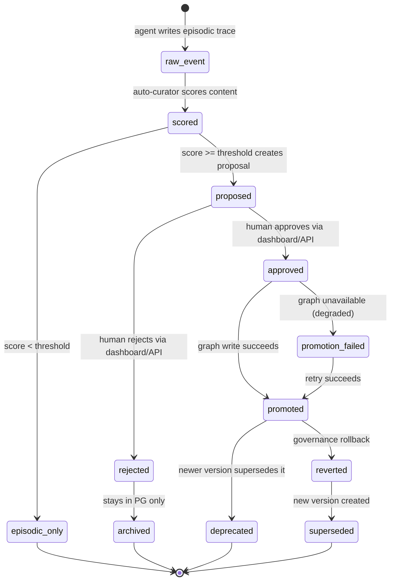
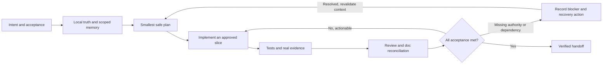
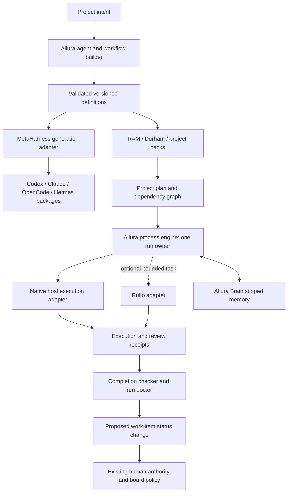

# Design Specification: Allura Memory Command Center

> [!NOTE]
> **AI-Assisted Documentation**
> Portions of this document were drafted with the assistance of an AI language model.
> Content has not yet been fully reviewed — this is a working design reference, not a final specification.
> When in doubt, defer to the source code, schemas, and team consensus.

> **Visual identity** (colors, typography, shadows, spacing, iconography) lives in [BLUEPRINT.md](./BLUEPRINT.md#0-brand-identity). The Memory Command Center must use real Allura brand assets and tokens only; generated logos and unrelated project tokens are forbidden.

---

## Table of Contents

- [Simple Enterprise Pilot UX contract](#simple-enterprise-pilot-ux-contract)
- [Team RAM Framework v0.1](#team-ram-framework-v01)
- [Overview](#overview)
- [Functional Requirements](#functional-requirements)
- [API Reference](#api-reference)
- [State Machine](#state-machine)
- [Business Rules](#business-rules)
- [Use Cases](#use-cases)
- [Important Constraints](#important-constraints)

---

## Simple Enterprise Pilot UX contract

**2026-10-13 — delivery scope accepted; navigation and copy proposed for a concrete walkthrough.** This contract translates the owner's request for a simple, deployable company second brain and supplied Reddit feedback. The discussion is qualitative input, not representative market research. It does not replace the approved brand identity, AD-64 graph contract, server authorization, or promotion policy. Aggregate acceptance is [SEP-01–10](./REQUIREMENTS-MATRIX.md#simple-enterprise-pilot-acceptance); delivery boundaries are [AD-69](./RISKS-AND-DECISIONS.md#ad-69-simple-enterprise-pilot-delivery-boundary).

Proposed promise to test: **Your team's knowledge and agent work, in one trusted workspace.** The first useful journey is connect an authorized source/agent, perform supported work, return to find relevant knowledge, inspect its evidence, and handle only decisions requiring a person. Ordinary eligible trace capture and authorized recall should not require database or curator expertise. This does not authorize automatic canonical-memory promotion.

| Proposed destination | Everyday task | Required behavior |
| --- | --- | --- |
| My Work | Understand what needs attention and resume work | Real authorized activity, clear next action, visible freshness; no synthetic/local-only data in production |
| Knowledge | Find knowledge and explore its connections | Prominent list/brain-map switch; actual nodes and relationships; selecting a node opens a shared evidence/provenance inspector |
| Agents & Runs | Understand who is working and what happened | Separate human/agent identities, observed capability and run state; never offer unsupported control |
| Inbox | Decide only what needs human judgment | Reason, evidence, authority and consequence visible before an action; existing approval gates preserved |
| Studio / Administration | Configure advanced work or administer access | Secondary but discoverable destinations; role-aware presentation never substitutes for server checks |

The knowledge map is core, not a decorative replacement for evidence. Retain AD-64's bounded authorized response, same-data text alternative, keyboard operation and distinct empty/denied/partial/degraded states. Keep policy, roles, source management and audit discoverable without exposing Team RAM terminology as required daily workflow.

Before UI implementation, review an inspectable prototype using actual Allura assets/tokens and walk through onboarding, capture/recall, search, node inspection, run status and an approval. Record the owner's observations against the prototype revision. Later working-product sessions are a separate gate: initially observe five comparable everyday participants, assess materially different administrator tasks separately, fix serious issues and retest. Proposed success is four of five completing the everyday tasks without assistance; permission mistakes and serious accessibility failures block acceptance regardless of that count. Record help, time, and manual memory-maintenance interventions separately from legitimate approval decisions. Do not fabricate participants or substitute unit tests for observed usability.

Research basis: [progressive disclosure](https://www.nngroup.com/articles/progressive-disclosure/) and [small iterative usability studies](https://www.nngroup.com/articles/why-you-only-need-to-test-with-5-users/). Five users is an initial formative sample, not a statistical guarantee. Exact visuals, routes and provider choices remain proposed until the corresponding contract is settled; existing approved work need not be reapproved at every development step.

### Preserved design decisions and limits

The pilot assembles existing experiences; it does not replace every page with the knowledge map. The following historical records support the current contract but are not additional live documentation authorities:

| Experience | Preserved reference | What carries forward |
| --- | --- | --- |
| My Work | [September 21 approval packet](../../memory-bank/bmad-output/planning-artifacts/epic-30-design-approval-packet.md#recorded-design-decision--2026-09-21), commit `4370cac3f77d1ed9a10c069aaebaab470f9e69c7` | Compact rail, document tree, reading/comparison workspace, context pane and collapsed Ask rail. Approval is bound to that revision and synthetic-only scope; it does not approve production data access. Current component bytes differ and require comparison, not an assertion of exact fidelity. |
| Knowledge map | [October 13 owner clarification](../../memory-bank/bmad-output/planning-artifacts/sprint-change-proposal-2026-10-12-dashboard-graph.md#15-owner-directed-visual-clarification--2026-10-13) following the October 12 bounded approval | Compact connected brain nodes on the protected Allura canvas. Selecting a node reveals its full governed record in the inspector. This supersedes full-card graph nodes, not the shell, authorized response, same-data text alternative or release gates. |
| Human decisions | [Preserved operator surface contract](../archive/allura/legacy-docs/design/command-center/operator-surface-contract.md) | Scope and role → queue → summary → evidence → permitted decision → receipt. Reusing that sequence does not establish approval of a new Inbox layout. |

My Work's `PROXIMITY ONLY` context pane must not be described as verified relationships. Knowledge Map relationships come from its authorized graph response. No single approved revision yet covers the combined pilot navigation, Agents & Runs, Studio and Administration. A walkthrough should focus on those changes and any deviations from the preserved baselines, without requesting approval again for unchanged decisions.

### Proposed screen and journey contract

This is a planning contract for the next concrete preview, not a claim of implemented routes or new authorization semantics. Every action below remains constrained by its existing server contract; missing capabilities are shown as unavailable rather than simulated as successful.

| Journey / acceptance | Initial view and next action | Evidence and completion condition |
| --- | --- | --- |
| First useful session — SEP-01, SEP-03 | Show the authorized workspace and one next step: resume accessible work, or connect a supported source/agent if the actor can configure it. Explain missing access without asking the user to understand storage internals. | A real supported connection and authorized record can be followed across sessions. Installation instructions and synthetic fixtures do not satisfy this journey. |
| Daily work — SEP-03, SEP-09 | Retain the document-centered My Work experience: compact navigation, authorized document tree, primary reading pane, optional comparison and context inspector. Keep advanced configuration out of the primary reading flow. | Resume a permitted document; inspect its source, freshness and access information; return from inspection/comparison without losing the reading context. Ask remains unavailable until provider and authorization gates pass. |
| Find and inspect — SEP-03, SEP-04 | Search from a prominent entry. Knowledge offers list and map presentations; selection opens evidence without replacing the search context. Filters and selected-result behavior need explicit preview coverage. | Search results and inspector are independently authorized. Show source/provenance, lifecycle and freshness only when supplied by the contract; distinguish missing evidence from verified absence. No inaccessible record names, counts or excerpts may leak through navigation or inspection. |
| Explore connections — SEP-04, SEP-09 | Open the actual compact-node graph, select a node, inspect its full record, and return to the graph. Provide a text presentation of the same returned nodes and edges. | Retain AD-64 limits and continuation handling. An incomplete graph is labelled partial, not shown as a complete company knowledge inventory. A proximity layout alone is not a relationship assertion. |
| Understand agent work — SEP-05 | Agents & Runs separates configured identity/capabilities from observed activity and a specific run's state. Show observation time and an evidence link. | An actual adapter must prove any offered inspect, cancel, resume or retry capability. Recent memory activity is not a heartbeat or proof that an agent is running. Hermes support remains unverified until the real integration journey passes. |
| Handle a decision — SEP-06, SEP-09 | Inbox shows only actionable, authorized decisions with reason, evidence, consequence and allowed actions. Details precede commitment. | Preserve existing human approval requirements. Show the authoritative result/receipt, denial or uncertainty; do not fabricate success or automatically retry a consequential mutation. The unresolved connected-Brain promotion discrepancy prevents a governed-memory acceptance claim. |
| Configure and administer — SEP-02, SEP-06 | Keep Studio and Administration secondary but discoverable. Explain which connections, roles, policies and audit views are actually available to the actor. | Server authorization remains decisive. Corporate SSO, document ACL management, arbitrary pipelines and agent controls are not enabled merely because a navigation label exists. Provider-specific setup is a separate verified contract. |

**Responsive and accessible preview coverage:** demonstrate the primary reading, search and inspector journeys at desktop and narrow widths; keyboard navigation, visible focus, named controls, close-and-return focus, loading announcements, 200% zoom and a text equivalent for graph exploration. At narrow widths, show one primary task at a time with an explicit return action; the prototype must settle the exact pane/disclosure behavior. Automated scans support, but do not replace, keyboard and screen-reader journeys.

**Truth-state coverage:** preserve loading, authorized-empty, denied, stale, partial/degraded, conflict, unavailable and error distinctions where the endpoint exposes them. A failed query is not an empty workspace. Do not map an uncertain mutation to success or invent rollback/retry behavior. Reuse approved state contracts; any new failure or concurrency rule requires a recorded decision under the AI Guidelines.

### Current implementation boundary — inspected 2026-10-13

These observations are source inspection, not live-user acceptance. They identify reusable implementation and the integration work still required.

| Surface | Existing source | Boundary before pilot acceptance |
| --- | --- | --- |
| My Work / Overview | [`dashboard/page.tsx`](../../src/app/dashboard/page.tsx), [`my-work-workspace.tsx`](../../src/components/dashboard/my-work-workspace.tsx) | Rich workspace requires explicit non-production synthetic mode; the ordinary branch is an overview. Do not remove the synthetic guard to claim production support. Compare current component to the hash-bound approved baseline. |
| Document search | [`brain/search/route.ts`](../../src/app/api/brain/search/route.ts), [`dashboard/search/page.tsx`](../../src/app/dashboard/search/page.tsx) | Protected document search is unavailable in production; the existing Search page lists recent memories rather than implementing that query journey. This does not imply the separate MCP memory-search tool is unavailable. |
| Graph and inspector | [`knowledge-map-workspace.tsx`](../../src/components/dashboard/knowledge-map/knowledge-map-workspace.tsx), [`memory/graph/route.ts`](../../src/app/api/memory/graph/route.ts) | Reuse bounded graph, filter, continuation and inspector work under AD-64. Verify compact-node fidelity, authorization, states and browser/a11y journeys; existence of code is not the proof. |
| Activity / runs | [`api/agents/route.ts`](../../src/app/api/agents/route.ts), [`api/runs/route.ts`](../../src/app/api/runs/route.ts) | Existing activity inference and gated run APIs need a scope/capability review before use in the new experience. No observed provider capability or Hermes acceptance follows from these routes. |
| Decisions / administration | [`dashboard/curator/page.tsx`](../../src/app/dashboard/curator/page.tsx), [`api/members/route.ts`](../../src/app/api/members/route.ts), [`api/tokens/route.ts`](../../src/app/api/tokens/route.ts) | Reuse verified contracts, not placeholder controls. Membership/token endpoints alone do not establish corporate identity, document ACL, offboarding or full administration acceptance. |

The prototype review must bind a revision, screenshots or inspectable artifact, actual assets/tokens, observed deviations, and owner feedback. The implementation review must separately bind real authorized journeys, security tests, recovery and accessibility evidence. Neither a prose contract nor the historical synthetic approvals completes SEP-01–10.

Token administration correction: `POST /api/tokens/[id]/revoke` retains its admin role gate and idempotent `{ ok: true, id }` response. Its database update now binds both the token ID and the authenticated tenant, never a query/body tenant selector. Missing, foreign-tenant and already-revoked IDs remain indistinguishable no-ops. This preserves existing tenant-admin management across selected workspaces; it does not introduce a current-workspace-only policy, new role, audit delivery guarantee or complete offboarding contract. Repository/route regressions use mocked database calls and do not alone prove a live deployment's permissions.

Process-run tenant correction: list/create, detail, events, breakpoints, doctor, cancel and resume retain their existing feature flag, role floors, required fields and same-tenant behavior. After format validation, the request's `group_id` is only an equality assertion against the authenticated identity via `resolveApiTenant`; a mismatch returns 403 before pool acquisition, definition lookup, run/event access or mutation. Required/malformed selectors remain 400 and absent authentication remains 401 when enabled; disabled routes remain 404. This repair does not authenticate the separately supplied `actor_id`/`approved_by`, establish workspace/document permissions, make event/snapshot writes atomic, execute an external agent or certify resume/cancel/retry semantics. Those limits block treating these local records as enterprise-safe Hermes controls.

**Concrete preview status, 2026-10-13:** a local, read-only `command-center-preview` candidate now demonstrates the proposed six-destination navigation and all seven journeys with explicitly synthetic records. It retains a dark My Work reader, proximity-only context, co-visible desktop comparison, an access inspector and unavailable Ask; the separate warm Knowledge canvas has compact directed nodes, filters, keyboard pan/zoom, a same-record list and an evidence inspector. Narrow screens provide a document chooser and single-task comparison/inspection with return focus. Inbox evidence review preserves the unsaved in-memory rationale and returns to the decision; it cannot approve or issue a receipt. Connection, policy and agent controls remain informational or disabled. The combined rail and graph shell/filter/inspector dimensions are proposed deviations from the separate approved baselines, not inherited approval. The preview manifest, screenshots and browser receipt are local review evidence, not shipped application code. It makes no database, identity, model or agent connection and must not replace production guards. Owner feedback, actual 200% browser zoom, screen-reader/human journeys and real-data implementation acceptance remain pending.

## Overview

The Allura Memory Command Center provides the human-facing control plane for the Allura Memory Engine. It is not the memory system itself; it is the governed window into memory, RuVix policy, curator decisions, provenance, audit evidence, and tenant settings.

AD-35 adds a proposed run-inspection responsibility for future operator surfaces: show evidence-gated `RunRecord` receipts without making the dashboard or Brain the orchestrator. Runs are reviewable audit objects that connect Notion/board work to Team RAM skill execution, approval breakpoints, quality gates, and memory writeback candidates.

**Core surfaces:**

| Surface | Role | Purpose |
|---------|------|---------|
| **Overview** (`/dashboard`) | Operator / Admin | Observe system health, queue status, freshness, degraded state, and active tenant scope |
| **Memories** (`/dashboard/memories`) | Operator / Curator | Search, filter, inspect, export, and trace memory records |
| **Curator** (`/dashboard/curator`) | Curator / Reviewer | Review, approve, or reject proposed insights before they become active knowledge |
| **Governance** (`/dashboard/governance`) | Admin / RuVix owner | Manage policy mode, thresholds, role separation, tenant isolation checks, and drift warnings |
| **Graph** (`/dashboard/graph`) | Operator / Admin | Explore promoted semantic memory with source receipts |
| **Audit** (`/dashboard/audit`) | Admin / Compliance | Filter event logs, inspect receipts, and export evidence packets |
| **Settings** (`/dashboard/settings`) | Admin | View tenant config, roles, endpoint health, and promotion settings |
| **Runs** (future `/dashboard/runs` or Audit extension) | PM / Reviewer / Compliance | Inspect RunRecord state, approval breakpoints, quality gates, run journals, doctor findings, and evidence packets |

The Command Center is optional: MCP tools, API routes, and CLI scripts remain the primary engine path. The UI surfaces real data from Allura Brain (PostgreSQL (episodic + semantic)), not mocks. Every component consumes mapped UI contracts from `src/lib/dashboard/`; raw Brain API shapes stay behind `api.ts`, `queries.ts`, and `mappers.ts` (AD-26).

### Memory Lifecycle and Done Gate

Agents and Team RAM lanes must read before work, write receipts after substantive action, and keep dashboard/operator views behind MCP/API contracts. The required flow is:

1. **Brain pre-search** — retrieve relevant approved context and recent traces for the active `group_id`.
2. **Governed action** — perform only the approved documentation, API, or workflow mutation.
3. **RuVix disposition** — classify the result as `Permit`, `Defer`, or `Deny` with `gate_reason`.
4. **Receipt write-back** — record `receipt_id`, actor, source evidence, validation, and audit event.
5. **Done gate** — completion is evidence-backed only; Brain receipts support audit but do not prove Done by themselves.

Current runtime evidence must be displayed as **pgvector bridge** until readiness checks prove full RuVector (`vector` extension 0.8.2 is present; `ruvector_function_count` was 0 in TALON evidence; memory count was around 3392). Operator surfaces may show readiness fields, but may not upgrade the label without approval.

### Dashboard v2 condensed UX contract

Phase 1 is a vertical flow with five operating areas:

| Panel | Purpose | Required state |
| --- | --- | --- |
| System status | Store availability, queue status, tenant scope, freshness | healthy, degraded, unknown, failed, empty, loading |
| Memories | Search, inspect, filter, and open provenance | episodic, semantic, pending, rejected, deleted, degraded |
| Approvals queue | Human decision surface for proposals | proposal ID, score, reasoning, evidence, state, allowed actions |
| RuVix governance | Policy mode, thresholds, role separation, tenant isolation, locks, drift warnings | enforced, blocked, degraded, unknown |
| Audit/evidence | Receipts, source lineage, export packets | append-only, filterable, exportable, degraded |

Required action surface:

```ts
interface DashboardGovernanceActions {
  refresh(): Promise<void>
  approveProposal(id: string): Promise<void>
  requestChanges(id: string, reason?: string): Promise<void>
  requestEvidence(id: string, reason?: string): Promise<void>
  denyProposal(id: string, reason?: string): Promise<void>
  softDeleteMemory(id: string, reason: string): Promise<void>
  recoverMemory(id: string, reason: string): Promise<void>
  openEvidence(id: string): void
  openDetail(id: string): void
  openGovernanceReceipt(id: string): void
}
```

`requestChanges` is a UX label in Phase 1. It maps to `POST /api/curator/reject` with a rationale prefix of `Needs evidence: `. Phase 2 may add a real `changes_requested` state.

Truthfulness rules: no fabricated live data, no “healthy” without verification, no “done” without evidence, no “live” without active polling/streaming and visible freshness, unknown is a first-class state, and Brain receipts are audit traces rather than proof of completion.

Run truthfulness rules: no “hallucination-free” claims, no yolo/forever autonomous modes, no foreign process library as canon, and no Done state unless declared quality gates and evidence requirements pass. Interrupted work must show resumable or stale state rather than restarting from vibes.

Governance receipt rule: every mutation and approval must show intent, actor, source, policy, validation, audit trail, `gate_decision` (`Permit | Defer | Deny`), and `approval_required` before completion. For mutations in the approval-required set (REQ-GOV-008), the control plane's `executeSyscall` enforces a well-formed `approval_ref` (a UUID, the canonical governed approval identity shape) after proof verification and policy evaluation and before the syscall executor runs. When the gate fires, the syscall's audit context is updated with `approval_required: true`, the gate decision (`approved`/`denied`), and the resolved `approval_ref`. Resolution against the canonical approval store (`canonical_proposals`) is the approval-lifecycle layer's responsibility: curator/HITL issues the governed identity, and the control plane enforces presence plus UUID format here.

### Accepted Bumblebee plugin planning contract

The intended Bumblebee is the pinned upstream `perplexityai/bumblebee` read-only
endpoint scanner. Allura integrates it through a headless plugin runner and receiver.
The historical names “Bumblebee Guard” and “Bumblebee Threat Watch” refer to local
Allura inventory/advisory adjuncts; they are not the upstream scanner or separate
authority planes.

Each advisory must record source identity and URL, publisher, publication time,
fetch time, trust state, freshness state, content revision/hash, classification or
redaction policy, and retention disposition. A source is eligible only when it is
on the reviewed allowlist and passes its defined verification rule. Failed,
unverified, stale, malformed, or scope-conflicting input becomes a distinct
`rejected`, `degraded`, or `stale` evidence state; it must not appear as a verified
finding. `trust_state` and `freshness_state` remain separate contract dimensions.

The plugin may run the upstream scanner to read approved endpoint metadata. Its runner
must obtain a server-issued source/population lease and dedicated ingestion-only
credential. Accepted scanner evidence may feed a deduplicated alert and a **simulated**
mitigation proposal. Neither scanner nor plugin may execute packages, activate policy,
block CI or packages, change schedules, revoke credentials, lock a workspace, or
contain a host. Those are separate human-authorized workflows with their own receipts.

| Action | V1 authority | Required owner |
|---|---|---|
| Add/change advisory source or verification rule | Human-approved configuration only | Security owner + governance owner |
| Review alert and evidence | Read/review | Security reviewer |
| Approve a mitigation draft for a later enforcement flow | Human approval only | Authorized approver |
| Create alert/simulated proposal from verified evidence | Automatic, deduplicated | Allura worker under AD-57 |
| Enforcement, schedule change, or endpoint action | Prohibited | Separate approved workflow |

Brand/accessibility rules: use existing Allura shell, navigation, logo assets, and semantic tokens; do not import Difference Driven tokens, colors, language, or assumptions; avoid marketing hero sections, fake charts, vanity metrics, AI-gradient tropes, inflated claims, or generated logo marks; approval actions must be keyboard reachable and confirmation dialogs must trap/restore focus.

## Memory Command Center Addendum

The Memory Command Center is an integration program over the MCP/API-first engine, not a second product or a bypass around governance.

| Surface | Role | Status |
|---------|------|--------|
| `localhost:6420` | Historical visual/reference memory dashboard experience | Reference/cutover history |
| `localhost:3334` | Historical development integration target | Reference/cutover history |
| `localhost:3100` | Historical Docker dashboard target | Protected until new launch gates pass |

The Memory Command Center is the approved operator surface for Allura memory governance. It preserves the useful memory capabilities from earlier references while narrowing the first launch around memories, curator work, RuVix governance, graph exploration, audit evidence, and settings.

### Command Center Route Parity

| Reference capability | Command Center target | Source of truth |
|----------------------|------------------------|-----------------|
| Dashboard | `/dashboard` | Aggregated adapter summaries |
| Memories | `/dashboard/memories` | Allura Brain APIs |
| Insights | `/dashboard/memories` or `/dashboard/graph` | Allura Brain / PostgreSQL semantic layer through controlled API |
| Trace logs | `/dashboard/audit` | PostgreSQL append-only events through controlled API |
| Provenance | `/dashboard/audit` and evidence drawer | Trace → proposal → approval → graph evidence chain |
| Extracted | `/dashboard/memories` | Allura extraction/memory APIs |
| Approvals | `/dashboard/curator` | Curator proposals + Native Allura Kanban work state; Notion/Linear/GitHub Projects optional adapters |
| Governance | `/dashboard/governance` | RuVix control plane rules, policy mode, thresholds, isolation, drift |
| Settings | `/dashboard/settings` | Resource manifest + dashboard configuration |
| Search | Memory search surface | Allura retrieval layer |
| Add memory | Governed Allura action | Controlled memory write endpoint |
| Approval Queue | `/dashboard/curator` promotion/approval panel | `canonical_proposals` + audit events |

### Cutover Rule

The rebuilt dashboard may not replace `3100` until route parity, visual parity, adapter/source-of-truth declarations, auth validation, smoke tests, no-fabricated-data checks, and rollback documentation all pass.

**What this document is:**
- Functional requirements for what the dashboard, curator, and settings surfaces must do
- API reference for all dashboard and curator endpoints
- State machines for the curator proposal lifecycle
- Business rules derived from architectural decisions

**What this document is not:**
- A UI style guide (see [BLUEPRINT.md](./BLUEPRINT.md#0-brand-identity))
- Component-level wireframes (see [Command Center route parity](#command-center-route-parity) and [Dashboard Requirements](#dashboard-requirements))
- An implementation roadmap (see [`SOLUTION-ARCHITECTURE.md`](./SOLUTION-ARCHITECTURE.md))

### UX Philosophy

**Sarah's Law:** If an 18-year-old intern has questions after two minutes, it's not done. iPhone clean means one thing on screen. You do it. You learn. No reading required.

**13-16-18 Validation Framework:** 13-year-olds spot emerging trends, 16-year-olds identify popularity gaps, 18-year-olds confirm mainstream readiness. Applied to all consumer-facing surfaces. Target score: 0.85+.

**Consumer mental model:** "Your AI remembers" — the machine is always invisible.

---

## Functional Requirements

### Dashboard Requirements

| # | Requirement | Satisfied by |
|---|-------------|-------------|
| F17 | Curator Dashboard — view pending proposals, approve/reject with rationale | `/dashboard/curator` · `GET /api/curator/proposals` · `POST /api/curator/approve` · `POST /api/curator/reject` |
| F18 | Audit Log — view all memory events with filtering and CSV export | `/dashboard/audit` · `GET /api/audit/events` |
| F19 | System Health Dashboard — view service status, metrics, and degradation warnings | `/dashboard` (overview) · `GET /api/health?detailed=true` · `GET /api/health/metrics` |
| F41 | Memory Command Center route shell — `/dashboard`, `/dashboard/memories`, `/dashboard/curator`, `/dashboard/governance`, `/dashboard/graph`, `/dashboard/audit`, `/dashboard/settings` | Governed operator surface over MCP/API contracts; launch only after gates pass |
| F42 | `/dashboard/memories` preserves useful reference memory capabilities | Memories, insights, traces, provenance, extracted facts, and approvals mapped into governed dashboard routes |
| F43 | `/work-board` uses Native Allura Kanban as the default planning source of truth | Native board model; Notion, Linear, and GitHub Projects are optional sync adapters |
| F44 | `/resources` reads resource inventory from manifest endpoint or `RESOURCE-MANIFEST.md` | Resource Manifest adapter |
| F45 | `/agents` distinguishes TALON/IRIS from Team RAM/Durham/external agents | Agent adapter + canonical agent taxonomy |
| F46 | `/telemetry` reports real/unknown metrics honestly | Telemetry adapter with degraded/unknown state |
| F47 | Every route displays source-of-truth and degraded behavior | Adapter registry UI contract |
| F48 | `3100` cutover has parity, smoke, auth, and rollback gates | Cutover validation checklist |
| F49 | Governed RunRecord captures tenant, owner, reviewer, goal, status, pinned definition revision, journal path, and timestamps | Partial implementation · AD-35 · `RunRecord` in `DATA-DICTIONARY.md` |
| F50 | Run policy declares allowed actions, approval breakpoints, measured quality gates, bounded attempts, and required evidence | Partial implementation · Epic 14 |
| F51 | Run journal records plan, steps, checks, approvals, failures, continuation state, and final evidence | Partial implementation · Story 12.2 correction |
| F52 | Doctor checks report stale, failed, incomplete, definition-drifted, unrecoverable, or approval-blocked runs before Done | Planned · Epic 14.3 · `/dashboard/runs` |
| F53 | PostgreSQL-backed projects and work items link operational work to runs, handoffs, evidence, and memory receipts | Planned · Epic 15 |
| F54 | Operator workspace uses mission-first navigation, Command Center, central work surface, and right evidence inspector | Planned · Epic 16 |
| F55 | One governed desktop shell provides secure connections, runtime supervision, deep links, updates, and reconnect behavior | Planned · Epic 17 |

### Curator Requirements

| # | Requirement | Satisfied by |
|---|-------------|-------------|
| F10 | `POST /api/curator/score` — score proposal, return confidence + reasoning + tier | `src/lib/curator/score.ts` |
| F11 | `POST /api/curator/approve` — approve proposal, promote to `graph_memories` | `src/app/api/curator/approve/route.ts` |
| F12 | `POST /api/curator/reject` — reject proposal, archive with rationale | `src/app/api/curator/reject/route.ts` |
| F13 | `GET /api/curator/proposals` — list pending proposals (emerging + adoption tiers) | `src/app/api/curator/proposals/route.ts` |
| F14 | Curator dashboard shows three tabs: Traces, Approved, Pending | `/dashboard/curator` |
| F15 | Pending tab sorts by confidence (descending); shows confidence badge + reasoning + action buttons | `ConfidenceBadge` component |
| F16 | Approved tab shows all approved knowledge (human + auto); sortable by date/confidence | `/dashboard/curator` approved tab |
| F17 | Tab 1 (Traces) restricted to authenticated users with `admin` role | Clerk RBAC |

### Audit & Health Requirements

| # | Requirement | Satisfied by |
|---|-------------|-------------|
| F18 | Audit log endpoint returns all events with filtering and pagination; CSV export for compliance | `GET /api/audit/events` |
| F19 | Dashboard integrates Clerk for authentication and RBAC (curator, admin, viewer roles) | `src/lib/auth/clerk.ts` |
| F26 | Agent task lifecycle events persisted as append-only traces | `src/lib/postgres/queries/insert-trace.ts` |
| F27 | Raw trace storage is append-only; no UPDATE/DELETE on events table | Schema enforcement |
| F28 | Traces preserve provenance linking downstream insights to source evidence | `trace_ref` field |
| F32 | Every approval, rejection, or policy decision recorded as audit event with actor and timestamp | `proposal_approved` / `proposal_rejected` event types |

### Governance Requirements

| # | Requirement | Satisfied by |
|---|-------------|-------------|
| F6 | `PROMOTION_MODE=soc2` — score ≥ threshold queues for human approval | Environment variable |
| F7 | `PROMOTION_MODE=auto` — score ≥ threshold promotes immediately | Environment variable |
| F34 | Changed insights create new nodes linked with `SUPERSEDES`/`DEPRECATED`/`REVERTED` | `createInsightVersion()` · `deprecateInsight()` |
| F37 | All knowledge-system reads/writes pass through controlled endpoints | RBAC middleware |
| F38 | Agent permissions enforced and all access audited | Auth middleware + event logging |

---

## API Reference

### Health & Metrics

#### `GET /api/health?detailed=true`

System health check with optional component-level detail.

**Query parameters:**

| Parameter | Type | Default | Description |
|-----------|------|---------|-------------|
| `detailed` | boolean | `false` | Include per-component health status |
| `include` | string | — | Comma-separated component names to include |
| `exclude` | string | — | Comma-separated component names to exclude |

**Response** (`200 OK`):

```json
{
  "status": "healthy | degraded | unhealthy",
  "timestamp": "2026-04-28T12:00:00Z",
  "uptime": 86400,
  "version": "0.1.0",
  "mode": "http",
  "interface": "rest",
  "dependencies": {
    "postgres": { "status": "up", "required": true, "latency_ms": 3 },
    "graph_memories": { "status": "up", "required": false, "latency_ms": 12 }
  },
  "degraded": {
    "enabled": false,
    "reason": null,
    "capabilities_lost": []
  },
  "components": [
    { "name": "postgresql", "status": "healthy", "message": "Database connection verified", "latency": 3 },
    { "name": "graph_memories", "status": "healthy", "message": "Graph database connection verified", "latency": 12 }
  ]
}
```

**Degraded mode:** When graph_memories is unavailable, `status` returns `"degraded"` and `capabilities_lost` lists lost semantic capabilities. HTTP status remains `200` for degraded state; `503` for unhealthy (PostgreSQL down).

---

#### `GET /api/health/metrics`

Operational metrics for the dashboard overview.

**Response** (`200 OK`):

```json
{
  "timestamp": "2026-04-28T12:00:00Z",
  "queue": {
    "pending_count": 3,
    "oldest_age_hours": 48,
    "approved_24h": 12,
    "rejected_24h": 2
  },
  "recall": {
    "search_available": true,
    "last_latency_ms": 45
  },
  "storage": {
    "postgres": { "status": "up", "latency_ms": 3, "total_memories": 247 },
    "graph_memories": { "status": "up", "latency_ms": 12, "total_nodes": 189 }
  },
  "degraded": {
    "graph_memories_unavailable": 0,
    "scope_error": 0,
    "embedding_failures": 0,
    "promotion_failures_24h": 0
  }
}
```

---

### Memory Operations (Dashboard)

#### `GET /api/memory`

List memories scoped by tenant. Supports user filtering and pagination.
The web route treats `group_id` as an equality assertion against the authenticated tenant, not a source of authority. It supplies the server-derived workspace, actor and session scope to the canonical list, search and deleted-list tools. A cross-tenant selector is denied before a tool call.

All routes under `/api/memory/**` are prohibited from importing or calling the
legacy owner pool directly. An exact Epic 30 regression test recursively scans
the route tree; protected database access must use a restricted workspace
transaction or a canonical tool carrying server-derived scope.

**Query parameters:**

| Parameter | Type | Required | Description |
|-----------|------|----------|-------------|
| `group_id` | string | Yes | Tenant identifier (must match `^allura-`) |
| `user_id` | string | No | Filter to specific user |
| `limit` | integer | No | Max results (default 50) |
| `offset` | integer | No | Pagination offset |

---

#### `POST /api/memory`

Add an episodic memory through the canonical tool. The web handler requires curator-or-higher authority. `group_id` must equal the authenticated tenant; the server supplies workspace, actor and session scope. Caller metadata cannot replace the verified actor, and a caller-provided scope object is ignored. This boundary does not approve the separate Epic 30 Digital Brain workspace policy.

---

#### `GET /api/memory/[id]`

Fetch a single memory by ID with tenant scope.
The route requires viewer authority and derives tenant, workspace, actor and session scope from the authenticated principal. The query `group_id` is an equality assertion only; cross-tenant selectors are denied before `memory_get` executes.

**Query parameters:**

`PUT` requires curator authority and creates an append-only superseding version. `DELETE` requires administrator authority and performs the governed soft-delete path. Both mutation routes use the verified principal as actor, ignore caller-selected `user_id` authority, prevent metadata actor replacement, and pass server-derived workspace/session scope to the canonical tool.

| Parameter | Type | Required | Description |
|-----------|------|----------|-------------|
| `group_id` | string | Yes | Tenant scope |

---

#### `GET /api/memory/count`

Returns a protected aggregate for the authenticated tenant and workspace. Tenant/workspace query values are equality assertions only. The handler executes both episodic and semantic queries inside the restricted workspace transaction; aggregate counts never use the legacy owner pool.

Return total count of unique active memories (deduplicated across PostgreSQL (episodic + semantic)).

**Query parameters:**

| Parameter | Type | Required | Description |
|-----------|------|----------|-------------|
| `group_id` | string | Yes | Tenant scope |
| `user_id` | string | No | Filter to specific user |

---

#### `GET /api/memory/traces`

List raw trace events with filtering. The tenant and workspace are derived from
the authenticated principal; optional scope selectors are equality assertions
and forged selectors are rejected before querying. Reads run through the
restricted workspace transaction with an explicit workspace predicate.

`POST` requires curator authority and binds tenant, workspace and agent to the
verified principal. Workspace trace inserts use the restricted workspace
transaction and persist the explicit workspace discriminator. Caller-selected
agent or scope values cannot replace authenticated authority, and backend
failure responses contain no configuration details.

Trace reads are limited to `trace.*` events and bounded pagination. Trace
content round-trips from `outcome.content`, not unrelated memory metadata. Each
workspace trace persists a content-free authority receipt binding tenant,
workspace, hashed session, actor, payload hash, control-plane proof-signature
hash and audit ID. Raw session values and content previews are not stored in
the receipt.

**Query parameters:**

| Parameter | Type | Required | Description |
|-----------|------|----------|-------------|
| `group_id` | string | Yes | Tenant scope |
| `agent_id` | string | No | Filter by agent |
| `event_type` | string | No | Filter by event type |
| `limit` | integer | No | Max results |
| `offset` | integer | No | Pagination offset |

---

#### `GET /api/memory/insights`

List approved insights with pagination.

**Query parameters:**

| Parameter | Type | Required | Description |
|-----------|------|----------|-------------|
| `group_id` | string | Yes | Tenant scope |
| `status` | string | No | Filter by status (`active`, `deprecated`, `superseded`) |
| `limit` | integer | No | Max results (default 20) |
| `offset` | integer | No | Pagination offset |

---

#### `GET /api/memory/insights/[id]/history`

Version history for a specific insight (SUPERSEDES chain).

The handler derives tenant and workspace from the authenticated principal,
rejects conflicting selectors, and reads only `workspace_scoped` versions
through the restricted workspace transaction. It does not widen the result to
the legacy `global` group.

**Query parameters:**

| Parameter | Type | Required | Description |
|-----------|------|----------|-------------|
| `group_id` | string | No | Optional equality assertion against authenticated tenant |
| `workspace_id` | string | No | Optional equality assertion against authenticated workspace |

---

#### `GET /api/memory/graph`

Read-only tenant-and-workspace-scoped knowledge graph visualization.

The authenticated principal supplies tenant and workspace authority; optional
selectors are equality assertions only. Structural nodes, edges, counts, and
the degraded event fallback all run through restricted workspace transactions
with explicit workspace predicates. The endpoint uses the canonical
`from_id`/`to_id`/`rel_type` edge schema and does not disclose backend errors.
It performs no mutations.

**Query parameters:**

| Parameter | Type | Required | Description |
|-----------|------|----------|-------------|
| `group_id` | string | No | Optional equality assertion against authenticated tenant |
| `workspace_id` | string | No | Optional equality assertion against authenticated workspace |

**Response:** `MemoryGraphResponse` — `{ nodes: GraphNode[], edges: GraphEdge[], total_edges?: number }`

---

### Curator Operations

#### `GET /api/curator/proposals`

List proposed insights awaiting review.

**Query parameters:**

| Parameter | Type | Required | Description |
|-----------|------|----------|-------------|
| `group_id` | string | Yes | Tenant scope |
| `status` | string | No | Filter by status (default: `pending`) |
| `limit` | integer | No | Max results (default 20) |

---

#### `POST /api/curator/approve`

Approve a proposed insight. Promotes to `graph_memories` as immutable knowledge row.

**Request body:**

```json
{
  "proposal_id": "uuid",
  "group_id": "allura-system",
  "decision": "approve",
  "curator_id": "human_reviewer",
  "rationale": "Validated against runtime evidence."
}
```

**Response** (`200 OK`):

```json
{
  "success": true,
  "memory_id": "uuid",
  "decided_at": "2026-04-28T12:00:00Z",
  "notion_sync": "pending"
}
```

**Error responses:**

| Status | Condition |
|--------|-----------|
| `404` | Proposal not found |
| `409` | Proposal already decided or insight already promoted |
| `503` | Graph backend unavailable — proposal queued but not promoted |

---

#### `POST /api/curator/reject`

Reject a proposed insight. Archives with rationale.

**Request body:**

```json
{
  "proposal_id": "uuid",
  "group_id": "allura-system",
  "curator_id": "human_reviewer",
  "rationale": "Duplicate of existing knowledge."
}
```

---

### Audit

#### `GET /api/audit/events`

Full audit trail with pagination, filtering, and CSV export.

**Query parameters:**

| Parameter | Type | Required | Description |
|-----------|------|----------|-------------|
| `group_id` | string | Yes | Tenant scope (must match `^allura-`) |
| `format` | string | No | `json` (default) or `csv` |
| `from` | ISO 8601 | No | Start date filter |
| `to` | ISO 8601 | No | End date filter |
| `agent_id` | string | No | Filter by agent |
| `event_type` | string | No | Filter by event type |
| `limit` | integer | No | Max rows (default 1000, max 10000) |
| `offset` | integer | No | Pagination offset |

**Auth:** Requires `viewer` role or above.

**CSV response** includes `Content-Disposition: attachment; filename="audit-events-{group_id}-{date}.csv"` header.

---

### Budget Admin

#### `POST /api/admin/reset-budget`

Reset halted budget sessions for a tenant group or globally. Requires bearer auth.

**Request body:**

```json
{
  "group_id": "allura-system"
}
```

`group_id` is optional — if omitted, all halted sessions across all groups are reset.

**Response** (`200 OK`):

```json
{
  "cleared": 3,
  "before": 5,
  "after": 2
}
```

**Auth:** Requires valid bearer token (same as other admin endpoints).

---

### Governed Retrieval

#### `POST /api/memory/retrieval`

The controlled retrieval layer — the sole read path for agents (AD-19). Agents MUST NOT query PostgreSQL directly.

**Request body:**

```json
{
  "group_id": "allura-system",
  "agent_id": "agent_executor",
  "query": "What image tag should postgres use?",
  "mode": "hybrid",
  "scope": { "project": true, "global": true },
  "include_traces": false,
  "filters": { "status": "active", "min_confidence": 0.7 },
  "limit": 10
}
```

**Response** (`200 OK`):

```json
{
  "results": [
    {
      "insight_id": "uuid",
      "content": "Postgres image must remain pinned to pgvector:0.7.0-pg16...",
      "source": "graph_memories",
      "confidence": 0.95,
      "scope": "project",
      "version": 2,
      "provenance": {
        "proposal_id": "uuid",
        "approved_by": "human_reviewer",
        "approved_at": "2026-04-19T20:50:00Z"
      }
    }
  ],
  "total": 1,
  "metadata": {
    "retrieved_at": "2026-04-28T21:00:00Z",
    "project_count": 1,
    "global_count": 0
  }
}
```

**Retrieval modes:**

| Mode | Description | Sources |
|------|-------------|---------|
| `semantic` | Content-based search across approved insights | PostgreSQL (graph_memories) `searchInsights()` |
| `structured` | Filter-based query (status, confidence, date range) | PostgreSQL (graph_memories) `listInsights()` |
| `hybrid` | Dual-context: project + global insights merged by confidence | `getDualContextSemanticMemory()` |
| `traces` | Raw trace retrieval (policy-gated, not default) | PostgreSQL `queryTraces()` |

---

## State Machine

### Event Types

The following event types are recorded in the PostgreSQL `events` table (append-only):

| Event Type | Description | Source |
|------------|-------------|--------|
| `memory_add` | Agent writes episodic trace to PostgreSQL | Memory engine |
| `memory_search` | Agent searches memories (federated PostgreSQL (episodic + semantic)) | Memory engine |
| `memory_get` | Agent retrieves single memory | Memory engine |
| `memory_delete` | Soft-delete with 30-day recovery | Memory engine |
| `memory_restore` | Restore from soft-delete within recovery window | Memory engine |
| `memory_promote` | Request promotion to PostgreSQL (graph_memories) (creates proposal) | Curator |
| `proposal_created` | Curator creates canonical proposal | Curator scorer |
| `proposal_approved` | Human approves proposal | Curator approve route |
| `proposal_rejected` | Human rejects proposal | Curator reject route |
| `memory_promoted` | Memory written to PostgreSQL (graph_memories) (semantic layer) | Promotion worker |
| `memory_deprecated` | Old version marked deprecated via SUPERSEDES | Version workflow |
| `threat_advisory_received` | Allowlisted advisory or approved internal evidence accepted as provisional | Allura downstream threat intake |
| `threat_evidence_rejected` | Evidence denied for trust, freshness, schema, or scope failure | Allura downstream threat intake |
| `threat_alert_created` | Deduplicated alert created from verified exposure evidence | Allura downstream correlation |
| `mitigation_proposal_simulated` | Non-enforcing mitigation draft prepared for human review | Allura downstream correlation |

These event types are defined by the Story 26.1 downstream Allura contracts in
[DATA-DICTIONARY.md](./DATA-DICTIONARY.md#story-261-allura-threat-intelligence-contracts).
They do not define the upstream scanner transport or snapshot ledger.

### Curator Pipeline State Machine



**State descriptions:**

| State | Entry Trigger | Next States | Description |
|-------|--------------|-------------|-------------|
| `raw_event` | Agent calls `memory_add` | `scored` | Episodic trace in PostgreSQL |
| `scored` | Curator scorer evaluates content | `proposed`, `episodic_only` | Content has confidence score |
| `proposed` | Score ≥ threshold, proposal created in `canonical_proposals` | `approved`, `rejected` | Awaiting human review |
| `approved` | Human approves via curator dashboard | `promoted`, `promotion_failed` | Cleared for semantic write |
| `rejected` | Human rejects with rationale | `archived` | Denied, stays in PG only |
| `promoted` | `graph_memories` write succeeds | `deprecated`, `reverted` | Active semantic knowledge |
| `promotion_failed` | Graph backend unavailable | `promoted` (retry) | Degraded mode |
| `deprecated` | Newer version supersedes | — (terminal) | Historical record only |
| `archived` | Rejected proposal | — (terminal) | Kept for audit |
| `episodic_only` | Score below threshold | — (terminal) | PG trace, no promotion |
| `reverted` | Governance rollback | `superseded` | Replaced by earlier version |
| `superseded` | New version created | — (terminal) | Old version replaced |

---

## Business Rules

| Rule ID | Rule | Source | Enforcement |
|---------|------|--------|-------------|
| AD-04 | `PROMOTION_MODE` governs writes. `soc2` mode requires human approval before PostgreSQL (graph_memories) promotion. `auto` mode promotes immediately if score ≥ threshold. | RISKS-AND-DECISIONS | Environment variable + code path |
| AD-08 | Soft-delete only. No hard deletes. Deletion records are append-only events, not erasures. | RISKS-AND-DECISIONS | `memory_delete` appends event + sets `deprecated: true` on PostgreSQL (graph_memories) node |
| AD-09 | PostgreSQL (graph_memories) write failure is non-fatal. PostgreSQL write is truth. PostgreSQL (graph_memories) is a promotion — its failure degrades gracefully (206 + Warning header). | RISKS-AND-DECISIONS | `readJson()` in dashboard client detects 206 status |
| AD-19 | Agents MUST NOT query PostgreSQL directly. All reads go through `POST /api/memory/retrieval`. | RISKS-AND-DECISIONS | Code review gate + `direct-access-blocker.ts` |
| AD-20 | Curator marks events as `promoted` after proposal creation. Without this, the curator re-scores the same traces on every run. | RISKS-AND-DECISIONS | Curator query excludes `status = 'promoted'` |
| AD-22 | `VALIDATION-GATE.md` is archived in `docs/archive/allura/`, not canonical. Per the canonical surface rule. | RISKS-AND-DECISIONS | Cross-linked from BLUEPRINT, not in `docs/allura/` |
| — | `group_id` must match `^allura-` pattern. Enforced by PostgreSQL CHECK constraint. | BLUEPRINT §7 | Schema-level, not application-level |
| — | 30-day recovery window for soft-deleted memories. After 30 days, memories are permanently gone. | BLUEPRINT §11 | `memory_restore` validates recovery window |
| — | Append-only events table. No UPDATE or DELETE mutations on `events`. | BLUEPRINT §7 | No UPDATE/DELETE code paths in application |
| — | Proposals require human approval in `soc2` mode. In `auto` mode, proposals above threshold auto-promote. | BLUEPRINT §2 F6/F7 | `PROMOTION_MODE` environment variable |
| — | Audit trail is append-only and exportable as CSV. | BLUEPRINT §9 F18 | `GET /api/audit/events?format=csv` |
| — | `DashboardResult<T>` wraps all API responses with `{ data, error, degraded, warnings }`. | Dashboard architecture | `src/lib/dashboard/types.ts` |
| — | Dashboard scoped to `group_id` (tenant isolation). All API calls include `group_id`. | Tenant isolation | `withGroupId()` in dashboard client |
| — | Degraded mode returns HTTP 206 + `Warning` header when graph backend unavailable. | AD-09 | Dashboard client checks `response.status === 206` |

---

## Use Cases

### MEM-UC10: Curator reviews and approves/rejects pending proposals

**Actor:** Curator (authenticated with `admin` or `curator` role)

**Precondition:** At least one proposal exists in `pending` status.

**Steps:**
1. Curator navigates to `/dashboard/curator`
2. Dashboard calls `GET /api/curator/proposals?status=pending`
3. Proposals display with confidence badge, reasoning, and source evidence
4. Curator reviews summary, evidence links, and confidence score
5. Curator approves: `POST /api/curator/approve` with `decision: "approve"` and rationale
6. System promotes approved insight to PostgreSQL (graph_memories) as immutable node
7. Audit event `proposal_approved` written to PostgreSQL with curator ID and timestamp
8. Curator rejects: `POST /api/curator/reject` with rationale
9. System archives rejected proposal; audit event `proposal_rejected` written

**Postcondition:** Proposal transitions to `approved` (promoted to PostgreSQL (graph_memories)) or `rejected` (archived in PG) with full audit trail.

**Requirements:** F10–F13, F17

---

### MEM-UC11: Admin views audit log with filtering and CSV export

**Actor:** Admin (authenticated with `admin` role)

**Precondition:** At least one event exists in the `events` table.

**Steps:**
1. Admin navigates to `/dashboard/audit`
2. Dashboard calls `GET /api/audit/events` with optional filters (`event_type`, `agent_id`, `from`, `to`)
3. Events display in chronological order with pagination
4. Admin clicks "Export CSV"
5. Dashboard calls `GET /api/audit/events?format=csv` with current filters
6. Browser downloads `audit-events-{group_id}-{date}.csv`

**Postcondition:** Admin has a complete, filtered audit trail in JSON or CSV format.

**Requirements:** F18

---

### MEM-UC12: Operator monitors system health and degradation

**Actor:** Operator

**Precondition:** Allura services are running.

**Steps:**
1. Operator navigates to `/dashboard` (overview)
2. Dashboard calls `GET /api/health?detailed=true` and `GET /api/health/metrics`
3. Overview displays: system status, queue depth, recall latency, storage stats, degraded component count
4. If PostgreSQL (graph_memories) is down, status shows "degraded" with `Warning` header and lost capabilities listed
5. Operator sees metric cards: total memories, pending proposals, active agents, system uptime
6. Activity panel shows recent events

**Postcondition:** Operator has full visibility into system health, including degradation state.

**Requirements:** F19

---

### MEM-UC13: Agent performs governed memory retrieval

**Actor:** AI Agent

**Precondition:** Agent has valid `group_id` and `agent_id`.

**Steps:**
1. Agent calls `POST /api/memory/retrieval` with query, scope, and mode
2. Retrieval layer validates `group_id` and agent permissions
3. For `semantic` mode: `searchInsights()` from PostgreSQL (graph_memories)
4. For `structured` mode: `listInsights()` from PostgreSQL (graph_memories)
5. For `hybrid` mode: `getDualContextSemanticMemory()` merges project + global insights
6. For `traces` mode (policy-gated): `queryTraces()` from PostgreSQL
7. Results returned with provenance metadata (proposal ID, approver, approval timestamp)
8. Retrieval call logged as audit event

**Postcondition:** Agent receives scoped, policy-controlled memory context. No direct database access occurred.

**Requirements:** AD-19, F10, F26–F40

---

### MEM-UC14: User soft-deletes and restores a memory within 30-day window

**Actor:** Administrator acting for the authenticated workspace

**Precondition:** Memory exists and is not already soft-deleted.

**Steps:**
1. User swipes/hovers on a memory in `/memory` view
2. User taps [Forget] (soft-delete)
3. System calls `DELETE /api/memory/[id]`
4. System appends `memory_delete` event to PostgreSQL
5. System marks PostgreSQL (graph_memories) node as `deprecated: true` (if promoted)
6. Memory appears in "Recently Forgotten" view (`/memory?view=forgotten`)
7. Within 30 days, user taps [Restore]
8. System calls `POST /api/memory/[id]/restore`
9. System appends `memory_restore` event to PostgreSQL
10. System removes `deprecated` flag from PostgreSQL (graph_memories) node

The restore handler derives tenant, workspace, actor and session from the
authenticated administrator. Optional tenant/workspace/user selectors are
equality assertions only and are rejected before the canonical restore tool
when they conflict with verified authority.

**Postcondition:** Memory is either soft-deleted (recoverable within 30 days) or restored to active state.

**Requirements:** AD-08, F5

Bulk user-data deletion is an administrator-only workspace operation. The
handler discovers eligible memories and appends request/completion audit events
through restricted workspace transactions with explicit workspace
discriminators. Each canonical delete receives the verified tenant, workspace,
administrator and session scope; individual backend failures are not disclosed
to the caller.

---

### MEM-UC15: Dashboard displays knowledge graph visualization

**Actor:** Operator / Admin

**Precondition:** PostgreSQL (graph_memories) contains Memory, Agent, Team, and Project nodes.

**Steps:**
1. Operator navigates to `/dashboard/graph`
2. Dashboard calls `GET /api/memory/graph`; server-issued identity supplies tenant/workspace authority
3. API returns `MemoryGraphResponse` with nodes, edges, and `total_edges`
4. Dashboard renders interactive graph with `GraphSummary` component
5. Operator clicks a node to see detail in `NodeDetailPanel`
6. Graph shows `AUTHORED_BY`, `RELATES_TO`, `MEMBER_OF`, `CONTRIBUTES_TO` relationships

**Postcondition:** Operator has visual understanding of knowledge graph structure and relationships.

**Requirements:** F17 (dashboard scope), AD-24 (structural context layer)

---

## Important Constraints

1. **Dashboard scoped to `group_id`.** Every API call includes `group_id` as an assertion, not authority. The root memory web route derives tenant/workspace/actor/session from the authenticated principal and denies a mismatched tenant before calling canonical tools. No cross-tenant data access is permitted.

2. **Proposals require human approval in `soc2` mode.** `PROMOTION_MODE=soc2` blocks autonomous PostgreSQL (graph_memories) writes. Every promotion goes through the curator queue.

3. **Audit trail is append-only and exportable.** No UPDATE or DELETE on the `events` table. CSV export supports SOC2 compliance requirements.

4. **Degraded mode returns 206 + Warning header.** When graph_memories is unavailable, the system continues serving episodic data from PostgreSQL. API responses include `degraded: true` and a `Warning` header. `DashboardResult<T>` surfaces this to components.

5. **`DashboardResult<T>` wraps all responses.** Every dashboard API call returns `{ data: T | null, error: string | null, degraded: boolean, warnings: DashboardWarning[] }`. Components handle null data and degraded state explicitly.

6. **Curator marks events as promoted (AD-20).** Without this, the curator re-scores the same traces on every run, creating duplicate proposals.

7. **Agents MUST NOT query PG/PostgreSQL (graph_memories) directly (AD-19).** All retrieval goes through `POST /api/memory/retrieval`. Code review gate checks for direct database imports in agent-facing code.

8. **No direct graph writes outside approved promotion flow.** Services and agents cannot write directly to the semantic store. All writes go through the curator pipeline.

9. **Immutable insight rows.** `graph_memories` rows are never updated in place. Any change requires a new proposal → approval → new row with `SUPERSEDES` edge.

10. **30-day soft-delete recovery.** Memories can be restored within 30 days of soft-deletion. After that, they are permanently gone.

11. **Bumblebee V1 is proposal-only (AD-57).** Its only automatic outputs are verified, deduplicated alerts and simulated mitigation proposals. It is read-only toward endpoints and external enforcement systems.

---

## Dashboard Architecture

### Pages

| Path | Purpose |
|------|---------|
| `/dashboard` | Overview — system health, metrics, recent activity |
| `/dashboard/memories` | Memory browser with search and filtering |
| `/dashboard/curator` | Three-tab curator: Traces, Approved, Pending |
| `/dashboard/governance` | RuVix policy mode, thresholds, role separation, tenant isolation, locks, drift warnings |
| `/dashboard/audit` | Full audit trail with filtering and CSV export |
| `/dashboard/graph` | Knowledge graph visualization |
| `/dashboard/agents` | Agent roster and activity |
| `/dashboard/projects` | Project list and status |
| `/dashboard/skills` | MCP skill catalog and status |
| `/dashboard/settings` | Tenant configuration, promotion mode, user management |
| `/dashboard/evidence/[id]` | Evidence detail for a specific trace |

### Components

| Component | Purpose |
|-----------|---------|
| `MetricCard` | KPI display card (memory count, pending proposals, etc.) |
| `InsightCard` | Approved insight with confidence badge |
| `MemoryCard` | Memory entry with provenance and status |
| `EvidenceCard` | Raw trace evidence display |
| `ActivityPanel` | Chronological event feed |
| `GraphSummary` | Graph node/edge count summary |
| `NodeDetailPanel` | Click-through detail for a graph node |
| `SearchInput` | Dashboard search with group_id scoping |
| `StatusPill` | Health/degradation status indicator |
| `ConfidenceBadge` | Confidence score display (60–100%) |
| `WarningList` | Degradation warnings display |
| `PageHeader` | Page title and action buttons |
| `EmptyState` | Zero-data placeholder |
| `LoadingState` | Skeleton loading placeholder |
| `ErrorState` | Error display with retry |
| `BudgetCard` | Budget enforcement status (active sessions, halted sessions, TTL auto-expiry countdown) |
| `TokenPreview` | Token system visualizer (DDR-004 compliant, surfaces WCAG contrast warnings for failing pairings) |
| `Tabs` | Tab navigation (Curator: Traces / Approved / Pending) |

### Types

```typescript
interface DashboardResult<T> {
  data: T | null
  error: string | null
  degraded: boolean
  warnings: DashboardWarning[]
}

interface DashboardWarning {
  id: string
  message: string
  source: string
}
```

### API Client

```typescript
class DashboardApiError extends Error {
  constructor(message: string, readonly status: number, readonly url: string)
}

// All calls include group_id for tenant scoping
function withGroupId(params?: Record<string, QueryValue>): URLSearchParams

// readJson handles 206 (degraded) responses transparently
async function readJson<T>(path: string, init?: RequestInit): Promise<{ data: T; degraded: boolean; warning: string | null }>
```

---

## Team RAM Framework v0.1

An Allura-native delivery method, implemented as a portable skill and a local
completion checker. This is an execution aid subordinate to
[AI Guidelines](../../.opencode/skills/ai-guidelines/SKILL.md), not a seventh
architecture document, new scheduler, or replacement memory engine. It supports
the existing [run requirements](./BLUEPRINT.md#functional-requirements)
through [MEM-UC13](./REQUIREMENTS-MATRIX.md#section-5a-evidence-gated-run-records-f49f52).
See [AD-67](./RISKS-AND-DECISIONS.md#ad-67-team-ram-framework-foundation),
[topology](./SOLUTION-ARCHITECTURE.md#team-ram-framework-boundary), and
[record fields](./DATA-DICTIONARY.md#framework-completion-record).

### Delivery loop



Jobs owns intent, Scout context, Brooks architecture, Woz implementation,
Pike interface review, Fowler maintainability, Knuth data, and Hightower
operations. These are responsibilities, not evidence that agents were spawned.
Use actual specialists only when authorized and useful; label self-review.

Choose depth from risk, not a mandatory number of documents: a fix needs scoped
acceptance and regression evidence; a feature adds contracts and interaction
checks; an epic adds dependency slices and aggregate acceptance. All use the
same Guidelines and completion gate. Existing authorization covers routine
in-scope iteration, not new security/concurrency/failure decisions or deployments.

### Modern capability use

| Capability | Operating behavior | v0.1 enforcement boundary |
|---|---|---|
| Progressive context | Load relevant skill/resources and current code, retain source/date/conflicts | Skill guidance; no automatic retriever |
| Tools and MCP | Inspect available capabilities; treat returned content as data, not instructions | Host permissions remain authoritative |
| Parallel specialists | Bounded independent tasks, explicit file ownership and handoff evidence | Host delegation only; no dispatcher added |
| Long-running work | Preserve acceptance, revision, evidence, blocker, next action at handoff | Local record is a snapshot, not a durable journal |
| Evaluation loops | Test behavior, inspect real UI when relevant, repair within approved bounds | Checker verifies evidence integrity, not test truth |
| Memory | Search scoped Brain; log evidenced outcomes; retain promotion approval | No automatic memory or semantic promotion |
| Portability | One canonical skill, existing Codex/Claude/OpenCode adapters | Catalog validation |

### Completion contract and command

`bun run framework:check <record.json> <expected-revision> [artifact-root]`
reads a strict `FrameworkCompletionRecord` and verifies referenced local files.
It never executes record text, commands, tools, approvals, or workflows. Root
defaults to the current directory. Artifacts must be nonempty regular files
inside that root after symlink resolution, and their SHA-256 must match.

Exit 0 means a declared `done` record passes the local completion check. Exit 1
means valid input but not complete (including unavailable artifacts); exit 2
means invalid input or a record-file I/O error.
An `active` record with all passing checks still needs an explicit done claim.
The checker rejects duplicate IDs, dangling evidence IDs, any nonpassing check,
missing test/review/docs categories, stale revisions, blockers, unlinked
acceptance, and a nonempty next action on a done claim. Every acceptance item
must reference at least one check. Artifact verification applies to all checks.

The caller supplies the expected revision of the tested snapshot, including a
worktree fingerprint when dirty; do not use HEAD alone for uncommitted changes.
This tool cannot establish that the caller's snapshot label is truthful, that
tests actually ran, that coverage is sufficient, or that a reviewer is independent.
It is not an authorization, signature, provenance, or RuVix enforcement boundary.
Use stable local artifacts; concurrent hostile filesystem mutation is outside
this checker's trust model. It pins the opened file but does not sandbox mutable
ancestor directories. A passing local review receipt does not waive independent
review required for documentation PRs under AI Guidelines.

### Use cases and definition of done

- **RAM-UC1 — small fix:** define acceptance, capture regression test, labeled review,
  and doc-impact evidence; all checks refer to the tested revision.
- **RAM-UC2 — epic:** keep aggregate acceptance open while child slices pass;
  iteration continues until all criteria have passing evidence.
- **RAM-UC3 — stale evidence:** changed revision, missing file, or hash mismatch
  prevents completion; rerun affected checks before a new claim.
- **RAM-UC4 — unavailable capability:** record the missing tool and its impact;
  continue independent authorized work, never fabricate a result.

The framework foundation is done when its skill is discoverable through both
adapters, schema matches the parser, positive and adversarial checker tests pass,
the CLI exits correctly, and canonical documentation checks pass. Runtime
dispatch, automatic budgets, authenticated receipts, durable resume, and dashboard
integration are future work, not part of this foundation's completion claim.

Research basis (retrieved 2026-10-13): [BMAD's adaptive planning](https://docs.bmad-method.org/),
[Agent Skills progressive disclosure](https://agentskills.io/specification), and
[long-running agent harnesses](https://www.anthropic.com/engineering/effective-harnesses-for-long-running-agents).
These inform the design; they do not replace repository governance.

## Allura Framework Builder — proposed next stage

**Status: First offline builder/compiler slice approved on 2026-10-13 and implemented locally in `../allura-framework`; runtime integration remains proposed.** This
section extends the request behind [B31 and F49–F52](./BLUEPRINT.md#2-requirements)
and [AD-67](./RISKS-AND-DECISIONS.md#ad-67-team-ram-framework-foundation).
It does not change the staged v0.1 implementation or approve a new runtime.
See [AD-68](./RISKS-AND-DECISIONS.md#ad-68-allura-framework-builder-proposal)
for the approved offline boundary. AI Guidelines remains the documentation authority.

### Product and options

Create an Allura-owned framework for authoring agents, composing governed
workflows, and planning/delivering projects. The user confirmed standalone
framework packaging integrated with Allura Memory on 2026-10-13. The offline contracts/compiler slice is approved; live execution and runtime adoption remain proposed. Team RAM and Team Durham become versioned domain packs rather
than duplicated orchestration systems. Work continues through Intent → Context →
Plan → Build → Test → Review → Verified completion, with planning depth sized to
fix, feature, or epic.

| Option | Benefit | Cost / disposition |
| --- | --- | --- |
| Extend the local v0.1 skill only | Smallest change; immediate reuse | Limited agent/module authoring and distribution; retain as foundation |
| Allura contracts with MetaHarness generation and bounded execution adapters | Own the method; reuse upstream package-generation work and existing Allura execution | Recommended; adapter compatibility must be proven before adoption |
| Fork Ruflo and make it the central runtime | Broad orchestration surface | Duplicates current journals, scheduling and memory unless migrated; defer |

This is inspired by BMAD's method and module-authoring approach; it does not
reinstall BMAD or grant upstream prompts authority over Allura policy.

### What to take from ruvnet

Upstream research checked on 2026-10-13; these are documented capabilities, not
Allura integration test results. The first implementation spike pins `@metaharness/host-codex@0.1.3` and calls its pure `agentsMarkdown()` API under Bun. Repository commit and registry artifact are pinned independently; full generator/runtime adoption is not implied. See [upstream evidence](../../../allura-framework/upstream-locks.json).

| Project | Proposed Allura use | Boundary |
| --- | --- | --- |
| [MetaHarness](https://github.com/ruvnet/metaharness) | Candidate generator/library for branded harness packages and host exports | Inspect and pin selected packages; do not adopt default autonomous evolution, memory stores, credentials or deployment hooks |
| [Ruflo](https://github.com/ruvnet/ruflo) | Optional adapter for a bounded agent task when native host execution is insufficient | One execution owner per run; no nested autonomous scheduler or silent subprocess fallback |
| [RuVector](https://github.com/ruvnet/RuVector) | Continue through Allura Brain's existing retrieval/graph adapter | No parallel AgentDB/ReasoningBank knowledge store, direct DB bypass, or automatic promotion |
| [BMAD Builder](https://github.com/bmad-code-org/bmad-builder) and [BMAD Method](https://github.com/bmad-code-org/BMAD-METHOD) | Reference module composition, agent authoring and work-sized delivery | Allura owns requirements and governance; retain upstream license/attribution if code is reused |

MetaHarness's [architecture](https://github.com/ruvnet/metaharness/blob/main/docs/ARCHITECTURE.md)
describes separate host adapters and a kernel. Its root package is a private
workspace, not the package to add blindly as a runtime dependency. The spike must
identify the actual generator/host exports and audit their defaults. Context7
retrieval for `/ruvnet/ruflo` found MCP/orchestration documentation, including ADR
examples; examples are not proof that a deployed tool implements that API.
Context7 returned no matching MetaHarness library; its official repository and
architecture/package documents were used instead, with runtime compatibility
left unverified until the spike.

### External skill catalog input

The user supplied [Awesome Skills](https://github.com/theneoai/awesome-skills)
as an additional reference. Its README distinguishes persona, tool and workflow
prompt packs and explicitly describes its historic quality scores as self-scored.
Use its taxonomy and selected content as candidate inputs to the Allura builder;
do not treat a catalog entry as an executable agent or validated competence.
This is a proposed catalog/import capability, not an installed integration.

Proposed import flow: discover → select → pin source revision/path → inspect
content and dependencies → adapt into Allura's canonical skill format → run
behavioral evaluations → produce a reviewable domain pack. Preserve source and
content hashes, license text, attribution and modification notices. Imported
instructions must not grant permissions, change memory tenancy, replace AI
Guidelines or install runtime hooks. Export only selected task-relevant skills;
retain separate namespaces and load supporting references on demand.

The repository's [license](https://github.com/theneoai/awesome-skills/blob/main/LICENSE)
is labelled MIT with additional attribution requirements, not an unmodified MIT
text. Preserve those terms when reusing material and inspect separately licensed
external entries individually. The first evaluation targets remain RAM delivery
and Durham brand workflows; do not bulk-import the whole catalog. The sampled
[CEO skill](https://github.com/theneoai/awesome-skills/blob/main/skills/persona/executive/ceo/SKILL.md)
contains an invented career history and performance targets without accompanying
validation evidence. Convert such persona claims into responsibilities and require
measured behavioral evidence; never present fictional credentials as real. Its
frontmatter also labels the license simply MIT, so import review must reconcile
metadata with the repository's actual license text. The full catalog and schema
were not audited; no skill is yet endorsed, imported or declared compatible.
Catalog authoring/inspection requirements are recorded in Blueprint F59; the implementation inspects local pinned bytes only.

### Components and flow



1. **Agent builder:** capture outcome, role, required capabilities, selected skills,
   memory scope, allowed actions, acceptance and evaluation cases. Generate one
   canonical definition and deterministic host adapters. Persona names remain
   distinct from authenticated principals. Validate permissions against real host
   capabilities; fail if required isolation cannot be enforced.
2. **Workflow builder:** compose typed steps, inputs/outputs, dependencies, owner,
   approvals, budgets and evidence requirements. Reject cycles, missing producers
   and unsupported runtime capabilities before execution. Definitions are immutable
   once referenced by a run. Compile declarative steps through an allowlisted
   handler registry: serialized data must never become eval/exec or arbitrary
   imports. Existing executable callbacks are not reconstructible from JSON.
   Do not introduce a second workflow interpreter.
3. **Project management:** connect project → epic → story → task, dependencies,
   owners, blockers, acceptance and handoffs. Reuse work-plane contracts and existing
   board authority. Plan/status outputs may propose updates; live Notion synchronization
   and Done/Approved mutations need explicit approval. Do not create a second board.
4. **Execution and recovery:** adapt validated definitions to the existing process
   engine. Continue an interrupted run only after checking pinned definition,
   tenant, authority, workspace and observed external state. Unknown side-effect
   outcome blocks replay until reconciled; never infer rollback or exactly-once
   delivery from a local journal alone.
5. **Evaluation:** preserve the v0.1 checker as an evidence-integrity component.
   Add actual execution receipts and independent review where required. A hash
   does not prove an action occurred, a reviewer was independent, or an approval
   was authentic. Do not equate a passing artifact check with board Done.

The standalone package owns portable definitions, validation and generation. It
must not import private Allura server files or copy the backend into every plugin.
A versioned Allura integration adapter will expose the existing execution/work-plane
services; its transport and endpoints are not yet approved or implemented. Offline
mode supports authoring, validation and package generation. Connected execution
requires the configured Allura service and its permissions; unavailable services
must not trigger a hidden alternative scheduler or local knowledge store.

### Existing foundations and adoption blockers

- `src/lib/team-ram-framework/` supplies the staged completion contract and artifact
  checks. The reported prior 44-test result is user-supplied context; it was not
  rerun as part of this design-only proposal.
- `src/lib/process-engine/` already contains DAG execution, revision/checkpoint and
  doctor primitives. Audit tenant-bound state access before reuse: Scout found
  `ProcessStateManager.loadState(processId)` queries without a `group_id` filter.
  Reuse is conditional on tenant-isolation tests and the required remediation.
- `src/lib/harness/runner.ts` provides tool-adapter and simulation/record/replay
  seams; simulation is not a receipt for a live action.
- `src/lib/work-plane/` and `src/lib/boards/schema.ts` supply work/board contracts.
  Existing work-item transitions can reach done without mandatory completion
  evidence; dependency declarations are not yet proof of an enforced dependency
  service. These are integration blockers, not fulfilled acceptance claims.
- `src/lib/branch-workflows/workflow-runner.ts` already models RAM/Durham writer and
  review lanes; preserve its authority boundaries.
- The current agent-builder skill still names `.claude/agents/` as canonical,
  conflicting with the nested `.opencode/agent/` authority. Correct that drift before any later live agent-definition installation; the offline compiler does not load that skill or overwrite live definitions.

### Proposed first release and acceptance

The first implementation slice is an offline builder/compiler and compatibility
spike. It may generate reviewable output under a designated scratch directory;
installation into live runtime roots is a separate approved operation.

| Slice | Observable acceptance |
| --- | --- |
| Contract and generation spike | A minimal agent plus workflow pack is generated deterministically from pinned inputs; it passes schema, reference and native-host manifest checks without changing runtime config |
| First useful project pack | RAM fix-delivery and Durham brief-to-copy examples have explicit owners, dependencies, approval points, acceptance and handoff records |
| Runtime adapter proof | One authorized task in a selected host yields a real execution receipt; missing tools fail explicitly; other hosts remain labelled export-only until tested |
| Process-engine integration | Tenant isolation, pinned definitions, cancellation, bounded retries and interruption/reconciliation tests pass; no duplicate completed side effect on resume |
| Project-management integration | Dependency eligibility and completion gating are enforced; local proposals cannot silently update Notion or Done/Approved state |
| Release gate | Stale/altered/failed evidence, cross-tenant context, expired authority and missing independent review prevent a verified-completion claim |

No dashboard, new scheduler, automatic self-modification, training loop or model
replacement is required for the first slice. Use the configured host model by
default. Evaluate optional model routing on representative accepted outcomes,
retries, handoffs, approval wait, elapsed time and cost; upstream performance
numbers do not establish improvement for Allura. Keep context scoped and load
only task-relevant skills; simple tasks do not require a full council.

### Requirements traceability and approval decisions

| Existing requirement | Proposed coverage | Current limitation |
| --- | --- | --- |
| B31 / F49 | Tenant-scoped runs pinned to immutable workflow definitions | Integration proof required |
| F50 | Allowed actions, approval breakpoints, budgets and evidence gates | Proposed workflow authoring/compiler |
| F51 | Existing journals plus explicit resume/reconciliation contract | Tenant access and side-effect semantics require approval and tests |
| F52 | Compose completion integrity checks with process-level doctor | Existing doctor covers some conditions; full end-to-end gate remains incomplete |

Agent/package generation, reusable module distribution and richer project
planning are not fully specified by F49–F52. The approved offline contracts now have B33/F57–F59 coverage; connected runtime contracts still require separate requirements. Portable field names/enums live in the standalone [Data Dictionary](../../../allura-framework/docs/allura/DATA-DICTIONARY.md) and schemas together. No new Allura service endpoint is implemented. The [Solution Architecture](./SOLUTION-ARCHITECTURE.md#team-ram-framework-boundary) continues to describe the existing in-repository foundation.

Standalone packaging and the first offline builder/compiler slice were approved by the user on 2026-10-13. [Blueprint B33/F57–F59](./BLUEPRINT.md#2-requirements) and the [Requirements Matrix](./REQUIREMENTS-MATRIX.md#section-5c-standalone-framework-compiler-b33-f57f59) cover the new contracts. The standalone [Data Dictionary](../../../allura-framework/docs/allura/DATA-DICTIONARY.md) is authoritative for those portable definitions. Its [validation record](../../../allura-framework/docs/allura/REQUIREMENTS-MATRIX.md) bounds implementation claims.

The local package validates and compiles RAM/Durham examples, exports guidance for four hosts, and inspects local catalog candidates. No upstream catalog skill was imported. Runtime authorization, per-work-item write ownership, retry/reconciliation semantics, board writes and package installation remain later decisions. The staged v0.1 implementation is preserved; pinned compiler dependencies were installed with lifecycle scripts disabled and optional native packages omitted. No upstream behavior is adopted as Allura policy.

## Related canonical documents

- [BLUEPRINT.md](./BLUEPRINT.md) — requirements this design satisfies
- [SOLUTION-ARCHITECTURE.md](./SOLUTION-ARCHITECTURE.md) — governed memory pipeline design
- [RISKS-AND-DECISIONS.md](./RISKS-AND-DECISIONS.md) — architectural decisions and risk register
- [SOLUTION-ARCHITECTURE.md](./SOLUTION-ARCHITECTURE.md) — system topology and deployment
- [DATA-DICTIONARY.md](./DATA-DICTIONARY.md) — canonical field and entity definitions
- [BLUEPRINT.md](./BLUEPRINT.md#0-brand-identity) — visual identity, wireframes, and design rules
