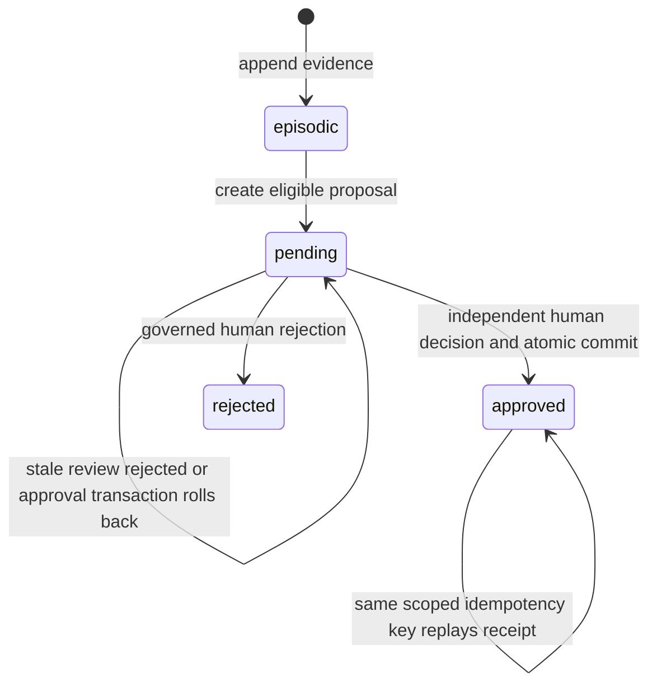
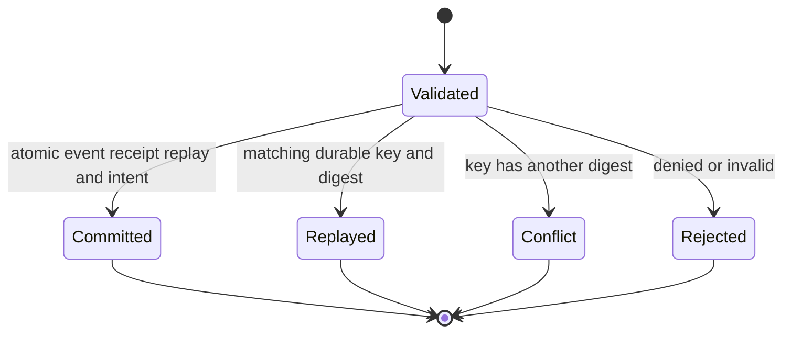

# Design Specification: Allura Memory Command Center

> [!NOTE]
> **AI-Assisted Documentation**
> Portions of this document were drafted with AI assistance; Codex prepared the 2026-10-20 development-readiness additions and React store-preview alignment.
> Content has not yet been fully reviewed — this is a working design reference, not a final specification.
> AI-generated content may contain inaccuracies or omissions.
> Code and schemas evidence implementation; approved product decisions establish intent. Record disagreement for the owning decision rather than silently changing either.

> **Visual identity** (colors, typography, shadows, spacing, iconography) lives in [BLUEPRINT.md](./BLUEPRINT.md#0-brand-identity). The Memory Command Center must use real Allura brand assets and tokens only; generated logos and unrelated project tokens are forbidden.


**Integration evidence boundary — 2026-10-21:** This revision consolidates specifications and source-local assessments from `28d90e843` plus the dirty-file snapshot identified in the [source manifest](../reference/development-readiness-20261021/source-manifest.json), onto main base `c720aca2e` (PR #169 content head `51e421ca0`). Dashboard, Cloudflare authentication and preview implementation changes are excluded. Their “implemented” or test-count statements below are dated source-local observations, not verification of this branch, current main or deployment. Missing local receipts remain [unavailable supporting evidence](../reference/development-readiness-20261021/unavailable-evidence.md). [Story packets](../reference/development-readiness-20261021/story-packets.md) operationalize the canonical gates without approving proposed decisions.

**Approved intended authentication migration (source-local implementation):** [Cloudflare Access security contract](#cloudflare-access-security-contract). The approved provider change is Cloudflare Access under [AD-69](RISKS-AND-DECISIONS.md#AD-69-cloudflare-access-replaces-clerk); the provider implementation remains a separate unmerged source-local change and is not current-main or deployment evidence.

## Review status — 2026-10-18

This correction specifies one bounded journey and distinguishes intended → specified → implemented → verified → released claims. Sabir approved the DOC-06 stale-review rejection and DOC-07 confirmed remote sync/immutable receipt decisions in the current session on 2026-10-18. The intended contracts below are approved; missing API, schema, worker and acceptance evidence remains explicit. This edit does not claim product implementation, select a visual reference, or mark historical routes released.

**Publication authority (DOC-01):** GitHub’s six versioned engineering specifications govern engineering. Notion holds private planning and approvals and links to the specifications; it is not a competing engineering specification. Sabir approved this direction on 2026-10-18. Use the bounded journey and linked acceptance matrix; other unresolved decisions remain in Risks & Decisions.
---

## Enterprise dashboard visual/read slice — 2026-10-19

**Portfolio positioning:** Sabir clarified that Allura is a portfolio project aiming toward SOC 2 readiness. The dashboard must not claim SOC 2 compliance, a completed examination or an issued SOC 2 report. Proposed controls and illustrative evidence remain explicitly distinct from verified operating controls.

The portfolio preview includes Security & Trust and a local Work Board. A control can create a linked sample task; tasks support creation, editing, filtering, stage changes and illustrative independent review. Task state remains in browser memory across preview navigation and resets on reload. This demonstration does not grant authority, approve knowledge, verify a security control or create an audit receipt. Implementation stage and evidence-review state are separate fields. The visual direction is warm and inviting: Cream ground, rounded controls, restrained Blue/Orange accents, one navigation system, and the unchanged official compact AL lettermark in the dashboard shell. Preview source remains isolated under `artifacts/enterprise-dashboard/visual-fixture/`.

Sabir supplied the business-memory graph composition reference and explicitly required the approved Allura palette, unchanged official Allura assets and Cream-dominant treatment. The current reference is the in-session Allura graph image (`codex-clipboard-72e359fd-9b7c-4f41-869f-9442efa59c70.png`), interpreted through the current branding instructions; a completed implementation still requires independent Durham review and Sabir's acceptance.

Shared semantic tokens live in `src/components/dashboard/brand-tokens.module.css`. Navigation, read surfaces, graph/inspector and access denial consume them. Use Aeonik for headings when available, a neutral sans fallback, and IBM Plex Mono only for technical labels. No generated logo, gradients, glow, glass or drop shadows. Orange selection has an Ink outline plus a textual selected state; Green must not imply approval without source evidence. Contrast is checked per actual foreground/background pair.

The implemented memory screen is `/dashboard/search` (the historical `/dashboard/memories` name below remains intended vocabulary). It supports approved/retained filtering, literal content search, 50-result pages and a disclosure inspector. Unknown version/provenance is explicit. Search is not semantic retrieval. The graph is an interactive node/edge canvas with selection, inspector, pan, zoom, fit, relationship filter, list alternative and a new bounded neighborhood read. Layout distance is not embedding similarity. Loaded scope and truncation remain visible.

Desktop uses sidebar/canvas/inspector; smaller widths stack the inspector and collapse navigation. Phone graph text and hit targets must remain usable after SVG scaling. Fixtures used for visual verification are labeled synthetic and isolated from sign-in and backend reads. They cannot establish access control, live data or the complete enterprise journey.

Sabir initially requested an HTML design preview on 2026-10-19, with no sign-in required. On 2026-10-20, the current Store overview reference became the corrected React/Vite preview at [`http://127.0.0.1:4008/index.html#ecommerce`](http://127.0.0.1:4008/index.html#ecommerce), sourced from `artifacts/enterprise-dashboard/visual-fixture/`. The portable single-file HTML predates the final tablet grid correction and awaits repackaging after a local governance-hook load failure; it is not equivalent to the corrected React build. The [commerce receipt — source-local receipt unavailable](../reference/development-readiness-20261021/unavailable-evidence.md) distinguishes the artifacts and their verification. Administration, embedding evidence, device inventory and audit/recovery remain live implementation gaps; populated preview examples do not close those gaps. This updates the preview reference, not the enterprise security or acceptance contracts.

## Table of Contents

- [Studio source reuse and shared preview journeys](#portfolio-preview-studio-source-reuse-and-shared-journeys)
- [Overview](#overview)
- [Functional Requirements](#functional-requirements)
- [API Reference](#api-reference)
- [State Machine](#state-machine)
- [Business Rules](#business-rules)
- [Use Cases](#use-cases)
- [Important Constraints](#important-constraints)
- [Development readiness design](#development-readiness-design--2026-10-20)


---

## Overview

The Allura Memory Command Center provides the human-facing control plane for the Allura Memory Engine. It is not the memory system itself; it is the governed window into memory, RuVix policy, curator decisions, provenance, audit evidence, and tenant settings.

AD-35 adds a proposed run-inspection responsibility for future operator surfaces: show evidence-gated `RunRecord` receipts without making the dashboard or Brain the orchestrator. Runs are reviewable audit objects that connect Notion/board work to Team RAM skill execution, approval breakpoints, quality gates, and memory writeback candidates.

**Core surfaces:**

| Surface | Role | Purpose |
|---------|------|---------|
| **Overview** (`/dashboard`) | Operator / Admin | Observe system health, queue status, freshness, degraded state, and active tenant scope |
| **Memories** (`/dashboard/memories`) | Operator / Curator | Search, filter, inspect, export, and trace memory records |
| **Curator** (`/dashboard/curator`) | Curator / Reviewer | Review, approve, or reject proposed insights before they become active knowledge |
| **Governance** (`/dashboard/governance`) | Admin / RuVix owner | Manage policy mode, thresholds, role separation, tenant isolation checks, and drift warnings |
| **Graph** (`/dashboard/graph`) | Operator / Admin | Explore promoted semantic memory with source receipts |
| **Audit** (`/dashboard/audit`) | Admin / Compliance | Filter event logs, inspect receipts, and export evidence packets |
| **Settings** (`/dashboard/settings`) | Admin | View tenant config, roles, endpoint health, and promotion settings |
| **Runs** (future `/dashboard/runs` or Audit extension) | PM / Reviewer / Compliance | Inspect RunRecord state, approval breakpoints, quality gates, run journals, doctor findings, and evidence packets |

The Command Center is optional: MCP tools, API routes, and CLI scripts remain the primary engine path. The UI surfaces real data from Allura Brain (PostgreSQL (episodic + semantic)), not mocks. Every component consumes mapped UI contracts from `src/lib/dashboard/`; raw Brain API shapes stay behind `api.ts`, `queries.ts`, and `mappers.ts` (AD-26).

### Memory Lifecycle and Done Gate

Agents and Team RAM lanes must read before work, write receipts after substantive action, and keep dashboard/operator views behind MCP/API contracts. The required flow is:

1. **Brain pre-search** — retrieve relevant approved context and recent traces for the active `group_id`.
2. **Governed action** — perform only the approved documentation, API, or workflow mutation.
3. **RuVix disposition** — classify the result as `Permit`, `Defer`, or `Deny` with `gate_reason`.
4. **Receipt write-back** — record `receipt_id`, actor, source evidence, validation, and audit event.
5. **Done gate** — completion is evidence-backed only; Brain receipts support audit but do not prove Done by themselves.

Display runtime labels from a dated health receipt. The TALON `pgvector bridge` observation (2026-06-02) is historical, while the source default graph adapter is `ruvector`. Neither proves native RuVector readiness or current production health. Unknown health remains unknown until checked.

### Dashboard v2 condensed UX contract

Phase 1 is a vertical flow with five operating areas:

| Panel | Purpose | Required state |
| --- | --- | --- |
| System status | Store availability, queue status, tenant scope, freshness | healthy, degraded, unknown, failed, empty, loading |
| Memories | Search, inspect, filter, and open provenance | episodic, semantic, pending, rejected, deleted, degraded |
| Approvals queue | Human decision surface for proposals | proposal ID, score, reasoning, evidence, state, allowed actions |
| RuVix governance | Policy mode, thresholds, role separation, tenant isolation, locks, drift warnings | enforced, blocked, degraded, unknown |
| Audit/evidence | Receipts, source lineage, export packets | append-only, filterable, exportable, degraded |

Required action surface:

```ts
interface DashboardGovernanceActions {
  refresh(): Promise<void>
  approveProposal(id: string): Promise<void>
  requestChanges(id: string, reason?: string): Promise<void>
  requestEvidence(id: string, reason?: string): Promise<void>
  denyProposal(id: string, reason?: string): Promise<void>
  softDeleteMemory(id: string, reason: string): Promise<void>
  recoverMemory(id: string, reason: string): Promise<void>
  openEvidence(id: string): void
  openDetail(id: string): void
  openGovernanceReceipt(id: string): void
}
```

`requestChanges` in the earlier interface sketch is a historical UI idea, not the current decision mapping. The current dashboard submits `decision: request_evidence` to `POST /api/curator/approve`; that path creates an evidence request and leaves the proposal pending. Terminal `reject` is a separate decision. The old rationale-prefix/reject mapping must not be implemented as a substitute for requesting evidence. Sources: `src/components/curator/types.ts`, `src/components/curator/curator-dashboard.tsx`, and `src/app/api/curator/approve/route.ts`.

Truthfulness rules: no fabricated live data, no “healthy” without verification, no “done” without evidence, no “live” without active polling/streaming and visible freshness, unknown is a first-class state, and Brain receipts are audit traces rather than proof of completion.

Run truthfulness rules: no “hallucination-free” claims, no yolo/forever autonomous modes, no foreign process library as canon, and no Done state unless declared quality gates and evidence requirements pass. Interrupted work must show resumable or stale state rather than restarting from vibes.

Governance receipt rule: every mutation and approval must show intent, actor, source, policy, validation, audit trail, `gate_decision` (`Permit | Defer | Deny`), and `approval_required` before completion. For mutations in the approval-required set (REQ-GOV-008), the control plane's `executeSyscall` enforces a well-formed `approval_ref` (a UUID, the canonical governed approval identity shape) after proof verification and policy evaluation and before the syscall executor runs. When the gate fires, the syscall's audit context is updated with `approval_required: true`, the gate decision (`approved`/`denied`), and the resolved `approval_ref`. Resolution against the canonical approval store (`canonical_proposals`) is the approval-lifecycle layer's responsibility: curator/HITL issues the governed identity, and the control plane enforces presence plus UUID format here.

### Accepted Bumblebee plugin planning contract

The intended Bumblebee is the pinned upstream `perplexityai/bumblebee` read-only
endpoint scanner. Allura integrates it through a headless plugin runner and receiver.
The historical names “Bumblebee Guard” and “Bumblebee Threat Watch” refer to local
Allura inventory/advisory adjuncts; they are not the upstream scanner or separate
authority planes.

Each advisory must record source identity and URL, publisher, publication time,
fetch time, trust state, freshness state, content revision/hash, classification or
redaction policy, and retention disposition. A source is eligible only when it is
on the reviewed allowlist and passes its defined verification rule. Failed,
unverified, stale, malformed, or scope-conflicting input becomes a distinct
`rejected`, `degraded`, or `stale` evidence state; it must not appear as a verified
finding. `trust_state` and `freshness_state` remain separate contract dimensions.

The plugin may run the upstream scanner to read approved endpoint metadata. Its runner
must obtain a server-issued source/population lease and dedicated ingestion-only
credential. Accepted scanner evidence may feed a deduplicated alert and a **simulated**
mitigation proposal. Neither scanner nor plugin may execute packages, activate policy,
block CI or packages, change schedules, revoke credentials, lock a workspace, or
contain a host. Those are separate human-authorized workflows with their own receipts.

| Action | V1 authority | Required owner |
|---|---|---|
| Add/change advisory source or verification rule | Human-approved configuration only | Security owner + governance owner |
| Review alert and evidence | Read/review | Security reviewer |
| Approve a mitigation draft for a later enforcement flow | Human approval only | Authorized approver |
| Create alert/simulated proposal from verified evidence | Automatic, deduplicated | Allura worker under AD-57 |
| Enforcement, schedule change, or endpoint action | Prohibited | Separate approved workflow |

Brand/accessibility rules: use existing Allura shell, navigation, logo assets, and semantic tokens; do not import Difference Driven tokens, colors, language, or assumptions; avoid marketing hero sections, fake charts, vanity metrics, AI-gradient tropes, inflated claims, or generated logo marks; approval actions must be keyboard reachable and confirmation dialogs must trap/restore focus.

## Memory Command Center Addendum

The Memory Command Center is an integration program over the MCP/API-first engine, not a second product or a bypass around governance.

| Surface | Role | Status |
|---------|------|--------|
| `localhost:6420` | Historical visual/reference memory dashboard experience | Reference/cutover history |
| `localhost:3334` | Historical development integration target | Reference/cutover history |
| `localhost:3100` | Historical Docker dashboard target | Protected until new launch gates pass |

The Memory Command Center is the approved operator surface for Allura memory governance. It preserves the useful memory capabilities from earlier references while narrowing the first launch around memories, curator work, RuVix governance, graph exploration, audit evidence, and settings.

### Command Center Route Parity

| Reference capability | Command Center target | Source of truth |
|----------------------|------------------------|-----------------|
| Dashboard | `/dashboard` | Aggregated adapter summaries |
| Memories | `/dashboard/memories` | Allura Brain APIs |
| Insights | `/dashboard/memories` or `/dashboard/graph` | Allura Brain / PostgreSQL semantic layer through controlled API |
| Trace logs | `/dashboard/audit` | PostgreSQL append-only events through controlled API |
| Provenance | `/dashboard/audit` and evidence drawer | Trace → proposal → approval → graph evidence chain |
| Extracted | `/dashboard/memories` | Allura extraction/memory APIs |
| Approvals | `/dashboard/curator` | Curator proposals are governed decision data. Work-board authority and adapter direction remain unresolved under DOC-09; the prior Native Kanban/default-adapter plan is not current implementation authority |
| Governance | `/dashboard/governance` | RuVix control plane rules, policy mode, thresholds, isolation, drift |
| Settings | `/dashboard/settings` | Resource manifest + dashboard configuration |
| Search | Memory search surface | Allura retrieval layer |
| Add memory | Governed Allura action | Controlled memory write endpoint |
| Approval Queue | `/dashboard/curator` promotion/approval panel | `canonical_proposals` + audit events |

### Cutover Rule

The rebuilt dashboard may not replace `3100` until route parity, visual parity, adapter/source-of-truth declarations, auth validation, smoke tests, no-fabricated-data checks, and rollback documentation all pass.

**What this document is:**
- Functional requirements for what the dashboard, curator, and settings surfaces must do
- API reference for all dashboard and curator endpoints
- State machines for the curator proposal lifecycle
- Business rules derived from architectural decisions

**What this document is not:**
- A UI style guide (see [BLUEPRINT.md](./BLUEPRINT.md#0-brand-identity))
- Component-level wireframes (see [Command Center route parity](#command-center-route-parity) and [Dashboard Requirements](#dashboard-requirements))
- An implementation roadmap (see [`SOLUTION-ARCHITECTURE.md`](./SOLUTION-ARCHITECTURE.md))

### UX Philosophy

**Sarah's Law:** If an 18-year-old intern has questions after two minutes, it's not done. iPhone clean means one thing on screen. You do it. You learn. No reading required.

**13-16-18 Validation Framework:** 13-year-olds spot emerging trends, 16-year-olds identify popularity gaps, 18-year-olds confirm mainstream readiness. Applied to all consumer-facing surfaces. Target score: 0.85+.

**Consumer mental model:** "Your AI remembers" — the machine is always invisible.

---

## Functional Requirements

`DS-Fn` identifies Design-owned requirements. Blueprint uses `BP-Fn`; the Requirements Matrix records explicit mappings. Local IDs do not inherit meaning from another document merely because their numbers match. Historical implementation/path claims below require endpoint-specific validation; the DOC-J journey is the current bounded acceptance scope.

### Dashboard Requirements

| # | Requirement | Satisfied by |
|---|-------------|-------------|
| DS-F17 | Curator Dashboard — view pending proposals, approve/reject with rationale | `/dashboard/curator` · `GET /api/curator/proposals` · `POST /api/curator/approve` · `POST /api/curator/reject` |
| DS-F18 | Audit Log — view all memory events with filtering and CSV export | `/dashboard/audit` · `GET /api/audit/events` |
| DS-F19 | System Health Dashboard — view service status, metrics, and degradation warnings | `/dashboard` (overview) · `GET /api/health?detailed=true` · `GET /api/health/metrics` |
| DS-F41 | Memory Command Center route shell — `/dashboard`, `/dashboard/memories`, `/dashboard/curator`, `/dashboard/governance`, `/dashboard/graph`, `/dashboard/audit`, `/dashboard/settings` | Governed operator surface over MCP/API contracts; launch only after gates pass |
| DS-F42 | `/dashboard/memories` preserves useful reference memory capabilities | Memories, insights, traces, provenance, extracted facts, and approvals mapped into governed dashboard routes |
| DS-F43 | Historical plan: `/work-board` uses Native Allura Kanban as the default planning source, conflicting with the Notion work-board rule | DOC-09 requires a separate work-board authority decision. Neither plan becomes authoritative through DOC-01, which governs engineering documents |
| DS-F44 | `/resources` reads resource inventory from manifest endpoint or `RESOURCE-MANIFEST.md` | Resource Manifest adapter |
| DS-F45 | `/agents` distinguishes TALON/IRIS from Team RAM/Durham/external agents | Agent adapter + canonical agent taxonomy |
| DS-F46 | `/telemetry` reports real/unknown metrics honestly | Telemetry adapter with degraded/unknown state |
| DS-F47 | Every route displays source-of-truth and degraded behavior | Adapter registry UI contract |
| DS-F48 | `3100` cutover has parity, smoke, auth, and rollback gates | Cutover validation checklist |
| DS-F49 | Governed RunRecord captures tenant, owner, reviewer, goal, status, pinned definition revision, journal path, and timestamps | Partial implementation · AD-35 · `RunRecord` in `DATA-DICTIONARY.md` |
| DS-F50 | Run policy declares allowed actions, approval breakpoints, measured quality gates, bounded attempts, and required evidence | Partial implementation · Epic 14 |
| DS-F51 | Run journal records plan, steps, checks, approvals, failures, continuation state, and final evidence | Partial implementation · Story 12.2 correction |
| DS-F52 | Doctor checks report stale, failed, incomplete, definition-drifted, unrecoverable, or approval-blocked runs before Done | Planned · Epic 14.3 · `/dashboard/runs` |
| DS-F53 | PostgreSQL-backed projects and work items link operational work to runs, handoffs, evidence, and memory receipts | Planned · Epic 15 |
| DS-F54 | Operator workspace uses mission-first navigation, Command Center, central work surface, and right evidence inspector | Planned · Epic 16 |
| DS-F55 | One governed desktop shell provides secure connections, runtime supervision, deep links, updates, and reconnect behavior | Planned · Epic 17 |

### Curator Requirements

| # | Requirement | Satisfied by |
|---|-------------|-------------|
| DS-F10 | `POST /api/curator/score` — score proposal, return confidence + reasoning + tier | `src/lib/curator/score.ts` |
| DS-F11 | `POST /api/curator/approve` — approve proposal, promote to `graph_memories` | `src/app/api/curator/approve/route.ts` |
| DS-F12 | Current compatibility route `POST /api/curator/reject` delegates to the governed decision route with `decision: reject`; it records the rejected state, rationale, event and immutable receipt. The earlier archive/7-day undo expectation is an unimplemented historical requirement, not current behavior | `src/app/api/curator/reject/route.ts`; `src/app/api/curator/approve/route.ts` |
| DS-F13 | Current `GET /api/curator/proposals` filters by `pending`, `approved`, `rejected` or `all`, without a tier filter. Restriction to emerging/adoption tiers remains an unimplemented historical requirement requiring a bounded product decision before reuse | `src/app/api/curator/proposals/route.ts` |
| DS-F14 | Curator dashboard shows three tabs: Traces, Approved, Pending | `/dashboard/curator` |
| DS-F15 | Pending tab sorts by confidence (descending); shows confidence badge + reasoning + action buttons | `ConfidenceBadge` component |
| DS-F16 | Approved tab shows current human-approved knowledge; any historical automated decision is labeled historical and cannot authorize new promotion; sortable by date/confidence | `/dashboard/curator` approved tab |
| DS-F56 | Tab 1 (Traces) restricted to authenticated users with `admin` role | Current Allura membership RBAC; verified Access identity |

### Audit & Health Requirements

| # | Requirement | Satisfied by |
|---|-------------|-------------|
| DS-F58 | Audit log endpoint returns all events with filtering and pagination; CSV export for compliance | `GET /api/audit/events` |
| DS-F57 | Dashboard verifies Cloudflare Access identity and resolves current Allura membership roles (curator, admin, viewer) | `src/lib/auth/cloudflare-access.ts`, `cloudflare-authority.ts`; AD-69 |
| DS-F26 | Agent task lifecycle events persisted as append-only traces | `src/lib/postgres/queries/insert-trace.ts` |
| DS-F27 | Raw trace storage is append-only; no UPDATE/DELETE on events table | Schema enforcement |
| DS-F28 | Traces preserve provenance linking downstream insights to source evidence | `trace_ref` field |
| DS-F32 | Every approval, rejection, or policy decision recorded as audit event with actor and timestamp | `proposal_approved` / `proposal_rejected` event types |

### Governance Requirements

| # | Requirement | Satisfied by |
|---|-------------|-------------|
| DS-F6 | `PROMOTION_MODE=soc2` — score ≥ threshold queues for human approval | Environment variable |
| DS-F7 | Both `soc2` and legacy `auto` settings require human promotion approval | `src/lib/curator/auto-promote.ts` |
| DS-F34 | Changed insights create new nodes linked with `SUPERSEDES`/`DEPRECATED`/`REVERTED` | `createInsightVersion()` · `deprecateInsight()` |
| DS-F37 | All knowledge-system reads/writes pass through controlled endpoints | RBAC middleware |
| DS-F38 | Agent permissions enforced and all access audited | Auth middleware + event logging |

---

## API Reference

The approval endpoint below was inspected for this bounded repair. Other examples retain prior design contracts and require endpoint-specific verification before use as current response evidence; example counts and health values are not live observations.

### Health & Metrics

#### `GET /api/health?detailed=true`

System health check with optional component-level detail.

**Query parameters:**

| Parameter | Type | Default | Description |
|-----------|------|---------|-------------|
| `detailed` | boolean | `false` | Include per-component health status |
| `include` | string | — | Comma-separated component names to include |
| `exclude` | string | — | Comma-separated component names to exclude |

**Response** (`200 OK`):

```json
{
  "status": "healthy | degraded | unhealthy",
  "timestamp": "2026-04-28T12:00:00Z",
  "uptime": 86400,
  "version": "0.1.0",
  "mode": "http",
  "interface": "rest",
  "dependencies": {
    "postgres": { "status": "up", "required": true, "latency_ms": 3 },
    "graph_memories": { "status": "up", "required": false, "latency_ms": 12 }
  },
  "degraded": {
    "enabled": false,
    "reason": null,
    "capabilities_lost": []
  },
  "components": [
    { "name": "postgresql", "status": "healthy", "message": "Database connection verified", "latency": 3 },
    { "name": "graph_memories", "status": "healthy", "message": "Graph database connection verified", "latency": 12 }
  ]
}
```

**Prior health endpoint contract, verification required:** a degraded health response may retain HTTP `200` while listing lost capabilities; unhealthy durable storage may use `503`. These health semantics do not prescribe approval errors or every retrieval response. PostgreSQL hosts both evidence and semantic tables in the default topology.

---

#### `GET /api/health/metrics`

Operational metrics for the dashboard overview.

**Response** (`200 OK`):

```json
{
  "timestamp": "2026-04-28T12:00:00Z",
  "queue": {
    "pending_count": 3,
    "oldest_age_hours": 48,
    "approved_24h": 12,
    "rejected_24h": 2
  },
  "recall": {
    "search_available": true,
    "last_latency_ms": 45
  },
  "storage": {
    "postgres": { "status": "up", "latency_ms": 3, "total_memories": 247 },
    "graph_memories": { "status": "up", "latency_ms": 12, "total_nodes": 189 }
  },
  "degraded": {
    "graph_memories_unavailable": 0,
    "scope_error": 0,
    "embedding_failures": 0,
    "promotion_failures_24h": 0
  }
}
```

---

### Memory Operations (Dashboard)

#### `GET /api/memory`

List memories scoped by tenant. Supports user filtering and pagination.

**Query parameters:**

| Parameter | Type | Required | Description |
|-----------|------|----------|-------------|
| `group_id` | string | Yes | Tenant identifier (must match `^allura-`) |
| `user_id` | string | No | Filter to specific user |
| `limit` | integer | No | Max results (default 50) |
| `offset` | integer | No | Pagination offset |

---

#### `GET /api/memory/[id]`

Fetch a single memory by ID with tenant scope.

**Query parameters:**

| Parameter | Type | Required | Description |
|-----------|------|----------|-------------|
| `group_id` | string | Yes | Tenant scope |

---

#### `GET /api/memory/count`

Return total count of unique active memories (deduplicated across PostgreSQL (episodic + semantic)).

**Query parameters:**

| Parameter | Type | Required | Description |
|-----------|------|----------|-------------|
| `group_id` | string | Yes | Tenant scope |
| `user_id` | string | No | Filter to specific user |

---

#### `GET /api/memory/traces`

List raw trace events with filtering.

**Query parameters:**

| Parameter | Type | Required | Description |
|-----------|------|----------|-------------|
| `group_id` | string | Yes | Tenant scope |
| `agent_id` | string | No | Filter by agent |
| `event_type` | string | No | Filter by event type |
| `limit` | integer | No | Max results |
| `offset` | integer | No | Pagination offset |

---

#### `GET /api/memory/insights`

List approved insights with pagination.

**Query parameters:**

| Parameter | Type | Required | Description |
|-----------|------|----------|-------------|
| `group_id` | string | Yes | Tenant scope |
| `status` | string | No | Filter by status (`active`, `deprecated`, `superseded`) |
| `limit` | integer | No | Max results (default 20) |
| `offset` | integer | No | Pagination offset |

---

#### `GET /api/memory/insights/[id]/history`

Version history for a specific insight (SUPERSEDES chain).

**Query parameters:**

| Parameter | Type | Required | Description |
|-----------|------|----------|-------------|
| `group_id` | string | Yes | Tenant scope |

---

#### `GET /api/memory/graph`

Read-only tenant-scoped knowledge graph visualization.

Returns real `graph_memories` rows and edges for the dashboard graph tab. Capped display sample plus `total_edges` count. Performs no mutations.

**Query parameters:**

| Parameter | Type | Required | Description |
|-----------|------|----------|-------------|
| `group_id` | string | Yes | Tenant scope (required, validated) |

**Response:** `MemoryGraphResponse` — `{ nodes: GraphNode[], edges: GraphEdge[], total_edges?: number }`

---

### Curator Operations

#### `GET /api/curator/proposals`

List proposed insights awaiting review.

**Query parameters:**

| Parameter | Type | Required | Description |
|-----------|------|----------|-------------|
| `group_id` | string | Yes | Tenant scope |
| `status` | string | No | Filter by status (default: `pending`) |
| `limit` | integer | No | Max results (default 20) |

---

#### `POST /api/curator/approve`

Authenticated decision boundary. The route accepts `approve`, `reject` or `request_evidence`; approval delegates to the atomic service. Principal and workspace come from the web session; the supplied group is checked against that authority. A client-supplied `curator_id` cannot grant reviewer identity.

**Approved request body (DOC-06; implemented in the current source candidate, not deployment evidence):**

```json
{
  "proposal_id": "uuid",
  "group_id": "allura-system",
  "expected_proposal_version": "3",
  "decision": "approve",
  "rationale": "Validated against source evidence.",
  "evidence_request_ids": []
}
```

For approval, send a stable `Idempotency-Key` header. The current implementation otherwise derives a key from proposal ID, action and authenticated user. Same scope/key/proposal replays the original decision receipt; changed rationale or evidence does not amend it.

**Approved revision rule (DOC-06):** a new approval carries `expected_proposal_version`, the positive decimal string for the exact proposal version shown during review. After authenticating and resolving tenant/workspace, the service locks the scoped proposal, validates successful replay first, and for a new decision compares the supplied version with the locked version before durable approval writes. Missing/malformed preconditions fail with `400`; a version mismatch fails with `409` (`PROPOSAL_VERSION_CONFLICT`) and no new semantic/proposal/outbox/receipt/replay writes. The UI reloads the proposal and requires review and explicit approval of that new version; it must not silently replace the expected version and retry. Two reviewers of the same version cannot both create a new approval. A successful same-key replay returns the original receipt, even though the approval transition has since advanced the proposal version; it does not authorize new content.

**Decision evidence:** retain the accepted pre-transition version as `reviewed_proposal_version` in the immutable decision evidence, distinct from current `proposal_version`, which records the post-transition version. The current source candidate adds this nullable field for new approval receipts. Historical immutable receipt JSON is not rewritten; read responses project `reviewed_proposal_version: null` when the stored historical evidence has no such field.

**Current source boundary:** the browser submits the exact version loaded for review; the route and service require its canonical positive-decimal string, preserve replay-first semantics for the same authenticated actor, and reject stale new approvals before writes. CLI and evaluation entrypoints cannot manufacture human approval. The exported legacy knowledge-promotion mutations now fail closed before proposal/event reads, workspace transactions, audit writes, or remote-client calls; their read-only lookup helpers remain available. Registered unit coverage exercises arbitrary-content and caller-selected-workspace approval-event replay. This is a reviewed source candidate only: production acceptance remains blocked on authorized verification that migration identity `072` is free and that the required columns/constraints exist in the live database, a valid-human live fixture, independent acceptance, and a separately approved production human-proof issuer/topology. No deployment or release is claimed.

**Current response:** `200 OK` returns the persisted `GovernanceReceipt` directly, including receipt ID, tenant/workspace, proposal/post-transition version, actor, policy, evidence identity, memory identity and decision-time outbox state. Data Dictionary owns the complete receipt shape and the intended reviewed-version extension. The original approval receipt is immutable and remains `queued` after later delivery. A separate delivery observation must include read-back matching the authorized destination, remote page/record, and intended source revision/content before showing Notion `synced` (DOC-07); neither local outbox `delivered` nor a successful approval response proves it.

| Status | Implemented condition |
|---|---|
| `400` | Invalid request/evidence, or idempotency key already bound to a different proposal |
| `401` / `403` | Missing authentication, insufficient role/scope, tenant mismatch, unresolved workspace, or requester self-approval |
| `404` | Proposal not found in resolved scope |
| `409` | Approval of an already-decided proposal |
| `500` | Unexpected decision failure; approval transaction rolls back |

**Evidence inspected 2026-10-18:** `src/app/api/curator/approve/route.ts`, `src/lib/memory/approve-proposal.ts`. Error mapping for rejection/evidence requests is separate in that route; approval replay semantics must not be assumed for other decisions.

---

#### `POST /api/curator/reject`

Compatibility shim: delegates to `POST /api/curator/approve` with `decision: reject`, preserving the authenticated request headers. The scoped decision records the rejected state, rationale, event and immutable receipt. It does not implement a 7-day archive/undo mechanism. Reviewer identity comes from authentication; a client `curator_id` cannot assign authority. Requesting more evidence uses the separate `request_evidence` decision and does not reject the proposal.

**Request body:**

```json
{
  "proposal_id": "uuid",
  "group_id": "allura-system",
  "rationale": "Duplicate of existing knowledge."
}
```

---

### Audit

#### `GET /api/audit/events`

Full audit trail with pagination, filtering, and CSV export.

**Query parameters:**

| Parameter | Type | Required | Description |
|-----------|------|----------|-------------|
| `group_id` | string | Yes | Tenant scope (must match `^allura-`) |
| `format` | string | No | `json` (default) or `csv` |
| `from` | ISO 8601 | No | Start date filter |
| `to` | ISO 8601 | No | End date filter |
| `agent_id` | string | No | Filter by agent |
| `event_type` | string | No | Filter by event type |
| `limit` | integer | No | Max rows (default 1000, max 10000) |
| `offset` | integer | No | Pagination offset |

**Auth:** Requires `viewer` role or above.

**CSV response** includes `Content-Disposition: attachment; filename="audit-events-{group_id}-{date}.csv"` header.

---

### Budget Admin

#### `POST /api/admin/reset-budget`

Reset halted budget sessions for a tenant group or globally. Requires bearer auth.

**Request body:**

```json
{
  "group_id": "allura-system"
}
```

`group_id` is optional — if omitted, all halted sessions across all groups are reset.

**Response** (`200 OK`):

```json
{
  "cleared": 3,
  "before": 5,
  "after": 2
}
```

**Auth:** Requires valid bearer token (same as other admin endpoints).

---

### Governed Retrieval

#### `POST /api/memory/retrieval`

The controlled retrieval layer — the sole read path for agents (AD-19). Agents MUST NOT query PostgreSQL directly.

**Request body:**

```json
{
  "group_id": "allura-system",
  "agent_id": "agent_executor",
  "query": "What image tag should postgres use?",
  "mode": "hybrid",
  "scope": { "project": true, "global": true },
  "include_traces": false,
  "filters": { "status": "active", "min_confidence": 0.7 },
  "limit": 10
}
```

**Response** (`200 OK`):

```json
{
  "results": [
    {
      "insight_id": "uuid",
      "content": "Postgres image must remain pinned to pgvector:0.7.0-pg16...",
      "source": "graph_memories",
      "confidence": 0.95,
      "scope": "project",
      "version": 2,
      "provenance": {
        "proposal_id": "uuid",
        "approved_by": "human_reviewer",
        "approved_at": "2026-04-19T20:50:00Z"
      }
    }
  ],
  "total": 1,
  "metadata": {
    "retrieved_at": "2026-04-28T21:00:00Z",
    "project_count": 1,
    "global_count": 0
  }
}
```

**Retrieval modes:**

| Mode | Description | Sources |
|------|-------------|---------|
| `semantic` | Content-based search across approved insights | PostgreSQL semantic tables `searchInsights()` |
| `structured` | Filter-based query (status, confidence, date range) | PostgreSQL semantic tables `listInsights()` |
| `hybrid` | Dual-context: project + global insights merged by confidence | `getDualContextSemanticMemory()` |
| `traces` | Raw trace retrieval (policy-gated, not default) | PostgreSQL `queryTraces()` |

---

## State Machine

### Event Types

The following event types are recorded in the PostgreSQL `events` table (append-only):

| Event Type | Description | Source |
|------------|-------------|--------|
| `memory_add` | Agent writes episodic trace to PostgreSQL | Memory engine |
| `memory_search` | Agent searches memories (federated PostgreSQL (episodic + semantic)) | Memory engine |
| `memory_get` | Agent retrieves single memory | Memory engine |
| `memory_delete` | Soft-delete with 30-day recovery | Memory engine |
| `memory_restore` | Restore from soft-delete within recovery window | Memory engine |
| `memory_promote` | Request promotion to PostgreSQL semantic tables (creates proposal) | Curator |
| `proposal_created` | Curator creates canonical proposal | Curator scorer |
| `proposal_approved` | Human approves proposal | Curator approve route |
| `proposal_rejected` | Human rejects proposal | Curator reject route |
| `memory_promoted` | Historical promotion event vocabulary; current approval result is GovernanceReceipt | Compatibility producer mapping requires verification |
| `memory_deprecated` | Old version marked deprecated via SUPERSEDES | Version workflow |
| `threat_advisory_received` | Allowlisted advisory or approved internal evidence accepted as provisional | Allura downstream threat intake |
| `threat_evidence_rejected` | Evidence denied for trust, freshness, schema, or scope failure | Allura downstream threat intake |
| `threat_alert_created` | Deduplicated alert created from verified exposure evidence | Allura downstream correlation |
| `mitigation_proposal_simulated` | Non-enforcing mitigation draft prepared for human review | Allura downstream correlation |

These event types are defined by the Story 26.1 downstream Allura contracts in
[DATA-DICTIONARY.md](./DATA-DICTIONARY.md#story-261-allura-threat-intelligence-contracts).
They do not define the upstream scanner transport or snapshot ledger.

### Curator Pipeline State Machine



`pending`, `approved` and `rejected` are proposal states. The stale-review transition is enforced by the current source candidate under DOC-06; live-database and production-issuer acceptance remain open. Semantic retrieval, local outbox delivery, remote projection and request completion are separate states: a failed Notion projection does not undo committed approval; a request timeout does not prove rollback. Supersession creates a new content version. Restore/rollback behavior is excluded from this bounded journey until DOC-03 is resolved.

### Bounded memory journey

**Purpose:** preserve an authorized observation as evidence, let a different authorized human approve reusable knowledge, and retrieve the resulting knowledge only within its permitted scope.

| Step | Observable contract | Failure / retry / evidence |
|---|---|---|
| Capture | Server resolves principal, tenant and workspace; appends episodic evidence; eligible content may become a pending proposal | Denied scope must not cause a write. A pending/timeout response is unconfirmed. Do not assume approval idempotency applies to `memory_add`; its retry contract requires transport-specific verification. |
| Review | Show exact proposal identity/version, source event, scope, content, reviewer permissions and rationale; submit that loaded version as `expected_proposal_version` | The current browser/source candidate holds and submits the loaded version; DOC-06 rejects a changed version and requires renewed human review. Missing/out-of-scope evidence and requester self-approval fail closed. Score is assistance, not permission. Live migration and production issuer verification remain gates. |
| Approve | Authorized curator/admin with `review:approve` commits semantic row, proposal transition, audit, outbox, receipt and replay record in one transaction | Same scoped key and proposal replays the original receipt only for the same authenticated actor; it does not amend that decision. Key reused for another proposal conflicts; already-decided proposals cannot be decided again with a new key. New approvals must satisfy DOC-06’s reviewed-version precondition. Rollback leaves no partial approval. |
| Retrieve | Same-scope request returns current permitted content and provenance | Deleted/superseded content must not appear as current knowledge; foreign scope is denied/excluded. Search success is not write or release authority. |
| Project | Intended remote Notion projection follows durable approval and authorized delivery; current promotion worker only appends a local event | DOC-07: remote `synced` requires read-back matching authorized destination/page and intended source revision/content; HTTP success or a page ID alone is insufficient. Local `delivered` is not sync. Keep original approval receipt immutable; expose separate delivery observation. Ambiguous remote results remain unknown and require reconciliation before retry. |

**Source evidence, inspected 2026-10-23:** `src/lib/memory/approve-proposal.ts`, `src/app/api/curator/approve/route.ts`, `src/app/api/curator/proposals/route.ts`, `src/curator/approve-cli.ts`, `src/lib/memory/promotion-outbox-worker.ts`, `src/curator/notion-sync-worker.ts`. **Claim state:** DOC-06 version binding is present in the current source candidate, while migration `072` live-ledger/column verification, the production human-proof issuer boundary, independent acceptance and release remain pending. The outbox emits `canonical_memory_promoted`; the Notion worker consumes `notion_sync_pending`, so DOC-07 still has no established remote handoff.

**Visual acceptance boundary:** the exact approved screen/design revision, assets and state references for this journey have not been established by this repair. DOC-02 is **Needs a decision** for Sabir and Durham. Existing broad Command Center sections and brand tokens are supporting references, not proof of an approved current screen. Before a UI story is Ready, name its exact approved reference plus loading, empty, denied, conflict, timeout/unknown, success, keyboard and responsive states. RAM reviews behavior; Durham independently reviews fidelity; the builder cannot approve either result alone.

---

## Business Rules

| Rule ID | Rule | Source | Enforcement |
|---------|------|--------|-------------|
| AD-04 | Legacy mode configuration does not authorize promotion. Human approval is required. | RISKS-AND-DECISIONS | `src/lib/curator/auto-promote.ts` and `approve-proposal.ts` |
| AD-08 | Soft-delete only. No hard deletes. Deletion records are append-only events, not erasures. | RISKS-AND-DECISIONS | `memory_delete` appends event + sets `deprecated: true` on PostgreSQL semantic tables node |
| AD-09 | Historical two-store degradation decision, superseded by AD-50. Current approval is one PostgreSQL transaction; failure rolls it back. | RISKS-AND-DECISIONS | `src/lib/memory/approve-proposal.ts` |
| AD-19 | Agents MUST NOT query PostgreSQL directly. Reads use authenticated governed interfaces: canonical MCP `memory_search` or the applicable controlled retrieval API. | RISKS-AND-DECISIONS | Code review gate + `direct-access-blocker.ts` |
| AD-20 | Historical event-status marking is obsolete. Watchdog deduplicates by an existing same-scope proposal referencing the source event. | RISKS-AND-DECISIONS | `src/curator/watchdog.ts` `NOT EXISTS` proposal check; no historical event mutation |
| AD-22 | `VALIDATION-GATE.md` is archived in `docs/archive/allura/`, not canonical. Per the canonical surface rule. | RISKS-AND-DECISIONS | Cross-linked from BLUEPRINT, not in `docs/allura/` |
| — | `group_id` must match `^allura-` pattern. Enforced by PostgreSQL CHECK constraint. | BLUEPRINT §7 | Schema-level, not application-level |
| — | Historical 30-day recovery UI expectation; expiry does not authorize erasing evidence. Restore semantics remain blocked under DOC-03. | BLUEPRINT §11 | `memory_restore` validates recovery window |
| — | Append-only events table. No UPDATE or DELETE mutations on `events`. | BLUEPRINT §7 | No UPDATE/DELETE code paths in application |
| — | Proposals require independent human approval; a threshold or legacy mode does not approve them. | BLUEPRINT §2 BP-F6/BP-F7 | `PROMOTION_MODE` environment variable |
| — | Audit trail is append-only and exportable as CSV. | BLUEPRINT §9 BP-F18 | `GET /api/audit/events?format=csv` |
| — | `DashboardResult<T>` wraps dashboard adapter results with `{ data, error, degraded, warnings }`; endpoint-specific responses such as `GovernanceReceipt` retain their own contract. | Dashboard architecture | `src/lib/dashboard/types.ts` |
| — | Dashboard scoped to `group_id` (tenant isolation). All API calls include `group_id`. | Tenant isolation | `withGroupId()` in dashboard client |
| — | Report degraded/unknown state according to the specific endpoint contract; do not infer success from partial availability. | Bounded journey | Approval failures roll back; health and retrieval status codes require their own evidence |

---

## Use Cases

### MEM-UC10: Curator reviews and approves/rejects pending proposals

**Actor:** Curator (authenticated with `admin` or `curator` role)

**Precondition:** At least one proposal exists in `pending` status. Score is review assistance; the approval service does not enforce a minimum score. Capture/watchdog eligibility thresholds are separate producer rules and cannot grant approval authority.

**Steps:**
1. Curator navigates to `/dashboard/curator`
2. Dashboard calls `GET /api/curator/proposals?status=pending`
3. Proposals display with confidence badge, reasoning, and source evidence
4. Curator reviews the exact proposal version, summary, evidence links, and confidence score
5. Curator approves: `POST /api/curator/approve` with `decision: "approve"`, rationale and the reviewed `expected_proposal_version`; the current source candidate enforces DOC-06 conflict/re-review if the version changed
6. System promotes approved insight to PostgreSQL semantic tables as an immutable content row within the atomic approval transaction
7. Audit event `proposal_approved` written to PostgreSQL with curator ID and timestamp
8. Curator rejects: `POST /api/curator/reject` with rationale
9. System archives rejected proposal; audit event `proposal_rejected` written

**Postcondition:** A valid decision transitions the proposal to `approved` (promoted to PostgreSQL semantic tables) or `rejected` (retained in PG) with audit evidence. A stale-review approval must leave it undecided and require new review under DOC-06. The source candidate implements that behavior and retires alternate legacy promotion mutations, but the held issuer, valid-human live fixture, migration `072`, independent acceptance and release gates block this use case from being called verified.

**Requirements:** DS-F10–DS-F13, DS-F17

---

### MEM-UC11: Admin views audit log with filtering and CSV export

**Actor:** Admin (authenticated with `admin` role)

**Precondition:** At least one event exists in the `events` table.

**Steps:**
1. Admin navigates to `/dashboard/audit`
2. Dashboard calls `GET /api/audit/events` with optional filters (`event_type`, `agent_id`, `from`, `to`)
3. Events display in chronological order with pagination
4. Admin clicks "Export CSV"
5. Dashboard calls `GET /api/audit/events?format=csv` with current filters
6. Browser downloads `audit-events-{group_id}-{date}.csv`

**Postcondition:** Admin has a complete, filtered audit trail in JSON or CSV format.

**Requirements:** DS-F18

---

### MEM-UC12: Operator monitors system health and degradation

**Actor:** Operator

**Precondition:** Allura services are running.

**Steps:**
1. Operator navigates to `/dashboard` (overview)
2. Dashboard calls `GET /api/health?detailed=true` and `GET /api/health/metrics`
3. Overview displays: system status, queue depth, recall latency, storage stats, degraded component count
4. If a graph operation fails while other reads remain available, show its actual lost capabilities and receipt. If PostgreSQL is unavailable, report durable-storage failure rather than implying a second healthy store.
5. Operator sees metric cards: total memories, pending proposals, active agents, system uptime
6. Activity panel shows recent events

**Postcondition:** Operator has full visibility into system health, including degradation state.

**Requirements:** DS-F19

---

### MEM-UC13: Agent performs governed memory retrieval

**Actor:** AI Agent

**Precondition:** Agent has valid `group_id` and `agent_id`.

**Steps:**
1. Agent calls `POST /api/memory/retrieval` with query, scope, and mode
2. Retrieval layer validates `group_id` and agent permissions
3. For `semantic` mode: `searchInsights()` from PostgreSQL semantic tables
4. For `structured` mode: `listInsights()` from PostgreSQL semantic tables
5. For `hybrid` mode: `getDualContextSemanticMemory()` merges project + global insights
6. For `traces` mode (policy-gated): `queryTraces()` from PostgreSQL
7. Results returned with provenance metadata (proposal ID, approver, approval timestamp)
8. Retrieval call logged as audit event

**Postcondition:** Agent receives scoped, policy-controlled memory context. No direct database access occurred.

**Requirements:** AD-19, DS-F28, DS-F37, DS-F38, DOC-J06

---

### MEM-UC14: User soft-deletes and restores a memory within 30-day window

**Blocked for implementation/acceptance:** this prior use case is not ready until DOC-03 resolves restore lineage semantics. The steps below are historical intended behavior, not permission to delete lineage.

**Actor:** End User

**Precondition:** Memory exists and is not already soft-deleted.

**Steps:**
1. User swipes/hovers on a memory in `/memory` view
2. User taps [Forget] (soft-delete)
3. System calls `DELETE /api/memory/[id]`
4. System appends `memory_delete` event to PostgreSQL
5. System marks PostgreSQL semantic tables node as `deprecated: true` (if promoted)
6. Memory appears in "Recently Forgotten" view (`/memory?view=forgotten`)
7. Within 30 days, user taps [Restore]
8. System calls `POST /api/memory/[id]/restore`
9. System appends `memory_restore` event to PostgreSQL
10. System removes `deprecated` flag from PostgreSQL semantic tables node

**Postcondition:** Memory is either soft-deleted (recoverable within 30 days) or restored to active state.

**Requirements:** AD-08, BP-F5, DOC-03

---

### MEM-UC15: Dashboard displays knowledge graph visualization

**Actor:** Operator / Admin

**Precondition:** PostgreSQL semantic tables contains Memory, Agent, Team, and Project nodes.

**Steps:**
1. Operator navigates to `/dashboard/graph`
2. Dashboard calls `GET /api/memory/graph?group_id=allura-system`
3. API returns `MemoryGraphResponse` with nodes, edges, and `total_edges`
4. Dashboard renders interactive graph with `GraphSummary` component
5. Operator clicks a node to see detail in `NodeDetailPanel`
6. Graph shows `AUTHORED_BY`, `RELATES_TO`, `MEMBER_OF`, `CONTRIBUTES_TO` relationships

**Postcondition:** Operator has visual understanding of knowledge graph structure and relationships.

**Requirements:** DS-F41 (dashboard route scope), AD-24 (structural context layer)

---

## Important Constraints

1. **Dashboard scoped to `group_id`.** Every API call includes `group_id` for tenant isolation. No cross-tenant data access is possible.

2. **Proposals require independent human approval.** Both configured modes preserve HITL; every semantic promotion goes through the governed approval service.

3. **Audit trail is append-only and exportable.** No UPDATE or DELETE on the `events` table. CSV export supports SOC2 compliance requirements.

4. **Degradation is endpoint-specific.** A partial retrieval may report degraded data; an unhealthy storage service may fail the request. Neither implies a separate healthy semantic/evidence database. Approval errors roll back their transaction, and timeout remains unconfirmed. Verify the endpoint status/envelope rather than imposing a universal HTTP 206 rule.

5. **`DashboardResult<T>` wraps all responses.** Every dashboard API call returns `{ data: T | null, error: string | null, degraded: boolean, warnings: DashboardWarning[] }`. Components handle null data and degraded state explicitly.

6. **Curator deduplicates without changing evidence (AD-20).** The watchdog excludes a source event when a same-tenant/workspace proposal already references it. Historical events remain append-only.

7. **Agents MUST NOT query PG/PostgreSQL semantic tables directly (AD-19).** All retrieval goes through `POST /api/memory/retrieval`. Code review gate checks for direct database imports in agent-facing code.

8. **Semantic promotion requires the governed human decision flow.** Content promotion cannot bypass the curator approval service; lifecycle and structural operations require their own authorized contracts and must not be inferred from promotion permission.

9. **Immutable insight rows.** `graph_memories` rows are never updated in place. Any change requires a new proposal → approval → new row with `SUPERSEDES` edge.

10. **30-day soft-delete recovery.** Memories can be restored within 30 days of soft-deletion. After that, they are permanently gone.

11. **Bumblebee V1 is proposal-only (AD-57).** Its only automatic outputs are verified, deduplicated alerts and simulated mitigation proposals. It is read-only toward endpoints and external enforcement systems.

---

## Dashboard Architecture

### Pages

| Path | Purpose |
|------|---------|
| `/dashboard` | Overview — system health, metrics, recent activity |
| `/dashboard/memories` | Memory browser with search and filtering |
| `/dashboard/curator` | Three-tab curator: Traces, Approved, Pending |
| `/dashboard/governance` | RuVix policy mode, thresholds, role separation, tenant isolation, locks, drift warnings |
| `/dashboard/audit` | Full audit trail with filtering and CSV export |
| `/dashboard/graph` | Knowledge graph visualization |
| `/dashboard/agents` | Agent roster and activity |
| `/dashboard/projects` | Project list and status |
| `/dashboard/skills` | MCP skill catalog and status |
| `/dashboard/settings` | Tenant configuration, promotion mode, user management |
| `/dashboard/evidence/[id]` | Evidence detail for a specific trace |

### Components

| Component | Purpose |
|-----------|---------|
| `MetricCard` | KPI display card (memory count, pending proposals, etc.) |
| `InsightCard` | Approved insight with confidence badge |
| `MemoryCard` | Memory entry with provenance and status |
| `EvidenceCard` | Raw trace evidence display |
| `ActivityPanel` | Chronological event feed |
| `GraphSummary` | Graph node/edge count summary |
| `NodeDetailPanel` | Click-through detail for a graph node |
| `SearchInput` | Dashboard search with group_id scoping |
| `StatusPill` | Health/degradation status indicator |
| `ConfidenceBadge` | Confidence score display (60–100%) |
| `WarningList` | Degradation warnings display |
| `PageHeader` | Page title and action buttons |
| `EmptyState` | Zero-data placeholder |
| `LoadingState` | Skeleton loading placeholder |
| `ErrorState` | Error display with retry |
| `BudgetCard` | Budget enforcement status (active sessions, halted sessions, TTL auto-expiry countdown) |
| `TokenPreview` | Token system visualizer (DDR-004 compliant, surfaces WCAG contrast warnings for failing pairings) |
| `Tabs` | Tab navigation (Curator: Traces / Approved / Pending) |

### Types

```typescript
interface DashboardResult<T> {
  data: T | null
  error: string | null
  degraded: boolean
  warnings: DashboardWarning[]
}

interface DashboardWarning {
  id: string
  message: string
  source: string
}
```

### API Client

```typescript
class DashboardApiError extends Error {
  constructor(message: string, readonly status: number, readonly url: string)
}

// All calls include group_id for tenant scoping
function withGroupId(params?: Record<string, QueryValue>): URLSearchParams

// readJson handles 206 (degraded) responses transparently
async function readJson<T>(path: string, init?: RequestInit): Promise<{ data: T; degraded: boolean; warning: string | null }>
```

---

## References

- [BLUEPRINT.md](./BLUEPRINT.md) — requirements this design satisfies
- [SOLUTION-ARCHITECTURE.md](./SOLUTION-ARCHITECTURE.md) — governed memory pipeline design
- [RISKS-AND-DECISIONS.md](./RISKS-AND-DECISIONS.md) — architectural decisions and risk register
- [SOLUTION-ARCHITECTURE.md](./SOLUTION-ARCHITECTURE.md) — system topology and deployment
- [DATA-DICTIONARY.md](./DATA-DICTIONARY.md) — canonical field and entity definitions
- [BLUEPRINT.md](./BLUEPRINT.md#0-brand-identity) — visual identity, wireframes, and design rules

### Portfolio preview: nontechnical navigation (2026-10-19)

The preview leads with Home document search, Company Knowledge, Work Board and Review changes. Security & Trust and Administration form the organization section. Technical search details appear only within Administration → Search settings → Advanced details for IT. Related-information visualization is contextual to documents. Search is explicitly local keyword matching over fictional documents; it does not claim generated answers or live permission enforcement. The team selector filters document results, and empty results clear document details. These are preview interactions, not production acceptance evidence.

### Portfolio preview: Apps and update management (2026-10-19)

The user-facing entry is **Apps**, with Mortgage and Bumblebee as separate sample work areas using the same Allura shell, AL icon, Cream palette and shared Work Board. The employee should understand the task before seeing any plugin terminology. Administration → Manage apps owns the sample update walkthrough. No installation, real scan, external call, permission change or database migration is part of this HTML design scope.

- Mortgage demonstrates a fictional case-document checklist, missing-document follow-up and a request for document review. It does not demonstrate automated underwriting, a lending/credit decision or compliance certification.
- Bumblebee demonstrates a fictional reported concern, source/evidence details and a simulated response proposed for review. It does not perform scanning, blocking, containment or other device changes.
- Both apps may create clearly attributed local follow-up tasks linked back to the originating app. Completing a Work Board task is not a mortgage decision, real remediation or app-domain approval.
- Manage apps explains the app owner, sample current/new version, changes and access impact in plain language. The walkthrough must distinguish a compatible update, an incompatible update that cannot proceed, a failed update that preserves the prior version, and a tested-example restore. Independent app state and task history must not silently disappear when changing a sample version.
- Reader/editor personas can inspect management information; update controls belong to the fictional Administrator demonstration. The selector is not authentication. Disabling an app in the demonstration must show an unavailable state on direct navigation without disabling unrelated apps.
- App data remains only in browser memory, survives navigation and resets on reload. Reset controls must describe their scope; they must not imply deleting live records.

Runtime implementation and acceptance remain separate: REQ-MOD-001–006 and REQ-MTG-001–002 still govern intended system behavior; preview evidence does not establish compatibility enforcement, authorization, migration safety or production readiness.


### Portfolio preview: Studio source reuse and shared journeys

**Direction recorded 2026-10-19:** Sabir selected [Studio Admin Base UI](https://github.com/arhamkhnz/next-shadcn-admin-dashboard-baseui) as the reusable source for existing dashboard page patterns. Reuse actual page/widget compositions, not just controls beneath a rebuilt page. This is a bounded visual-preview choice, not adoption of the full template framework, a plugin runtime or production authorization. [AI-GUIDELINES §11](../../guidelines/AI-GUIDELINES.md#11-allura-dashboard-and-portfolio-preview) governs future AI execution of this direction.

The source pin is `62b1b3e3c4af7a1abf055298b01b4af020bd0f8b`. Current adaptations use the File Manager folder/grid/list compositions; Kanban task/column/toolbar compositions with Board/List/Table and search; and five e-commerce widgets: **KpiStrip**, **StoreTraffic**, **TopProducts**, **Inventory**, and **RecentOrders**. Profiles, People, Teams and Roles remain existing preview components. Keep the unchanged official compact AL mark, Cream-dominant shared semantic tokens, and a familiar nontechnical vocabulary. Preserve source license and hashes; record adapter/compatibility changes. Evidence: [source manifest — source-local receipt unavailable](../reference/development-readiness-20261021/unavailable-evidence.md), [initial preview receipt — source-local receipt unavailable](../reference/development-readiness-20261021/unavailable-evidence.md), [commerce provenance — source-local receipt unavailable](../reference/development-readiness-20261021/unavailable-evidence.md) and [commerce verification receipt — source-local receipt unavailable](../reference/development-readiness-20261021/unavailable-evidence.md). Those receipts report bounded source and browser checks, not a complete design acceptance or production release.

**Store overview at `#ecommerce`:** the React page provides order-number/customer search, status filters, numeric total/date sorting, five-row pagination and an explicit empty result. Product/order controls open sample details and preserve keyboard focus, including returning focus when closed. The 34 fictional order rows are an illustrative subset, not the ledger behind the 379-order monthly summary. Missing customer contacts, order item details and individual stock counts are disclosed rather than invented. Product shares and the October/September sales comparison derive from the displayed sample values. Revenue and profit share a dollar scale with a legend and monthly data table; chart periods and sample labels remain explicit. Keep the responsive grid, a labeled inner scroll region for the phone order table, and reduced-motion behavior.

The 2026-10-20 commerce receipt records desktop 1440px, tablet 820px, phone 390px and keyboard checks, plus Munari's scoped review of the corrected direct React build. Its portable HTML digest and earlier packaging checks describe an older artifact; the final review explicitly excludes that artifact. Future edits require checks against their own candidate. No accessibility certification, live store access or production acceptance is established.

Shared local providers connect people/team membership, task owners, source files and app-originated work. Files link both ways with Work Board tasks; a task owner links to a profile. A file link does not grant read access. Evidence changes reset the sample review, and the existing Done guard remains applicable to all stage-change controls, including drag handlers. Source review covered the drag handler; the native drag gesture itself is not claimed as browser-tested in this receipt. Reader disables edit/drag controls; Administrator demonstrates management controls without authenticating or conferring automatic department access. State is browser-memory-only and resets on reload.

The Shopify sample demonstrates read-only product/inventory access review and fictional import/pause/disconnect behavior without credentials or external requests. Store overview uses separate fixed fictional metrics. Importing sample files does not populate those charts or establish live customer, order or payment access. Real connector/authentication/authorization contracts and production evidence remain open.

**Proposed next slices, not implemented by this documentation update:** Search everything; My day; Inbox; understandable sharing/access requests; a guided policy → source → task → file → review → outcome journey. Existing local document search is not cross-resource search or generated answers. After the approved reliability work below, suggested feature priority is Search + My day and one coherent end-to-end journey. Each slice needs bounded data/behavior contracts, acceptance and named reviewers before implementation. Product approval, preview verification and production release are separate claims.

### Approved preview reliability direction — 2026-10-20

Sabir approved the repair priorities for documentation: reproducible source/build/test ownership, crash containment, then bounded data loading before feature expansion. These are open implementation obligations. [AI Guidelines](../../guidelines/AI-GUIDELINES.md#approved-reliability-priorities--2026-10-20), [PV-AC01–05](REQUIREMENTS-MATRIX.md#preview-reliability-acceptance--2026-10-20) and [RK-42–44](RISKS-AND-DECISIONS.md#preview-reliability-risks--2026-10-20) govern this work.

Maintain the React application, adapters, licensed source, dependencies and tests in a tracked application location selected after import/build inventory. Generated bundles and evidence remain separate. A clean checkout must build and run required tests without ignored inputs or a workstation-specific export path; moving files alone does not establish reproducibility.

Search settings currently clamps its numeric URL parameter without requiring an integer. `record=0.5` reached `records[selected].title` and blanked the React root; a later hash change did not recover it until reload. Validate before array access and contain screen failures while preserving the shell/shared work. Cover invalid routes and a deliberate render error through the actual entrypoint.

Connections calculates full layout before selecting List/Flat/3D. Replace repeated scans with adjacency/degree indexes, cache stable model/layout work, skip layout for List and bound graph neighborhoods. Establish device/browser, density, warm/cold, memory and input-response baselines before setting budgets. The isolated 5,000-node CPU result is diagnostic, not a browser benchmark or capacity guarantee. Large orders require bounded server queries when real data is introduced; display pagination alone is insufficient.

Real persistence, authorization, concurrency and retries follow existing development-readiness contracts and decision gates. Test interrupted saves, competing edits, duplicate/out-of-order events and revoked access before claiming a live journey. This direction changes no DTO, schema, credential, promotion or deployment authority.


### Portfolio preview: Connections graph — 2026-10-20

Sabir requested a **Connections** navigation entry and a graph of the existing sample files, tasks, people and apps. The preview route is `#graph`. The Shopify setup demonstration remains `#connections`, labeled **Connected tools**, to distinguish integration setup from browsing related work. Existing sample-knowledge graph links remain available at `#memory-graph`; old `#graph?focusNodeId=...` knowledge links retain their meaning. These are portable-preview routes, not backend endpoints.

Connections derives its view from the same local Files, Work, Organization and Apps providers as the original screens. Node identity is namespaced by resource type and original ID. Relationships represent explicit file owners, task assignees, file/task attachments, app owners and the originating app recorded on a task route. Matching department names or layout proximity must not manufacture relationships. Show isolated records and missing relationships honestly; never invent a connection merely to fill the canvas. Current file/app versions and captured task/attachment versions must remain distinguishable.

Employees can search and filter by familiar item type, select an item to read its relationships, switch Graph/List, and open the original File Manager task, profile or app. Original item views provide See connections links. Allura Cream remains dominant, nodes use Blue, and selection uses Orange with Ink outline and a text indicator. Types are labeled and distinguished beyond color. Fit/zoom, readable labels, keyboard navigation and a list alternative support smaller screens. The graph does not grant access, authenticate a role, verify knowledge, calculate embedding similarity or connect a real account. Local mutations are reflected without a second fixture store; reload resets all sample state.

Verification is bounded to the local preview and recorded with its artifact receipt; no production implementation, acceptance or release is implied.

#### Approved direction: 3D network and scorecards

Sabir subsequently requested an animated, brain-like 3D network inspired by Obsidian's node-and-link interaction. This explicitly changes the earlier flat/static graph direction for the **Connections preview only**. Preserve Allura Cream, the official AL mark and legible Blue/Ink/Orange semantics. A spatial arrangement communicates navigation context, not measured similarity, verified knowledge or additional relationships.

Selecting a node opens a scorecard with its recorded facts and related work. A scorecard is a profile summary, not an invented numerical rating. The requested Gabriel/COO example is a clearly labeled fictional portfolio person; job title does not establish an application permission. Vendor examples show explicitly fictional contact details, source identity and recorded relationships. Do not copy private stakeholder details into the portfolio or infer real contact information.

The intended interaction includes manual rotation, zoom, reset, a visible pause control, stopping automatic motion when inspecting a node, and reduced-motion support. Preserve an accessible list and readable scorecards when 3D rendering is unavailable or unsuitable for the device. Existing Files, Work, People and Apps state remains shared. Any additional sample entity and relationship must have an explicit local source; visual density must not be manufactured with false record nodes or edges. Verification of this direction is recorded separately from its authorization.

Sabir approved adopting the MIT-licensed `vasturiano/react-force-graph` project's React 3D package for this preview. Reuse its graph engine behind Allura's shared record model rather than maintaining a bespoke 3D layout. Preserve the Gabriel → company → contact scorecard journey, original-record navigation, and explicit relationship evidence. Focused exploration may show direct connections or one further step; filters must never create relationships. Physics positions are presentation, not similarity or authority. Record the pinned dependency, upstream attribution, license, compatibility checks and observed behavior with the preview artifact. This approval does not establish production scale or security readiness.

## Development readiness design — 2026-10-20

**AI-assisted proposed design, not implemented acceptance.** Traces [BP-F59–BP-F70](BLUEPRINT.md#proposed-functional-requirements). Existing invariants and approved DOC-06/DOC-07 continue to apply; new contract naming, failure and concurrency choices below require [AD-65–AD-68](RISKS-AND-DECISIONS.md#development-readiness-decisions--2026-10-20). [Data Dictionary](DATA-DICTIONARY.md#proposed-development-contracts--2026-10-20) owns proposed DTO fields; [Requirements Matrix](REQUIREMENTS-MATRIX.md#development-readiness-traceability--2026-10-20) owns acceptance and readiness. No API/schema is changed by this specification draft.

### Functional ownership

| Requirement | Owning design section | Use case / acceptance |
|---|---|---|
| BP-F59 | [Retry-safe capture](#retry-safe-capture-proposal) | DEV-UC01 / DEV-AC01 |
| BP-F60 | [Workspace vector seam](#workspace-vector-seam-proposal) | DEV-UC02 / DEV-AC02 |
| BP-F61 | [Governed semantic correction](#governed-semantic-correction-proposal) | DEV-UC03 / DEV-AC03 |
| BP-F62 | [Reviewed revision](#reviewed-revision-and-delivery-extensions) | DEV-UC04 / DEV-AC04 |
| BP-F63 | [Remote delivery](#reviewed-revision-and-delivery-extensions) | DEV-UC05 / DEV-AC05 |
| BP-F64 | [Behavioral evidence](#quality-operations-and-maintenance-contracts) | DEV-UC06 / DEV-AC06 |
| BP-F65 | [Reproducible CI](#quality-operations-and-maintenance-contracts) | DEV-UC07 / DEV-AC07 |
| BP-F66 | [Operational truth](#quality-operations-and-maintenance-contracts) | DEV-UC08 / DEV-AC08 |
| BP-F67 | [Retrieval evaluation](#quality-operations-and-maintenance-contracts) | DEV-UC09 / DEV-AC09 |
| BP-F68 | [Dashboard acceptance](#quality-operations-and-maintenance-contracts) | DEV-UC10 / DEV-AC10 |
| BP-F69 | [Compatibility cleanup](#quality-operations-and-maintenance-contracts) | DEV-UC11 / DEV-AC11 |
| BP-F70 | [Capability and usage guidance](#capability-and-usage-guidance) | DEV-UC12 / DEV-AC12 |

### Retry-safe capture proposal

**Current discrepancy:** `src/lib/memory/canonical-contracts.ts` has no capture operation key; `src/mcp/canonical-tools.ts` generates a fresh memory ID per call. Capture deduplication by content marker is not server-enforced idempotency. Existing approval replay is separate and must not be reused as capture identity.

**Proposed MCP request:** extend `memory_add` with `idempotency_key: string` (1–128 ASCII characters from `[A-Za-z0-9._:-]`), while preserving `group_id`, `content`, optional effective `threshold` and accepted provenance metadata. The typed internal request supports `trace_type`; exposed transport support must be inventoried separately. Proposed vNext explicitly validates `run|tool|failure|cron|conversation` when accepted and otherwise uses the transport-defined default; reject unsupported input rather than silently dropping it. Do not claim the field is already exposed by every live transport. `user_id` remains legacy untrusted input, not permission or the receipt actor. Resolve effective principal/workspace in the authenticated transport, verify group access and bind the request through the existing non-serializable capability. HTTP adapters, where present, accept `Idempotency-Key`; conflicting header/body keys fail validation. Do not invent a second capture endpoint.

New contract-version clients require a key. Legacy clients need an explicitly reviewed compatibility/deprecation plan before enforcement; they must not be advertised as retry-safe. The compatibility activation and exact key constraint are Proposed, not a silent breaking change.

Canonicalization candidate `capture-v1`: SHA-256 of a UTF-8 JSON tuple containing operation kind, effective tenant, workspace and principal, content verbatim (no trimming/Unicode rewrite), effective trace type, effective threshold override and every accepted behavior-affecting field including accepted provenance metadata. Sort object keys recursively, preserve array order and reject non-JSON values/unknown authority fields before hashing. Exclude the operation key, timestamps, correlation IDs and ignored legacy identity fields. Version the algorithm; test metadata ordering and default normalization explicitly. Metadata allowlist and limits require the API owner's acceptance; do not hash one payload and persist another.

**Transaction:** authorize first; look up key under `(group_id, workspace_id, principal_id, operation_kind, idempotency_key)`. Same digest replays the exact immutable receipt. A differing digest conflicts. For a new key, commit the event, receipt, replay binding and durable index intent atomically, with one generated memory identity. Unique-key races roll back the losing candidate before reading the winner; never publish an uncommitted candidate receipt. Provider calls occur after commit through the durable worker. No expiry/deletion of replay evidence is proposed. Admission/rate-limit accounting must distinguish replay from a new durable capture and must not perform another content write on replay; its quota policy remains an AD-65 decision.

**Proposed response:** retain compatible existing fields, adding `receipt: CaptureReceiptV1`. `stored`, score, pending-review and embedding state must not overstate projections; score may require a versioned response change if asynchronous scoring cannot satisfy the old field. Clients verify `receipt_id`, tenant/workspace, authenticated principal, record/event IDs, digest version/value and commit timestamp through same-scope `memory_get` receipt read-back. If extending that reader cannot be compatible, stop for API review rather than adding an unreviewed tool.

| Proposed error / HTTP mapping | Meaning and client behavior |
|---|---|
| `INVALID_CAPTURE_REQUEST` / 400 | Missing/invalid required key or content/metadata; correct input before retry |
| Existing auth codes / 401 or 403 | Unauthenticated, denied tenant/workspace/action, unresolved required workspace; no broader retry |
| `CAPTURE_KEY_CONFLICT` / 409 | Same scoped actor/key, different canonical digest; no new event; investigate client operation identity |
| `CAPTURE_NOT_FOUND` / 404 | Read-back has no visible receipt; never reveal another scope's existence |
| `CAPTURE_TEMPORARILY_UNAVAILABLE` / 503 | Transaction cannot confirm commit; safe error reference, same-key reconciliation required |
| Transport timeout / no application status | `pending/unknown` at the client; no claim that persistence failed or Brain disconnected |

MCP returns the same stable application error code in its error payload; HTTP mappings do not assume MCP itself uses those statuses. Read-back must also reauthorize, not merely trust possession of an ID or key. Durable event success and projection failure coexist without changing the original capture receipt.



`pending/unknown` is a caller observation after lost acknowledgement, not proof of a persisted server state. Index intent states are independently `queued → processing → succeeded` or `retry_wait/failed`; ambiguous worker acknowledgement reconciles the same source event and scoped index identity. Retry timing/claim leases require AD-65/66 review.

### Workspace vector seam proposal

**Observed gap:** `src/lib/ruvector/bridge.ts` insertion and `src/lib/ruvector/retrieval-adapter.ts` search use tenant-only plumbing where migration 40 requires scoped new rows. Deployment applicability must first be established read-only; no live isolation breach was demonstrated.

Replace tenant-as-`userId` internal calls with `captureIndex(authority, sourceEventId, vectorPayload)` and `searchIndex(authority, queryOptions)`, where `authority` is an opaque verified server capability yielding group, workspace, principal and permitted action. These are proposed internal signatures, not new public MCP tools. Public request fields never construct that capability. Use one restricted connection/transaction context to set and enforce tenant, workspace and principal; pooled connection reuse must clear transaction-local context. A namespace CHECK alone is insufficient isolation.

`vectorPayload` binds source memory/event IDs, content digest, embedding model/revision, dimensions and indexing version. Validate dimensions/model before insertion. `queryOptions` contains query, bounded limit/threshold, `approved|all` public status (the common bounded contract; internal lifecycle exclusions do not add public enum values) and `hybrid|vector|text` mode; authorize requested status separately. Current-knowledge mode excludes deprecated/superseded content; trace/history access requires its own permission and labeling. Federated search does not convert raw traces into approved knowledge.

Missing workspace is a denial, never null/default/global repair. Existing legacy-null rows remain quarantined until an explicitly approved provenance-based migration. Feature-off, provider timeout and index failure may use an already permitted lexical path under exactly the same scope/status filters, returning `degraded=true`, attempted/used stores and a bounded reason. Authority failure cannot enter fallback. Keep embedding intent and append-only raw evidence when indexing fails; never mark vector-ready from non-null embedding counts alone.

### Governed semantic correction proposal

Keep the existing `memory_update` entrypoint only after auditing its current exposed transport contracts. Proposed vNext request adds `base_memory_id`, `expected_base_version` (positive decimal string), `content`, `rationale`, `evidence_refs`, and a stable operation key. Preserve legacy aliases only through an explicit mapping/consumer plan. Effective group/workspace/principal derive from authority; raw caller identity does not grant access.

Resolve a visible immutable base and append correction evidence plus a linked pending proposal atomically. Proposed response is `{ proposal_id, base_memory_id, expected_base_version, status: "pending_review", submission_receipt_id }`, where the receipt is scoped correction-submission evidence, not a promotion receipt. Same key/digest replays submission; changed content conflicts. Missing/foreign bases return indistinguishable scoped not-found, invalid versions fail validation, stale current head returns `SEMANTIC_BASE_VERSION_CONFLICT`/409 without a new proposal. Approval rechecks the expected base head and DOC-06 review version atomically before creating the new semantic row and `graph_supersedes` edge. Concurrent corrections to the same head cannot both become the new head; the losing proposal needs updated evidence and human re-review, never automatic rebase.

Failure at evidence, proposal, version, lineage, audit, outbox or receipt boundary leaves no partial successful transaction. Existing version/trace rows remain immutable. New-version approval does not delete historical supersession edges. Restore/rollback semantics remain blocked by DOC-03 and canonical duplicate policy by DOC-05; this proposal does not resolve either. The retired `getVersion`/write adapter path must be removed from this call chain only after equivalent production-bound tests and consumers are accounted for.

### Reviewed revision and delivery extensions

**DOC-06 is already approved.** Implement the existing [approval contract](#post-apicuratorapprove), including `expected_proposal_version` and durable `reviewed_proposal_version`; do not replace its replay-first semantics or introduce a different approval authority. Required regression: successful replay after the transition still returns the original receipt; new stale approval returns `PROPOSAL_VERSION_CONFLICT` without semantic/proposal/outbox/receipt/replay mutation. Fresh-review UX requires explicit human action and cannot auto-retry a new version.

**DOC-07 is already approved.** Follow the [outbox and remote-delivery contract](DATA-DICTIONARY.md#promotion_outbox). Proposed implementation uses an explicit bridge between `canonical_memory_promoted` and `notion_sync_pending`, a stable delivery identity and separate `RemoteDeliveryObservationV1`. Worker claims must filter actual retry eligibility; persistence of the bridging intent is atomic and retry-safe. Reconcile unknown remote results by scoped authorized read-back before creating or resending; changed source revision/digest or destination conflicts. Permission revocation stops new delivery and preserves evidence; destination authorization must cover the transfer, not only access to a Notion page.

The transport/read route for current delivery observations and exact retry policy remain Proposed under AD-68. Consumers may show `queued`, `synced`, `failed` or `unknown`; `synced` requires remote destination, record/page identity, intended source revision/digest, observer and observed time. The immutable approval receipt remains its decision-time snapshot.

### Quality, operations and maintenance contracts

- **Behavioral evidence:** inventory critical suites and test-lane inclusion before editing tests. Exercise production public adapters/services with boundary dependencies mocked or a disposable scoped integration database, rather than a parallel local policy fixture. Inject failure at every durable approval boundary including receipt/replay. Assert state, record counts, denial and original-receipt equality. Replace stale source-text expectations only after behavioral equivalence is covered. An expected critical suite collected as zero is a failure, even if another lane passes.
- **CI:** select the authoritative main path explicitly; execute ESLint as lint, TypeScript as typecheck and declared critical lanes with file/test discovery assertions. Pin Bun to the reviewed manifest (`1.3.14` in the assessment), use frozen install, record lockfile/runtime digests and fail if installation changes the lock. A CI-pin change needs its own authorization; current docs do not install it. Existing Epic 24 changed-file lint is retained until intentional consolidation.
- **Operational truth:** use `OperationObservationV1` to distinguish `succeeded|failed|partial|unknown`. Emit success only after its boundary succeeds; a `finally` block cannot unconditionally set success. A capture committed while indexing fails is partial for the overall workflow, successful at its capture boundary. Use opaque correlation IDs for user-visible errors; logs contain scope-safe error codes/timing, no raw content, query text, secrets or unrelated-scope identifiers. Verify that dashboard error redaction keeps the same safe reference. Metric dimensions are bounded (`operation`, `outcome`, `stage`, `reason`); do not use principal/content/correlation as metric labels.
- **Retrieval evaluation:** freeze scoped, access-authorized fixture corpus/revision and human-reviewed current/history questions with relevant IDs and as-of labels. Compare approved-only and permitted federated paths separately; explicitly label lexical-only results. Include stale contradictory memory, history-only, no-answer and foreign-workspace fixtures. Record precision/recall@k, reciprocal rank, current-answer correctness/freshness, zero unauthorized results, p50/p95 total/provider/database time and fallback reasons. Record sample count, warm/cold conditions, timeout/censoring and backend/model/index versions. One slow sample is not a latency target. Set regression/latency budgets only after an accepted baseline; never tune on the holdout set or autonomously promote evaluation feedback.
- **Dashboard:** distinguish local synthetic preview, implemented source, authenticated scoped acceptance and released deployment. Full journey is capture → proposal → independent human decision → receipt → authorized current retrieval → separately confirmed remote status if enabled. Work items remain unavailable until ownership and DOC-09 board authority are resolved. ENT-01–ENT-05 and exact visual reference DOC-02 still gate affected stories; read-only reader tests cannot close authentication/approval/release gates.
- **Dependency/SDK cleanup:** inventory root SDK versus `packages/sdk`, CLI/transport exports, actual imports and packed consumers before choosing consolidation. Record package/version, owner, compatibility window and deprecation mapping. Stage Next/ESLint alignment separately from Vitest convergence and runtime upgrades. Confirm current official release/advisory/runtime documentation at implementation time; the assessment's versions are historical input, not automatic latest or vulnerability findings. Remove an unused export/adapter only after import, generated-output, CLI, packed-consumer/build and integration checks. Preserve historical migrations and intentional fail-closed compatibility stubs. Extract cohesive services after behavior is pinned; no wholesale rewrite is proposed.

### Verification command starting points

These commands are story preparation examples from the current package scripts, not a claim they ran for this documentation edit. Confirm each file is collected in the chosen lane and record counts/exit status; no-tests success is a failed critical check. Dashboard-specific tests in the separate source-local slice are excluded from this integration and must be selected only after that source is integrated.

```bash
bun run test:unit src/__tests__/mcp-auth-adversarial.test.ts src/lib/auth/__tests__/principal-context.test.ts src/lib/memory/retrieval-authority.test.ts
bun run test src/lib/graph-adapter/__tests__/ruvector-workspace-authority.test.ts
bun run typecheck --incremental false --pretty false
bun run lint:eslint --no-fix
bash .github/scripts/docs-allura-canonical-guard.sh
bash .github/scripts/docs-backend-residue-guard.sh --docs-only
```

The current `lint` alias invokes typecheck; it is not evidence ESLint ran. `test:all` is not sufficient proof of suite discovery. Atomic promotion and outbox suites (`src/lib/memory/__tests__/atomic-promotion.e2e.test.ts`, `promotion-outbox-worker.e2e.test.ts`) require an explicitly configured disposable scoped database with the story's migration/role inventory; determine their correct current lane before running them. Do not point mutation tests, benchmark/load scripts or stack-control commands at production. Live acceptance uses authenticated governed MCP checks at the canonical endpoint with `group_id=allura-system`, no credential printing and no alternate-endpoint workaround. Capability discovery and a read result never authorize a write or grant change.

### Capability and usage guidance

Use the following evidence classes in operator guidance. `intended → specified → implemented → verified → released` is not automatic progression; each claim carries its source revision/date, exact scope, check and limitation. An installed agent/tool/connector establishes availability for invocation, not successful authentication or use. A registered specialist is not evidence it ran.

| Workflow | Useful request | Evidence and limits to disclose |
|---|---|---|
| Project hydration | “Refresh this project from its handoff and one scoped Brain search; show stale decisions and next action.” | Current handoff/revision plus scoped result; access denial or old memories stays explicit |
| Bounded planning | “Brooks, scope the smallest useful slice with acceptance checks.” | Existing coordination; new contract choices require owning decisions |
| Code review | “Fowler, inspect this module read-only and propose reversible cleanup.” | Actual invocation and cited findings; source suspicion is not proven dead code |
| Memory curation | “Bahari, prepare a small authorized curation packet with contradictory sources; leave approval to the human.” | Role availability does not grant new tenant access or promotion authority |
| Diagnostics | “Measure retrieval stages and fallback reasons before proposing a fix.” | Current timings and sample size, not a guessed provider cause |
| Handoff/close | “Summarize objective, revision, result, checks and risks; persist only if the receipt contract can be met.” | Handoff does not mean another runtime ran; missing idempotency/read-back means persistence unconfirmed |

SDK, CLI, harness/replay and evaluation code exist locally; production enrollment and end-to-end operation need their own checks. Bumblebee remains default-off unless authorized and verified. Notion projection is incomplete under DOC-07. The public walkthrough is synthetic. Do not label any capability “underused” as a measured personal fact without usage evidence. Review the 80-proposal count as a dated curation opportunity, not a bulk-approval instruction. A scheduled review is optional future work requiring its own request.

### Use Cases

| Label | Scenario and required result |
|---|---|
| DEV-UC01 | A lost capture acknowledgement is retried concurrently with the same scoped key/digest: one event and original receipt; changed digest conflicts |
| DEV-UC02 | Two workspaces share one tenant and query text: only authorized eligible rows return on vector and lexical paths; denied/legacy scope never widens |
| DEV-UC03 | Two corrections race on one semantic head: independent human approval produces one new head, loser conflicts, old content/lineage remains unchanged |
| DEV-UC04 | Human reviews proposal v3, proposal becomes v4, then submits v3: conflict and explicit fresh review; successful existing replay remains original |
| DEV-UC05 | Remote write acknowledgement is lost: delivery becomes unknown, scoped read-back reconciles the original destination, no duplicate page or changed decision receipt |
| DEV-UC06 | A required authentication/governance suite is excluded by a lane: CI fails collection; production-bound denial and rollback tests expose the real boundary |
| DEV-UC07 | Clean runner uses declared Bun/frozen lock and actual lint: reproducible dependency graph, separate lint/typecheck results and no unexpected zero critical tests |
| DEV-UC08 | Capture commits but embedding fails: user sees capture receipt plus pending/failed indexing; metrics report truthful stage outcomes and safe correlation |
| DEV-UC09 | A current architecture question returns an outdated memory: labeled evaluation counts freshness error and identifies retrieval path, rather than claiming embedding coverage means quality |
| DEV-UC10 | Viewer accesses dashboard and work items: authorized read data only; unavailable ownership and synthetic preview states are explicit; no release claim from screenshots |
| DEV-UC11 | A legacy SDK export appears unused: packed consumer/import evidence decides retention/deprecation before removal; upgrades are staged and compatibility tested |
| DEV-UC12 | Sabir selects hydration/curation/review: guidance shows available roles, access boundaries, evidence class/date and a useful request without fabricating execution |

## Cloudflare Access security contract

**Unsafe browser requests:** For Access-authenticated human POST/PUT/PATCH/DELETE requests, require an exact same-origin `Origin` and reject cross-site Fetch Metadata before forwarding. Missing, opaque or foreign origins deny without mutation. Signed identity alone is not CSRF protection because Access cookies are sent automatically. Machine routes using their own route-handler bearer/device authentication remain separate. Deployment must set appropriate HttpOnly/SameSite cookie policy and protect the origin; these controls supplement the application check.


**Scope:** BP-F71–BP-F74 and AD-69, replacing Clerk for human web authentication only. The source-local instruction dated 2026-10-20 authorized that separate source migration under AD-69; this documentation consolidation grants no new migration authority. Actual grants, account policies, secrets and release remain separately scoped operations. This section supersedes current-provider references in older Clerk setup descriptions, not their historical evidence.

| Requirement | Contract in this section | Use cases / acceptance |
|---|---|---|
| BP-F71 | JWT verification before human identity; signed-browser request protections | CF-UC01/02; CF-AC01/02 |
| BP-F72 | Explicit stable-principal binding and current membership/workspace authority | CF-UC01/03; CF-AC03 |
| BP-F73 | Provider replacement, login continuity and separate machine authentication | CF-UC04; CF-AC04 |
| BP-F74 | Negative identity/authority/navigation tests and independently verified release boundary | CF-UC01–04; CF-AC01–05 |

- **Configuration:** `ALLURA_CF_ACCESS_ISSUER` is an HTTPS Cloudflare team origin, `ALLURA_CF_ACCESS_AUD` is the exact application audience, and server-only `ALLURA_CF_ACCESS_BINDINGS` is the explicit migration binding array specified in the Data Dictionary. Partial or malformed configuration denies protected access; it never selects DevAuth. No identity binding is supplied by the browser or defaulted to admin/allura-system.
- **JWT:** accept `Cf-Access-Jwt-Assertion` or the application `CF_Authorization` cookie; ambiguous conflicting tokens deny. Restrict RS256 and issuer-owned JWKS. Validate issuer, audience, expiry, issuance time, app token type and a nonempty human subject/email. Empty-subject service tokens, unsigned tokens, attacker key URLs, malformed/oversized tokens and invalid/missing claims deny. Never log raw JWTs or credentials. Tests use local signing keys and injected key/authority resolvers, not live credentials.
- **Authority:** bind verified issuer/subject to configured `userId`, `groupId`, `workspaceId`; preserve the previous stable Allura user ID. Query active membership and matching workspace through the restricted scoped transaction on every resolution, derive role from the current row, and reject missing/removed membership, invalid roles, foreign/nonexistent workspace and full lockdown. Email is display identity, never an auto-link or access grant. Binding provisioning requires an authorized operator and is not performed by this change.
- **Entry boundaries:** proxy strips caller x-allura-* headers, then applies the existing route/action manifest and injects verified scope. Dashboard server components independently resolve the signed token and binding. Missing/invalid identity returns 401 on protected APIs; verified identity without Allura authority is denied (403 where distinguishable). Browser denial uses existing login/unauthorized surfaces without leaking provider errors. Unclassified routes retain the existing admin-only fallback; CI requires manifest coverage for declared API surfaces. Existing handler-authenticated MCP/device routes retain their own credentials and strip browser scope assertions.
- **Development:** DevAuth remains explicit local-only and cannot activate in production under any flag/key/config combination. When a Cloudflare config is present or invalid, never silently use local DevAuth. No actual environment secret is read or changed to make tests pass.
- **Login:** retain `/auth/v2/login` and existing sanitized return targets; render an Access continuation action instead of Clerk widgets. The continuation visits the protected relative destination and relies on the deployed Access application to authenticate. Reject absolute/protocol-relative, backslash/control-character and authentication-loop destinations. Without a configured provider show an honest unavailable/local-development state.
- **Device contract:** newly emitted approval evidence uses `auth_method: "cloudflare_access"`; recovery action is provider-neutral `sign_in_required`. Preserve historical audit/token redaction, stable device ownership, transactional membership/lock checks and nonproduction test-only gates. E2E Access mode consumes an explicitly supplied test JWT without printing it.
- **Release:** local cryptographic tests prove verifier behavior only. Live acceptance must prove issuer/AUD policy match, Access origin protection and revocation, current membership behavior and preserved machine access. A deployment failure preserves existing data and refuses unauthenticated traffic; never enable a bypass to repair availability.

| Use case | Required result |
|---|---|
| CF-UC01 | Valid signed and bound subject resolves the same existing Allura principal and current membership role |
| CF-UC02 | Forged headers, wrong signature/issuer/AUD, expiry, missing claims, conflicting tokens or service token yield no human authority |
| CF-UC03 | Membership removal/demotion or workspace mismatch/lock is effective on the next authority lookup |
| CF-UC04 | Login, dashboard and pairing preserve role/action checks, safe navigation and separate machine credentials after dependency removal |

Official references: [Access application tokens](https://developers.cloudflare.com/cloudflare-one/access-controls/applications/http-apps/authorization-cookie/application-token/), [JWT validation](https://developers.cloudflare.com/cloudflare-one/access-controls/applications/http-apps/authorization-cookie/validating-json/), [sessions and revocation](https://developers.cloudflare.com/cloudflare-one/access-controls/access-settings/session-management/), [Access cookies and CSRF](https://developers.cloudflare.com/cloudflare-one/access-controls/applications/http-apps/authorization-cookie/). Source and current-revision test receipts determine implementation state.

## First-use disclosure and review labels — 2026-10-20

The Reddit-remediation journey begins with one useful task: save the PostgreSQL decision and find its reason in a later connected session. Show one primary starting action. Provide architecture, operations and portfolio material through task-specific links; do not require a gallery or full dashboard tour before the task.

Use the [shared terminology](../reference/reddit-remediation/brief.md#shared-vocabulary): saved evidence, eligible proposal, human decision and approved knowledge. A successful save, confidence score, graph storage label or search match is insufficient to display “human approved.” Display the returned review state and source; where the response lacks that state, say unknown and retain the save receipt as a separate observation. Do not infer current approval from an earlier pending-review receipt.

Empty search, service failure, missing source, authorization denial and unknown review state must lead to an explicit result and a next diagnostic action. Never silently broaden tenant/workspace scope or report a demonstration as passed when the exact saved record was not found. Capture manual choices and recovery effort in the first-use receipt.

Three explanatory storyboards are specified in [Kotler's brief](../reference/reddit-remediation/brief.md#three-infographic-storyboards). They are educational drafts with visible limitations; no operational UI or global strategy approval is implied. Independent rendered-asset QA and [human observation](../reference/reddit-remediation/usability-study.md) are separate evidence gates.

### Fresh-evidence candidate eligibility

[AD-70](RISKS-AND-DECISIONS.md#ad-70-bounded-candidate-eligibility-for-fresh-evidence-search) specifies a bounded local repair for explicit all-mode retrieval. Each existing authorized source contributes a bounded candidate set even when an earlier source fills the output limit. Explicit confidence filtering runs before selection; exact or literal content matches do not override `min_score` and do not change returned score values. Selection prefers normalized whole-content equality, then literal query-in-content, then existing score order. Empty queries receive no match bonus. ID deduplication retains an exact/literal matching representation; identical-content event/projection duplicates prefer the durable event's actual provenance/time. Approved-only behavior and verified workspace access remain separate and unchanged.

For explicit all-mode, an omitted limit defaults to 10. A supplied limit must be a finite number in 1..100 before floor normalization; invalid values fail before store access. Each store and the final response use the resulting integer bound. This reuses the SDK ceiling while preserving existing fractional normalization within the accepted range; it does not redefine other status paths. Candidate eligibility can increase calls relative to the former early-exit behavior, so no latency improvement is claimed.

The output remains at most the requested limit. Partial store failures remain visible. Tests must show that unrelated high-confidence graph results cannot suppress an eligible matching fresh event, and that a below-threshold event cannot bypass an explicit filter. This repair does not supply general semantic-relevance calibration, current human approval, a remote deployment receipt or the full BE-AC03 corpus/latency baseline.
