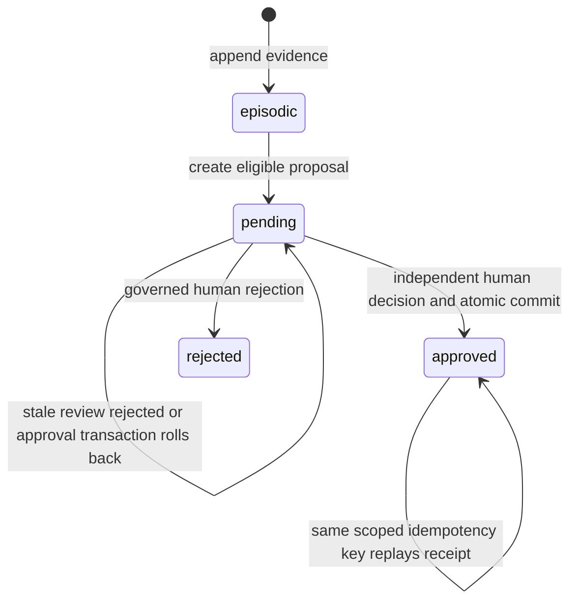

# Design Specification: Allura Memory Command Center

> [!NOTE]
> **AI-Assisted Documentation**
> Portions of this document were drafted with the assistance of an AI language model.
> Content has not yet been fully reviewed — this is a working design reference, not a final specification.
> Code and schemas evidence implementation; approved product decisions establish intent. Record disagreement for the owning decision rather than silently changing either.

> **Visual identity** (colors, typography, shadows, spacing, iconography) lives in [BLUEPRINT.md](./BLUEPRINT.md#0-brand-identity). The Memory Command Center must use real Allura brand assets and tokens only; generated logos and unrelated project tokens are forbidden.


## Review status — 2026-10-18

This correction specifies one bounded journey and distinguishes intended → specified → implemented → verified → released claims. Sabir approved the DOC-06 stale-review rejection and DOC-07 confirmed remote sync/immutable receipt decisions in the current session on 2026-10-18. The intended contracts below are approved; missing API, schema, worker and acceptance evidence remains explicit. This edit does not claim product implementation, select a visual reference, or mark historical routes released.

**Publication authority (DOC-01):** GitHub’s six versioned engineering specifications govern engineering. Notion holds private planning and approvals and links to the specifications; it is not a competing engineering specification. Sabir approved this direction on 2026-10-18. Use the bounded journey and linked acceptance matrix; other unresolved decisions remain in Risks & Decisions.
---

## Table of Contents

- [Overview](#overview)
- [Functional Requirements](#functional-requirements)
- [API Reference](#api-reference)
- [State Machine](#state-machine)
- [Business Rules](#business-rules)
- [Use Cases](#use-cases)
- [Important Constraints](#important-constraints)

---

## Overview

The Allura Memory Command Center provides the human-facing control plane for the Allura Memory Engine. It is not the memory system itself; it is the governed window into memory, RuVix policy, curator decisions, provenance, audit evidence, and tenant settings.

AD-35 adds a proposed run-inspection responsibility for future operator surfaces: show evidence-gated `RunRecord` receipts without making the dashboard or Brain the orchestrator. Runs are reviewable audit objects that connect Notion/board work to Team RAM skill execution, approval breakpoints, quality gates, and memory writeback candidates.

**Core surfaces:**

| Surface | Role | Purpose |
|---------|------|---------|
| **Overview** (`/dashboard`) | Operator / Admin | Observe system health, queue status, freshness, degraded state, and active tenant scope |
| **Memories** (`/dashboard/memories`) | Operator / Curator | Search, filter, inspect, export, and trace memory records |
| **Curator** (`/dashboard/curator`) | Curator / Reviewer | Review, approve, or reject proposed insights before they become active knowledge |
| **Governance** (`/dashboard/governance`) | Admin / RuVix owner | Manage policy mode, thresholds, role separation, tenant isolation checks, and drift warnings |
| **Graph** (`/dashboard/graph`) | Operator / Admin | Explore promoted semantic memory with source receipts |
| **Audit** (`/dashboard/audit`) | Admin / Compliance | Filter event logs, inspect receipts, and export evidence packets |
| **Settings** (`/dashboard/settings`) | Admin | View tenant config, roles, endpoint health, and promotion settings |
| **Runs** (future `/dashboard/runs` or Audit extension) | PM / Reviewer / Compliance | Inspect RunRecord state, approval breakpoints, quality gates, run journals, doctor findings, and evidence packets |

The Command Center is optional: MCP tools, API routes, and CLI scripts remain the primary engine path. The UI surfaces real data from Allura Brain (PostgreSQL (episodic + semantic)), not mocks. Every component consumes mapped UI contracts from `src/lib/dashboard/`; raw Brain API shapes stay behind `api.ts`, `queries.ts`, and `mappers.ts` (AD-26).

### Memory Lifecycle and Done Gate

Agents and Team RAM lanes must read before work, write receipts after substantive action, and keep dashboard/operator views behind MCP/API contracts. The required flow is:

1. **Brain pre-search** — retrieve relevant approved context and recent traces for the active `group_id`.
2. **Governed action** — perform only the approved documentation, API, or workflow mutation.
3. **RuVix disposition** — classify the result as `Permit`, `Defer`, or `Deny` with `gate_reason`.
4. **Receipt write-back** — record `receipt_id`, actor, source evidence, validation, and audit event.
5. **Done gate** — completion is evidence-backed only; Brain receipts support audit but do not prove Done by themselves.

Display runtime labels from a dated health receipt. The TALON `pgvector bridge` observation (2026-06-02) is historical, while the source default graph adapter is `ruvector`. Neither proves native RuVector readiness or current production health. Unknown health remains unknown until checked.

### Dashboard v2 condensed UX contract

Phase 1 is a vertical flow with five operating areas:

| Panel | Purpose | Required state |
| --- | --- | --- |
| System status | Store availability, queue status, tenant scope, freshness | healthy, degraded, unknown, failed, empty, loading |
| Memories | Search, inspect, filter, and open provenance | episodic, semantic, pending, rejected, deleted, degraded |
| Approvals queue | Human decision surface for proposals | proposal ID, score, reasoning, evidence, state, allowed actions |
| RuVix governance | Policy mode, thresholds, role separation, tenant isolation, locks, drift warnings | enforced, blocked, degraded, unknown |
| Audit/evidence | Receipts, source lineage, export packets | append-only, filterable, exportable, degraded |

Required action surface:

```ts
interface DashboardGovernanceActions {
  refresh(): Promise<void>
  approveProposal(id: string): Promise<void>
  requestChanges(id: string, reason?: string): Promise<void>
  requestEvidence(id: string, reason?: string): Promise<void>
  denyProposal(id: string, reason?: string): Promise<void>
  softDeleteMemory(id: string, reason: string): Promise<void>
  recoverMemory(id: string, reason: string): Promise<void>
  openEvidence(id: string): void
  openDetail(id: string): void
  openGovernanceReceipt(id: string): void
}
```

`requestChanges` in the earlier interface sketch is a historical UI idea, not the current decision mapping. The current dashboard submits `decision: request_evidence` to `POST /api/curator/approve`; that path creates an evidence request and leaves the proposal pending. Terminal `reject` is a separate decision. The old rationale-prefix/reject mapping must not be implemented as a substitute for requesting evidence. Sources: `src/components/curator/types.ts`, `src/components/curator/curator-dashboard.tsx`, and `src/app/api/curator/approve/route.ts`.

Truthfulness rules: no fabricated live data, no “healthy” without verification, no “done” without evidence, no “live” without active polling/streaming and visible freshness, unknown is a first-class state, and Brain receipts are audit traces rather than proof of completion.

Run truthfulness rules: no “hallucination-free” claims, no yolo/forever autonomous modes, no foreign process library as canon, and no Done state unless declared quality gates and evidence requirements pass. Interrupted work must show resumable or stale state rather than restarting from vibes.

Governance receipt rule: every mutation and approval must show intent, actor, source, policy, validation, audit trail, `gate_decision` (`Permit | Defer | Deny`), and `approval_required` before completion. For mutations in the approval-required set (REQ-GOV-008), the control plane's `executeSyscall` enforces a well-formed `approval_ref` (a UUID, the canonical governed approval identity shape) after proof verification and policy evaluation and before the syscall executor runs. When the gate fires, the syscall's audit context is updated with `approval_required: true`, the gate decision (`approved`/`denied`), and the resolved `approval_ref`. Resolution against the canonical approval store (`canonical_proposals`) is the approval-lifecycle layer's responsibility: curator/HITL issues the governed identity, and the control plane enforces presence plus UUID format here.

### Accepted Bumblebee plugin planning contract

The intended Bumblebee is the pinned upstream `perplexityai/bumblebee` read-only
endpoint scanner. Allura integrates it through a headless plugin runner and receiver.
The historical names “Bumblebee Guard” and “Bumblebee Threat Watch” refer to local
Allura inventory/advisory adjuncts; they are not the upstream scanner or separate
authority planes.

Each advisory must record source identity and URL, publisher, publication time,
fetch time, trust state, freshness state, content revision/hash, classification or
redaction policy, and retention disposition. A source is eligible only when it is
on the reviewed allowlist and passes its defined verification rule. Failed,
unverified, stale, malformed, or scope-conflicting input becomes a distinct
`rejected`, `degraded`, or `stale` evidence state; it must not appear as a verified
finding. `trust_state` and `freshness_state` remain separate contract dimensions.

The plugin may run the upstream scanner to read approved endpoint metadata. Its runner
must obtain a server-issued source/population lease and dedicated ingestion-only
credential. Accepted scanner evidence may feed a deduplicated alert and a **simulated**
mitigation proposal. Neither scanner nor plugin may execute packages, activate policy,
block CI or packages, change schedules, revoke credentials, lock a workspace, or
contain a host. Those are separate human-authorized workflows with their own receipts.

| Action | V1 authority | Required owner |
|---|---|---|
| Add/change advisory source or verification rule | Human-approved configuration only | Security owner + governance owner |
| Review alert and evidence | Read/review | Security reviewer |
| Approve a mitigation draft for a later enforcement flow | Human approval only | Authorized approver |
| Create alert/simulated proposal from verified evidence | Automatic, deduplicated | Allura worker under AD-57 |
| Enforcement, schedule change, or endpoint action | Prohibited | Separate approved workflow |

Brand/accessibility rules: use existing Allura shell, navigation, logo assets, and semantic tokens; do not import Difference Driven tokens, colors, language, or assumptions; avoid marketing hero sections, fake charts, vanity metrics, AI-gradient tropes, inflated claims, or generated logo marks; approval actions must be keyboard reachable and confirmation dialogs must trap/restore focus.

## Memory Command Center Addendum

The Memory Command Center is an integration program over the MCP/API-first engine, not a second product or a bypass around governance.

| Surface | Role | Status |
|---------|------|--------|
| `localhost:6420` | Historical visual/reference memory dashboard experience | Reference/cutover history |
| `localhost:3334` | Historical development integration target | Reference/cutover history |
| `localhost:3100` | Historical Docker dashboard target | Protected until new launch gates pass |

The Memory Command Center is the approved operator surface for Allura memory governance. It preserves the useful memory capabilities from earlier references while narrowing the first launch around memories, curator work, RuVix governance, graph exploration, audit evidence, and settings.

### Command Center Route Parity

| Reference capability | Command Center target | Source of truth |
|----------------------|------------------------|-----------------|
| Dashboard | `/dashboard` | Aggregated adapter summaries |
| Memories | `/dashboard/memories` | Allura Brain APIs |
| Insights | `/dashboard/memories` or `/dashboard/graph` | Allura Brain / PostgreSQL semantic layer through controlled API |
| Trace logs | `/dashboard/audit` | PostgreSQL append-only events through controlled API |
| Provenance | `/dashboard/audit` and evidence drawer | Trace → proposal → approval → graph evidence chain |
| Extracted | `/dashboard/memories` | Allura extraction/memory APIs |
| Approvals | `/dashboard/curator` | Curator proposals are governed decision data. Work-board authority and adapter direction remain unresolved under DOC-09; the prior Native Kanban/default-adapter plan is not current implementation authority |
| Governance | `/dashboard/governance` | RuVix control plane rules, policy mode, thresholds, isolation, drift |
| Settings | `/dashboard/settings` | Resource manifest + dashboard configuration |
| Search | Memory search surface | Allura retrieval layer |
| Add memory | Governed Allura action | Controlled memory write endpoint |
| Approval Queue | `/dashboard/curator` promotion/approval panel | `canonical_proposals` + audit events |

### Cutover Rule

The rebuilt dashboard may not replace `3100` until route parity, visual parity, adapter/source-of-truth declarations, auth validation, smoke tests, no-fabricated-data checks, and rollback documentation all pass.

**What this document is:**
- Functional requirements for what the dashboard, curator, and settings surfaces must do
- API reference for all dashboard and curator endpoints
- State machines for the curator proposal lifecycle
- Business rules derived from architectural decisions

**What this document is not:**
- A UI style guide (see [BLUEPRINT.md](./BLUEPRINT.md#0-brand-identity))
- Component-level wireframes (see [Command Center route parity](#command-center-route-parity) and [Dashboard Requirements](#dashboard-requirements))
- An implementation roadmap (see [`SOLUTION-ARCHITECTURE.md`](./SOLUTION-ARCHITECTURE.md))

### UX Philosophy

**Sarah's Law:** If an 18-year-old intern has questions after two minutes, it's not done. iPhone clean means one thing on screen. You do it. You learn. No reading required.

**13-16-18 Validation Framework:** 13-year-olds spot emerging trends, 16-year-olds identify popularity gaps, 18-year-olds confirm mainstream readiness. Applied to all consumer-facing surfaces. Target score: 0.85+.

**Consumer mental model:** "Your AI remembers" — the machine is always invisible.

---

## Functional Requirements

`DS-Fn` identifies Design-owned requirements. Blueprint uses `BP-Fn`; the Requirements Matrix records explicit mappings. Local IDs do not inherit meaning from another document merely because their numbers match. Historical implementation/path claims below require endpoint-specific validation; the DOC-J journey is the current bounded acceptance scope.

### Dashboard Requirements

| # | Requirement | Satisfied by |
|---|-------------|-------------|
| DS-F17 | Curator Dashboard — view pending proposals, approve/reject with rationale | `/dashboard/curator` · `GET /api/curator/proposals` · `POST /api/curator/approve` · `POST /api/curator/reject` |
| DS-F18 | Audit Log — view all memory events with filtering and CSV export | `/dashboard/audit` · `GET /api/audit/events` |
| DS-F19 | System Health Dashboard — view service status, metrics, and degradation warnings | `/dashboard` (overview) · `GET /api/health?detailed=true` · `GET /api/health/metrics` |
| DS-F41 | Memory Command Center route shell — `/dashboard`, `/dashboard/memories`, `/dashboard/curator`, `/dashboard/governance`, `/dashboard/graph`, `/dashboard/audit`, `/dashboard/settings` | Governed operator surface over MCP/API contracts; launch only after gates pass |
| DS-F42 | `/dashboard/memories` preserves useful reference memory capabilities | Memories, insights, traces, provenance, extracted facts, and approvals mapped into governed dashboard routes |
| DS-F43 | Historical plan: `/work-board` uses Native Allura Kanban as the default planning source, conflicting with the Notion work-board rule | DOC-09 requires a separate work-board authority decision. Neither plan becomes authoritative through DOC-01, which governs engineering documents |
| DS-F44 | `/resources` reads resource inventory from manifest endpoint or `RESOURCE-MANIFEST.md` | Resource Manifest adapter |
| DS-F45 | `/agents` distinguishes TALON/IRIS from Team RAM/Durham/external agents | Agent adapter + canonical agent taxonomy |
| DS-F46 | `/telemetry` reports real/unknown metrics honestly | Telemetry adapter with degraded/unknown state |
| DS-F47 | Every route displays source-of-truth and degraded behavior | Adapter registry UI contract |
| DS-F48 | `3100` cutover has parity, smoke, auth, and rollback gates | Cutover validation checklist |
| DS-F49 | Governed RunRecord captures tenant, owner, reviewer, goal, status, pinned definition revision, journal path, and timestamps | Partial implementation · AD-35 · `RunRecord` in `DATA-DICTIONARY.md` |
| DS-F50 | Run policy declares allowed actions, approval breakpoints, measured quality gates, bounded attempts, and required evidence | Partial implementation · Epic 14 |
| DS-F51 | Run journal records plan, steps, checks, approvals, failures, continuation state, and final evidence | Partial implementation · Story 12.2 correction |
| DS-F52 | Doctor checks report stale, failed, incomplete, definition-drifted, unrecoverable, or approval-blocked runs before Done | Planned · Epic 14.3 · `/dashboard/runs` |
| DS-F53 | PostgreSQL-backed projects and work items link operational work to runs, handoffs, evidence, and memory receipts | Planned · Epic 15 |
| DS-F54 | Operator workspace uses mission-first navigation, Command Center, central work surface, and right evidence inspector | Planned · Epic 16 |
| DS-F55 | One governed desktop shell provides secure connections, runtime supervision, deep links, updates, and reconnect behavior | Planned · Epic 17 |

### Curator Requirements

| # | Requirement | Satisfied by |
|---|-------------|-------------|
| DS-F10 | `POST /api/curator/score` — score proposal, return confidence + reasoning + tier | `src/lib/curator/score.ts` |
| DS-F11 | `POST /api/curator/approve` — approve proposal, promote to `graph_memories` | `src/app/api/curator/approve/route.ts` |
| DS-F12 | Current compatibility route `POST /api/curator/reject` delegates to the governed decision route with `decision: reject`; it records the rejected state, rationale, event and immutable receipt. The earlier archive/7-day undo expectation is an unimplemented historical requirement, not current behavior | `src/app/api/curator/reject/route.ts`; `src/app/api/curator/approve/route.ts` |
| DS-F13 | Current `GET /api/curator/proposals` filters by `pending`, `approved`, `rejected` or `all`, without a tier filter. Restriction to emerging/adoption tiers remains an unimplemented historical requirement requiring a bounded product decision before reuse | `src/app/api/curator/proposals/route.ts` |
| DS-F14 | Curator dashboard shows three tabs: Traces, Approved, Pending | `/dashboard/curator` |
| DS-F15 | Pending tab sorts by confidence (descending); shows confidence badge + reasoning + action buttons | `ConfidenceBadge` component |
| DS-F16 | Approved tab shows current human-approved knowledge; any historical automated decision is labeled historical and cannot authorize new promotion; sortable by date/confidence | `/dashboard/curator` approved tab |
| DS-F56 | Tab 1 (Traces) restricted to authenticated users with `admin` role | Clerk RBAC |

### Audit & Health Requirements

| # | Requirement | Satisfied by |
|---|-------------|-------------|
| DS-F58 | Audit log endpoint returns all events with filtering and pagination; CSV export for compliance | `GET /api/audit/events` |
| DS-F57 | Dashboard integrates Clerk for authentication and RBAC (curator, admin, viewer roles) | `src/lib/auth/clerk.ts` |
| DS-F26 | Agent task lifecycle events persisted as append-only traces | `src/lib/postgres/queries/insert-trace.ts` |
| DS-F27 | Raw trace storage is append-only; no UPDATE/DELETE on events table | Schema enforcement |
| DS-F28 | Traces preserve provenance linking downstream insights to source evidence | `trace_ref` field |
| DS-F32 | Every approval, rejection, or policy decision recorded as audit event with actor and timestamp | `proposal_approved` / `proposal_rejected` event types |

### Governance Requirements

| # | Requirement | Satisfied by |
|---|-------------|-------------|
| DS-F6 | `PROMOTION_MODE=soc2` — score ≥ threshold queues for human approval | Environment variable |
| DS-F7 | Both `soc2` and legacy `auto` settings require human promotion approval | `src/lib/curator/auto-promote.ts` |
| DS-F34 | Changed insights create new nodes linked with `SUPERSEDES`/`DEPRECATED`/`REVERTED` | `createInsightVersion()` · `deprecateInsight()` |
| DS-F37 | All knowledge-system reads/writes pass through controlled endpoints | RBAC middleware |
| DS-F38 | Agent permissions enforced and all access audited | Auth middleware + event logging |

---

## API Reference

The approval endpoint below was inspected for this bounded repair. Other examples retain prior design contracts and require endpoint-specific verification before use as current response evidence; example counts and health values are not live observations.

### Health & Metrics

#### `GET /api/health?detailed=true`

System health check with optional component-level detail.

**Query parameters:**

| Parameter | Type | Default | Description |
|-----------|------|---------|-------------|
| `detailed` | boolean | `false` | Include per-component health status |
| `include` | string | — | Comma-separated component names to include |
| `exclude` | string | — | Comma-separated component names to exclude |

**Response** (`200 OK`):

```json
{
  "status": "healthy | degraded | unhealthy",
  "timestamp": "2026-04-28T12:00:00Z",
  "uptime": 86400,
  "version": "0.1.0",
  "mode": "http",
  "interface": "rest",
  "dependencies": {
    "postgres": { "status": "up", "required": true, "latency_ms": 3 },
    "graph_memories": { "status": "up", "required": false, "latency_ms": 12 }
  },
  "degraded": {
    "enabled": false,
    "reason": null,
    "capabilities_lost": []
  },
  "components": [
    { "name": "postgresql", "status": "healthy", "message": "Database connection verified", "latency": 3 },
    { "name": "graph_memories", "status": "healthy", "message": "Graph database connection verified", "latency": 12 }
  ]
}
```

**Prior health endpoint contract, verification required:** a degraded health response may retain HTTP `200` while listing lost capabilities; unhealthy durable storage may use `503`. These health semantics do not prescribe approval errors or every retrieval response. PostgreSQL hosts both evidence and semantic tables in the default topology.

---

#### `GET /api/health/metrics`

Operational metrics for the dashboard overview.

**Response** (`200 OK`):

```json
{
  "timestamp": "2026-04-28T12:00:00Z",
  "queue": {
    "pending_count": 3,
    "oldest_age_hours": 48,
    "approved_24h": 12,
    "rejected_24h": 2
  },
  "recall": {
    "search_available": true,
    "last_latency_ms": 45
  },
  "storage": {
    "postgres": { "status": "up", "latency_ms": 3, "total_memories": 247 },
    "graph_memories": { "status": "up", "latency_ms": 12, "total_nodes": 189 }
  },
  "degraded": {
    "graph_memories_unavailable": 0,
    "scope_error": 0,
    "embedding_failures": 0,
    "promotion_failures_24h": 0
  }
}
```

---

### Memory Operations (Dashboard)

#### `GET /api/memory`

List memories scoped by tenant. Supports user filtering and pagination.

**Query parameters:**

| Parameter | Type | Required | Description |
|-----------|------|----------|-------------|
| `group_id` | string | Yes | Tenant identifier (must match `^allura-`) |
| `user_id` | string | No | Filter to specific user |
| `limit` | integer | No | Max results (default 50) |
| `offset` | integer | No | Pagination offset |

---

#### `GET /api/memory/[id]`

Fetch a single memory by ID with tenant scope.

**Query parameters:**

| Parameter | Type | Required | Description |
|-----------|------|----------|-------------|
| `group_id` | string | Yes | Tenant scope |

---

#### `GET /api/memory/count`

Return total count of unique active memories (deduplicated across PostgreSQL (episodic + semantic)).

**Query parameters:**

| Parameter | Type | Required | Description |
|-----------|------|----------|-------------|
| `group_id` | string | Yes | Tenant scope |
| `user_id` | string | No | Filter to specific user |

---

#### `GET /api/memory/traces`

List raw trace events with filtering.

**Query parameters:**

| Parameter | Type | Required | Description |
|-----------|------|----------|-------------|
| `group_id` | string | Yes | Tenant scope |
| `agent_id` | string | No | Filter by agent |
| `event_type` | string | No | Filter by event type |
| `limit` | integer | No | Max results |
| `offset` | integer | No | Pagination offset |

---

#### `GET /api/memory/insights`

List approved insights with pagination.

**Query parameters:**

| Parameter | Type | Required | Description |
|-----------|------|----------|-------------|
| `group_id` | string | Yes | Tenant scope |
| `status` | string | No | Filter by status (`active`, `deprecated`, `superseded`) |
| `limit` | integer | No | Max results (default 20) |
| `offset` | integer | No | Pagination offset |

---

#### `GET /api/memory/insights/[id]/history`

Version history for a specific insight (SUPERSEDES chain).

**Query parameters:**

| Parameter | Type | Required | Description |
|-----------|------|----------|-------------|
| `group_id` | string | Yes | Tenant scope |

---

#### `GET /api/memory/graph`

Read-only tenant-scoped knowledge graph visualization.

Returns real `graph_memories` rows and edges for the dashboard graph tab. Capped display sample plus `total_edges` count. Performs no mutations.

**Query parameters:**

| Parameter | Type | Required | Description |
|-----------|------|----------|-------------|
| `group_id` | string | Yes | Tenant scope (required, validated) |

**Response:** `MemoryGraphResponse` — `{ nodes: GraphNode[], edges: GraphEdge[], total_edges?: number }`

---

### Curator Operations

#### `GET /api/curator/proposals`

List proposed insights awaiting review.

**Query parameters:**

| Parameter | Type | Required | Description |
|-----------|------|----------|-------------|
| `group_id` | string | Yes | Tenant scope |
| `status` | string | No | Filter by status (default: `pending`) |
| `limit` | integer | No | Max results (default 20) |

---

#### `POST /api/curator/approve`

Authenticated decision boundary. The route accepts `approve`, `reject` or `request_evidence`; approval delegates to the atomic service. Principal and workspace come from the web session; the supplied group is checked against that authority. A client-supplied `curator_id` cannot grant reviewer identity.

**Approved intended request body (DOC-06; version precondition not yet implemented):**

```json
{
  "proposal_id": "uuid",
  "group_id": "allura-system",
  "expected_proposal_version": "3",
  "decision": "approve",
  "rationale": "Validated against source evidence.",
  "evidence_request_ids": []
}
```

For approval, send a stable `Idempotency-Key` header. The current implementation otherwise derives a key from proposal ID, action and authenticated user. Same scope/key/proposal replays the original decision receipt; changed rationale or evidence does not amend it.

**Approved revision rule (DOC-06):** a new approval carries `expected_proposal_version`, the positive decimal string for the exact proposal version shown during review. After authenticating and resolving tenant/workspace, the service locks the scoped proposal, validates successful replay first, and for a new decision compares the supplied version with the locked version before durable approval writes. Missing/malformed preconditions fail with `400`; a version mismatch fails with `409` (`PROPOSAL_VERSION_CONFLICT`) and no new semantic/proposal/outbox/receipt/replay writes. The UI reloads the proposal and requires review and explicit approval of that new version; it must not silently replace the expected version and retry. Two reviewers of the same version cannot both create a new approval. A successful same-key replay returns the original receipt, even though the approval transition has since advanced the proposal version; it does not authorize new content.

**Decision evidence:** retain the accepted pre-transition version as `reviewed_proposal_version` in the immutable decision evidence, distinct from current `proposal_version`, which records the post-transition version. The intended field is not present in the inspected receipt schema. The reviewed-version precondition and evidence must be implemented together.

**Current implementation gap:** the route/service accepts no expected review version and locks whichever revision exists at submission. Its internal version predicate protects the already locked transition, not the human’s earlier review. The current API may ignore the new request field; callers must not treat sending it as enforcement. DOC-06 remains blocked for implementation acceptance until stale-review and successful-replay tests pass.

**Current response:** `200 OK` returns the persisted `GovernanceReceipt` directly, including receipt ID, tenant/workspace, proposal/post-transition version, actor, policy, evidence identity, memory identity and decision-time outbox state. Data Dictionary owns the complete receipt shape and the intended reviewed-version extension. The original approval receipt is immutable and remains `queued` after later delivery. A separate delivery observation must include read-back matching the authorized destination, remote page/record, and intended source revision/content before showing Notion `synced` (DOC-07); neither local outbox `delivered` nor a successful approval response proves it.

| Status | Implemented condition |
|---|---|
| `400` | Invalid request/evidence, or idempotency key already bound to a different proposal |
| `401` / `403` | Missing authentication, insufficient role/scope, tenant mismatch, unresolved workspace, or requester self-approval |
| `404` | Proposal not found in resolved scope |
| `409` | Approval of an already-decided proposal |
| `500` | Unexpected decision failure; approval transaction rolls back |

**Evidence inspected 2026-10-18:** `src/app/api/curator/approve/route.ts`, `src/lib/memory/approve-proposal.ts`. Error mapping for rejection/evidence requests is separate in that route; approval replay semantics must not be assumed for other decisions.

---

#### `POST /api/curator/reject`

Compatibility shim: delegates to `POST /api/curator/approve` with `decision: reject`, preserving the authenticated request headers. The scoped decision records the rejected state, rationale, event and immutable receipt. It does not implement a 7-day archive/undo mechanism. Reviewer identity comes from authentication; a client `curator_id` cannot assign authority. Requesting more evidence uses the separate `request_evidence` decision and does not reject the proposal.

**Request body:**

```json
{
  "proposal_id": "uuid",
  "group_id": "allura-system",
  "rationale": "Duplicate of existing knowledge."
}
```

---

### Audit

#### `GET /api/audit/events`

Full audit trail with pagination, filtering, and CSV export.

**Query parameters:**

| Parameter | Type | Required | Description |
|-----------|------|----------|-------------|
| `group_id` | string | Yes | Tenant scope (must match `^allura-`) |
| `format` | string | No | `json` (default) or `csv` |
| `from` | ISO 8601 | No | Start date filter |
| `to` | ISO 8601 | No | End date filter |
| `agent_id` | string | No | Filter by agent |
| `event_type` | string | No | Filter by event type |
| `limit` | integer | No | Max rows (default 1000, max 10000) |
| `offset` | integer | No | Pagination offset |

**Auth:** Requires `viewer` role or above.

**CSV response** includes `Content-Disposition: attachment; filename="audit-events-{group_id}-{date}.csv"` header.

---

### Budget Admin

#### `POST /api/admin/reset-budget`

Reset halted budget sessions for a tenant group or globally. Requires bearer auth.

**Request body:**

```json
{
  "group_id": "allura-system"
}
```

`group_id` is optional — if omitted, all halted sessions across all groups are reset.

**Response** (`200 OK`):

```json
{
  "cleared": 3,
  "before": 5,
  "after": 2
}
```

**Auth:** Requires valid bearer token (same as other admin endpoints).

---

### Governed Retrieval

#### `POST /api/memory/retrieval`

The controlled retrieval layer — the sole read path for agents (AD-19). Agents MUST NOT query PostgreSQL directly.

**Request body:**

```json
{
  "group_id": "allura-system",
  "agent_id": "agent_executor",
  "query": "What image tag should postgres use?",
  "mode": "hybrid",
  "scope": { "project": true, "global": true },
  "include_traces": false,
  "filters": { "status": "active", "min_confidence": 0.7 },
  "limit": 10
}
```

**Response** (`200 OK`):

```json
{
  "results": [
    {
      "insight_id": "uuid",
      "content": "Postgres image must remain pinned to pgvector:0.7.0-pg16...",
      "source": "graph_memories",
      "confidence": 0.95,
      "scope": "project",
      "version": 2,
      "provenance": {
        "proposal_id": "uuid",
        "approved_by": "human_reviewer",
        "approved_at": "2026-04-19T20:50:00Z"
      }
    }
  ],
  "total": 1,
  "metadata": {
    "retrieved_at": "2026-04-28T21:00:00Z",
    "project_count": 1,
    "global_count": 0
  }
}
```

**Retrieval modes:**

| Mode | Description | Sources |
|------|-------------|---------|
| `semantic` | Content-based search across approved insights | PostgreSQL semantic tables `searchInsights()` |
| `structured` | Filter-based query (status, confidence, date range) | PostgreSQL semantic tables `listInsights()` |
| `hybrid` | Dual-context: project + global insights merged by confidence | `getDualContextSemanticMemory()` |
| `traces` | Raw trace retrieval (policy-gated, not default) | PostgreSQL `queryTraces()` |

---

## State Machine

### Event Types

The following event types are recorded in the PostgreSQL `events` table (append-only):

| Event Type | Description | Source |
|------------|-------------|--------|
| `memory_add` | Agent writes episodic trace to PostgreSQL | Memory engine |
| `memory_search` | Agent searches memories (federated PostgreSQL (episodic + semantic)) | Memory engine |
| `memory_get` | Agent retrieves single memory | Memory engine |
| `memory_delete` | Soft-delete with 30-day recovery | Memory engine |
| `memory_restore` | Restore from soft-delete within recovery window | Memory engine |
| `memory_promote` | Request promotion to PostgreSQL semantic tables (creates proposal) | Curator |
| `proposal_created` | Curator creates canonical proposal | Curator scorer |
| `proposal_approved` | Human approves proposal | Curator approve route |
| `proposal_rejected` | Human rejects proposal | Curator reject route |
| `memory_promoted` | Historical promotion event vocabulary; current approval result is GovernanceReceipt | Compatibility producer mapping requires verification |
| `memory_deprecated` | Old version marked deprecated via SUPERSEDES | Version workflow |
| `threat_advisory_received` | Allowlisted advisory or approved internal evidence accepted as provisional | Allura downstream threat intake |
| `threat_evidence_rejected` | Evidence denied for trust, freshness, schema, or scope failure | Allura downstream threat intake |
| `threat_alert_created` | Deduplicated alert created from verified exposure evidence | Allura downstream correlation |
| `mitigation_proposal_simulated` | Non-enforcing mitigation draft prepared for human review | Allura downstream correlation |

These event types are defined by the Story 26.1 downstream Allura contracts in
[DATA-DICTIONARY.md](./DATA-DICTIONARY.md#story-261-allura-threat-intelligence-contracts).
They do not define the upstream scanner transport or snapshot ledger.

### Curator Pipeline State Machine



`pending`, `approved` and `rejected` are proposal states. The stale-review transition is approved intended behavior under DOC-06, not current implementation evidence. Semantic retrieval, local outbox delivery, remote projection and request completion are separate states: a failed Notion projection does not undo committed approval; a request timeout does not prove rollback. Supersession creates a new content version. Restore/rollback behavior is excluded from this bounded journey until DOC-03 is resolved.

### Bounded memory journey

**Purpose:** preserve an authorized observation as evidence, let a different authorized human approve reusable knowledge, and retrieve the resulting knowledge only within its permitted scope.

| Step | Observable contract | Failure / retry / evidence |
|---|---|---|
| Capture | Server resolves principal, tenant and workspace; appends episodic evidence; eligible content may become a pending proposal | Denied scope must not cause a write. A pending/timeout response is unconfirmed. Do not assume approval idempotency applies to `memory_add`; its retry contract requires transport-specific verification. |
| Review | Show exact proposal identity/version, source event, scope, content, reviewer permissions and rationale; submit that version as `expected_proposal_version` | DOC-06 rejects a changed version and requires renewed human review; enforcement is not yet implemented. Missing/out-of-scope evidence and requester self-approval fail closed. Score is assistance, not permission. |
| Approve | Authorized curator/admin with `review:approve` commits semantic row, proposal transition, audit, outbox, receipt and replay record in one transaction | Same scoped key and proposal replays the original receipt even if rationale/evidence differ; it does not amend that decision. Key reused for another proposal conflicts; already-decided proposals cannot be decided again with a new key. New approvals must satisfy DOC-06’s reviewed-version precondition (implementation pending). Rollback leaves no partial approval. |
| Retrieve | Same-scope request returns current permitted content and provenance | Deleted/superseded content must not appear as current knowledge; foreign scope is denied/excluded. Search success is not write or release authority. |
| Project | Intended remote Notion projection follows durable approval and authorized delivery; current promotion worker only appends a local event | DOC-07: remote `synced` requires read-back matching authorized destination/page and intended source revision/content; HTTP success or a page ID alone is insufficient. Local `delivered` is not sync. Keep original approval receipt immutable; expose separate delivery observation. Ambiguous remote results remain unknown and require reconciliation before retry. |

**Source evidence, inspected 2026-10-18:** `src/lib/memory/approve-proposal.ts`, `src/lib/curator/auto-promote.ts`, `src/curator/approve-cli.ts`, `src/lib/graph-adapter/ruvector-adapter.ts`, `src/lib/memory/promotion-outbox-worker.ts`, `src/curator/notion-sync-worker.ts`. **Claim state:** approved intended contracts are distinct from source-inspected current behavior. The outbox emits `canonical_memory_promoted`; the Notion worker consumes `notion_sync_pending`, so this path has no established remote handoff. DOC-06 version binding and DOC-07 confirmed delivery remain implementation gaps. Full journey verification and release remain pending current-revision receipts (Requirements Matrix).

**Visual acceptance boundary:** the exact approved screen/design revision, assets and state references for this journey have not been established by this repair. DOC-02 is **Needs a decision** for Sabir and Durham. Existing broad Command Center sections and brand tokens are supporting references, not proof of an approved current screen. Before a UI story is Ready, name its exact approved reference plus loading, empty, denied, conflict, timeout/unknown, success, keyboard and responsive states. RAM reviews behavior; Durham independently reviews fidelity; the builder cannot approve either result alone.

---

## Business Rules

| Rule ID | Rule | Source | Enforcement |
|---------|------|--------|-------------|
| AD-04 | Legacy mode configuration does not authorize promotion. Human approval is required. | RISKS-AND-DECISIONS | `src/lib/curator/auto-promote.ts` and `approve-proposal.ts` |
| AD-08 | Soft-delete only. No hard deletes. Deletion records are append-only events, not erasures. | RISKS-AND-DECISIONS | `memory_delete` appends event + sets `deprecated: true` on PostgreSQL semantic tables node |
| AD-09 | Historical two-store degradation decision, superseded by AD-50. Current approval is one PostgreSQL transaction; failure rolls it back. | RISKS-AND-DECISIONS | `src/lib/memory/approve-proposal.ts` |
| AD-19 | Agents MUST NOT query PostgreSQL directly. Reads use authenticated governed interfaces: canonical MCP `memory_search` or the applicable controlled retrieval API. | RISKS-AND-DECISIONS | Code review gate + `direct-access-blocker.ts` |
| AD-20 | Historical event-status marking is obsolete. Watchdog deduplicates by an existing same-scope proposal referencing the source event. | RISKS-AND-DECISIONS | `src/curator/watchdog.ts` `NOT EXISTS` proposal check; no historical event mutation |
| AD-22 | `VALIDATION-GATE.md` is archived in `docs/archive/allura/`, not canonical. Per the canonical surface rule. | RISKS-AND-DECISIONS | Cross-linked from BLUEPRINT, not in `docs/allura/` |
| — | `group_id` must match `^allura-` pattern. Enforced by PostgreSQL CHECK constraint. | BLUEPRINT §7 | Schema-level, not application-level |
| — | Historical 30-day recovery UI expectation; expiry does not authorize erasing evidence. Restore semantics remain blocked under DOC-03. | BLUEPRINT §11 | `memory_restore` validates recovery window |
| — | Append-only events table. No UPDATE or DELETE mutations on `events`. | BLUEPRINT §7 | No UPDATE/DELETE code paths in application |
| — | Proposals require independent human approval; a threshold or legacy mode does not approve them. | BLUEPRINT §2 BP-F6/BP-F7 | `PROMOTION_MODE` environment variable |
| — | Audit trail is append-only and exportable as CSV. | BLUEPRINT §9 BP-F18 | `GET /api/audit/events?format=csv` |
| — | `DashboardResult<T>` wraps dashboard adapter results with `{ data, error, degraded, warnings }`; endpoint-specific responses such as `GovernanceReceipt` retain their own contract. | Dashboard architecture | `src/lib/dashboard/types.ts` |
| — | Dashboard scoped to `group_id` (tenant isolation). All API calls include `group_id`. | Tenant isolation | `withGroupId()` in dashboard client |
| — | Report degraded/unknown state according to the specific endpoint contract; do not infer success from partial availability. | Bounded journey | Approval failures roll back; health and retrieval status codes require their own evidence |

---

## Use Cases

### MEM-UC10: Curator reviews and approves/rejects pending proposals

**Actor:** Curator (authenticated with `admin` or `curator` role)

**Precondition:** At least one proposal exists in `pending` status. Score is review assistance; the approval service does not enforce a minimum score. Capture/watchdog eligibility thresholds are separate producer rules and cannot grant approval authority.

**Steps:**
1. Curator navigates to `/dashboard/curator`
2. Dashboard calls `GET /api/curator/proposals?status=pending`
3. Proposals display with confidence badge, reasoning, and source evidence
4. Curator reviews the exact proposal version, summary, evidence links, and confidence score
5. Curator approves: `POST /api/curator/approve` with `decision: "approve"`, rationale and the reviewed `expected_proposal_version`; DOC-06 requires conflict/re-review if the version changed (not yet implemented)
6. System promotes approved insight to PostgreSQL semantic tables as an immutable content row within the atomic approval transaction
7. Audit event `proposal_approved` written to PostgreSQL with curator ID and timestamp
8. Curator rejects: `POST /api/curator/reject` with rationale
9. System archives rejected proposal; audit event `proposal_rejected` written

**Postcondition:** A valid decision transitions the proposal to `approved` (promoted to PostgreSQL semantic tables) or `rejected` (retained in PG) with audit evidence. A stale-review approval must leave it undecided and require new review under DOC-06; that implementation/acceptance gap blocks this use case from being called verified.

**Requirements:** DS-F10–DS-F13, DS-F17

---

### MEM-UC11: Admin views audit log with filtering and CSV export

**Actor:** Admin (authenticated with `admin` role)

**Precondition:** At least one event exists in the `events` table.

**Steps:**
1. Admin navigates to `/dashboard/audit`
2. Dashboard calls `GET /api/audit/events` with optional filters (`event_type`, `agent_id`, `from`, `to`)
3. Events display in chronological order with pagination
4. Admin clicks "Export CSV"
5. Dashboard calls `GET /api/audit/events?format=csv` with current filters
6. Browser downloads `audit-events-{group_id}-{date}.csv`

**Postcondition:** Admin has a complete, filtered audit trail in JSON or CSV format.

**Requirements:** DS-F18

---

### MEM-UC12: Operator monitors system health and degradation

**Actor:** Operator

**Precondition:** Allura services are running.

**Steps:**
1. Operator navigates to `/dashboard` (overview)
2. Dashboard calls `GET /api/health?detailed=true` and `GET /api/health/metrics`
3. Overview displays: system status, queue depth, recall latency, storage stats, degraded component count
4. If a graph operation fails while other reads remain available, show its actual lost capabilities and receipt. If PostgreSQL is unavailable, report durable-storage failure rather than implying a second healthy store.
5. Operator sees metric cards: total memories, pending proposals, active agents, system uptime
6. Activity panel shows recent events

**Postcondition:** Operator has full visibility into system health, including degradation state.

**Requirements:** DS-F19

---

### MEM-UC13: Agent performs governed memory retrieval

**Actor:** AI Agent

**Precondition:** Agent has valid `group_id` and `agent_id`.

**Steps:**
1. Agent calls `POST /api/memory/retrieval` with query, scope, and mode
2. Retrieval layer validates `group_id` and agent permissions
3. For `semantic` mode: `searchInsights()` from PostgreSQL semantic tables
4. For `structured` mode: `listInsights()` from PostgreSQL semantic tables
5. For `hybrid` mode: `getDualContextSemanticMemory()` merges project + global insights
6. For `traces` mode (policy-gated): `queryTraces()` from PostgreSQL
7. Results returned with provenance metadata (proposal ID, approver, approval timestamp)
8. Retrieval call logged as audit event

**Postcondition:** Agent receives scoped, policy-controlled memory context. No direct database access occurred.

**Requirements:** AD-19, DS-F28, DS-F37, DS-F38, DOC-J06

---

### MEM-UC14: User soft-deletes and restores a memory within 30-day window

**Blocked for implementation/acceptance:** this prior use case is not ready until DOC-03 resolves restore lineage semantics. The steps below are historical intended behavior, not permission to delete lineage.

**Actor:** End User

**Precondition:** Memory exists and is not already soft-deleted.

**Steps:**
1. User swipes/hovers on a memory in `/memory` view
2. User taps [Forget] (soft-delete)
3. System calls `DELETE /api/memory/[id]`
4. System appends `memory_delete` event to PostgreSQL
5. System marks PostgreSQL semantic tables node as `deprecated: true` (if promoted)
6. Memory appears in "Recently Forgotten" view (`/memory?view=forgotten`)
7. Within 30 days, user taps [Restore]
8. System calls `POST /api/memory/[id]/restore`
9. System appends `memory_restore` event to PostgreSQL
10. System removes `deprecated` flag from PostgreSQL semantic tables node

**Postcondition:** Memory is either soft-deleted (recoverable within 30 days) or restored to active state.

**Requirements:** AD-08, BP-F5, DOC-03

---

### MEM-UC15: Dashboard displays knowledge graph visualization

**Actor:** Operator / Admin

**Precondition:** PostgreSQL semantic tables contains Memory, Agent, Team, and Project nodes.

**Steps:**
1. Operator navigates to `/dashboard/graph`
2. Dashboard calls `GET /api/memory/graph?group_id=allura-system`
3. API returns `MemoryGraphResponse` with nodes, edges, and `total_edges`
4. Dashboard renders interactive graph with `GraphSummary` component
5. Operator clicks a node to see detail in `NodeDetailPanel`
6. Graph shows `AUTHORED_BY`, `RELATES_TO`, `MEMBER_OF`, `CONTRIBUTES_TO` relationships

**Postcondition:** Operator has visual understanding of knowledge graph structure and relationships.

**Requirements:** DS-F41 (dashboard route scope), AD-24 (structural context layer)

---

## Important Constraints

1. **Dashboard scoped to `group_id`.** Every API call includes `group_id` for tenant isolation. No cross-tenant data access is possible.

2. **Proposals require independent human approval.** Both configured modes preserve HITL; every semantic promotion goes through the governed approval service.

3. **Audit trail is append-only and exportable.** No UPDATE or DELETE on the `events` table. CSV export supports SOC2 compliance requirements.

4. **Degradation is endpoint-specific.** A partial retrieval may report degraded data; an unhealthy storage service may fail the request. Neither implies a separate healthy semantic/evidence database. Approval errors roll back their transaction, and timeout remains unconfirmed. Verify the endpoint status/envelope rather than imposing a universal HTTP 206 rule.

5. **`DashboardResult<T>` wraps all responses.** Every dashboard API call returns `{ data: T | null, error: string | null, degraded: boolean, warnings: DashboardWarning[] }`. Components handle null data and degraded state explicitly.

6. **Curator deduplicates without changing evidence (AD-20).** The watchdog excludes a source event when a same-tenant/workspace proposal already references it. Historical events remain append-only.

7. **Agents MUST NOT query PG/PostgreSQL semantic tables directly (AD-19).** All retrieval goes through `POST /api/memory/retrieval`. Code review gate checks for direct database imports in agent-facing code.

8. **Semantic promotion requires the governed human decision flow.** Content promotion cannot bypass the curator approval service; lifecycle and structural operations require their own authorized contracts and must not be inferred from promotion permission.

9. **Immutable insight rows.** `graph_memories` rows are never updated in place. Any change requires a new proposal → approval → new row with `SUPERSEDES` edge.

10. **30-day soft-delete recovery.** Memories can be restored within 30 days of soft-deletion. After that, they are permanently gone.

11. **Bumblebee V1 is proposal-only (AD-57).** Its only automatic outputs are verified, deduplicated alerts and simulated mitigation proposals. It is read-only toward endpoints and external enforcement systems.

---

## Dashboard Architecture

### Pages

| Path | Purpose |
|------|---------|
| `/dashboard` | Overview — system health, metrics, recent activity |
| `/dashboard/memories` | Memory browser with search and filtering |
| `/dashboard/curator` | Three-tab curator: Traces, Approved, Pending |
| `/dashboard/governance` | RuVix policy mode, thresholds, role separation, tenant isolation, locks, drift warnings |
| `/dashboard/audit` | Full audit trail with filtering and CSV export |
| `/dashboard/graph` | Knowledge graph visualization |
| `/dashboard/agents` | Agent roster and activity |
| `/dashboard/projects` | Project list and status |
| `/dashboard/skills` | MCP skill catalog and status |
| `/dashboard/settings` | Tenant configuration, promotion mode, user management |
| `/dashboard/evidence/[id]` | Evidence detail for a specific trace |

### Components

| Component | Purpose |
|-----------|---------|
| `MetricCard` | KPI display card (memory count, pending proposals, etc.) |
| `InsightCard` | Approved insight with confidence badge |
| `MemoryCard` | Memory entry with provenance and status |
| `EvidenceCard` | Raw trace evidence display |
| `ActivityPanel` | Chronological event feed |
| `GraphSummary` | Graph node/edge count summary |
| `NodeDetailPanel` | Click-through detail for a graph node |
| `SearchInput` | Dashboard search with group_id scoping |
| `StatusPill` | Health/degradation status indicator |
| `ConfidenceBadge` | Confidence score display (60–100%) |
| `WarningList` | Degradation warnings display |
| `PageHeader` | Page title and action buttons |
| `EmptyState` | Zero-data placeholder |
| `LoadingState` | Skeleton loading placeholder |
| `ErrorState` | Error display with retry |
| `BudgetCard` | Budget enforcement status (active sessions, halted sessions, TTL auto-expiry countdown) |
| `TokenPreview` | Token system visualizer (DDR-004 compliant, surfaces WCAG contrast warnings for failing pairings) |
| `Tabs` | Tab navigation (Curator: Traces / Approved / Pending) |

### Types

```typescript
interface DashboardResult<T> {
  data: T | null
  error: string | null
  degraded: boolean
  warnings: DashboardWarning[]
}

interface DashboardWarning {
  id: string
  message: string
  source: string
}
```

### API Client

```typescript
class DashboardApiError extends Error {
  constructor(message: string, readonly status: number, readonly url: string)
}

// All calls include group_id for tenant scoping
function withGroupId(params?: Record<string, QueryValue>): URLSearchParams

// readJson handles 206 (degraded) responses transparently
async function readJson<T>(path: string, init?: RequestInit): Promise<{ data: T; degraded: boolean; warning: string | null }>
```

---

## References

- [BLUEPRINT.md](./BLUEPRINT.md) — requirements this design satisfies
- [SOLUTION-ARCHITECTURE.md](./SOLUTION-ARCHITECTURE.md) — governed memory pipeline design
- [RISKS-AND-DECISIONS.md](./RISKS-AND-DECISIONS.md) — architectural decisions and risk register
- [SOLUTION-ARCHITECTURE.md](./SOLUTION-ARCHITECTURE.md) — system topology and deployment
- [DATA-DICTIONARY.md](./DATA-DICTIONARY.md) — canonical field and entity definitions
- [BLUEPRINT.md](./BLUEPRINT.md#0-brand-identity) — visual identity, wireframes, and design rules
