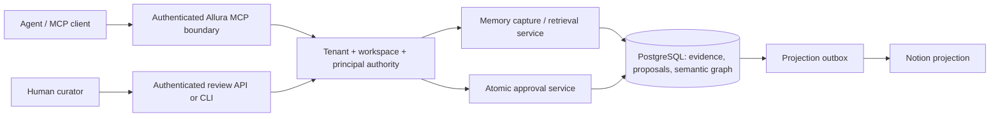
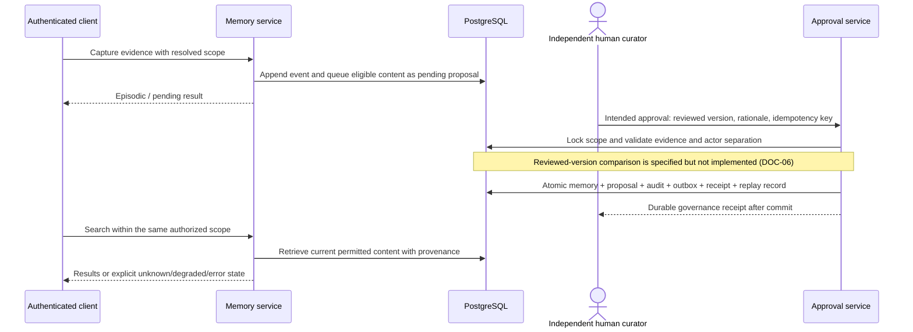
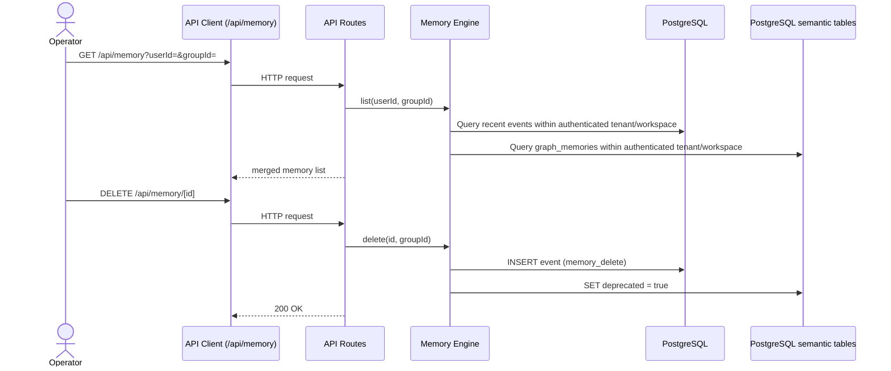
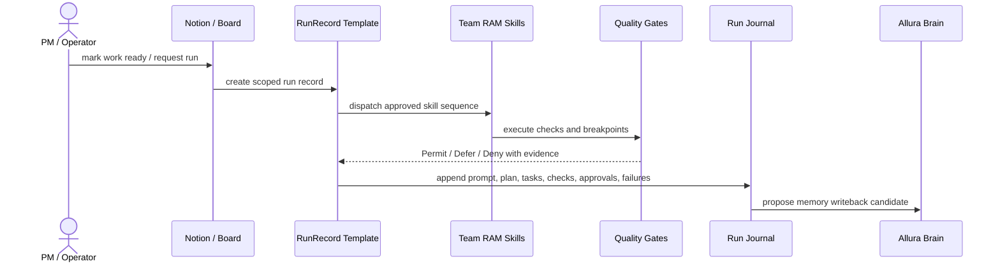
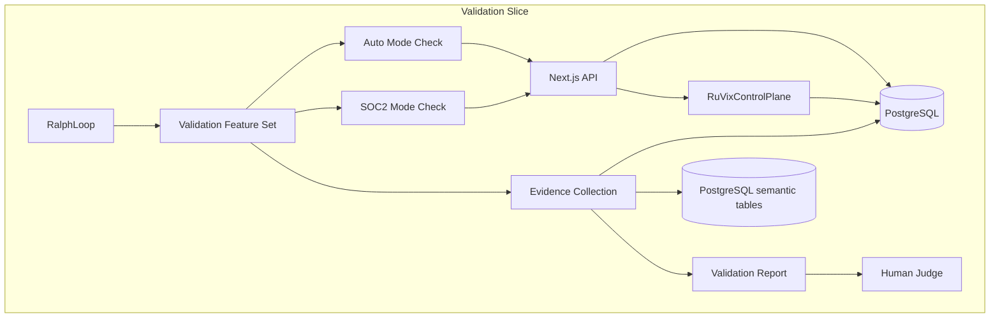
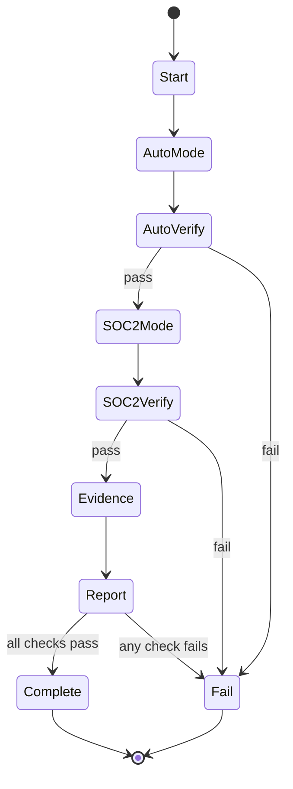
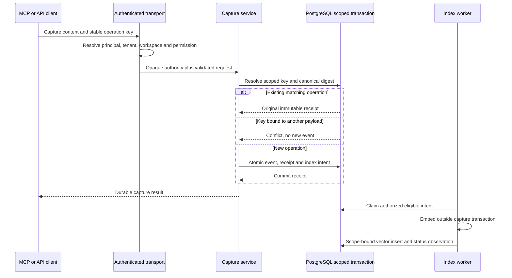
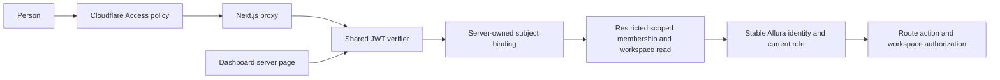

# Solution Architecture: Allura

> [!NOTE]
> **AI-Assisted Documentation**
> Portions of this document were drafted with AI assistance; Codex prepared the 2026-10-20 development-readiness additions.
> Content has not yet been fully reviewed. This is a working design reference, not a final specification.
> AI-generated content may contain inaccuracies or omissions.
> Code and schemas evidence implementation; approved product decisions establish intent. Record disagreement for the owning decision rather than silently changing either.

**Integration evidence boundary — 2026-10-21:** This revision consolidates specifications and source-local assessments from `28d90e843` plus the dirty-file snapshot identified in the [source manifest](../reference/development-readiness-20261021/source-manifest.json), onto main base `c720aca2e` (PR #169 content head `51e421ca0`). Dashboard, Cloudflare authentication and preview implementation changes are excluded. Their “implemented” or test-count statements below are dated source-local observations, not verification of this branch, current main or deployment. Missing local receipts remain [unavailable supporting evidence](../reference/development-readiness-20261021/unavailable-evidence.md). [Story packets](../reference/development-readiness-20261021/story-packets.md) operationalize the canonical gates without approving proposed decisions.

This document covers Allura's deployment topologies, integration interfaces, and architectural constraints. The physical data contract is owned by [DATA-DICTIONARY.md](./DATA-DICTIONARY.md); behavior and API contracts are owned by [DESIGN-ALLURA.md](./DESIGN-ALLURA.md).


**Approved intended authentication migration (source-local implementation):** [Cloudflare Access web authentication](#cloudflare-access-web-authentication). The approved provider change is Cloudflare Access under [AD-69](RISKS-AND-DECISIONS.md#AD-69-cloudflare-access-replaces-clerk); the provider implementation remains a separate unmerged source-local change and is not current-main or deployment evidence.

## Evidence and publication status — 2026-10-18

**Claim state:** specified with source-inspected implementation evidence for the bounded capture → review/promotion → retrieval journey; no fresh end-to-end or release receipt is claimed here. Blueprint DOC-01 records Sabir’s 2026-10-18 reconfirmation: GitHub owns the six versioned engineering specifications; Notion holds private planning/approval records and links. DOC-06 and DOC-07 record approved specification decisions with implementation gaps. This repair does not adopt the proposed Agreement Before Implementation policy wholesale.

The main boundary is stable: authenticated scope enters governed services; append-only evidence, mutable proposal workflow state, immutable semantic content versions and asynchronous projections have distinct responsibilities. Physical fields belong to Data Dictionary and observable failure/retry behavior belongs to Design.
---

## Enterprise dashboard read boundary — 2026-10-19

Source-local implementation path (not included in this integration): authenticated page → `requireDashboardScope` → server-only `src/lib/dashboard/read-service.ts` → `withWorkspaceTransaction` using the restricted application role and transaction-local tenant/workspace/principal scope. Client presentation receives DTOs from `read-model.ts`, never a database credential or a caller-selected tenant. This is application server behavior, not authorization for an agent to query the database directly.

In that source-local slice, `/dashboard/search` uses the bounded memory reader; `/dashboard/graph` uses actual stored lineage and structural edges. The new pages do not call the legacy `/api/memory/graph` route. That legacy route and other historical readers require separate isolation review; this slice does not endorse them. Read errors are redacted to stable unavailable states. Work-item counts are unavailable because the current table lacks the required workspace contract.

Unit tests verify scoped query construction and page wiring; live database role, RLS and multi-user isolation still need acceptance evidence. A local Next/Clerk origin mismatch was reproduced when the development server bound `127.0.0.1`: Next normalizes the URL to `localhost`, making a Clerk rewrite appear external. Binding the local server to `localhost` restored the sign-in form without enabling development authentication or changing credentials. This is local development evidence only.

## Table of Contents

- [1. Architectural Positioning](#1-architectural-positioning)
- [2. System Boundary and External Actors](#2-system-boundary-and-external-actors)
- [3. Logical Topologies](#3-logical-topologies)
- [4. Interface Catalogue](#4-interface-catalogue)
- [5. Risk-Architecture Traceability](#5-risk-architecture-traceability)
- [6. Key Architectural Constraints](#6-key-architectural-constraints)
- [7. References](#7-references)
- [Development readiness topology](#development-readiness-topology--2026-10-20)


---

## 1. Architectural Positioning

Allura is a **memory data plane** — it holds no business logic about what an agent does, only what an agent remembers. It is the authoritative source of truth for all agent memory within a tenant namespace. The default graph adapter persists semantic relationships in PostgreSQL; vector retrieval uses pgvector. The dated TALON observation from 2026-06-02 is historical evidence, not a current deployment health claim. Native capability and released readiness require separate receipts.

| Consumer Class | Interaction Mode | Notes |
|---|---|---|
| AI Agents (Claude, GPT, etc.) | Brooks / Team RAM + skills | Skills enforce memory-first routing to packaged MCP servers |
| Team RAM Work Items | `.opencode/work-items/` | Local evidence and work-item artifacts support the Notion board without becoming an independent authority |
| DevOps / Admin | Docker Compose + MCP_DOCKER config | Deployment, configuration, and packaged MCP server activation |

Allura Brain does **not** orchestrate agents, run workflows, or make decisions. It stores and retrieves memory. Period. Optional orchestration wrappers may compose Team RAM skills into governed runs, but those wrappers remain outside the memory data plane and may only write receipts, proposals, and evidence through approved API/MCP paths.

---

## 2. System Boundary and External Actors



The client cannot mint tenant, workspace, or reviewer authority from request fields. Intended Notion projection follows the durable decision; it does not authorize promotion. The inspected outbox worker confirms local event delivery only, and the handoff to confirmed remote Notion delivery is an implementation gap (DOC-07). Orchestration and UI sit outside the memory data plane.

## 3. Logical Topologies

### 3.1 Agent Memory Recall (Primary Path)

Discover and use the authenticated Allura Brain `memory_search` interface for the permitted tenant. Retrieval applies server-resolved workspace scope and returns content with source/provenance. A successful search does not prove write authority, promotion, or release readiness. Source: `src/mcp/canonical-tools.ts` and the retrieval contracts under `src/lib/retrieval/`.

### 3.2 Evidence Escalation (Trace Verification)

Use governed audit/read tools for the same authorized tenant and workspace when a recalled result requires source evidence. Append-only events remain the historical record. Read authority does not grant cross-workspace copying or mutation. A tool timeout leaves that request unconfirmed; it is not proof that the backend is unavailable.

### 3.3 Graph Inspection (Read-only)

Inspect lineage and structural context through controlled API/MCP services backed by `IGraphAdapter`. The PostgreSQL default stores semantic content in `graph_memories`, lineage in `graph_supersedes`, and structural context in `graph_structural_nodes`/`graph_structural_edges`. Historical Neo4j inspection servers and Cypher fallbacks are retired from this current route. No direct database access is implied for an agent.

### 3.4 Governed Memory Write Path



**Implemented boundary, inspected 2026-10-18:** `src/lib/memory/approve-proposal.ts` requires curator/admin authority plus `review:approve`, validates the same-scope source event, and rejects requester self-approval. A failed approval transaction rolls back its durable writes. Replaying the same scoped key and proposal returns the original stored receipt, even if the retry supplies different rationale/evidence; binding that key to another proposal conflicts. The CLI delegates to this same service (`src/curator/approve-cli.ts`). Neither score nor the legacy `auto` configuration substitutes for human approval (`src/lib/curator/auto-promote.ts`). This is source evidence, not a new live acceptance receipt.

**Approved specification gaps (Sabir, 2026-10-18, current chat):**

- **DOC-06 — stale review:** a new approval compares the reviewed proposal version with the locked current version. A mismatch fails without approval writes and requires refreshed human review. The inspected route/service supplies no expected reviewed version, so current locking alone does not satisfy this contract. A replay of an already committed same scoped operation returns its original immutable receipt rather than making another decision.
- **DOC-07 — projection truth:** preserve the original decision receipt, including its decision-time outbox state. Current projection status is a separate read model. Local outbox `delivered` is not remote `synced`; use `synced` only after confirmed Notion delivery with destination/record/read-back evidence. `promotion-outbox-worker.ts` emits `canonical_memory_promoted`, while the Notion worker consumes `notion_sync_pending`; the verified end-to-end handoff is missing.

### 3.4.0 Current RuVector Readiness Boundary

Name the semantic layer independently of its implementation. The graph adapter default and the native vector/graph capability are different claims. Historical extension versions, counts, and parity results do not establish current production health.

### 3.4.0.1 Agent Factory CI Topology

Factory validation must evidence scope isolation, schema/contract compatibility, and honest readiness labels against the selected deployment. A CI check is not a production rollout or permission to publish/promote. Historical two-store fallback smoke tests are not the current topology. Current test coverage and release status must be linked to the reviewed revision before a story is marked verified or released.

### 3.4.0.2 Graph Backend Cutover Path

| Selector | Implemented behavior | Evidence / limit |
|---|---|---|
| `ruvector` | Default `RuVectorGraphAdapter`, PostgreSQL tables | `src/lib/graph-adapter/factory.ts`; no native-extension claim |
| `ruvector-crate` | Opt-in `RuvectorCrateGraphAdapter` | Requires configured native addon, storage path, embedder; deployment acceptance remains separate |
| `neo4j` | Historical retired selector; throws an error | No supported fallback in the factory |

AD-49 records the graph cutover and AD-50 the retirement decision. Their historical rollout receipts are distinct from this source inspection and from current live verification. See Data Dictionary for physical tables and Risks & Decisions for unresolved restore-lineage behavior.

### 3.4.1 RuVix Control Plane Governance Contract

The RuVix control plane is the governance contract for Allura Brain. Every operation carries identity, scope, authority, evidence, audit, and a disposition: `Permit`, `Defer`, or `Deny`. Gated operations carry `approval_required=true` until the approved owner clears them.

**Control Plane invariant:** Every operation carries identity, scope, authority, evidence, and audit.

**The five questions:**

| Question | Required answer |
|---|---|
| who | `agent_id` + `session_id` |
| what scope | `group_id` + operation scope |
| what authority | mode, role, and approval state |
| what evidence | trace row, proposal, witness hash, or source event |
| what audit trail | append-only event record + lineage edge |

**12-rule summary**

| Rule | Invariant |
|---|---|
| RULE-001 Identity Scoping | Every operation is bound to `group_id`, `agent_id`, and `session_id`. |
| RULE-002 Mutation Provenance | Every mutation records who initiated it and why. |
| RULE-003 Append-Only Episodic | Raw traces are append-only; no in-place overwrite. |
| RULE-004 Semantic Promotion Gate | Semantic writes require promotion policy evaluation. |
| RULE-005 SUPERSEDES Versioning | Changed knowledge creates a new node linked by `SUPERSEDES`. |
| RULE-006 Root Cause Before Fix | Debugging must identify root cause before any fix is written. |
| RULE-007 Evidence Before Completion | Completion requires evidence, not assertion. |
| RULE-008 Secret Isolation | Secrets never leak into logs, traces, or semantic memory. |
| RULE-009 Governed Tool Surface | Only approved tools and routes may mutate governed state. |
| RULE-010 Fail Closed | Unknown, unsafe, or degraded states block mutation. |
| RULE-011 Tenant Isolation | `group_id` remains the hard namespace boundary. |
| RULE-012 HITL Gate | Human-in-the-loop approval is required where policy demands it. |

**Promotion mode architecture**

| Mode | Behavior | Threshold |
|---|---|---|
| `soc2` | Queue eligible memories for human approval; never auto-promote. | N/A |
| `auto` | Legacy compatibility setting; eligible proposals still require curator/HITL approval | Score is not authority |

The canonical control plane contract is stored as `RUVIX_CONTROL_PLANE_CONTRACT_v1` in PostgreSQL semantic tables, with 12 individual rule entries plus one anchor ADR in PostgreSQL.

### 3.4.2 Brand Governance Layer

The brand layer is a RuVix-enforced contract, not a design preference. It governs Allura terminal output, API documentation, and the optional Memory Command Center.

| Brand Rule | Invariant |
|---|---|
| BRAND-001 | Token exclusivity: terminal output and dashboard surfaces may use only approved Allura/Durham tokens; Difference Driven tokens and generated logo-like marks are forbidden. |
| BRAND-002 | Voice stays mission-control: no fake certainty, no marketing fluff, no unsupported claims. |
| BRAND-003 | Claims are evidence-gated: no CLI or dashboard feature is marked done until test coverage, documentation, source receipts, and anti-drift audit exist. |
| BRAND-004 | Accessibility is mandatory: terminal output and dashboard controls are readable, keyboard reachable, and high-contrast safe. |
| BRAND-005 | Component consistency is required: reuse established Allura/Durham patterns over ad hoc variants. |
| BRAND-006 | Durham gate before ship: Aaker + Glaser + Munari must pass before branded operator surfaces are released. |

**Enforcement pipeline:**

`Aaker review → Glaser review → Munari review → evidence collector → ship decision`

**Enforcement details:**

- Token enforcement rejects any terminal or dashboard style rule that is not expressed through the approved token set.
- Voice enforcement rejects copy that reads like advertising, certainty theater, or unsupported claims.
- Completion enforcement requires evidence artifacts before any CLI or dashboard claim is promoted to done.
- Accessibility enforcement checks screen reader compatibility and high contrast mode before merge.
- Component enforcement prefers the established Durham patterns over ad hoc variants.

Canonical brand policy artifacts: BRAND-RULES-cli-v1.md for terminal/API surfaces and BRAND-RULES-dashboard-v2.md for Memory Command Center surfaces. (Both files are pending creation; route to `docs/archive/allura/governance/` when authored. Until then, brand rules are defined in [RISKS-AND-DECISIONS.md](./RISKS-AND-DECISIONS.md#ad-xx1-ruvix-brand-governance-rules).)

### 3.5 Memory API

Human operator or agent uses the `/api/memory` endpoints to inspect, search, and delete memories.

Canonical `memory_add` is not a REST write. Only the authenticated MCP HTTP
gateway and configured stdio service transport can mint its in-process write
capability after credential/service identity verification. The capability is
bound by object identity, not serialized request fields: copying, JSON
serializing, or supplying `scope` cannot recreate it. The transport injects the
authenticated `user_id` when absent and returns `403` for an actor mismatch.
`POST /api/memory` is intentionally fail-closed (`403`) until a browser route
has an equivalent verified workspace-principal boundary.



---

### 3.6 API-First Architecture and Memory Command Center

Allura is MCP/API-first. The MCP HTTP gateway (port 3201), API routes, and CLI scripts remain the primary engine path. The optional Memory Command Center is a RuVix-governed operator surface over those same contracts; it may not bypass API governance or write directly to substrates.

| Surface | Architectural Role | Constraint |
|---------|--------------------|------------|
| `localhost:3201` | MCP HTTP gateway | Primary operator surface for MCP clients |
| `/api/memory` | REST API | Read/inspection surface; writes are fail-closed (`403`) |
| `bun run curator:approve` | CLI approval | Curator approves pending proposals from terminal |
| `/dashboard/*` | Optional Memory Command Center | Human control plane for memories, governance, curator, graph, audit, and settings |

**Operator paths:**

| Route | Backing Source of Truth | Write Policy |
|-----------------------|-------------------------|--------------|
| `/api/memory` | Allura Brain APIs | Governed reads/inspection only; `POST` write is fail-closed pending an equivalent verified transport boundary |
| `/api/curator/approve` | PostgreSQL proposals | Independent curator approval required; score does not authorize promotion |
| `/api/audit/events` | PostgreSQL events | Read-only audit trail |
| `/dashboard/governance` | RuVix control plane and policy APIs | Governed settings only; all mutations require receipt |

**Architecture note:** Previous dashboard ports (3100, 3334, 6420) are reference/cutover history. New dashboard work is scoped to the approved RuVix-governed Memory Command Center plan and must pass source-of-truth, no-fabricated-data, auth, accessibility, and rollback gates before launch.

### 3.7 Governed Run Layer

AD-35 defines `RunRecord` as a thin orchestration contract outside the memory
data plane. The repository now contains a partial process engine, event/replay
layer, headless runner, SDK primitives, DAG validation, gates, and checkpoints.
This foundation does not yet satisfy the production run contract because
definitions are not durably versioned, resume does not continue remaining
steps, doctor checks are absent, and product APIs are missing.



**Key constraints:**

- `RunRecord` is neutral durable state; policy and runtime state remain separate.
- Corporate-facing surfaces use run/story/review/evidence language and do not expose Team RAM internals unless requested.
- No yolo/forever modes, hallucination-free claims, foreign process libraries, or unapproved runtime installs are canonical.
- Notion holds private planning and approval records under DOC-01; Brain stores append-only receipts and outcomes. The authoritative operational work board and sync direction are unresolved under DOC-09, independent of engineering-document publication.

---

## 4. Interface Catalogue

| Interface | Direction | Channel | Payload / Contract | Risk / Decision |
|---|---|---|---|---|
| AI Agent via Brooks / Team RAM | Inbound | Authenticated Allura MCP | Governed memory search/capture with explicit authorized scope | AD-03, AD-50 |
| Dashboard UI | Inbound | REST HTTP | JSON — memory records | AD-05 |
| Memory Command Center | Inbound | REST HTTP + adapter contracts | Memories, RuVix governance, curator, graph, audit/evidence, settings | AD-31, RK-19 |
| Native Allura Kanban (proposed) | Inbound | Proposed REST HTTP + PostgreSQL-backed service contract | Backlog; authoritative work-board selection unresolved | BP-F43, DOC-09 |
| Board Sync Adapters (proposed) | Unresolved | Provider APIs | Backlog; upstream ownership, conflict rules and sync direction unresolved | BP-F43, DOC-09 |
| Governed Run Layer | Inbound | REST + CLI + Board + Brain receipts | Version-pinned run record, policy, runtime state, append-only events, breakpoints, evidence, doctor findings | AD-35, AD-41, RK-25–RK-30 |
| Resource Manifest Adapter | Outbound | File or generated endpoint | Skills, agents, MCP servers, containers, cron jobs, drift warnings | BP-F44, AD-31 |
| Curator Approve CLI | Inbound | CLI (`bun run curator:approve`) | Processes pending proposals from PostgreSQL, promotes approved ones to `graph_memories` via `approveProposal()` | GM-F6, B18, B19 |
| PostgreSQL 16 | Outbound | TCP (pg driver) | SQL — append-only INSERTs + SELECTs | AD-01, RK-02 |
| RuVector graph (PG tables) | Outbound | TCP (pg driver) | Approved memory recall + governed writes via `graph_memories` | AD-29, AD-49, RK-32 |
| Bumblebee plugin (accepted Correct Course plan) | Inbound | Pinned upstream endpoint scanner → server-issued lease → HTTPS NDJSON receiver | Sanitized package/finding/summary evidence, complete bound-population state, downstream exposure handoff | AD-57, AD-60; read-only scanning, no execution or enforcement authority |

---

## 5. Risk-Architecture Traceability

| Section | Risks and Decisions Addressed |
|---|---|
| §3.1 Primary Memory Recall | AD-23 (skills-first packaged MCP), AD-19 (controlled retrieval intent) |
| §3.2 Evidence Escalation | AD-01 (Postgres for episodic), RK-02 (tenant isolation in queries) |
| §3.3 Graph Inspection | AD-49 / AD-50 (PostgreSQL graph adapter; retired legacy fallback) |
| §3.4 Governed Memory Write Path | AD-04 (promotion mode), RK-01 (dedup), RK-03 (low-quality promotion) |
| §3.5 Memory API | AD-05 (5-tool surface) |
| §3.6 API-First Architecture and Memory Command Center | AD-31 (Memory Command Center), AD-29 (superseded), RK-19 |
| §3.7 Governed Run Layer | AD-35 (RunRecord contract), AD-41 (governed AI office sequence), RK-25–RK-30 |
| §4 Bumblebee plugin | AD-57 (alert-and-proposal ceiling), AD-60 (scanner/plugin/lease boundary) |

---

## 6. Key Architectural Constraints

| Constraint | Rationale |
|---|---|
| Every operation MUST enforce authenticated tenant and applicable workspace scope; `group_id` must match `^allura-` | AD-06 CHECK validates format only. Authentication, scoped authorization and applicable RLS enforce access; cross-scope denial requires tests |
| Historical `events` rows MUST NOT be updated or deleted | Append-only evidence; proposal and outbox workflow rows have governed lifecycle transitions |
| Semantic content MUST NOT be overwritten in place | New content version and lineage preserve history; lifecycle flags and unresolved restore behavior are distinct (DOC-03) |
| Duplicate-knowledge protection requires a scoped, operation-specific contract | Capture similarity, watchdog source dedup and approval replay are different mechanisms; cross-proposal semantic duplicate policy remains DOC-05 |
| Both `soc2` and legacy `auto` modes require independent human approval for semantic promotion | Score and mode cannot grant approval — AD-04 |
| Circuit breaker MUST trip before budget exhaustion | Prevents agent runaway — control plane/circuit-breaker |
| Memory Command Center MUST use API/MCP contracts and never write directly to substrates | Prevents governance bypass and UI drift — AD-31 |
| RunRecord wrappers MUST remain outside the memory data plane | Preserves Allura Brain's memory-only boundary — AD-35 |
| Done MUST require declared evidence gates | Prevents assertion-only completion — AD-35 / RK-27 |
| PostgreSQL MUST own operational project, work-item, and run state | Prevents Kanban/runtime state from drifting into the semantic memory graph — AD-41 |
| A run MUST pin a process definition revision before execution | Makes resume and replay deterministic — AD-41 / RK-30 |
| Bumblebee V1 MUST treat external advisory data as provisional until source verification, freshness, scope, and evidence linkage pass | Prevents untrusted/stale intelligence from becoming an alert or proposal — AD-57 |
| Bumblebee scanner/plugin MUST be read-only toward endpoint contents and enforcement systems | The pinned scanner may read approved metadata; neither scanner nor plugin may execute packages, invoke package managers, block, change schedules, activate policy, or contain — AD-57 / AD-60 |
| Bumblebee production ingestion MUST use a server-issued source/population lease and HTTPS | Prevents caller scope, stale-run ordering, population drift, and cleartext credential exposure — AD-60 |

---

## 7. References

### API v2 condensed topology

`/api/memory` consumes existing API/query/mapper boundaries rather than raw database shapes:

```text
API route
  → authenticated route and query/mapper boundary
  → controlled API endpoint
  → PostgreSQL / PostgreSQL semantic tables through application service
  → mapper + Zod validation
  → ApiResult<T>
  → CLI / MCP client state
```

The former `src/lib/api/` module list is historical and absent from the inspected tree. For the bounded journey, current implementation evidence is `src/app/api/curator/approve/route.ts`, `src/lib/memory/approve-proposal.ts`, `src/lib/memory/retrieval-layer.ts`, and `src/mcp/canonical-tools.ts`. No broader API-module migration is claimed by this repair.

Curator action topology:

```text
approveProposal → POST /api/curator/approve
denyProposal    → POST /api/curator/reject
needsEvidence   → POST /api/curator/reject with rationale prefix "Needs evidence: "
```

Bumblebee plugin topology (accepted Correct Course plan; not yet implemented):

```text
pinned upstream scanner
  → Allura runner obtains source/population generation lease
  → HTTPS NDJSON ingest with dedicated short-lived credential
  → sanitized append-only evidence + immutable batch/run decisions
  → complete bound-population current inventory
  → Allura exposure correlation, alert, and simulated proposal
  → optional Curator display / separately governed host response
```

Proposed board integration: internal operational board state belongs in PostgreSQL, with semantic relationships and durable Brain evidence separate. This storage responsibility does not choose the authoritative planning board. Native Allura Kanban versus external upstream ownership, sync direction and conflict handling remain DOC-09; these integration stories stay in backlog until resolved.

Governed AI office delivery order: reconcile product truth, finish the run
control plane, build the PostgreSQL work plane, build the operator workspace, then
package one desktop shell. This order prevents the desktop from packaging
placeholder state or unstable contracts.

Architecture note: Previous dashboard surfaces (ports 3100, 3334, 6420) are reference/cutover history. MCP/API remains canonical for engine access; the Memory Command Center is an optional governed operator surface.

- [BLUEPRINT.md](./BLUEPRINT.md) — Core data model, API surface, execution rules
- [DATA-DICTIONARY.md](./DATA-DICTIONARY.md) — Field-level definitions
- [RISKS-AND-DECISIONS.md](./RISKS-AND-DECISIONS.md) — AD-## and RK-## entries
- [TEAM-RAM-INTEGRATION.md](../archive/bmad-legacy/TEAM-RAM-INTEGRATION.md) — historical pre-retirement Team RAM workflow record (archived; not operative)
- `.opencode/skills/allura-memory-skill/` — memory workflow rules
- `.opencode/skills/memory-client/` — default retrieval behavior
- `.opencode/skills/mcp-docker-memory-system/` — packaged MCP server discovery/configuration guidance
- `src/lib/memory/` — Memory engine
- `src/lib/dedup/` — Deduplication logic

---

## 8. Integration Plan

### 8.1 Deployment Boundary

Supporting history: [portal deployment runbook, 2026-09-15](../archive/allura/PORTAL-DEPLOYMENT.md). It is not current release proof, an approved endpoint/port configuration, or a seventh governing specification.

Deployment configuration is owned by the reviewed compose/environment manifests, not a second abbreviated configuration copied into this document. The default graph implementation requires PostgreSQL; the optional native addon requires its own explicit configuration and validation. Do not restore a retired graph endpoint from an old documentation example.

The primary local compose stack depends on existing volumes/network. This documentation pass does not prove clean-machine setup, live service health, or a production release.

### 8.2 Runtime Layers

```text
Agent / operator
  → authenticated MCP or review API / CLI
  → resolved principal, tenant and workspace
  → governed memory / approval / retrieval services
  → PostgreSQL evidence + semantic tables
  → optional asynchronous Notion projection
```

### 8.3 Implementation and Verification

Source evidence: `src/lib/graph-adapter/factory.ts`, `src/lib/memory/approve-proposal.ts`, `src/curator/approve-cli.ts`. The bounded journey and acceptance evidence live in Requirements Matrix, rather than a competing table of unchecked completion claims.

### 8.4 Success Evidence

A successful slice requires capture read-back, independent human decision, committed receipt, same-scope retrieval, denied out-of-scope retrieval, replay/conflict checks, and a revision-pinned test result. Notion projection status is reported separately from canonical promotion.

---

## 9. Validation Topology (merged)

This section carries forward the essential validation topology from the retired standalone validation diagrams artifact.

### 9.1 Validation slice architecture



### 9.2 Validation state machine



### 9.3 Validation constraints

| Constraint | Enforcement |
|---|---|
| `group_id` required | PostgreSQL schema check + request validation |
| Append-only traces | No UPDATE/DELETE contract on events |
| `trace_ref` integrity in SOC2 | FK and numeric verification |
| Human gate per slice | Explicit reviewer sign-off before progression |

## Modular dashboard and app upgrades — product intent, 2026-10-19

Sabir requires the dashboard and system to be modular and easy to upgrade. This extends Requirements Matrix REQ-MOD-001–003; it does not replace their restricted module contract or claim that the portfolio HTML implements the runtime. The existing matrix reports merged implementation with independent acceptance/status reconciliation pending; no new verification of that claim occurred here.

- **Shared foundation:** Allura owns identity, server-derived workspace scope, authorization, review/receipt contracts, common navigation and brand components. Apps consume these services through explicit contracts; they cannot substitute their own authority.
- **Bounded apps:** Mortgage and Bumblebee contribute their own permitted workflows and domain views through the approved module registry. They may link authorized work and review items into shared surfaces. They do not share private records merely because they are installed together. Bumblebee retains its read-only/proposal-only ceiling; Mortgage retains REQ-MTG-002 limitations.
- **Compatibility:** Each app release declares its identity, version, supported core-contract versions, dependencies and requested capabilities. Validate these before activation. Unknown, incompatible or disabled modules remain unavailable without breaking the shell. Display a useful unavailable state and a recovery path. Runtime packaging and the exact manifest schema still require a bounded design and independent review.
- **Independent change:** Keep app-specific screens, tests and adapters separate from shared components. Adding a conforming app should not require editing unrelated apps or duplicating the shell. A modular deployment does not require one service per app; choose process isolation only when trust or operational needs justify it. Never load arbitrary plugin code into the browser under this contract.
- **Safe upgrades:** Check compatibility and changed permissions, test with representative fixtures in a nonproduction environment, and record the reviewed version. App updates must not silently expand access. Preserve existing configuration and records; incompatible data changes require an explicit migration and recovery plan. A previous app version is a recovery option only when its data compatibility has been demonstrated. Append-only events and immutable semantic versions remain intact.
- **User experience:** Employees open familiar Apps and continue their work. Administration shows app owner, installed version, compatibility, update impact and actionable failures in plain language. Hide technical release details behind an advanced disclosure. The HTML preview now demonstrates local sample update controls; compatibility enforcement, deployment, migrations and recovery remain intended runtime requirements without proof from this simulation.

Acceptance and release evidence belong in REQ-MOD-004–006. No plugin installation, permission change, database migration or production release is authorized by this documentation update.

## Development readiness topology — 2026-10-20

**AI-assisted proposed topology.** Implements the intent of [BP-B33–BP-B35](BLUEPRINT.md#proposed-business-requirements); contract details belong to [Design](DESIGN-ALLURA.md#development-readiness-design--2026-10-20), fields to the [Data Dictionary](DATA-DICTIONARY.md#proposed-development-contracts--2026-10-20), delivery gates to the [Requirements Matrix](REQUIREMENTS-MATRIX.md#development-slices-and-handoff-gates). New choices remain Proposed under [AD-65–AD-68](RISKS-AND-DECISIONS.md#development-readiness-decisions--2026-10-20). DOC-06 and DOC-07 retain their existing approved meanings.

### Scoped capture, replay and asynchronous indexing



The proposed service owns the transaction; transport adapters remain thin. Neither user-supplied identity nor a serialized scope tuple is authority. Index work is asynchronous so provider failure cannot turn a durable capture into a reported failure or duplicate event. The restricted worker revalidates scope and eligibility when claiming, not merely at enqueue time. Retries use the same durable intent identity; failed/unknown indexing does not approve knowledge or alter raw events. A read fallback retains the same effective authority and records its reason. Missing workspace, denial and invalid credentials fail closed before fallback.

### Correction, review and remote projection

A correction service resolves the scoped immutable base version, creates a proposal and source evidence atomically, then hands it to the existing human-review flow. On approval, compare the reviewed proposal version (DOC-06) and current lineage head before inserting the new version and supersession edge. A competing approved correction requires refreshed review, not silent rebasing. Existing approval, audit, outbox, receipt and replay writes remain atomic. No retired adapter method or raw direct semantic write is a substitute.

Remote projection consumes the committed outbox through an explicit scoped handoff to Notion delivery, with the same source decision/revision/content identity throughout. A timeout leaves remote state unknown; reconciliation reads the authorized destination before deciding whether it exists. The decision receipt remains unchanged. A separately authorized delivery observation supplies current state (DOC-07). Local enqueue/event delivery is not remote acknowledgement. Worker eligibility must enforce `available_at <= current time`; backoff and retry limits are specified and tested in the owning story, not inferred from ordering.

### Interface and risk catalogue

| Interface | Direction / payload | Authority and governing references |
|---|---|---|
| Capture transport → service | Inbound MCP `memory_add` and any existing HTTP adapter; stable key, content, trace metadata | Authenticated transport capability; AD-65, RK-36; existing caller fields cannot manufacture identity |
| Service → PostgreSQL | Scoped event, receipt, operation replay and durable index intent | Same transaction and effective scope; AD-65/AD-66, RK-36/RK-37 |
| Search adapter → vector/lexical readers | Opaque authority plus validated query, status and bounded options | No tenant-only workspace path; AD-66, RK-37 |
| Correction → approval | Scoped base identity/version, correction proposal, evidence and expected review version | Existing independent human gate; AD-67, DOC-06, RK-38 |
| Approval outbox → remote delivery | Decision/source identity, authorized destination, revision/digest | DOC-07, RK-39; promotion permission does not imply transfer permission |
| CI/evaluation → evidence | Test inventory, exact commands/results, runtime/lockfile and source digests | AD-68, RK-40; artifacts remain outside `docs/allura/` |
| Read/dashboard → user | Source, freshness, unavailable/degraded/unknown states and safe error reference | BP-F66/BP-F68; ENT-01–ENT-05, DOC-02/09 remain open |

### Incremental rollout and rollback constraints

1. Inventory deployed revision, migrations, restricted database role and enabled retrieval path read-only. No current production claim can be inferred from local dirty files or health counters.
2. In a disposable integration environment, add forward-compatible data contracts and adapters only after their decisions/schema approvals. Exercise MCP/HTTP/CLI/SDK consumers actually supported by that story. Do not remove the old accepted interface before a compatibility plan and consumer evidence exist.
3. Release requires a separately authorized target, current-SHA CI and scoped live acceptance. Rollback may disable the newly authorized path or restore compatible application code; it must preserve committed events, receipts, semantic versions, supersession edges and unknown remote operations. No destructive down migration or automatic broad fallback is an acceptable rollback.
4. If a new scoped path cannot enforce isolation, stop that path and retain evidence. Do not change tenant, endpoint, credentials or grants to make a canary pass. Confirm fail-closed behavior and reconcile same-key pending operations before resuming.

Rollback drills prove replay survives an application rollback, old readers tolerate additive records, denied work leaves no accepted capture, and unknown remote delivery never creates a second page automatically. Deployment, schema, permission and transfer approvals remain distinct from documentation review.

## Cloudflare Access web authentication

AD-69 replaces the previous Clerk production-provider branch. Cloudflare Access supplies human identity at ingress; Allura retains resource authorization and the membership ledger. Machine MCP/device bearer routes continue their own authenticated handler paths. No Cloudflare service token or caller-supplied email is promoted into a human reviewer.



The JWT verifier uses only the configured team issuer's JWKS, RS256, exact issuer/audience and mandatory temporal/human-identity claims. It does not fetch keys from a token-supplied URL. Proxy removes caller x-allura-* assertions before adding verified authority; server pages independently use the same resolver. The resolver binds a restricted transaction to the configured group/workspace/stable principal, requires active membership and matching workspace ownership, reads the current role and denies full workspace lockdown. Membership or configuration failures deny access. No cached role survives membership removal.

Login stays `/auth/v2/login`. Its branded continuation link targets a sanitized protected relative application path so Cloudflare Access at ingress handles authentication. It creates no local password/account flow and no open redirect. Direct-origin requests still require a valid JWT; the deployment must also prevent bypass of Access so session revocation/policy enforcement remains effective. Offline JWT validation alone does not query Cloudflare's live revocation state. Signed human identity and Allura membership are separate checks.

User-supplied credentials and actual Cloudflare account policies are not changed by repository edits. Operator deployment evidence must establish application AUD, team issuer, explicit bindings, restricted-role migration compatibility, origin protection, session expiry/revocation and human/browser/device/MCP regression checks. Preserve stable principal IDs; no automatic email linkage or rewriting of append-only history is allowed.

## First-use path and evidence boundary — 2026-10-20

For the Reddit-remediation evaluation, follow one path: an existing authorized agent client submits a project decision; that client session ends; another client session searches the same authorized scope for the decision; the evaluator inspects record identity, source and review state. Transport reconnection is evidence of a new client session only when the run records it. A mock response, synthetic portfolio screen or health endpoint cannot establish persistence across sessions.

Keep the service boundary explicit: an integration chooses save/search calls; the memory service applies identity/scope and persistence/retrieval rules; an operator provisions the environment; an independent authorized human reviews promotion. A caller-supplied group string grants no access. Missing authorization must fail without trying another tenant or principal. A save is not a promotion decision.

The current primary Compose deployment assumes external infrastructure. A successful run against a provisioned gateway must be labeled that way; it is not clean-install evidence. The [shared first-use guide](../user-guide/getting-started.md) owns the supported reader path, while [execution evidence](../reference/reddit-remediation/execution-checklist.md) distinguishes source checks, offline tests, live runs and human observation. This explanation adds no new runtime, schema or authorization contract.
