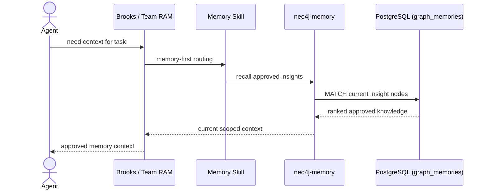
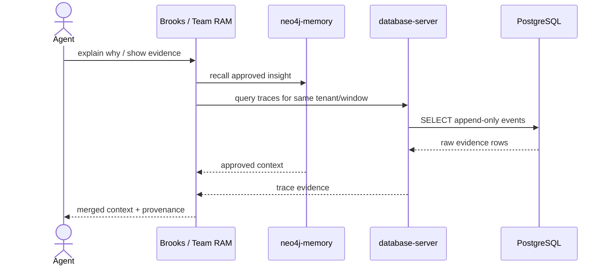
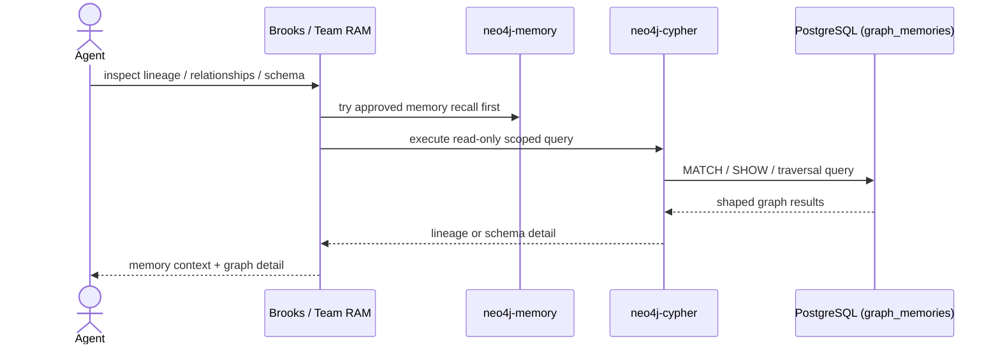
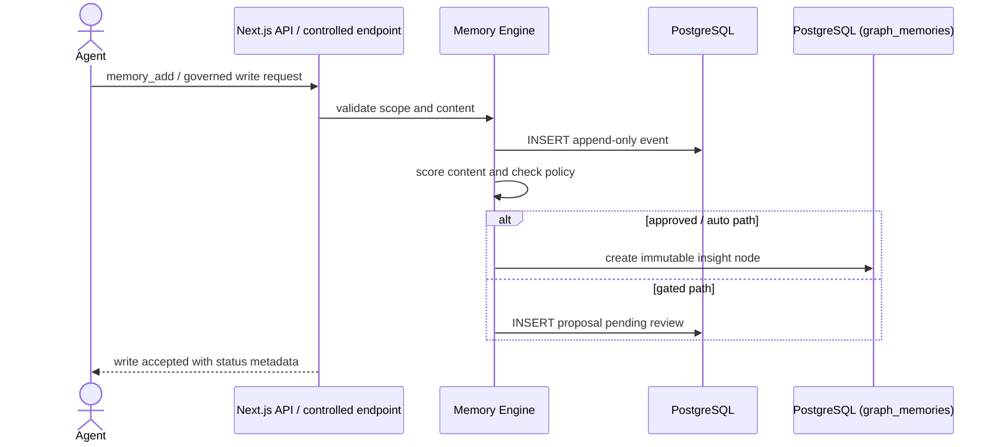
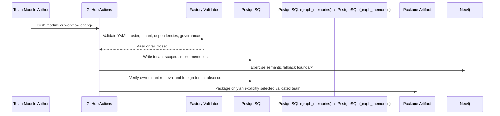
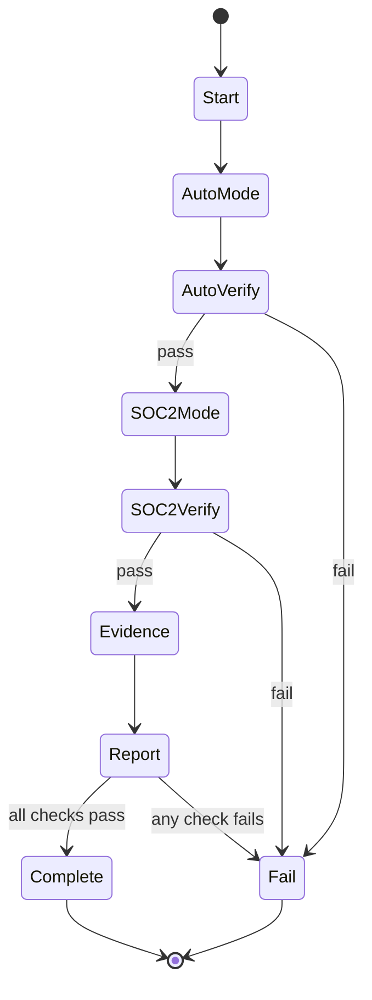
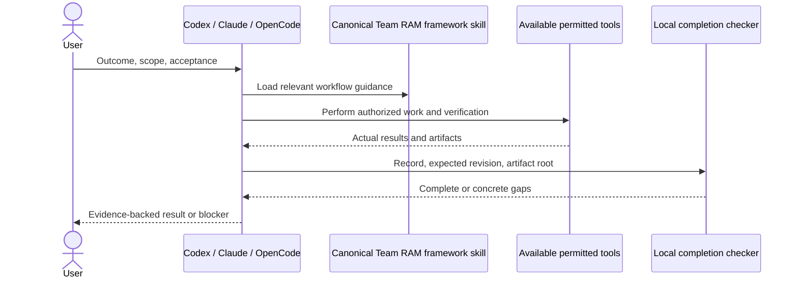

# Solution Architecture: Allura

> [!NOTE]
> **AI-Assisted Documentation**
> Portions of this document were drafted with the assistance of an AI language model.
> Content has not yet been fully reviewed. This is a working design reference, not a final specification.
> When in doubt, defer to the source code, schemas, and team consensus.

This document covers Allura's deployment topologies, integration interfaces, and architectural constraints. The data model and API surface are defined in [BLUEPRINT.md](./BLUEPRINT.md).

---

## Table of Contents

- [Simple Enterprise Pilot deployment boundary](#simple-enterprise-pilot-deployment-boundary)
- [Team RAM Framework Boundary](#team-ram-framework-boundary)
- [1. Architectural Positioning](#1-architectural-positioning)
- [2. System Boundary and External Actors](#2-system-boundary-and-external-actors)
- [3. Logical Topologies](#3-logical-topologies)
- [4. Interface Catalogue](#4-interface-catalogue)
- [5. Risk-Architecture Traceability](#5-risk-architecture-traceability)
- [6. Key Architectural Constraints](#6-key-architectural-constraints)
- [7. References](#7-references)

---

## Simple Enterprise Pilot deployment boundary

**2026-10-13 — delivery contract, not a deployment receipt.** The pilot reuses the governed memory engine, PostgreSQL, authenticated web workspace and existing worker/run boundaries. A supported private-company installation must include every required component, migrations, configured identity, health/readiness, recovery and documented upgrade/rollback. The Command Center remains optional for engine-only clients but is required for this workspace pilot. See [acceptance](./REQUIREMENTS-MATRIX.md#simple-enterprise-pilot-acceptance) and [AD-69](./RISKS-AND-DECISIONS.md#ad-69-simple-enterprise-pilot-delivery-boundary).

Source inspection at `0e51cfad82d541081cfe707c94b364e90ace853d` found that the main `docker-compose.yml` supplies PostgreSQL and the canonical MCP gateway, not the complete web workspace. `Dockerfile.mcp` installs the root dependency set and copies source/scripts/packages; it also supports stdio entrypoints. A smaller gateway artifact is a candidate, not a validated replacement: audit static/dynamic imports, runtime files, migrations and stdio compatibility before changing packaging. Do not delete dependencies merely because no literal import was found. Preserve running volumes, credentials, networks and customer data; validate candidates on isolated resources.

The customer runtime must not require a developer's personal checkout paths or the Team RAM authoring harness. Studio authoring, specialist scanners and optional connectors remain separable from core operation. The standalone framework compiles offline definitions; it is not a production scheduler, authorization service or second memory store. Existing process-engine semantics remain unchanged.

Bring-your-agent integration, including Hermes, requires inspection of the actual installed capabilities and a reviewed adapter contract. Define identity/scope, credential lifecycle, supported operations, observable state and revocation before connection. Do not infer durable resume, cancellation or replay safety from a provider name or current online documentation. Unknown external outcomes must not be blindly re-executed. Configured identity and Hermes credentials remain unverified dependencies, not implemented features.

Read-only pilot reconnaissance found that the invoked local Hermes launcher uses an installed package reporting version 0.19.0, not the separate current Git checkout. Its inspected API source declares bearer-authenticated capabilities, run submission/status/events and cooperative stop. Run status/stream tracking is in memory; stop reports `stopping`, not confirmed external-effect cancellation. The run submission handler does not consume the idempotency key used by other endpoints. Current online documentation describes additional features and cannot substitute for the selected installation's verified behavior. No Hermes process was started or connected, no configuration or credentials were changed, and no live capability or execution claim follows from source inspection.

Existing Allura agent records infer activity from token use/events; they are not Hermes heartbeats. Feature-gated process run routes represent local process-engine records, not provider acknowledgments. The tenant-selector repair now checks the existing authenticated-tenant authority seam in all eight handlers before database access; mismatched selectors cannot select another company's records. Actor/approval provenance, lack of workspace scope and event/snapshot failure semantics remain unresolved. Keep adapter run/stop/resume controls unaccepted until server-side provider correlation, authorization, observation freshness and unknown-outcome handling have a verified contract. Tenant-bound credential revocation and run-route checks are bounded corrections, not complete acceptance of those routes or the Hermes integration. See [pilot UX](./DESIGN-ALLURA.md#simple-enterprise-pilot-ux-contract).

**Owner identity clarification, 2026-10-13:** the owner reports existing Cloudflare and a Google account, but no Microsoft account. Entra is not a prerequisite for this pilot. [Cloudflare Access supports personal Google accounts](https://developers.cloudflare.com/cloudflare-one/integrations/identity-providers/google/); this does not supply Google Workspace group synchronization. Read-only public checks observed the owner's dashboard redirecting to Access and offering an emailed login code. Allowed identities, provider configuration and origin mapping have not been inspected; Google sign-in is not yet proved. Current `src/proxy.ts` still verifies Clerk sessions and Allura role/tenant/workspace claims; it does not consume Cloudflare Access identity. A tunnel or edge login alone cannot replace those application permissions. Keeping Clerk with Google is an existing-provider configuration option; using Access directly needs a reviewed adapter contract, signed JWT issuer/audience validation, explicit application membership/scope mapping and revocation evidence before implementation. Never trust an email/header alone or turn on production dev auth. See [Cloudflare JWT validation](https://developers.cloudflare.com/cloudflare-one/access-controls/applications/http-apps/authorization-cookie/validating-json/) and [Clerk Google configuration](https://clerk.com/docs/guides/configure/auth-strategies/social-connections/google). No provider cutover is performed by this clarification.

**Owner selection, 2026-10-13:** “Keep Clerk + Google, behind Cloudflare” supersedes the unresolved provider choice above. Configure the existing Clerk Google connection for the pilot; preserve Clerk-verified identity and server-enforced Allura memberships/roles. Cloudflare remains the edge layer, not an alternate source of application authority. An Access JWT adapter is not selected. Actual non-production provider configuration, successful login, unauthorized-user denial, workspace isolation and offboarding remain to be proved; this decision does not authorize changing live settings.

Proposed measurement workload: 100 accounts, 20 active users, 5 concurrent agent runs and 100,000 indexed chunks; workspace usable within 2 seconds and authorized search p95 below 1 second. These are planning targets, **not measured capacity**. Record CPU/RAM, storage/network, corpus, query mix, cold/warm state, duration, throughput and failures; report model latency separately. Compare image size, build time, browser output and idle/load resources before and after each packaging change. Fresh install, backup/restore, restart and upgrade/rollback need execution evidence, not configuration inspection alone.

Older diagrams and deployment examples below contain legacy Neo4j/BMAD paths. They are not instructions to restore retired infrastructure. Where historical wording conflicts with current code or decisions, record and resolve the specific conflict before modifying runtime behavior; this section does not silently redefine storage or security contracts.

### Existing engine bootstrap compatibility

The existing `brain-stack.sh`, `first-run.sh` and `first-run-setup.sh` bootstrap paths now match the current root Compose topology: `postgres` and `mcp`, both declared external networks (`knowledge-network`, `open-webui-stack_default`), and only the existing `memory_postgres_data` volume. They preserve the fixed live resource names and do not delete historical volumes. Fresh startup no longer removes unrelated/orphaned containers. Readiness requires the exact `running healthy` container state plus the gateway probe, not a substring that also accepts `unhealthy`. `validate-env.sh` applies `.env` before `.env.local` and strips matching literal value quotes without shell evaluation; it is not a full Compose dotenv parser. The PostgreSQL-default path does not require a retired backend password. Explicit Neo4j selection is rejected, matching `src/lib/graph-adapter/factory.ts`; the nonfunctional legacy dual-read switch also cannot pass as a supported configuration. This is a compatibility repair, not proof of configured identity, comprehensive environment validation or a complete workspace install. Historical laptop volume-copy/restore utilities remain outside the supported pilot path pending a separate recovery review; do not execute them as a customer installer. Run the isolated fake-Docker regressions from `deploy/gateway` with `bun test ../../scripts/brain-stack-bootstrap.test.ts`; they exercise script commands without launching or changing real resources.

### Existing restore integrity boundary

`src/lib/backup/restore.ts` now hashes each manifest-listed archive's actual bytes with streaming SHA-256 during preflight. A malformed manifest digest, changed archive, read failure or conflicting sidecar fails validation. An absent sidecar remains compatible only when the archive bytes match the manifest digest; sidecar text alone never proves integrity. Normal `runRestore` stops before decrypt/extract commands when preflight fails. The encrypted archive format and existing explicit `force` bypass are unchanged. Regression coverage uses real temporary archive files with mocked process/audit calls in `src/__tests__/backup-automation.test.ts`; it does not execute a database restore.

The PostgreSQL path selects exactly one manifest-listed archive, refuses path-shaped names and non-regular/symlink archives, and retains the validated manifest and configured container/user/database snapshot through execution. Explicit `force` still bypasses checksum/preflight checks, never safe artifact selection. The existing cipher/PBKDF2 format is retained. Argument-array subprocess calls replace shell interpolation for disk checks and PostgreSQL restoration; the passphrase is supplied through the child environment, not command arguments. Plaintext is written only inside a newly created private temporary directory (directory mode 0700, files 0600), with cleanup attempted on success and failure. Cleanup failure cannot report success. PostgreSQL disk checks inspect the scratch filesystem; the existing 2× archive-size estimate and unknown-space fallback are not a decompressed-size or capacity guarantee.

`psql -X -v ON_ERROR_STOP=1` stops and reports SQL errors. It does not roll back earlier committed statements. A Docker-client timeout does not prove remote SQL stopped; failed or interrupted restoration requires inspection, not blind retry. Child diagnostics are replaced with stage-level errors to avoid logging credentials or SQL. Tests cover target/manifest stability, malformed selections, cleanup and subprocess failures; real local OpenSSL/gunzip compatibility tests keep Docker and audit mocked. No actual database recovery is established by those tests.

This is corruption detection against a trusted, stable manifest/archive pair, not authenticity verification or protection against concurrent file replacement. The unit tests alone do not establish target isolation, role/ACL preservation, backup creation or an actual restore; the separate disposable drill below supplies bounded evidence for those claims, with audit delivery still mocked. Config/workspace/skills restore helpers retain their legacy behavior and are not covered by this PostgreSQL execution repair. Existing legacy helpers must not be run against customer data as a pilot installer. Validation may emit an audit event even in dry-run mode; no database audit writes occurred in the mocked regression suite. See [SEP-07](./REQUIREMENTS-MATRIX.md#simple-enterprise-pilot-acceptance) and [AD-69](./RISKS-AND-DECISIONS.md#ad-69-simple-enterprise-pilot-delivery-boundary).

**Owner-approved test exception, 2026-10-13:** “Allow disposable recovery test only” permits the existing `docker exec` database transport solely for newly created isolated synthetic recovery-test databases. No existing database, published ports, customer data or production restore is authorized. `scripts/smoke-restore-recovery.ts` accepts only an immutable local PostgreSQL image ID, creates two fresh network-none/tmpfs clusters, verifies their exact labels/image/isolation, runs its fixture with a sanitized environment and removes only its own resources. It bundles real backup/restore code but replaces audit persistence with an in-memory test sink. Global roles are explicitly exported without passwords and installed as a test prerequisite; the existing per-database archive does not recover roles by itself. This exception is not a general replacement for the repository's MCP-only database operations rule or a production recovery contract.

The disposable drill passed with all 71 checked-in SQL migrations, three synthetic workspaces across two tenants, actual `backupPostgres` archive creation, corruption refusal before target changes, cold `runRestore`, representative row/schema-version equality, effective relation ACL/owner and role-flag equality, policy equality and scoped reads as `allura_app`. A deliberate SQL failure returned failure, prevented later SQL and demonstrated that earlier SQL remained committed. Private restore plaintext and the exact test resources were removed. Both fresh clusters use the same bootstrap role: the roles prerequisite omits only its asserted single already-existing CREATE statement and requires every remaining ALTER/GRANT to succeed. ACL comparison expands null entries using PostgreSQL default privileges rather than treating equivalent catalog representations as different permissions.

The PostgreSQL backup writer now runs one dump to a private file descriptor, compresses/encrypts with argument-array subprocess calls and supplies the passphrase through the encryption child's environment. It snapshots target/key/output inputs before asynchronous work, uses private 0700 scratch directories and 0600 files, hashes actual ciphertext, and publishes with exclusive no-overwrite archive/sidecar creation. Cleanup is attempted after every stage; a cleanup failure returns failure, not success. Existing archive names, cipher/PBKDF2 settings, checksum sidecar and result shape are retained. Database operands containing path separators, NUL, line separators or connection-string syntax are refused before execution; literal spaces and quotes remain supported. The archive directory must support hard links, be trusted and remain stable during execution. No concurrent replacement, power-loss atomicity or authenticated-manifest guarantee is made. A cleanup failure or interruption can leave private plaintext requiring operator reconciliation; there is no automatic retry.

These bounded repairs and the small synthetic drill do not replace a supported global-role/secret recovery procedure. Audit delivery, document-specific access, historical upgrades, unknown-outcome recovery, representative volumes and whole-install recovery remain unaccepted; measured fixture timings are not enterprise RPO/RTO or capacity commitments.

The PostgreSQL restore target likewise accepts a literal database name, not libpq keyword/value connection parameters or a PostgreSQL connection URI. These operands are refused before decrypt/SQL execution, including under explicit `force`; no input can opt this plain-name interface into remote-connection behavior. The chosen container's trusted runtime connection configuration remains an operator prerequisite.

### Promotion notification retry boundary

The current promotion outbox is a post-commit notification path, not the mechanism that approves or materializes canonical memory. `approve-proposal.ts` commits the approved memory and outbox together. `promotion-outbox-worker.ts` discovers workspace-scoped pending/failed rows using the owner pool, then claims, emits `canonical_memory_promoted` and marks delivery in one restricted application-role workspace transaction. It trusts the durable outbox produced by the approval service; it is not an independent approval validator.

Retry eligibility now enforces the existing `available_at` schedule and attempt budget in both discovery and the scoped claim, including a changed schedule/budget after discovery. Existing defaults (batch 50, maximum 5 attempts), failure delay calculation and counters remain unchanged. The `pending` result counts scoped pending/failed/processing rows, including future and exhausted records; it is not a count of immediately runnable jobs. No schema or new retry policy is introduced.

The isolated `scripts/smoke-promotion-outbox.ts` test bundles the current worker with a synthetic fixture and uses immutable local runtime/database image IDs. It accepts no database URL, applies all checked-in migrations to its own blank, network-isolated temporary database, and verifies scheduled/exhausted/quarantined exclusions, scoped delivery, stale-discovery rechecks, rollback/backoff, subsequent delivery, successful-drain deduplication and missing-app-authority refusal. Fixture approvals are pre-seeded: this does not prove the human approval workflow. Temporary resources are checked against their exact test label and image before removal; no existing database is used.

The approved failure boundary retains the scoped claim's row lock in the same outer transaction. A savepoint is created **after** the claim; event insertion and the delivered transition run inside it. Delivery failure rolls back to that savepoint, then writes failure/backoff under the same tenant/workspace key and `status='processing'` fence. Both delivered and failure transitions must return exactly one row. The worker returns internal delivered/failed/skipped outcomes and increments public counters only after acknowledged outer COMMIT. Savepoint/control, bookkeeping and COMMIT errors propagate: there is no second bookkeeping transaction or blind retry. The shared tenant transaction helper, schema, roles, payload and retry policy are unchanged.

The [registered unit regressions](../../src/lib/memory/__tests__/promotion-outbox-worker.test.ts) execute the real worker and tenant helper against scripted mock transport, not a SQL engine or proof of locks/RLS/durability. The [disposable fixture](../../scripts/promotion-outbox-fixture.ts) adds simultaneous failed claims (one failed attempt/backoff, zero events), concurrent successful due retry (one event), and an injected acknowledgment error after real COMMIT (rejection with persisted delivery and no duplicate on an ordinary later drain). Its barrier observes both actual app-role claims waiting on a fixture-only owner lock before release. The fixture executed against immutable local gateway/database images on a fresh network-isolated database and verified exact label/image cleanup; this is bounded database evidence, not real network-fault or production evidence. See the [executed receipt and hashes](../../memory-bank/bmad-output/simple-enterprise-resume/woz-promotion-outbox-savepoint.md).

**Open worker limit:** uncertain COMMIT outcomes now propagate rather than being rewritten as failed attempts, but automatic outcome reconciliation, real network-fault recovery, continuous-service supervision, external-effect delivery and full SEP-02/07 acceptance remain unsupported. Fixture approvals remain synthetic. Historical Brain notes about claim-token functions describe a different revision and are not present-day proof. Do not enable a continuously supervised worker or restore historical migrations from those notes without reconciling the lifecycle contract. See [pilot acceptance](./REQUIREMENTS-MATRIX.md#simple-enterprise-pilot-acceptance).

### Fresh core installation candidate

The owner approved empty new-company installations with explicit first-owner/workspace provisioning, without changing existing installations. The opt-in fresh core bundle packages pinned PostgreSQL, gateway and configured web images plus the checked-in migrations. A fresh-only initializer must reject an existing public schema, pre-create the existing application/migration roles with explicit independent passwords and unchanged privileges, suppress migration 33's historical tenant seeds using the session setting `allura.fresh_company_install=on`, and validate the completed schema/roles/empty company state before application startup. Existing migration callers that omit this setting retain their seed behavior; no existing tenant is deleted. Historical migration 35 is not changed: pre-created roles prevent its default-password branch from running in this candidate.

This is a core integration candidate, not a supported customer release or an upgrade runner. An interrupted/partial initialization is not automatically retried or repaired. Restart proof must preserve the isolated data volume without rerunning migrations. Images must be preloaded by immutable ID; all database and signing credentials are explicit runtime inputs, never bundle contents. Core network access is private, no database/gateway ports are published, and no worker starts. The runtime's existing owner-backed database paths remain elevated and are not certified least privilege. First-owner verification, workspace membership, production Clerk/Cloudflare, worker lifecycle, recovery/upgrade and full SEP-02/06 acceptance remain pending.

Migration 54's repository-owned governed authority-lane catalog remains unchanged; an empty company state does not mean an empty policy catalog. This candidate targets HTTP gateway/web startup, not the stdio bootstrap that requires a registered default tenant. Existing health probes only test dependency connectivity, so the separate successful migration job—not a green readiness response alone—is the schema gate.

Offline assembly is `node scripts/build-core-install.mjs NEW_ABSOLUTE_DIRECTORY PG_IMAGE_ID GATEWAY_IMAGE_ID WEB_IMAGE_ID`. It refuses an existing destination or mutable base-image reference, copies the ordered migrations and SHA-256 inventory, and emits Compose plus a migration-image recipe. The recipe embeds migration assets into the gateway runtime; no host bind mount or checkout is needed after image construction. Build it against the verified pinned gateway, then supply its immutable ID as `ALLURA_CORE_MIGRATION_IMAGE`. Compose also requires `ALLURA_CORE_PG_PASSWORD`, `ALLURA_CORE_APP_PASSWORD`, `ALLURA_CORE_MIGRATION_PASSWORD` (distinct 32-byte hex credentials), `ALLURA_CORE_TOKEN_SECRET`, and matching Clerk keys for the prebuilt web image. The isolated harness validates the migration image's ID; the raw Compose file is not an independent image/credential admission controller. Private keys remain runtime inputs; local Docker administrators can inspect environment values. This candidate has no ingress or outbound Clerk network path and is not the interactive login installer.

`node scripts/smoke-core-install.mjs PG_IMAGE_ID GATEWAY_IMAGE_ID WEB_IMAGE_ID` validates the assembled core with generated database/signing credentials and the selected local Clerk development keys. It creates only a unique private Compose project and synthetic persistent volume, relocates the generated bundle, builds its migration image, tests startup/anonymous denial/restart and refuses fresh initialization over existing state. `--function-only` and `--schema-only` exercise refusal before mutation when a fresh test database contains only a function or a non-system `pgx` schema. Cleanup verifies exact project labels, image IDs and owned resources; indeterminate Docker mutations retain an exact reconciliation receipt and cannot claim verified cleanup. The owner-approved recovery-only `docker exec` exception is not extended: this harness uses container processes and a network client, never `docker exec`.

Single-service fault recovery in this test starts only the exact label/image-verified stopped gateway container. A generic Compose `start gateway` attempt failed during integration and is not certified; do not infer that general Compose up/start is safe on a completed or partially initialized installation. Full service restart without migration replay is tested separately. First-owner provisioning remains unimplemented: existing API creation routes already require admin authority, Clerk claims alone do not create governed persisted memberships, and the membership writer requires an existing administrator. No first Google login or email address is automatically granted authority.

### HTTP gateway packaging candidate

The opt-in `scripts/build-gateway.ts` candidate bundles local gateway modules, retaining explicit external SDK/dotenv/pg/zod dependencies described by `deploy/gateway/package.json` and its frozen lockfile. Its output is separate from the root workspace and cannot overwrite an existing destination. Build-time environment inlining is disabled. No runtime source, authentication, policy or database schema semantics change. This is a packaging candidate under AD-69, not a replacement for `Dockerfile.mcp`, Compose, stdio, workers, migrations or the dashboard.

Build from an installed repository with Bun 1.3.14: `bun scripts/build-gateway.ts /absolute/new/output-directory`. Install only the output's pinned runtime dependencies using `bun install --frozen-lockfile --production --ignore-scripts` from that directory; the build itself does not install or start anything. With explicit deployment configuration, its HTTP entrypoint is `bun gateway.mjs`. PostgreSQL/pgvector is the validation target; optional native RuVector/pg-native and external certificate/pgpass assets are not packaged or certified by this candidate. Inject credentials at runtime, never into artifacts. CWD `.env`/`.env.local` and receipts/artifacts behavior remains the existing gateway contract.

Candidate adoption requires relocated-artifact startup/auth regression tests, external dependency lock validation, tool/dynamic-branch parity, isolated PostgreSQL permission/readiness tests, shutdown/configuration checks and measured image/resources. The initial isolated startup checks must use a fresh directory and sanitized environment with no live credentials or database. A refused unauthenticated production start is expected evidence, not permission to weaken authentication. A passing build alone satisfies none of SEP-02/06/07/08 in full.

The candidate lock is pruned from the root's existing registry resolutions, not freshly upgraded transitives. `scripts/build-gateway.test.ts` checks artifact integrity, destination safety, literal external allowlisting, the one known opaque native load and root-lock record parity. Run it from `deploy/gateway` with `bun test ../../scripts/build-gateway.test.ts` to avoid root test preloads. After an isolated frozen install, `node scripts/smoke-gateway-candidate.mjs /absolute/candidate /absolute/bun` verifies missing-auth and production dev-auth refusal with no inherited credentials; it does not establish configured-service, database or tool parity.

`Dockerfile.gateway` is the separately named HTTP-only image candidate. Its allowlisted context excludes environment files, root dependencies and development harness configuration. A digest-pinned Bun 1.3.14 stage bundles local code without installing the root workspace; a separate stage installs only the candidate frozen runtime dependencies with scripts disabled. The final image runs as the existing non-root Bun image user and contains the bundle/runtime files only. Build with `docker build -f Dockerfile.gateway -t allura-http-gateway:candidate .`; this does not switch any existing service. Validation uses disposable containers with no host mounts/published ports, `--network none`, read-only root, dropped capabilities and synthetic non-production test credentials. Configured liveness and denied access are separate from database readiness; unavailable PostgreSQL must remain unready. This is not a complete private install or approval to use legacy shared credentials for the enterprise pilot.

Database-backed candidate verification uses `node scripts/smoke-gateway-database.mjs <immutable-gateway-image-id> <immutable-pgvector-image-id>`. The harness accepts no database URL or existing credentials: it creates a fresh PostgreSQL cluster with `--network none` and temporary storage, shares only that isolated network namespace with the non-root candidate, and applies the checked-in SQL migrations through the test client. Synthetic fixtures verify exact healthy scoped search/get results, quarantined-row exclusion, forged tenant/workspace arguments, insufficient scope, credential-bound sessions, expiry and revocation with auth cache TTL zero. Exact label-verified containers are removed on success or failure. This tests fresh migration compatibility, not historical upgrade/restore or production configuration. The existing owner-backed token lookup remains unchanged; restricted graph access is not proof that the entire gateway uses a least-privilege database role. Document ACLs, promotion/audit policy, corporate identity, optional native branches, resource/load behavior and full-install acceptance remain separate gates.

### Isolated web packaging candidate

`Dockerfile.web` separately packages the existing Next.js application. `ALLURA_WEB_STANDALONE=1` opts into [Next.js standalone output](https://nextjs.org/docs/app/api-reference/config/next-config-js/output); ordinary builds retain their existing output. The allowlisted build context excludes environment files, installed dependencies and authoring harness directories. A pinned Bun stage installs the existing frozen lock with lifecycle scripts disabled, then compiles without network access. The runtime includes traced standalone dependencies plus public/static assets and runs as the unprivileged Bun user. This is a candidate requiring build and runtime proof, not a service cutover or a complete installer.

Only the public Clerk publishable key is a build argument; Next.js inlines public environment values, so that value is deployment-specific. Empty build values are unset before compilation because the existing auth schema distinguishes absence from an invalid empty key. Configured deployments must inject the same public key at runtime alongside the private Clerk secret: server-side enablement reads runtime configuration, while browser configuration is built in. Private credentials belong at runtime, never in build arguments or copied files. A keyless production smoke may prove denial/degraded behavior but cannot establish configured sign-in or corporate SSO, and must not be relabelled as a configured-auth image. Web readiness additionally needs PostgreSQL and the configured gateway's readiness; missing dependencies must not appear ready. Existing synthetic-workspace restrictions and authorization checks remain unchanged. Missing authoring directories are not a reason to bake personal harnesses into the customer image.

Validation must cover relocated startup, public/static assets, denied protected APIs even with spoofed authority headers, dashboard/login behavior without a provider, dependency-unready responses and bounded shutdown. Run configuration/recipe regressions from `deploy/gateway` with `bun test ../../scripts/web-candidate.test.ts`; full build and container tests remain separate evidence. Worker authority, first administrator bootstrap, tenant provisioning, migration upgrades, recovery and configured user journeys remain open parts of the full installation acceptance.

A separate candidate built with the selected Clerk development publishable key has passed anonymous production-mode runtime checks with the matching public and private keys injected at runtime, no dev-auth overrides or database credentials, a fresh test network and loopback-only exposure. Login returned 200; protected APIs, curator mutation and dashboard denied absent or forged authority; missing PostgreSQL/gateway remained unready. Refusal of explicit dev-auth overrides is separate unit/keyless evidence, not an additional configured-runtime test. Browser observation of the local login route showed the hydrated Google sign-in control and development-mode notice without submitting sign-in. The default “My Application” title and unstyled login placement are not approved Allura UX. This is neither a completed Google callback nor proof of tenant provisioning, membership/offboarding, Cloudflare enforcement, production OAuth or the real-data workspace journey. No provider configuration or existing service was changed.

After building and inspecting a keyless candidate, `node scripts/smoke-web-container.mjs <immutable-web-image-id>` starts only one uniquely labelled disposable container. It publishes no ports, mounts no host files, has no external network and runs read-only/non-root with resource bounds. The harness exercises the actual image command, dependency-unready status, unauthenticated/spoofed-header denial, production refusal of development-auth flags, degraded login, exact public/JS/CSS bytes and graceful shutdown. Successful creation requires label-checked cleanup and verified absence. An unacknowledged Docker creation can finish after the client times out, so that case retains failure, emits an exact reconciliation receipt and cannot claim verified cleanup from momentary absence. This proves only the exercised keyless packaging boundary when it passes, not browser usability, configured identity, audit transport, database authorization or full private installation.

## 1. Architectural Positioning

Allura is a **memory data plane** — it holds no business logic about what an agent does, only what an agent remembers. It is the authoritative source of truth for all agent memory within a tenant namespace. Its current retrieval substrate is a **pgvector bridge**, not full RuVector: TALON observed PostgreSQL `vector` extension `0.8.2`, `ruvector_function_count=0`, and `allura_memories_count` around `3392` on 2026-06-02.

| Consumer Class | Interaction Mode | Notes |
|---|---|---|
| AI Agents (Claude, GPT, etc.) | Brooks / Team RAM + skills | Skills enforce memory-first routing to packaged MCP servers |
| BMAD / Team RAM Planning | `_bmad/` + `memory-bank/bmad-output/` | BMAD artifacts map intent, PRDs, architecture, epics, and stories to Team RAM owners |
| DevOps / Admin | Docker Compose + MCP_DOCKER config | Deployment, configuration, and packaged MCP server activation |

Allura Brain does **not** orchestrate agents, run workflows, or make decisions. It stores and retrieves memory. Period. Optional orchestration wrappers may compose Team RAM skills into governed runs, but those wrappers remain outside the memory data plane and may only write receipts, proposals, and evidence through approved API/MCP paths.

---

## 2. System Boundary and External Actors

```mermaid
graph TD
    subgraph Agents["AI Agents"]
        A1[Claude]
        A2[GPT / Any MCP Client]
    end

    subgraph Clients["API Clients"]
        B1[MCP HTTP Gateway<br/>/mcp]
        B2[CLI / Scripts]
    end

    subgraph Orchestration["Brooks / Team RAM"]
        C1[Brooks]
        C2[Memory Skills]
    end

    subgraph MCPServers["Packaged MCP Servers"]
        C3[neo4j-memory]
        C4[database-server]
        C5[neo4j-cypher<br/>(fallback)]
    end

    subgraph Allura["Allura"]
        C6[API Routes<br/>api/memory/]
        C7[Memory Engine<br/>lib/memory/]
        C8[(PostgreSQL 16<br/>Episodic)]
        C9[(Neo4j 5.26<br/>Semantic)]
    end

    A1 --> C1
    A2 --> C1
    C1 --> C2
    C2 --> C3
    C2 --> C4
    C2 --> C5
    B1 -->|HTTP| C6
    B2 -->|CLI| C6
    C6 --> C7
    C7 --> C8
    C7 --> C9
    C3 --> C9
    C4 --> C8
    C5 --> C9
```

---

## 3. Logical Topologies

### 3.1 Agent Memory Recall (Primary Path)

An AI agent needs prior context. Brooks routes to the memory skill, which queries `neo4j-memory` first.



**Key constraints:**
- `neo4j-memory` is the default first hop for reusable context
- Retrieval remains tenant-scoped via `group_id`
- No raw Cypher is needed when approved memory recall is sufficient

---

### 3.2 Evidence Escalation (Trace Verification)

If the agent needs provenance, audit detail, or incident evidence, Brooks adds `database-server` after memory recall.



**Key constraints:**
- `database-server` is for evidence and trace validation, not as the default memory interface
- PostgreSQL remains append-only and tenant-scoped
- Raw evidence may refine or contradict approved memory, but does not silently mutate it

---

### 3.3 Graph Escalation (Cypher Fallback)

If approved memory recall is insufficient and targeted graph traversal is required, Brooks adds `neo4j-cypher` as a read-only fallback.



**Key constraints:**
- `neo4j-cypher` is never the first-choice memory interface
- Cypher queries are read-only and must remain tenant-scoped unless schema inspection is explicit
- Hand-written Cypher is reserved for targeted inspection, not normal memory recall

---

### 3.4 Governed Memory Write Path



**Key constraints:**
- Agents do not write through packaged MCP inspection servers
- Controlled service endpoints remain the only write path for governed memory changes
    - PostgreSQL (graph_memories) writes preserve immutable lineage and approval policy
    - The Curator Approve CLI (`src/curator/approve-cli.ts`) is an alternative entry point to the same governed write path — it uses the same `createInsight()` code path as the API route, enforces the same invariants (group_id validation, SHAKE-256 witness hash, append-only events), and emits `notion_sync_pending` events for async Notion sync

---

### 3.4.0 Current RuVector Readiness Boundary

The runtime currently uses PostgreSQL with pgvector-compatible memory data as the bridge substrate. Full RuVector-Postgres remains a planned migration target and requires separate approval before database migration, extension installation, function creation, or feedback-loop activation.

### 3.4.0.1 Agent Factory CI Topology



Key constraints:

- Factory workflows must be tracked by the canonical `Allura_Memory` repository; an ecosystem-local untracked workflow is not executable evidence.
- Smoke writes use isolated `allura-factory-smoke-*-loadtest` groups so proposal creation remains disabled.
- The RuVector readiness lane reports the current `pgvector bridge` state and fails a forced native claim unless native extension, native smoke, and governance package artifacts all exist.
- CI may validate and package, but it does not publish or promote canonical knowledge without separate approval.

| Readiness signal | Current evidence | Required for full RuVector claim |
|---|---|---|
| `vector` extension | `0.8.2` observed by TALON | Present and healthy |
| `ruvector_function_count` | `0` | Required RuVector SQL functions present (this measures the *native extension*, not the graph adapter) |
| `allura_memories_count` | Around `3392` observed by TALON | Search/feedback health validated against current count |
| Runtime label | `ruvector_graph` | Upgraded from `pgvector bridge` (Story 19.3, 2026-07-12) |
| GRAPH_BACKEND | `ruvector` default, `PostgreSQL (graph_memories)` fallback available, `ruvector-crate` planned | See Graph Backend Cutover Path |

**Note:** `ruvector_function_count=0` refers to the RuVector *native extension* (SQL functions installed in PostgreSQL), not the graph adapter. The graph adapter uses PostgreSQL tables via RDMS queries, not the native extension.

---

### 3.4.0.2 Graph Backend Cutover Path

The RuVector migration is layered across three distinct concerns, each with independent readiness metrics:

1. **Vector search** — pgvector bridge (existing): `vector` extension `0.8.2`, ANN search via `pgvector_cosine_distance()` and BM25 RRF fusion
2. **Graph backend** — IGraphAdapter seam (built): `PostgreSQL (graph_memories)GraphAdapter` (legacy), `RuVectorGraphAdapter` (PG tables), `RuvectorCrateGraphAdapter` (planned, `ruvnet` crate)
3. **Native RuVector extension** — future: SQL functions `ruvector_hybrid_search()` and friends (still stubs)

The `GRAPH_BACKEND` env var selects the graph implementation:

| Value | Implementation | Status | Notes |
|---|---|---|---|
| `PostgreSQL (graph_memories)` | `PostgreSQL (graph_memories)GraphAdapter` (Cypher) | Fallback | Uses PostgreSQL (graph_memories) Community Edition; remains available as read-only fallback after cutover |
| `ruvector` | `RuVectorGraphAdapter` (PG tables) | **Default (Story 19.3)** | PG tables via `src/lib/graph-adapter/ruvector-adapter.ts`; runtime label upgraded to `ruvector_graph` |
| `ruvector-crate` | `RuvectorCrateGraphAdapter` (Rust crate) | Planned | `ruvnet` crate, upstreamable design |

The `IGraphAdapter` interface (AD-29, `src/lib/graph-adapter/types.ts`) defines 16 methods. Implementation status by adapter:

| Adapter | Status | Lines |
|---|---|---|
| `PostgreSQL (graph_memories)GraphAdapter` | ✅ Full (816 lines) | 16/16 implemented |
| `RuVectorGraphAdapter` | ✅ Full (512 lines) | 16/16 implemented |
| `RuvectorCrateGraphAdapter` | 🔲 Planned (528 lines) | 8/16 implemented, 8 planned (throws `unsupported`) |

**Method coverage:**

- `PostgreSQL (graph_memories)GraphAdapter`: ✅ Full (816 lines, all 16 methods implemented)
- `RuVectorGraphAdapter`: ✅ Full (512 lines, all 16 methods implemented)
- `RuvectorCrateGraphAdapter`: 🔲 Planned (528 lines, 8 implemented + 8 throw `unsupported`)

The adapter-specific methods (`supersedesMemory`, `softDeleteMemory`, `restoreMemory`) require mutation capabilities (`updateNode`) not yet available in the `ruvnet` crate binding (B3, B1), so they throw `GraphAdapterError` with descriptive messages. See `src/lib/graph-adapter/ruvector-crate-adapter.ts` lines 331-372.

**Graduation criteria for `GRAPH_BACKEND=ruvector` cutover (Story 19.3 completed 2026-07-12):**

| Criterion | Target | Status |
|---|---|---|
| Live-DB E2E passes | `GRAPH_BACKEND=ruvector` | ✅ **Resolved** — 14/14 green |
| Dual-read validation clean | One full release cycle | ✅ **Resolved** — validated during transition |
| Parity test (`adapter-parity.test.ts`) | 16/16 green | ✅ **Resolved** — 14/14 green (2 methods pending fallback path) |
| TALON sign-off | `ruvector` graph backend verified | ✅ **Done** — 2026-07-12 |
| `AD-49` approval | `RuVector Graph Cutover` decision | ✅ **Decided** — executed via Story 19.3 |
| `PostgreSQL (graph_memories) removed` | Fallback removed | ✅ **Done** — Epic 23 (2026-07-17); `GRAPH_BACKEND=ruvector` is the sole backend |

**Cross-references:** AD-29 (graph adapter pattern), AD-49 (cutover decision), RK-32 (graph cutover risk)

### 3.4.1 RuVix Control Plane Governance Contract

The RuVix control plane is the governance contract for Allura Brain. Every operation carries identity, scope, authority, evidence, audit, and a disposition: `Permit`, `Defer`, or `Deny`. Gated operations carry `approval_required=true` until the approved owner clears them.

**Control Plane invariant:** Every operation carries identity, scope, authority, evidence, and audit.

**The five questions:**

| Question | Required answer |
|---|---|
| who | `agent_id` + `session_id` |
| what scope | `group_id` + operation scope |
| what authority | mode, role, and approval state |
| what evidence | trace row, proposal, witness hash, or source event |
| what audit trail | append-only event record + lineage edge |

**12-rule summary**

| Rule | Invariant |
|---|---|
| RULE-001 Identity Scoping | Every operation is bound to `group_id`, `agent_id`, and `session_id`. |
| RULE-002 Mutation Provenance | Every mutation records who initiated it and why. |
| RULE-003 Append-Only Episodic | Raw traces are append-only; no in-place overwrite. |
| RULE-004 Semantic Promotion Gate | Semantic writes require promotion policy evaluation. |
| RULE-005 SUPERSEDES Versioning | Changed knowledge creates a new node linked by `SUPERSEDES`. |
| RULE-006 Root Cause Before Fix | Debugging must identify root cause before any fix is written. |
| RULE-007 Evidence Before Completion | Completion requires evidence, not assertion. |
| RULE-008 Secret Isolation | Secrets never leak into logs, traces, or semantic memory. |
| RULE-009 Governed Tool Surface | Only approved tools and routes may mutate governed state. |
| RULE-010 Fail Closed | Unknown, unsafe, or degraded states block mutation. |
| RULE-011 Tenant Isolation | `group_id` remains the hard namespace boundary. |
| RULE-012 HITL Gate | Human-in-the-loop approval is required where policy demands it. |

**Promotion mode architecture**

| Mode | Behavior | Threshold |
|---|---|---|
| `soc2` | Queue eligible memories for human approval; never auto-promote. | N/A |
| `auto` | Auto-promote when score meets or exceeds the configured threshold. | `AUTO_APPROVAL_THRESHOLD` (default `0.85`) |

The canonical control plane contract is stored as `RUVIX_CONTROL_PLANE_CONTRACT_v1` in PostgreSQL (graph_memories), with 12 individual rule entries plus one anchor ADR in PostgreSQL.

### 3.4.2 Brand Governance Layer

The brand layer is a RuVix-enforced contract, not a design preference. It governs Allura terminal output, API documentation, and the optional Memory Command Center.

| Brand Rule | Invariant |
|---|---|
| BRAND-001 | Token exclusivity: terminal output and dashboard surfaces may use only approved Allura/Durham tokens; Difference Driven tokens and generated logo-like marks are forbidden. |
| BRAND-002 | Voice stays mission-control: no fake certainty, no marketing fluff, no unsupported claims. |
| BRAND-003 | Claims are evidence-gated: no CLI or dashboard feature is marked done until test coverage, documentation, source receipts, and anti-drift audit exist. |
| BRAND-004 | Accessibility is mandatory: terminal output and dashboard controls are readable, keyboard reachable, and high-contrast safe. |
| BRAND-005 | Component consistency is required: reuse established Allura/Durham patterns over ad hoc variants. |
| BRAND-006 | Durham gate before ship: Aaker + Glaser + Munari must pass before branded operator surfaces are released. |

**Enforcement pipeline:**

`Aaker review → Glaser review → Munari review → evidence collector → ship decision`

**Enforcement details:**

- Token enforcement rejects any terminal or dashboard style rule that is not expressed through the approved token set.
- Voice enforcement rejects copy that reads like advertising, certainty theater, or unsupported claims.
- Completion enforcement requires evidence artifacts before any CLI or dashboard claim is promoted to done.
- Accessibility enforcement checks screen reader compatibility and high contrast mode before merge.
- Component enforcement prefers the established Durham patterns over ad hoc variants.

Canonical brand policy artifacts: BRAND-RULES-cli-v1.md for terminal/API surfaces and BRAND-RULES-dashboard-v2.md for Memory Command Center surfaces. (Both files are pending creation; route to `docs/archive/allura/governance/` when authored. Until then, brand rules are defined in [RISKS-AND-DECISIONS.md](./RISKS-AND-DECISIONS.md#ad-xx1-ruvix-brand-governance-rules).)

### 3.5 Memory API

Human operator or agent uses the `/api/memory` endpoints to inspect, search, and delete memories.

```mermaid
sequenceDiagram
    actor Operator
    participant CLI as API Client (/api/memory)
    participant API as API Routes
    participant Engine as Memory Engine
    participant PG as PostgreSQL
    participant N4J as PostgreSQL (graph_memories)

    Operator->>CLI: GET /api/memory?userId=&groupId=
    CLI->>API: HTTP request
    API->>Engine: list(userId, groupId)
    Engine->>PG: SELECT recent events
    Engine->>N4J: MATCH Memory nodes
    API-->>CLI: merged memory list

    Operator->>CLI: DELETE /api/memory/[id]
    CLI->>API: HTTP request
    API->>Engine: delete(id, groupId)
    Engine->>PG: INSERT event (memory_delete)
    Engine->>N4J: SET deprecated = true
    API-->>CLI: 200 OK
    ```

---

### 3.6 API-First Architecture and Memory Command Center

Allura is MCP/API-first. The MCP HTTP gateway (port 3201), API routes, and CLI scripts remain the primary engine path. The optional Memory Command Center is a RuVix-governed operator surface over those same contracts; it may not bypass API governance or write directly to substrates.

| Surface | Architectural Role | Constraint |
|---------|--------------------|------------|
| `localhost:3201` | MCP HTTP gateway | Primary operator surface for MCP clients |
| `/api/memory` | REST API | Memory search, insights, traces, provenance, extracted facts, agents, approvals |
| `bun run curator:approve` | CLI approval | Curator approves pending proposals from terminal |
| `/dashboard/*` | Optional Memory Command Center | Human control plane for memories, governance, curator, graph, audit, and settings |

**Operator paths:**

| Route | Backing Source of Truth | Write Policy |
|-----------------------|-------------------------|--------------|
| `/api/memory` | Allura Brain APIs | Governed memory actions only; no direct substrate writes |
| `/api/curator/approve` | PostgreSQL proposals | Curator approval required; auto-promote >85% configurable |
| `/api/audit/events` | PostgreSQL events | Read-only audit trail |
| `/dashboard/governance` | RuVix control plane and policy APIs | Governed settings only; all mutations require receipt |

**Architecture note:** Previous dashboard ports (3100, 3334, 6420) are reference/cutover history. New dashboard work is scoped to the approved RuVix-governed Memory Command Center plan and must pass source-of-truth, no-fabricated-data, auth, accessibility, and rollback gates before launch.

### 3.7 Governed Run Layer

AD-35 defines `RunRecord` as a thin orchestration contract outside the memory
data plane. The repository now contains a partial process engine, event/replay
layer, headless runner, SDK primitives, DAG validation, gates, and checkpoints.
This foundation does not yet satisfy the production run contract because
definitions are not durably versioned, resume does not continue remaining
steps, doctor checks are absent, and product APIs are missing.

```mermaid
sequenceDiagram
    actor PM as PM / Operator
    participant Notion as Notion / Board
    participant Run as RunRecord Template
    participant RAM as Team RAM Skills
    participant Gates as Quality Gates
    participant Journal as Run Journal
    participant Brain as Allura Brain

    PM->>Notion: mark work ready / request run
    Notion->>Run: create scoped run record
    Run->>RAM: dispatch approved skill sequence
    RAM->>Gates: execute checks and breakpoints
    Gates-->>Run: Permit / Defer / Deny with evidence
    Run->>Journal: append prompt, plan, tasks, checks, approvals, failures
    Journal->>Brain: propose memory writeback candidate
```

**Key constraints:**

- `RunRecord` is neutral durable state; policy and runtime state remain separate.
- Corporate-facing surfaces use run/story/review/evidence language and do not expose Team RAM internals unless requested.
- No yolo/forever modes, hallucination-free claims, foreign process libraries, or unapproved runtime installs are canonical.
- Notion remains the planning/decision source of truth when reachable; Brain stores append-only receipts and outcomes.

---

## 4. Interface Catalogue

| Interface | Direction | Channel | Payload / Contract | Risk / Decision |
|---|---|---|---|---|
| AI Agent via Brooks / Team RAM | Inbound | Skills + packaged MCP servers | `neo4j-memory` first, `database-server` for evidence, `neo4j-cypher` only when needed | AD-23, AD-03 |
| Dashboard UI | Inbound | REST HTTP | JSON — memory records | AD-05 |
| Memory Command Center | Inbound | REST HTTP + adapter contracts | Memories, RuVix governance, curator, graph, audit/evidence, settings | AD-31, RK-19 |
| Native Allura Kanban | Inbound | REST HTTP + PostgreSQL-backed service contract | Default planning/work item source of truth | F43, AD-31 |
| Board Sync Adapters | Outbound | Provider APIs | Optional Notion, Linear, and GitHub Projects projections of native board state | F43, AD-31 |
| Governed Run Layer | Inbound | REST + CLI + Board + Brain receipts | Version-pinned run record, policy, runtime state, append-only events, breakpoints, evidence, doctor findings | AD-35, AD-41, RK-25–RK-30 |
| Resource Manifest Adapter | Outbound | File or generated endpoint | Skills, agents, MCP servers, containers, cron jobs, drift warnings | F44, AD-31 |
| Curator Approve CLI | Inbound | CLI (`bun run curator:approve`) | Processes pending proposals from PostgreSQL, promotes approved ones to `graph_memories` via `approveProposal()` | F6, B18, B19 |
| PostgreSQL 16 | Outbound | TCP (pg driver) | SQL — append-only INSERTs + SELECTs | AD-01, RK-02 |
| RuVector graph (PG tables) | Outbound | TCP (pg driver) | Approved memory recall + governed writes via `graph_memories` | AD-29, AD-49, RK-32 |
| Bumblebee plugin (accepted Correct Course plan) | Inbound | Pinned upstream endpoint scanner → server-issued lease → HTTPS NDJSON receiver | Sanitized package/finding/summary evidence, complete bound-population state, downstream exposure handoff | AD-57, AD-60; read-only scanning, no execution or enforcement authority |

---

## 5. Risk-Architecture Traceability

| Section | Risks and Decisions Addressed |
|---|---|
| §3.1 Primary Memory Recall | AD-23 (skills-first packaged MCP), AD-19 (controlled retrieval intent) |
| §3.2 Evidence Escalation | AD-01 (Postgres for episodic), RK-02 (tenant isolation in queries) |
| §3.3 Graph Escalation | AD-02 (PostgreSQL (graph_memories) for semantic), AD-23 (read-only graph fallback) |
| §3.4 Governed Memory Write Path | AD-04 (promotion mode), RK-01 (dedup), RK-03 (low-quality promotion) |
| §3.5 Memory API | AD-05 (5-tool surface) |
| §3.6 API-First Architecture and Memory Command Center | AD-31 (Memory Command Center), AD-29 (superseded), RK-19 |
| §3.7 Governed Run Layer | AD-35 (RunRecord contract), AD-41 (governed AI office sequence), RK-25–RK-30 |
| §4 Bumblebee plugin | AD-57 (alert-and-proposal ceiling), AD-60 (scanner/plugin/lease boundary) |

---

## 6. Key Architectural Constraints

| Constraint | Rationale |
|---|---|
| Every operation MUST include a valid `group_id` matching `^allura-` | Tenant isolation enforced at schema level — AD-06 |
| Postgres rows MUST NOT be updated or deleted | Append-only audit trail — AD-01 |
| `graph_memories` rows MUST NOT be edited in place | SUPERSEDES versioning preserves full lineage — AD-29 |
| `graph_memories` writes MUST be preceded by a dedup check | Prevents knowledge graph bloat — RK-01 |
| `PROMOTION_MODE=soc2` MUST prevent all autonomous semantic writes | Regulatory compliance gate — AD-04 |
| Circuit breaker MUST trip before budget exhaustion | Prevents agent runaway — control plane/circuit-breaker |
| Memory Command Center MUST use API/MCP contracts and never write directly to substrates | Prevents governance bypass and UI drift — AD-31 |
| RunRecord wrappers MUST remain outside the memory data plane | Preserves Allura Brain's memory-only boundary — AD-35 |
| Done MUST require declared evidence gates | Prevents assertion-only completion — AD-35 / RK-27 |
| PostgreSQL MUST own operational project, work-item, and run state | Prevents Kanban/runtime state from drifting into the semantic memory graph — AD-41 |
| A run MUST pin a process definition revision before execution | Makes resume and replay deterministic — AD-41 / RK-30 |
| Bumblebee V1 MUST treat external advisory data as provisional until source verification, freshness, scope, and evidence linkage pass | Prevents untrusted/stale intelligence from becoming an alert or proposal — AD-57 |
| Bumblebee scanner/plugin MUST be read-only toward endpoint contents and enforcement systems | The pinned scanner may read approved metadata; neither scanner nor plugin may execute packages, invoke package managers, block, change schedules, activate policy, or contain — AD-57 / AD-60 |
| Bumblebee production ingestion MUST use a server-issued source/population lease and HTTPS | Prevents caller scope, stale-run ordering, population drift, and cleartext credential exposure — AD-60 |

---

## 7. References

### API v2 condensed topology

`/api/memory` consumes existing API/query/mapper boundaries rather than raw database shapes:

```text
API route
  → src/lib/api/query helper
  → controlled API endpoint
  → PostgreSQL / PostgreSQL (graph_memories) through application service
  → mapper + Zod validation
  → ApiResult<T>
  → CLI / MCP client state
```

Authoritative implementation boundary: `src/lib/api/api.ts`, `src/lib/api/queries.ts`, `src/lib/api/mappers.ts`, `src/lib/api/schemas.ts`, and `src/lib/api/types.ts`.

Curator action topology:

```text
approveProposal → POST /api/curator/approve
denyProposal    → POST /api/curator/reject
needsEvidence   → POST /api/curator/reject with rationale prefix "Needs evidence: "
```

Bumblebee plugin topology (accepted Correct Course plan; not yet implemented):

```text
pinned upstream scanner
  → Allura runner obtains source/population generation lease
  → HTTPS NDJSON ingest with dedicated short-lived credential
  → sanitized append-only evidence + immutable batch/run decisions
  → complete bound-population current inventory
  → Allura exposure correlation, alert, and simulated proposal
  → optional Curator display / separately governed host response
```

Native Kanban direction: PostgreSQL owns operational board state; PostgreSQL (graph_memories) may project semantic relationships; Allura Brain stores durable decisions/evidence receipts. Notion, Linear, and GitHub Projects are optional sync adapters; Native Allura Kanban is default upstream.

Governed AI office delivery order: reconcile product truth, finish the run
control plane, build the PostgreSQL work plane, build the operator workspace, then
package one desktop shell. This order prevents the desktop from packaging
placeholder state or unstable contracts.

Architecture note: Previous dashboard surfaces (ports 3100, 3334, 6420) are reference/cutover history. MCP/API remains canonical for engine access; the Memory Command Center is an optional governed operator surface.

- [BLUEPRINT.md](./BLUEPRINT.md) — Core data model, API surface, execution rules
- [DATA-DICTIONARY.md](./DATA-DICTIONARY.md) — Field-level definitions
- [RISKS-AND-DECISIONS.md](./RISKS-AND-DECISIONS.md) — AD-## and RK-## entries
- [TEAM-RAM-INTEGRATION.md](../archive/bmad-legacy/TEAM-RAM-INTEGRATION.md) — Team RAM, BMAD, and Allura Brain operating contract (archived)
- `.opencode/skills/allura-memory-skill/` — memory workflow rules
- `.opencode/skills/memory-client/` — default retrieval behavior
- `.opencode/skills/mcp-docker-memory-system/` — packaged MCP server discovery/configuration guidance
- `src/lib/memory/` — Memory engine
- `src/lib/dedup/` — Deduplication logic

---

## 8. Integration Plan

### 8.1 Deployment Scenarios

#### Scenario 1: Local Development (Packaged MCP Servers)

```bash
# Terminal 1: API server
bun run api

# Attach packaged MCP servers through MCP_DOCKER as needed:
# - neo4j-memory
# - database-server
# - neo4j-cypher (only if needed)
```

#### Scenario 2: Skills + External MCP Server Activation

```bash
Use `MCP_DOCKER_mcp-find`, `MCP_DOCKER_mcp-config-set`, and `MCP_DOCKER_mcp-add`
to activate the packaged server set required for the current task.
```

#### Scenario 3: Containerized Core Stack

```yaml
# docker-compose.yml
services:
  web:
    build: .
    command: bun run start
    environment:
      - POSTGRES_DB=...
      - PostgreSQL (graph_memories)_URI=...
```

**Current Docker caveat:** the primary local `docker-compose.yml` is a development stack with pre-existing external volumes/network and a compose-level command override for the `mcp` service. It is not yet the stranger-friendly public Docker story. Public Docker onboarding should add a separate OSS compose profile, `.env.example`, and an image-first `allura-brain` service before claiming one-command setup.

### 8.2 Runtime Layers

**Brooks orchestrates. Skills decide. Packaged MCP servers execute.**

```
Brooks / Team RAM
├─ memory-client
├─ allura-memory-skill
└─ mcp-docker-memory-system
    ↓
    ├─ neo4j-memory      (primary approved-memory recall)
    ├─ database-server   (trace and audit evidence)
    └─ neo4j-cypher      (read-only fallback)
```

### 8.3 Implementation Phases

| Phase | Component | Status |
|-------|-----------|--------|
| 1 | Skills-first runtime contract | ✅ Complete |
| 2 | Packaged `neo4j-memory` + `database-server` integration | ✅ Complete |
| 3 | Read-only `neo4j-cypher` fallback | ✅ Complete |
| 4 | Brooks staged routing (memory first, evidence second, Cypher last) | In Progress |
| 5 | Legacy custom MCP removal from runtime docs and config | Planned |
| 6 | Phase 6 deliverables (DLQ, Notion sync, auth, CSV, Sentry, CORS) | ✅ Complete (AD-25) |
| 7 | Curator pipeline E2E validation | Planned (RK-14) |
| 8 | Graph-Notion sync hardening | Planned (RK-16) |
| 9 | API shape validation (Zod + mapper tests) | Planned (RK-17, archived) |

### 8.4 Success Metrics

- ✓ Skills route normal recall to `neo4j-memory` first
- ✓ `database-server` is used for evidence, not default recall
- ✓ `neo4j-cypher` is reserved for read-only graph fallback
- ✓ Core stack remains deployable independently of a custom monolithic MCP runtime

---

## 9. Validation Topology (merged)

This section carries forward the essential validation topology from the retired standalone validation diagrams artifact.

### 9.1 Validation slice architecture

```mermaid
graph TD
    subgraph "Validation Slice"
        A[RalphLoop] --> B[Validation Feature Set]
        B --> C[Auto Mode Check]
        B --> D[SOC2 Mode Check]
        B --> E[Evidence Collection]
        C --> F[Next.js API]
        D --> F
        F --> G[(PostgreSQL)]
        F --> H[RuVixControlPlane]
        H --> G
        E --> G
        E --> I[(PostgreSQL (graph_memories))]
        E --> J[Validation Report]
        J --> K[Human Judge]
    end
```

### 9.2 Validation state machine



### 9.3 Validation constraints

| Constraint | Enforcement |
|---|---|
| `group_id` required | PostgreSQL schema check + request validation |
| Append-only traces | No UPDATE/DELETE contract on events |
| `trace_ref` integrity in SOC2 | FK and numeric verification |
| Human gate per slice | Explicit reviewer sign-off before progression |

## Team RAM Framework Boundary

The [v0.1 framework](./DESIGN-ALLURA.md#team-ram-framework-v01) adds a local
method and completion checker to the existing skill harness, governed by
[AD-67](./RISKS-AND-DECISIONS.md#ad-67-team-ram-framework-foundation).
The existing process engine is unchanged. The checker is not a scheduler,
policy decision point, independent reviewer, or source of durable run state.



The CLI reads JSON and files only; it performs no network calls, memory writes,
tool dispatch, command execution, approval changes, or product state transitions.
The host retains permission and delegation control. Snapshot labels and check
outcomes are caller assertions; file hashes detect changed evidence, not forgery.
An eventual authenticated adapter must bind identity, tool receipts, snapshot
digest, budgets, and process-engine recovery semantics before autonomous release
claims are possible. That integration remains proposed, not enabled here.
