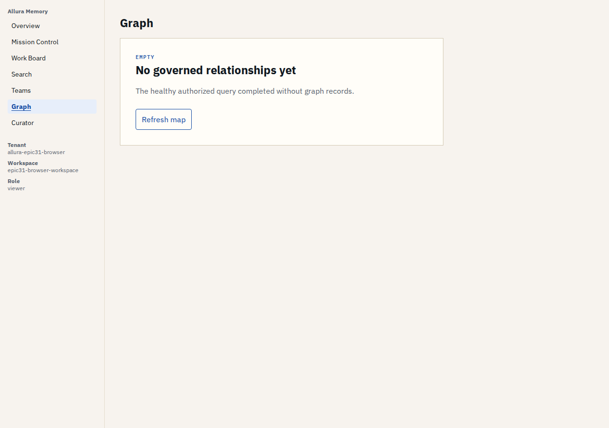
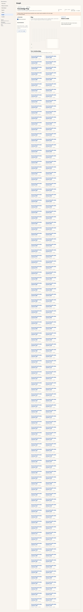
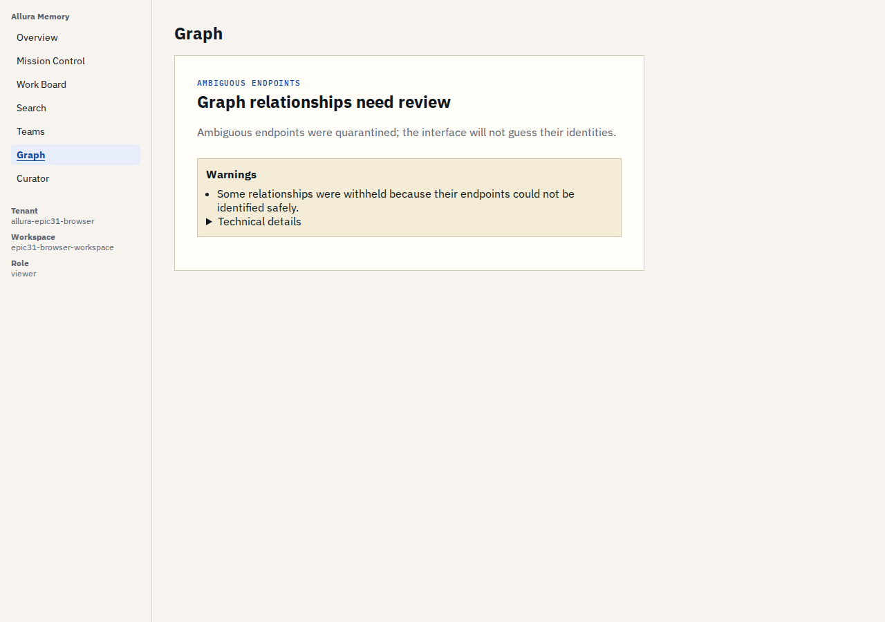
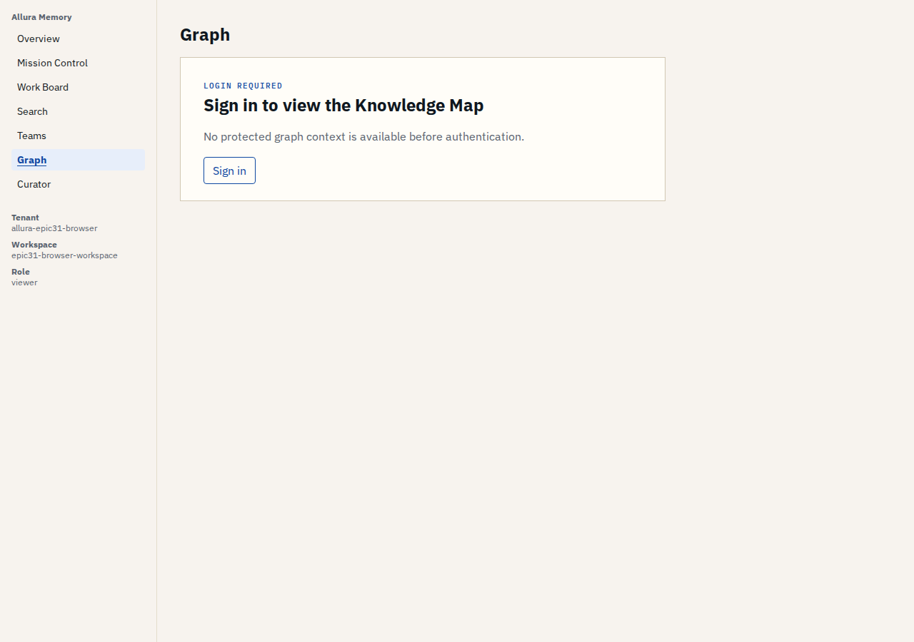
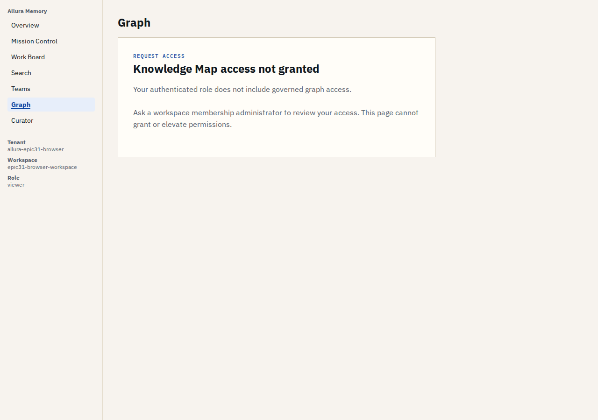
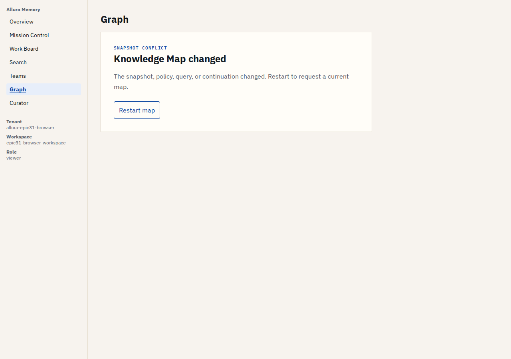
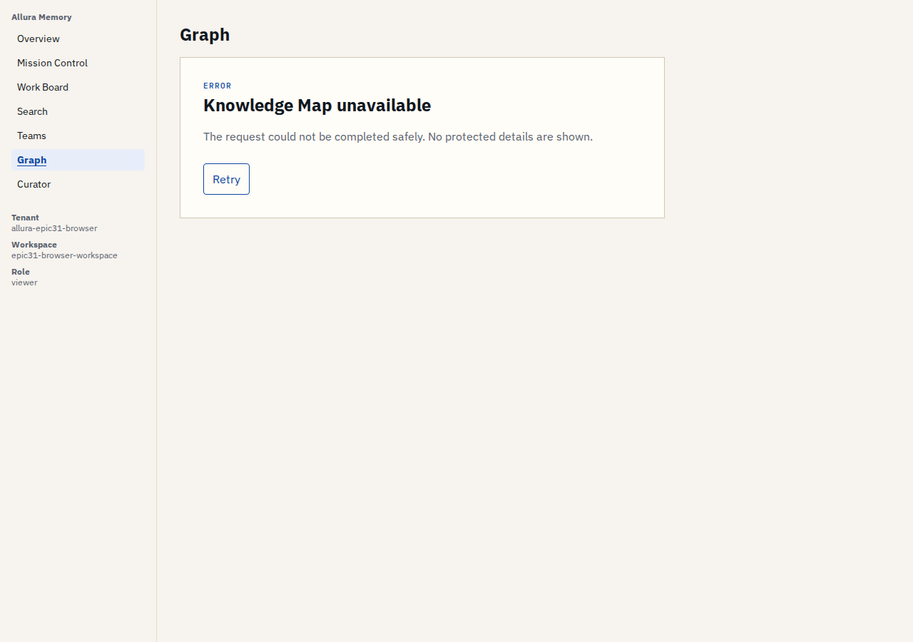
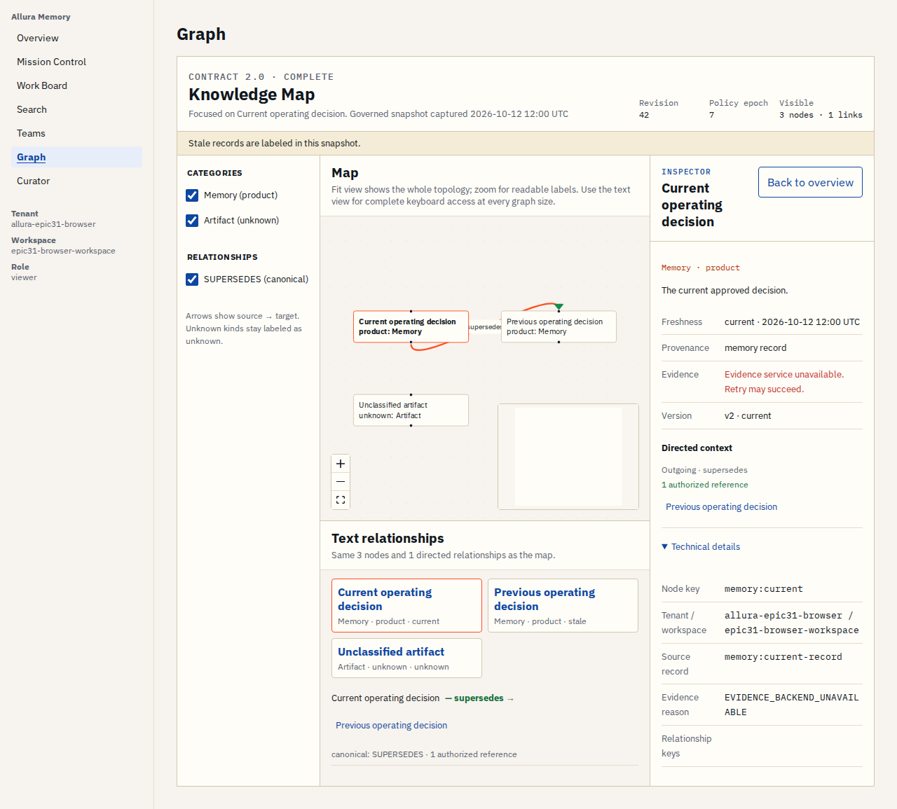

# Epic 31 owner truth-state gallery

**Candidate commit:** `1bed5b08cf755f837c747e640f4b3570eb9d95cc`  
**Candidate tree:** `be52bef367bb6edf228612df41599e7cf170026e`  
**Capture receipt:** [`captures/truth-states/receipt.json`](captures/truth-states/receipt.json)

These captures render the exact production Knowledge Map component from the frozen candidate with schema-validated controlled responses. They let the owner inspect presentations that are unsafe or impractical to force in the live governed walkthrough. They are presentation evidence only: the live PostgreSQL/browser receipts remain the authority, isolation, and real-data proof. Viewing this gallery does not itself establish GRAPH-32 or GRAPH-36.

## Healthy empty

## Partial result with continuation

## Degraded ambiguous relationships

## Login required

## Authenticated but access not granted

## Snapshot conflict

## Safe unavailable error

## Stale data presentation

+

## Evidence service unavailable

