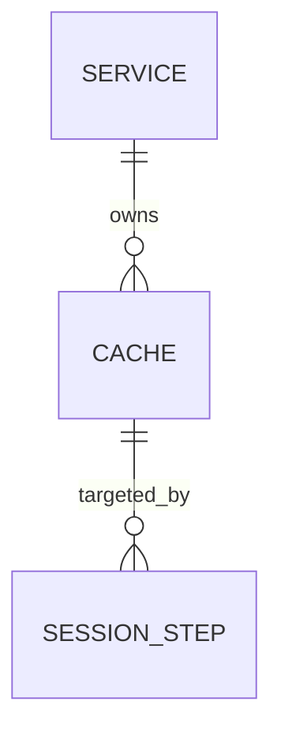

# AI Guidelines: Repository Documentation Standards

> [!NOTE]
> **AI-Assisted Documentation** — updated with Codex assistance on 2026-10-21; human review remains required.

> [!IMPORTANT]
> This document provides guidelines for using AI assistance (e.g., GitHub Copilot) effectively within this repository. It captures the documentation patterns, required artifacts, and quality standards that every contributor — human or AI-assisted — must follow.

---

## Table of Contents

- [1. Purpose](#1-purpose)
- [2. Required Documentation Artifacts](#2-required-documentation-artifacts)
  - [Closed Documentation Set](#closed-documentation-set)
  - [Blueprint](#blueprint)
  - [Solution Architecture](#solution-architecture)
  - [Design Document](#design-document)
  - [Requirements Traceability Matrix](#requirements-traceability-matrix)
  - [Risks & Decisions Matrix](#risks--decisions-matrix)
  - [Data Dictionary](#data-dictionary)
- [3. AI-Assisted Documentation Policy](#3-ai-assisted-documentation-policy)
  - [Disclosure Requirement](#disclosure-requirement)
  - [What AI Should Help With](#what-ai-should-help-with)
  - [What AI Must Not Decide Alone](#what-ai-must-not-decide-alone)
- [4. Document Quality Standards](#4-document-quality-standards)
  - [Accuracy & Source of Truth](#accuracy--source-of-truth)
  - [Cross-Referencing](#cross-referencing)
  - [Completeness Checklist](#completeness-checklist)
- [5. Diagrams](#5-diagrams)
  - [When Diagrams Are Required](#when-diagrams-are-required)
  - [Diagram Types & Tools](#diagram-types--tools)
- [6. Naming & File Conventions](#6-naming--file-conventions)
- [7. Extra Document Prevention Rules](#7-extra-document-prevention-rules)
- [8. Templates](#8-templates)
- [9. Review & Maintenance](#9-review--maintenance)
- [10. Workflow Authority](#10-workflow-authority)

---

## 1. Purpose

This repository uses **structured documentation as a first-class engineering artifact**. Before writing code, operators and engineers are expected to define:

- **What** the system does (Blog and Requirements)
- **Why** design decisions were made (Design docs)
- **How** data is structured and named (Data Dictionary)
- **Where** each requirement is satisfied (Requirements Matrix)

AI assistance (GitHub Copilot, LLMs, etc.) is encouraged for drafting these documents — but all AI-generated content must be reviewed, validated against the source of truth (code, schemas, team consensus), and disclosed.

---

## 2. Required Documentation Artifacts

### Closed Documentation Set

The canonical project documentation set is **closed**. For this repository, the canonical project documentation directory is `docs/allura/`. That directory must contain only these six Markdown artifacts:

1. `BLUEPRINT.md`
2. `SOLUTION-ARCHITECTURE.md`
3. `DESIGN-ALLURA.md`
4. `REQUIREMENTS-MATRIX.md`
5. `RISKS-AND-DECISIONS.md`
6. `DATA-DICTIONARY.md`

No additional Markdown documents may be added to the canonical documentation directory without first replacing or merging into one of the six artifacts above. Research notes, evidence packets, screenshots, temporary plans, board exports, retrospectives, generated reports, and implementation scratchpads must live outside the canonical documentation directory.

If a contributor believes a seventh document is required, the default answer is **no**. The proposer must instead identify which of the six documents owns the information and add it there. A new document requires an explicit `AD-##` decision in `RISKS-AND-DECISIONS.md` before creation.

---

### Blueprint

**File:** `BLUEPRINT.md`  
**Template:** [`guidelines/templates/BLUEPRINT.template.md`](templates/BLUEPRINT.template.md)

The Blueprint is the **single source of design intent** for the service. It must exist before any Design-* documents are written. All other documents trace back to it.

A complete Blueprint must include:

| Section | Purpose |
|---------|---------|
| **Summary** | One-paragraph description of what the service does and who uses it |
| **Core Concepts** | Domain entities with plain-language definitions |
| **Business Requirements** | Operator/user-facing goals, labeled `B1`, `B2`, … |
| **Functional Requirements** | Grouped by domain area, labeled `F1`, `F2`, …; each maps to one or more `B#` |
| **Architecture** | Named components and their responsibilities |
| **Diagrams** | Component overview, execution/data flow, ER diagram (see [§5](#5-diagrams)) |
| **Data Model** | Per-entity table with field names, types, and descriptions |
| **Execution Rules** | Ordering, eligibility, failure semantics, retry, cancellation |
| **Concurrency Rules** | Global constraints on parallel execution |
| **API Surface** | High-level endpoint listing grouped by resource |
| **Logging & Audit** | What is persisted, what is redacted, how it is surfaced |
| **Event-Driven Architecture** | Event types, producers, consumers (if applicable) |
| **References** | Links to all Design-*, JSON schemas, and external resources |

> **Why this matters for AI:** An LLM generating code or config without a Blueprint will hallucinate domain rules. The Blueprint gives the AI the bounded context it needs to produce accurate, consistent output.

---

### Solution Architecture

**File:** `SOLUTION-ARCHITECTURE.md`  
**Template:** [`guidelines/templates/SOLUTION-ARCHITECTURE.template.md`](templates/SOLUTION-ARCHITECTURE.template.md)

The Solution Architecture document describes **how the system is structured from a topological perspective** — who calls what, how external actors interface with the service, how it avoids coupling to the runtime hot path, and how architectural decisions from `RISKS-AND-DECISIONS.md` shape interaction patterns. It complements the Blueprint's data-and-API view with a system-of-systems view.

A complete Solution Architecture document must include:

| Section | Purpose |
|---------|--------|
| **Architectural Positioning** | What role this service plays (control plane, data plane, etc.) and a consumer class table listing all external actors |
| **System Boundary and External Actors** | Mermaid diagram showing all actors and their interaction channels |
| **Logical Topologies** | One sub-section per distinct interaction class (e.g., control plane, onboarding pipeline, runtime request path, enforcement, event-driven); each with a sequence diagram and key constraints list |
| **Interface Catalogue** | Table of all integration points: direction, channel, payload, and references to governing AD/RK entries |
| **Risk-Architecture Traceability** | Mapping of each topology section to the AD/RK entries in `RISKS-AND-DECISIONS.md` that it addresses |
| **Key Architectural Constraints** | Cross-cutting `MUST`/`MUST NOT` constraints that apply to all integrations |
| **References** | Links to Blueprint, RISKS-AND-DECISIONS.md, Requirements Matrix, and `DESIGN-ALLURA.md` |

> **Why this matters for AI:** Without a topology document, AI will flatten all interactions into a single synchronous request model and miss async, caching, and federation patterns entirely. The topology sections give the AI the interaction boundaries it needs to generate correct integration code and avoid putting the service on the hot path.

---

### Design Document

**File:** `DESIGN-ALLURA.md`
**Template:** [`guidelines/templates/DESIGN.template.md`](templates/DESIGN.template.md)

The Design document **deep-dives on functional areas inside one file**. It translates Blueprint requirements into precise API contracts, state machines, validation rules, and operational constraints. Do not create additional `DESIGN-*.md` files for new areas; add a section to `DESIGN-ALLURA.md` unless an approved architectural decision explicitly changes the closed set.

A complete Design document must include:

| Section | Purpose |
|---------|---------|
| **Overview** | What this area does and its relationship to other areas |
| **Functional Requirements** | Table tracing each `F#` ID to the specific implementation detail |
| **API Reference** | Full endpoint details: method, path, request body, response, errors |
| **State Machine** | Allowed states, transition triggers, and side effects (if stateful) |
| **Business Rules / Constraints** | Invariants, validations, and edge-case handling |
| **Use Cases** | Label-indexed scenarios that verify the design covers intended workflows |
| **Important Constraints** | Hard limits, security considerations, performance notes |

Each Design document must link back to the Blueprint section it satisfies and forward-link to related Design documents.

> **Why this matters for AI:** Without design docs, AI will invent semantics. Explicit state machines and constraint tables give the AI exact boundaries and prevent it from generating plausible-but-wrong behavior (e.g., wrong HTTP status codes, missing lock releases, incorrect retry logic).

---

### Requirements Traceability Matrix

**File:** `REQUIREMENTS-MATRIX.md`  
**Template:** [`guidelines/templates/REQUIREMENTS-MATRIX.template.md`](templates/REQUIREMENTS-MATRIX.template.md)

The Requirements Matrix is the **coverage map** for the entire project. It traces every Business Requirement through Functional Requirements to Use Cases, API endpoints, and Design documents.

A complete Requirements Matrix must include:

| Section | Purpose |
|---------|---------|
| **B → F mapping table** | Each Business Requirement row links to its Functional Requirement IDs and Use Case labels |
| **Functional Requirements Detail** | Grouped `| ID \| Requirement \| Satisfied by |` tables (3-column). The **Satisfied by** column combines the API routes that implement the requirement with links to the `DESIGN-*.md` section (and `RISKS-AND-DECISIONS.md` entry, if applicable) that specifies it. Use `·` as a separator between multiple routes or document links within the same cell. |
| **Use Case Index** | All use cases grouped by domain area with ID labels (e.g., `SVC-UC1`) |

Rules:
- Every `F#` ID must appear in exactly one design document section.
- Every `B#` must map to at least one `F#`.
- Every use case label must be findable in a Design document's **Use Cases** section.
- The matrix is updated whenever requirements change — never fall out of sync.

> **Why this matters for AI:** AI-generated features often satisfy the visible request while silently violating adjacent requirements. The matrix gives reviewers an instant impact-assessment surface and gives the AI a checklist to validate against.

---

### Risks & Decisions Matrix

**File:** `RISKS-AND-DECISIONS.md`  
**Template:** [`guidelines/templates/RISKS-AND-DECISIONS.template.md`](templates/RISKS-AND-DECISIONS.template.md)

The Risks & Decisions Matrix captures **every significant architectural decision and known risk** in the system. It answers *why* the design is the way it is, what alternatives were evaluated, what operators must watch out for, and who owns each mitigation.

A complete Risks & Decisions Matrix must include:

| Section | Purpose |
|---------|--------|
| **Architectural Decisions (AD-##)** | One entry per decision; fields: Status, Decision, Rationale, Alternatives considered, Consequences (optional), Owner (optional), References |
| **Risk Summary Table** | A compact overview table at the top of the Risks section with one row per RK entry listing ID, title, severity, and status (`✅ Mitigated` / `🔴 Open`) |
| **Risk Entries (RK-##)** | One entry per risk; fields: Severity, Likelihood, Status, Description, Mitigation, Owner, Related decision |

Rules:
- Every AD entry must have a `Status` value: `Decided`, `Proposed`, `Superseded`, or `Deferred`.
- Every RK entry must appear in the summary table and carry a `Status` of `✅ Mitigated` or `🔴 Open`.
- When a new API change, schema change, or design decision is made, this document must be updated in the same PR.

> **Why this matters for AI:** AI has no access to the verbal discussions, rejected alternatives, and hard-won invariants that shaped the design. The Risks & Decisions Matrix is the explicit record of that institutional knowledge. Without it, AI will re-propose rejected patterns and generate code that silently violates critical invariants.

---

### Data Dictionary

**File:** `DATA-DICTIONARY.md`  
**Template:** [`guidelines/templates/DATA-DICTIONARY.template.md`](templates/DATA-DICTIONARY.template.md)

The Data Dictionary is the **canonical field-level reference** for every entity, table, and event in the system. It is the source of truth for naming — no field name, enum value, or relationship should appear in code or schema before it appears here.

A complete Data Dictionary must include:

| Section | Purpose |
|---------|---------|
| **One section per entity/table** | Field table with: name, type, required flag, description |
| **Enum value tables** | Every enum field must have its own sub-table listing each value and its meaning |
| **Relationship notes** | Foreign key targets, cardinality (per entity section) |
| **JSON Schema links** | Each entity section links to its corresponding `json-schema/*.schema.json` file |
| **Events section** | If event-driven: event names, producer, consumer, payload fields |

Rules:
- Field names in the dictionary must exactly match field names in JSON schemas and Go/code models.
- Enum values documented here must exactly match values accepted by the API and stored in the database.
- Any field marked `Required: Yes` must also be `required` in the JSON schema.

> **Why this matters for AI:** AI models frequently rename fields, invent enum values, or guess nullability. A Data Dictionary eliminates this ambiguity — when used as context, the AI will produce field names and types that match the actual schema exactly.

---

## 3. AI-Assisted Documentation Policy

### Disclosure Requirement

Any document that was drafted or substantially modified with AI assistance **must include the following notice block** at the top (below the title):

```markdown
> [!NOTE]
> **AI-Assisted Documentation**
> Portions of this document were drafted with the assistance of an AI language model (GitHub Copilot).
> Content has not yet been fully reviewed — this is a working design reference, not a final specification.
> AI-generated content may contain inaccuracies or omissions.
> When in doubt, defer to the source code, JSON schemas, and team consensus.
```

Remove this notice only after a full human review has been completed and signed off in a PR.

---

### What AI Should Help With

- Drafting initial document structure from a verbal or bullet-point brief
- Generating field tables from JSON schemas or Go struct definitions
- Producing Mermaid diagram markup from described flows
- Filling in repetitive traceability table rows (Requirements Matrix)
- Suggesting enum value descriptions and edge-case rules
- Writing use case narratives from API contracts
- Identifying gaps in requirement coverage

---

### What AI Must Not Decide Alone

- **Concurrency rules** — e.g., whether locks are per-task or per-session; transaction boundaries
- **Failure semantics** — e.g., whether a partial failure rolls back or continues
- **Security boundaries** — e.g., what is redacted from audit logs; credential handling
- **Naming conventions** — field names and enum values must be confirmed against schemas
- **Business requirements** — what the system should do is a product/team decision
- **Breaking changes** — any schema or API change that affects existing consumers

---

## 4. Document Quality Standards

### Accuracy & Source of Truth

Separate **intended → specified → implemented → verified → released** claims. A working HTML interaction establishes only the behavior demonstrated in that preview. A screenshot, passing build, persona verdict, or Brain receipt does not establish production behavior or human approval.

| Question or disagreement | Authority and required action |
|--------------------------|-------------------------------|
| What should Allura do? | Approved product decisions and the owning canonical specification establish intent. |
| What does the implementation currently accept or persist? | Inspect current schemas, code, and runtime evidence; identify the version and scope. |
| Specification and implementation disagree | Record the discrepancy, impact, decision owner, and evidence. Do not rewrite intent merely to bless the implementation. |
| Two canonical documents disagree | Identify the owning document and product intent; obtain the unresolved decision before implementing the affected story. |
| Canonical document and supporting evidence disagree | Evidence may expose a defect or stale statement; resolve it in the owning document. A screenshot or template is not a competing specification. |
| AI suggestion introduces a product, data, security, or design rule | Treat it as a proposal until the responsible owner decides. |

Correctness-affecting uncertainty blocks the affected story; unrelated bounded work may continue. Readiness must be **Ready**, **Needs a decision**, or **Blocked**, with a specific reason. Keep the six canonical documents authoritative in their respective domains; see [the current design contract](../docs/allura/DESIGN-ALLURA.md) and [open decisions](../docs/allura/RISKS-AND-DECISIONS.md).

### Cross-Referencing

Every canonical document must link to related canonical documents using relative Markdown links. Do not use bare file names — always use `[link text](path/to/file.md#anchor)` syntax.

Required links per document type:

| Document | Must link to |
|----------|--------------|
| Blueprint | `DESIGN-ALLURA.md`, `SOLUTION-ARCHITECTURE.md`, `RISKS-AND-DECISIONS.md`, all JSON schemas |
| SOLUTION-ARCHITECTURE.md | `BLUEPRINT.md`, `RISKS-AND-DECISIONS.md`, `REQUIREMENTS-MATRIX.md`, `DESIGN-ALLURA.md` |
| DESIGN-ALLURA.md | `BLUEPRINT.md` (requirement IDs), `REQUIREMENTS-MATRIX.md`, JSON schemas |
| REQUIREMENTS-MATRIX.md | `BLUEPRINT.md`, `DESIGN-ALLURA.md`, `RISKS-AND-DECISIONS.md` (for F# entries that reference AD/RK entries) |
| RISKS-AND-DECISIONS.md | `BLUEPRINT.md`, `DESIGN-ALLURA.md`, `REQUIREMENTS-MATRIX.md` |
| DATA-DICTIONARY.md | All JSON schema files |

---

### Completeness Checklist

Before merging a documentation PR, verify:

- [ ] All `B#` IDs in the Blueprint appear in the Requirements Matrix
- [ ] All `F#` IDs in the Blueprint appear in the Requirements Matrix and `DESIGN-ALLURA.md`
- [ ] The canonical documentation directory contains exactly the six approved Markdown files and no extra Markdown documents or subdirectories
- [ ] All entities in the Data Dictionary have a corresponding JSON schema file
- [ ] All JSON schema fields are represented in the Data Dictionary
- [ ] All diagrams render correctly (Mermaid syntax validated)
- [ ] All links resolve (no dead anchors)
- [ ] `SOLUTION-ARCHITECTURE.md` topology sections reference their governing AD/RK entries
- [ ] `RISKS-AND-DECISIONS.md` risk summary table is up to date; all new AD/RK entries appear in the TOC
- [ ] AI disclosure notice is present on any AI-drafted document
- [ ] No secrets, credentials, or PII appear in any documentation

---

## 5. Diagrams

### When Diagrams Are Required

| Diagram Type | Required In | Condition |
|---|---|---|
| Component overview | Blueprint | Always |
| Data flow / execution flow | Blueprint | Whenever the system processes multi-step operations |
| Sequence diagram | Blueprint or Design doc | Whenever async or multi-party interaction exists |
| ER diagram | Blueprint | Whenever there are two or more related entities |
| State machine diagram | DESIGN-*.md | Whenever an entity has state transitions |
| Event flow diagram | Blueprint | Whenever event-driven architecture is used |

### Diagram Types & Tools

This repository uses **Mermaid** diagrams embedded in Markdown. All diagrams must be written as fenced code blocks with the `mermaid` language tag.

Supported and recommended diagram types:

| Mermaid Type | Use For |
|---|---|
| `graph TD` / `graph LR` | Component overviews, dependency graphs |
| `sequenceDiagram` | Request/response flows, async interactions |
| `erDiagram` | Data model entity-relationship diagrams |
| `stateDiagram-v2` | State machines (session states, task states) |
| `flowchart TD` | Execution logic, decision trees |

Example:

````markdown

````

---

## 6. Naming & File Conventions

| Artifact | File Name Pattern | Location |
|---|---|---|
| Blueprint | `BLUEPRINT.md` | Canonical project documentation directory |
| Solution Architecture | `SOLUTION-ARCHITECTURE.md` | Canonical project documentation directory |
| Design document | `DESIGN-ALLURA.md` | Canonical project documentation directory |
| Requirements Matrix | `REQUIREMENTS-MATRIX.md` | Canonical project documentation directory |
| Risks & Decisions Matrix | `RISKS-AND-DECISIONS.md` | Canonical project documentation directory |
| Data Dictionary | `DATA-DICTIONARY.md` | Canonical project documentation directory |
| JSON Schema | `<entity>.schema.json` (lowercase, hyphenated) | `json-schema/` |
| AI Guidelines | `guidelines/AI-GUIDELINES.md` | `guidelines/` |
| Document templates | `guidelines/templates/*.template.md` | `guidelines/templates/` |

---

## 7. Extra Document Prevention Rules

These rules prevent documentation sprawl and preserve conceptual integrity:

1. **Six-file maximum:** The canonical project documentation directory must contain exactly the six approved Markdown files listed in [Closed Documentation Set](#closed-documentation-set).
2. **No sidecar notes:** Do not create `NOTES.md`, `PLAN.md`, `AUDIT.md`, `REVIEW.md`, `GOVERNANCE.md`, `RELEASE.md`, `INSTALL.md`, `MIGRATION.md`, or similarly named documents in the canonical documentation directory.
3. **Merge, do not multiply:** If new information is needed, merge it into the owning canonical document:
   - Intent, scope, business rules → `BLUEPRINT.md`
   - Topology, actors, interfaces → `SOLUTION-ARCHITECTURE.md`
   - UI/API/workflow details → `DESIGN-ALLURA.md`
   - Requirement coverage → `REQUIREMENTS-MATRIX.md`
   - Risks, decisions, exceptions → `RISKS-AND-DECISIONS.md`
   - Fields, entities, events, enums → `DATA-DICTIONARY.md`
4. **Evidence is not documentation:** Test logs, screenshots, generated reports, and review packets must go to an evidence/artifacts location, not the canonical documentation directory.
5. **Temporary work expires:** Drafts and scratchpads must live in a temporary workspace and must not be linked as canonical references.
6. **Seventh-doc gate:** Any proposed new canonical document requires a prior `AD-##` entry in `RISKS-AND-DECISIONS.md` with owner, rationale, rejected alternatives, and a statement explaining why the six-file set cannot absorb it.
7. **Review blocker:** A PR that adds any non-approved Markdown file or subdirectory to the canonical documentation directory is blocked until the content is merged into the six-file set or an approved `AD-##` exception exists.

---

## 8. Templates

Ready-to-use document templates are provided in [`guidelines/templates/`](templates/):

| Template | Description |
|---|---|
| [`BLUEPRINT.template.md`](templates/BLUEPRINT.template.md) | Full Blueprint scaffold with all required sections |
| [`SOLUTION-ARCHITECTURE.template.md`](templates/SOLUTION-ARCHITECTURE.template.md) | Solution Architecture scaffold with topology, interface catalogue, and risk traceability sections |
| [`DESIGN.template.md`](templates/DESIGN.template.md) | Design document scaffold for any functional area |
| [`REQUIREMENTS-MATRIX.template.md`](templates/REQUIREMENTS-MATRIX.template.md) | Requirements traceability matrix scaffold with 3-column Satisfied by format |
| [`RISKS-AND-DECISIONS.template.md`](templates/RISKS-AND-DECISIONS.template.md) | Architectural decisions and risk register scaffold with summary table and Status fields |
| [`DATA-DICTIONARY.template.md`](templates/DATA-DICTIONARY.template.md) | Data dictionary scaffold with entity and event sections |

To start a new document, copy the relevant template and replace all `<!-- placeholders -->` and `[AREA]` tokens with project-specific content.

---

## 9. Review & Maintenance

- Documentation PRs require at least one reviewer outside of the original author.
- Requirements Matrix and Data Dictionary must be updated in the **same PR** as any schema or API change.
- The Blueprint is the most stable document — changes to it require a separate, focused PR with explicit rationale.
- AI-disclosure notices are only removed after a full human review sign-off noted in the PR description.
- Stale documents (last updated > 90 days ago with active code changes) should be flagged in the next team retrospective.
- Documentation PRs that create extra canonical Markdown documents are rejected unless the seventh-doc gate in [§7](#7-extra-document-prevention-rules) is satisfied.

---

## 10. Workflow Authority

The repository-owned `allura-dev-story` and `allura-code-review` wrappers implement these gates. Read the [development handoff packets](../docs/reference/development-readiness-20261021/story-packets.md) and [readiness matrix](../docs/allura/REQUIREMENTS-MATRIX.md#development-slices-and-handoff-gates) before selecting a story. A wrapper, generated command or installed methodology is not an independent source of authority.


`AI-GUIDELINES.md` is the sole repository workflow authority. Team RAM roles
implement its requirements; no external methodology, installed workflow engine,
or generated command surface governs work in this repository.

For every substantive change:

1. Load the relevant local source and identify documentation impact.
2. Search Allura Brain using `group_id=allura-system` when prior decisions or
   operational context can affect the work; disclose unavailable tools.
3. Assign one accountable Team RAM owner and preserve complete handoff context.
4. Keep the Notion Work Board as the human source of truth for work-item status.
5. Collect test, review, and live-behavior evidence appropriate to the change.
6. Update the canonical six documentation artifacts in the same PR when a schema
   or API contract changes.
7. Write one concise governed outcome trace with evidence, unresolved hazards,
   owner, and next action when memory tools are available.

Temporary local evidence may live in `.opencode/work-items/`; it is not a
second planning authority and must not override the Notion board, source code,
or the canonical documentation set. Migrated work items retain their original
content as evidence, not as executable workflow instructions. Historical records
in `docs/archive/bmad-legacy/` are non-operative and remain unchanged.


## 11. Allura Dashboard and Portfolio Preview

**Source-local evidence boundary:** The preview and authentication observations in this section came from the separate dirty checkout at `28d90e843`; their implementation and ignored receipts are not included in this integration. Preserve the intended design constraints, but refresh source, artifacts and checks before claiming implementation on main. See [unavailable evidence](../docs/reference/development-readiness-20261021/unavailable-evidence.md).


### Scope and claims

Sabir's current reference is the **local React/Vite portfolio preview**, with Store overview at [`http://127.0.0.1:4008/index.html#ecommerce`](http://127.0.0.1:4008/index.html#ecommerce). Its source lives in `artifacts/enterprise-dashboard/visual-fixture/`. It uses fictional people, records, stores, and local interaction state; shared sample records survive navigation and reset on reload. It does not establish sign-in, server authorization, persistent storage, real uploads, live memory retrieval, a connected Shopify store, or production readiness. Work-board sample review does not approve knowledge, complete an operating security control, or make a lending decision.

The portable single-file HTML is a separate delivery artifact. The [2026-10-20 commerce receipt — source-local receipt unavailable](../docs/reference/development-readiness-20261021/unavailable-evidence.md) records that it predates the final tablet grid correction and awaits repackaging because a local governance hook could not load. Its recorded digest identifies that older HTML, not the corrected React build. Use the React reference for this update; do not describe the portable file as current or carry the React review over to it. Repackaging and artifact verification remain outstanding.

Keep the portfolio label visible. Approved positioning is: **SOC 2 readiness is a goal; no compliance or audit claim.** Do not infer certification, a completed examination, or operating control effectiveness from populated sample screens. Record an unavailable capability explicitly rather than fabricate metrics, success, permissions, or evidence.

This scope governs the preview, not the production contracts in the canonical six documents. Do not start backend, credential, deployment, or dependency migration work merely because a template contains corresponding UI.

### Reuse the selected Studio source before building

Sabir selected [Studio Admin Base UI](https://github.com/arhamkhnz/next-shadcn-admin-dashboard-baseui). The preview's current source pin is `62b1b3e3c4af7a1abf055298b01b4af020bd0f8b`; it is not a claim about the upstream latest release.

- Inspect the existing upstream page and local component implementations first. Use its actual page/widget compositions for available patterns such as Kanban, File Manager, and e-commerce. Reusing only buttons while recreating an available page does not satisfy this direction.
- Keep imported source, license, revision, source hashes, and explicit adapter changes traceable. Retain the MIT notice in distributed HTML. Record compatibility changes rather than silently replacing component APIs or upgrading dependencies.
- Keep feature adapters separate from shared components and domain state. Existing task, file, person, team, app, and review providers own local sample relationships; copied page fixtures must not create a second contradictory data set.
- Keep UI source reuse distinct from framework or backend adoption. A template's role screens and charts are not working authorization or a connector.
- Make every visible action work within preview scope, disable it with an explanation, or omit it. Inspect Base UI form semantics: submit controls must explicitly submit their form.
- Before an upstream update, compare changes and preserve local contracts and evidence. A source pin does not authorize an automatic upgrade.

Implementation evidence is [source provenance — source-local receipt unavailable](../docs/reference/development-readiness-20261021/unavailable-evidence.md) and the [Studio preview receipt — source-local receipt unavailable](../docs/reference/development-readiness-20261021/unavailable-evidence.md). These support the [canonical design](../docs/allura/DESIGN-ALLURA.md#portfolio-preview-studio-source-reuse-and-shared-journeys); they are not alternative specifications. Existing Profiles, People, Teams, and Roles were retained as preview components, not claimed as migrated Studio Base UI pages.

### Store overview: preserve the implemented React behavior

`studio-ecommerce-preview.tsx` composes five actual adapted Studio widgets from `studio-adapters/ecommerce/`: **KpiStrip**, **StoreTraffic**, **TopProducts**, **Inventory**, and **RecentOrders**. Keep their [commerce provenance — source-local receipt unavailable](../docs/reference/development-readiness-20261021/unavailable-evidence.md), source pin and MIT attribution with the implementation. This is component reuse within Allura's preview, not adoption of the entire template or its backend.

- Orders support search by order number or sample customer, status filters, numeric total/date sorting and pagination of five rows per page. Search and filter changes reset the page, and unmatched queries have an explicit empty state.
- Product and order selections open factual sample details. Preserve keyboard selection, visible focus and return to the opening control when closing details. Missing customer contacts, item-level order details and individual product stock counts remain labeled as absent; do not invent them or connect orders to products without source data.
- Keep the summary period, chart periods and fictional-data notice visible. The 34 sample orders are an illustrative subset, not the complete ledger behind the 379-order monthly summary. Product shares derive from the sample sales values; the October sales comparison derives from September. Revenue and profit use the same dollar scale, an explicit legend and a monthly data table.
- Preserve Allura Cream, Ink, Blue and Orange, readable chart labels and responsive grid widths. The phone orders table scrolls inside its labeled, keyboard-focusable region rather than widening the page. Preserve the existing CSS reduced-motion rules. Explicitly disabling commerce chart animation remains an open implementation requirement; do not describe it as already implemented.
- Keep the sample Shopify journey separate. Store values are fixed fictional examples; connecting or importing examples does not populate these charts. No account is contacted, and there are no payment, refund, fulfillment or customer-contact actions.

The [commerce receipt — source-local receipt unavailable](../docs/reference/development-readiness-20261021/unavailable-evidence.md) records build, strict TypeScript, three sample-integrity tests, focused lint, search/filter/sort/pagination checks, keyboard/focus checks, and desktop 1440px/tablet 820px/phone 390px checks. It records Munari's scoped review of the corrected direct React build and explicitly excludes the older portable HTML. These are recorded results for that candidate, not proof that every later edit passes or an accessibility certification. When changing this surface, attach fresh checks to the actual candidate and identify which artifact was reviewed.

**Validation clarification — 2026-10-21:** The current commerce `Area`, `Bar`, `Line` and `Pie` components do not explicitly disable animation; the installed Recharts browser defaults enable it. The CSS reduced-motion rule suppresses CSS animations and transitions, but does not establish that Recharts' JavaScript animation is disabled. The historical receipt's disabled-chart-animation claim is therefore not corroborated by the current source. Keep that gap open until the actual widgets and reduced-motion behavior are verified. The [current documentation-validation receipt — source-local receipt unavailable](../docs/reference/development-readiness-20261021/unavailable-evidence.md) records the checked source, build, tests and browser actions.

### Allura branding applies to every surface

| Semantic role | Required brand value |
|---------------|----------------------|
| Primary workspace ground | Allura Cream `#F7F3EE`, dominant across screens |
| Text, headings, structure | Allura Ink `#0F1720` |
| Knowledge, links, primary actions | Allura Blue `#0D47A1` |
| Review and selected-item emphasis | Allura Orange `#FF4D1F`; graph selection also has a contrasting Ink outline |
| Supported verified/approved state | Allura Green `#148A4B`, only with real supporting data |

Apply shared semantic tokens to navigation, graphs, inspectors, tables, forms, administration, mobile and access-denied states. Use the supplied official compact **AL icon** in the dashboard shell; preserve its proportions and clear space. Never redraw or generate a logo. Use Aeonik for display when available, otherwise a neutral sans-serif; IBM Plex Mono is for code and technical labels only. Keep rounded forms, outline icons, restrained borders and generous spacing; no dark-template substitution, gradients, glow, glass, shadows, or decorative card grids. Functional file/folder cards may follow the selected Studio layout.

Graph memory nodes are Blue on Cream. Label nodes and relationship types, and show status in words as well as color. Graph proximity does not prove embedding similarity. Check contrast for actual text/control combinations; do not assume the palette alone guarantees accessibility. See [brand authority](../docs/allura/BLUEPRINT.md#0-brand-identity).

### Design for a nontechnical employee

Lead with familiar tasks: **Company Knowledge**, **Files**, **Work Board**, **Apps**, **People & teams**, and **Store overview**. Give technical details a contextual or advanced location. Explain search settings as whether documents can be found; do not make employees understand embeddings, vector dimensions, or plugin plumbing before using the workspace.

Show ownership, team or shared-space scope, source and version where useful. Distinguish a team filter from permission enforcement. An Administrator demonstration must not imply automatic access to every department's information. A sample role selector demonstrates controls; it does not authenticate or impersonate the selected person.

Keep one coherent journey across views: a file opens its linked task, the task opens its source file, and task owners link to profiles. App-originated tasks retain app/source attribution. Changing task evidence invalidates the earlier sample review; Done uses the existing independent-review rule, including through drag actions. Preserve these contracts when adapting template layouts.

### Connections graph uses the shared sample records

Sabir requested **Connections** in the preview navigation on 2026-10-20. Use `#graph` for this relationship view; keep Shopify setup at `#connections` under **Connected tools**. Preserve prior sample-knowledge graph deep links rather than reinterpreting their IDs as file/task/person/app records.

Derive nodes and edges from the existing local providers. Use stable namespaced resource IDs and only explicit ownership, assignment, attachment and app-origin references. Do not infer relationships from matching titles, team names or visual proximity. An item with no relationships needs an honest empty state. File renames, task links and app settings must appear consistently in the graph and original views; resets must not leave stale links. Keep captured evidence versions distinct from current item/app versions.

Provide Graph/List, search/type filtering, readable relationship labels, keyboard-accessible selection, a useful inspector and links to original items. Original File, Work, Profile and Apps views may link back to the focused graph item. Apply the same Allura branding and portfolio-only boundaries. See the [Connections design contract](../docs/allura/DESIGN-ALLURA.md#portfolio-preview-connections-graph--2026-10-20).

Sabir's subsequent approved direction adds an animated 3D network and profile-style scorecards to Connections. Keep the 3D exception scoped to this graph, with pause, reduced-motion handling and accessible alternatives. Shared fictional vendor/contact records may add explicit account-owner and vendor-contact relationships. The Gabriel/COO example supplies a business title, not an access grant; scorecards must not invent ratings or private contact details. Follow the [3D and scorecard direction](../docs/allura/DESIGN-ALLURA.md#approved-direction-3d-network-and-scorecards) and record implementation verification separately.

For the approved graph-engine migration, reuse the `vasturiano/react-force-graph` React 3D package, preserve its license and pinned provenance, and keep Allura's shared model and scorecards separate from engine-owned mutable layout objects. Library adoption alone proves neither accessibility nor performance at scale; verify the preview's actual interaction and packaging.

### Apps and connectors

Mortgage and Bumblebee use the common shell and shared work/file concepts, while retaining separate domain behavior. Show employee work in Apps; show versions, access impact, compatibility, update failure and restore in administration. A template is not evidence of a production plugin SDK, secure isolation, or safe migrations. Follow the [existing Apps contract](../docs/allura/DESIGN-ALLURA.md#portfolio-preview-apps-and-update-management-2026-10-19).

The Shopify connection is a labeled sample setup/access-review/import/pause/disconnect journey. It requests no real credentials and contacts no store. Store overview charts are fixed fictional examples and are **not populated by the sample connector**. Keep simulated read-only product/inventory scope separate from customer, order, payment, or write access; any real integration needs a separately specified and authorized contract.

### Proposed next UX slices — not implemented or production-approved

The following are recommendations from the current conversation, recorded for follow-up rather than silently promoted to product requirements:

1. **Search everything:** a common entry to knowledge, files, tasks, people, and app records; current preview document search remains literal/local, not cross-resource or generated-answer search.
2. **My day:** assigned work, requests waiting for review and upcoming deadlines; a distinct personal view is not yet demonstrated.
3. **Inbox:** mentions, review requests and connector issues, each with a next action; real notifications are not implemented.
4. **Sharing details:** ownership, audience and an access-request journey; role demonstrations do not enforce real permissions.
5. **Guided demo:** find a policy → inspect the source → create a task → attach a file → request review → see the outcome. Existing partial interactions do not establish a complete guided journey.

After the approved reliability work below, the suggested feature order is Search + My day, then that bounded end-to-end journey. Before building a slice, state its purpose, governing sources, data/behavior contract, relevant design reference, testable acceptance and named builder/reviewers. Sabir owns product intent and acceptance; Brooks coordinates architectural coherence; Durham reviews fidelity; implementation review is independent of the builder. A role verdict is not human sign-off.

### Approved reliability priorities — 2026-10-20

Sabir approved recording the adversarial review's priorities: **reproducibility, crash containment, then bounded data loading before additional features**. This adopts the documentation and acceptance direction; it does not mean the fixes have shipped. [Design](../docs/allura/DESIGN-ALLURA.md#approved-preview-reliability-direction--2026-10-20), [acceptance](../docs/allura/REQUIREMENTS-MATRIX.md#preview-reliability-acceptance--2026-10-20) and [open risks](../docs/allura/RISKS-AND-DECISIONS.md#preview-reliability-risks--2026-10-20) carry the contract.

- **Reproduce from source control.** Maintained application source, adapters, dependencies, lockfiles and regression tests must have a tracked application home. Ignored `artifacts/` is for generated evidence and outputs, not the only copy of maintained code. Preserve source provenance and licenses; inventory imports, fonts, public assets and build/package scripts. Prove a clean checkout builds and runs named critical suites without cached files, an old bundle or undocumented local paths. Missing required suites must fail rather than pass with zero tests.
- **Contain bad input and screen failures.** Validate URL parameters and external records before lookup or render. Record indexes must be finite integers in range; malformed or missing IDs produce a recoverable state. Provide screen-level error containment so a failed feature does not remove navigation or silently discard shared work. Test fractional, negative, oversized and non-numeric inputs and a deliberate render failure; navigation to another screen must still work.
- **Bound work as data grows.** Index graph adjacency/degrees once per relevant data change, cache stable layout and avoid full-edge rescans on every search keystroke. List view must not pay for graphical layout. Bound graph expansion and provide an accessible bounded list; avoid unnecessary animation/label work in paused or hidden views. Split heavy feature loading where measurement justifies it. Five visible table rows do not establish bounded fetching: real datasets need server-enforced page limits, filtering and sorting.
- **Measure before claiming scale.** Record browser responsiveness, CPU, memory, asset sizes, device/network conditions and fixture density. Include 100, 500, 2,000 and 5,000 graph nodes and a 100,000-order backend fixture; these are test sizes, not promised capacity. Agree latency/memory/load budgets before acceptance. Isolated CPU layout timings exclude React/DOM/WebGL and are not browser or service SLOs.
- **Keep the production boundary explicit.** Browser state and the role chooser remain demonstrations. Real accounts need server-issued identity/scope, durable writes, conflict handling and safe replay. Test competing edits, interrupted saves/retries, duplicate/out-of-order connector events, revocation and recovery before connecting real data. Reuse [DEV acceptance](../docs/allura/REQUIREMENTS-MATRIX.md#acceptance-evidence-and-use-case-index); new concurrency, retry, schema and permission semantics retain their existing decision gates.

The observed fractional-record crash, untracked source/tests and expensive graph layout remain open until current-revision evidence closes them. Earlier responsive/Munari checks and this documentation update do not establish remediation.

### Validation and handoff

For material preview changes, build the React candidate being delivered, run appropriate focused type/lint checks and inspect its affected journey in a browser. When delivering a portable HTML export, package and verify that artifact separately; React checks do not establish export parity. Verify desktop, tablet and phone layouts, keyboard/focus behavior, readable chart/graph labels, control contrast and intentional table/board scrolling without page overflow. Capture affected views and relevant graph, inspector, administration or access-denied states when changed. Re-test state transitions and shared references after adapter changes; screenshots alone cannot prove behavior.

Save evidence outside `docs/allura/`; record source revision, changed files, exact checks, screenshot paths, delivered artifact identity and digest or build manifest, limitations and remaining decisions. Associate each receipt with the React build or HTML export actually checked. If packaging is blocked, report the corrected React candidate and older export separately, preserving the blocker and outstanding export verification. Distinguish source inspection, automated checks and browser-tested actions. Report a pending or failed operation accurately. Do not claim release, production security, complete journey verification or human acceptance from preview evidence.

## 12. Reliability and Backend Adversarial Review

Sabir requested a backend-wide adversarial assessment on 2026-10-20 alongside the preview review. Inspect executable boundaries and callers, not only screens or architecture prose. Record commit plus dirty-file hashes, entrypoints, feature flags, tested paths and exclusions. Broad coverage is not proof that every path is safe.

| Boundary | Failure scenarios and evidence |
|---|---|
| Web, server actions and MCP ingress | Unauthenticated/foreign-scope access, actor impersonation, revoked membership, alternate routes, malformed/oversized/slow bodies. A role check alone does not establish resource scope. |
| Capture, approval and semantic lineage | Failure before/after commit, lost acknowledgement, same-operation retry, changed payload, concurrent approvals/corrections and partial projection. Preserve append-only history and human approval; distinguish approved contracts from unresolved decisions. |
| Retrieval and graph | Unrelated/no-answer queries, current versus superseded content, cross-workspace negatives, all modes, empty indexes, provider failures, excessive limits and high-cardinality input. Verify relevance, scope and measured latency, not just status codes. |
| Workers and delivery | Duplicate delivery, competing workers, crash after claim/side effect, lease expiry, retry eligibility/backoff, poison items, cancellation, queue/concurrency bounds and shutdown. Local acknowledgement does not establish remote persistence. |
| Database and infrastructure | Restricted roles/RLS, pooled-scope reuse, query deadlines, rollback, connection exhaustion, migration compatibility and authorized disposable restore/restart drills. A backup command succeeding does not prove recoverability. |
| Operations and build | Secret-safe diagnostics, truthful partial/error states, health-data exposure, tracked source, reproducible tooling, required-suite discovery and verified backup contents/selection. |

Each finding names severity, exact source/caller, trigger, affected scope, expected/observed behavior, reproduction class (source-only, mocked/offline, disposable integration or live) and uncertainty. Distinguish application-layer failure from deployed exploitation, existing open risks from new findings, and repair direction from completed fixes. Trace material findings into the existing Requirements Matrix and Risks & Decisions; detailed reports/probes stay outside the canonical six.

Use read-only inspection and bounded hermetic probes by default. Review authorization does not permit production load, actual foreign-tenant reads, destructive fault injection, credential changes, deployment or semantic promotion. Existing action-specific gates apply to later tests and fixes. Documentation validation checks consistency and traceability; it does not close application findings.
